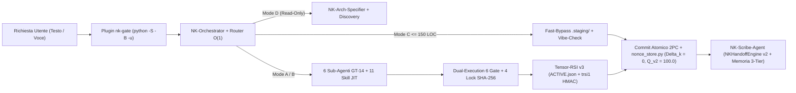
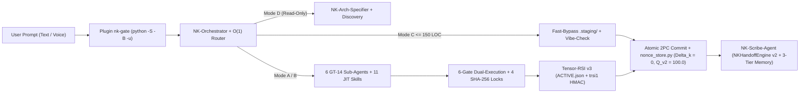

# NK Hub Generation (`v3.0.2-Generation`)
## L'Ambiente di Sviluppo Multi-Agente Ordinato, Sicuro e Autonomo per Google Antigravity 2.0

> 🌍 **Lingua / Language:** **[🇮🇹 Italiano (Qui sotto)](#-1-presentazione-veloce-in-90-secondi)** | **[🇬🇧 English Version (Below)](#-english-version--nk-hub-generation-v302-generation)** | **[🚀 Salto Qualitativo](#-2-salto-qualitativo-da-v100-generation-a-v302-generation)** | **[📖 Guida Installazione ZIP](../nk_docs_and_setup/GUIDA_INSTALLAZIONE.md)** | **[🗺️ Mappa Libreria](../nk_docs_and_setup/00_MAPPA_LIBRERIA_NK.md)** | **[📋 Patch Notes](../nk_genome/PATCH_NOTES.md)**
>
> 📦 **SCARICA CON 1 CLICK L'AMBIENTE COMPLETO (`.ZIP`, `v3.0.2-Generation`, Milestone `NK-GEN-3.0.2-FORENSIC-HARDENING-CLEAN`, Core ABI `1.0.0-Generation`):**  
> 👉 **[Scarica NK_Hub_OneClick_Package.zip (Download Diretto dal Repository)](https://github.com/erbaldo86/NK-Hub/raw/main/nk_docs_and_setup/NK_Hub_OneClick_Package.zip)**  
> *(Contiene `.agents/`, `NK_Hub/` e `NK Proget/Locale/` compatibile `NK_External_Projects/`. Include il mirror RO `NK Proget/Online/`, `Tensor-RSI v3`, `NKHandoffEngine v2` e i `7` profili con default `NK_MODEL_PROFILE=generation`.)*

---

## ⚡ 1. Presentazione Veloce in 90 Secondi

### Perché nasce `NK Hub Generation`?
Creare software con l'IA parte veloce. Appena un progetto reale cresce emergono però tre problemi ricorrenti:
1. **Cartelle nel caos:** file di sistema, script, test e app utente finiscono mescolati nella stessa radice.
2. **Modifiche che rompono il codice sano:** l'agente altera i file attivi senza collaudarli in isolamento.
3. **Perdita di memoria e test addolciti:** nelle sessioni lunghe l'IA dimentica regole o indebolisce le asserzioni.

**`NK Hub Generation` (`v3.0.2-Generation`) elimina questi tre problemi.** Trasforma Google Antigravity 2.0 in una regia deterministica governata da `Tensor-RSI v3` e `NKHandoffEngine v2`. Coordina `6` Sub-Agenti Nativi `GT-14` e `11` Playbook `SKILL.md` JIT. Supporta `7` profili di contesto (`generation` default, `carbon` fallback, `neon`, `pro`, `flash`, `argon`, `standard`). La squadra progetta e costruisce dentro `.staging/`. Promuove i file tramite `Win32 2PC` solo dopo `ACTIVE.json`, `nonce_store.py` anti-replay e piramide NVMe (`<= 8.0s / <= 28.0s`) al `100%`.

### 💬 Esempio Reale in 30 Secondi: Come Dialoghi con `NK Hub Generation`
> 1. **Tu scrivi in chat (o detti col microfono):**  
>    *"Crea un'applicazione web per gestire i preventivi dei clienti ed esportarli in PDF."*
> 2. **`NK Hub Generation` mostra subito lo Specchio Concettuale `Gate L0`:**  
>    *"Obiettivo chiaro (`R1..Rn`): creo l'app in `NK Proget/Locale/PreventiviApp` (compat `NK_External_Projects/`). Preparo piano `Pentad 4+1`, database e UI in `.staging/`. Confermi con 1 click?"*
> 3. **Tu clicchi su `Conferma`:**  
>    La squadra costruisce in `.staging/`, esegue audit `Dual-Execution`, verifica i `4` lock `SHA-256` e lancia la piramide NVMe (`<= 8.0s / <= 28.0s`). Superato il gate `ACTIVE.json`, consegna l'app nella tua cartella.

### I Benefici Immediati a Colpo d'Occhio

| Cosa Succede con un Agente AI Standard | Cosa Succede con `NK Hub Generation` (`v3.0.2-Generation`) |
| :--- | :--- |
| File di sistema sparsi insieme alle app | **Libreria Ordinata:** motore in `NK_Hub/`, app in `NK Proget/Locale/` e blocco RO rigoroso su `NK Proget/Online/` |
| L'IA parte subito su richieste ambigue | **Gate L0 a 1 Click:** riassume intenzioni, piano e regole prima di scrivere codice |
| Scritture dirette sui file attivi | **`.staging/` + `ACTIVE.json` + `nonce_store.py` + `2PC`:** promuove atomico solo con token monouso e manifest verificato |
| Un solo agente scrive e si auto-valuta | **`Tensor-RSI v3` + `6` Sub-Agenti `GT-14`:** chi scrive è separato via hardware da chi audita |
| Rischio che l'IA indebolisca i test | **`4` Lock `SHA-256` (`424+2+315+1` file):** `oracle_lock.json`, `oracle_lock_holdout.json`, `governance_lock.json`, `tensor_rsi_lock.json` |
| Degrado in sessioni lunghe o crash su Drive FS | **`7` Profili + `NKHandoffEngine v2` + Piramide NVMe:** continuità `2-CID` e test rapidi `<= 8.0s / <= 28.0s` |

---

## 🚀 2. Salto Qualitativo: Da `v1.0.0-Generation` a `v3.0.2-Generation`

Dalla release inaugurale (`v1.0.0-Generation`, `2026-11-17`, Milestone `NK-GEN-1.0.0`) alla release `v3.0.2-Generation` (`2026-11-24`), il sistema consolida **`12` milestone**. Il `Core ABI 1.0.0-Generation` resta invariato.

| Dimensione Reale | `v1.0.0-Generation` (`2026-11-17`, `NK-GEN-1.0.0`) | `v3.0.2-Generation` (`2026-11-24`, `NK-GEN-3.0.2`) |
| :--- | :--- | :--- |
| **Control Plane** | `RSI v1` con promozione `Win32 2PC` base | **`Tensor-RSI v3` + `RSI v2`:** `Q_v2 = 100.0`, `14` gate `G_hard`, ticket `trsi1` HMAC, `ParetoGate`, `CladeBandit` (`K=4`), clamp `NaN/Inf`, Jeffreys `LCB90` |
| **Sicurezza & Anti-Tamper** | `1` lock `SHA-256` iniziale (`373` file) | **`4` lock `SHA-256` (`424+2+315+1` file)** + `nonce_store.py` anti-replay + Epistemic Firewall pure-stdlib `AP-12..16` e `strip_l3_persuasive_narrative` |
| **Velocità & Piramide Test** | `513` test monolitici (`~68.3s`) | **Piramide Submodulare `384/384 PASS` in `20.0s` (`-70.7%`).** Tier 1 `-m fast <= 8.0s`, `PYTEST_DISABLE_PLUGIN_AUTOLOAD=1`, timing JUnit XML |
| **Copertura & Mutation Audit** | Baseline `v1` inaugurale | **Schema `v2` `14` metriche** (`stmt 91.25%`, `true_branch 83.43%`, `combined 88.98%`, `0` SAST) + **Mutation Audit `97.22%`** (`245/252` killed su `21/21` moduli) |
| **Continuità Sessione** | `Template 11` base | **`NKHandoffEngine v2`:** `PASSIVE_STANDBY` / `ACTIVE_CONTINUATION`, isolamento `2-CID`, ownership `EXTERNAL_CONCURRENT`, `--handoff-verify` `1-step` |
| **Isolamento & Profili** | `NK_External_Projects/` + `2` profili (`generation`, `carbon`) | **Multi-root `NK Proget/Locale/` + `NK Proget/Online/` RO (`CRIT-01`)** + **`7` profili** (`ACS Z0..Z3`) |
| **Debloat & Modularità** | `39` script top-level (`<= 500` LOC) | **`34` facciate CLI/contratti (`29` script + `5` schemi `L0` Pydantic v2)**, `_internal/` (`<= 350..400` LOC, `0` cicli Tarjan SCC), `DOM-04` JIT (`<= 40` righe) con `4` guardie Anti-Bias |
| **Affidabilità Cross-Repo** | Verifica singola su repository `NK_Hub` | **Certificazione federata `S0..S7` (`487/487`)** + **`4/4` app esterne (`526/526 PASS`)** |

### Tre Salti Chiave della Serie `v3.0.2-Generation`
1. **Control Plane Forense & Anti-Replay:** `Tensor-RSI v3` sigilla la sessione in `ACTIVE.json` (`trsi1` HMAC, `ParetoGate`, `CladeBandit`, clamp `NaN/Inf`, Jeffreys `LCB90`). `nonce_store.py` impedisce il riuso dei token `v2:` e `--promote-staging`.
2. **Piramide NVMe `-70.7%` & Mutation Gate `97.22%`:** la piramide submodulare porta l'esecuzione da `513` test (`~68.3s`) a `384/384 PASS` in `20.0s`, con Tier 1 `-m fast <= 8.0s` e `PYTEST_DISABLE_PLUGIN_AUTOLOAD=1`.
3. **Firewall Epistemico, `NK Proget/` & `DOM-04` JIT:** `strip_l3_persuasive_narrative` rimuove bias narrativi verso `DOM-04`. `NK Proget/Online/` blocca ogni scrittura (`CRIT-01`) e le skill `DOM-04` scendono sotto `40` righe con `4` guardie Anti-Bias.

> *Nota Storica:* rispetto alla generazione legacy `v5.x` (`5` agenti, `16` skill, `15` nodi, `93` test, `Tetralogia`), `NK Hub Generation` preserva la topologia `2-Tier` (`11` skill JIT, `6` sub-agenti `GT-14`, `10` nodi, `Pentad 4+1`) su `Core ABI 1.0.0-Generation`.

---

## 📦 3. Guida Rapida all'Installazione (3 Passi + Workspace + 16 Trigger)

Scarica il pacchetto pronto all'uso **`v3.0.2-Generation`**: **[NK_Hub_OneClick_Package.zip](https://github.com/erbaldo86/NK-Hub/raw/main/nk_docs_and_setup/NK_Hub_OneClick_Package.zip)** e consulta la [GUIDA_INSTALLAZIONE.md](../nk_docs_and_setup/GUIDA_INSTALLAZIONE.md) inclusa.

### Installazione in 3 Passi
1. **Estrai lo ZIP:** estrai `NK_Hub_OneClick_Package.zip` nella cartella principale di lavoro (ad esempio `Antigravity/`). Troverai `.agents/`, `NK_Hub/`, `NK Proget/Locale/` (compat `NK_External_Projects/`) e il mirror RO `NK Proget/Online/`.
2. **Avvia l'Installer Automatico:** apri il terminale dentro `NK_Hub/` ed esegui lo script per il tuo sistema operativo.
   ```powershell
   # Su Windows (PowerShell)
   cd NK_Hub
   .\nk_docs_and_setup\install.ps1
   ```
   ```bash
   # Su Linux o macOS (Bash)
   cd NK_Hub
   bash ./nk_docs_and_setup/install.sh
   ```
   *(Configura il profilo tra i `7` supportati — `generation` default, `carbon` fallback, `neon`, `pro`, `flash`, `argon`, `standard` — installa [`requirements.txt`](../nk_docs_and_setup/requirements.txt), sincronizza `.agents/` ed esegue bootstrap, verifica `O(1)` e `--strict-verify`).*
3. **Apri il Workspace e Accendi il Motore:** apri [`nk_docs_and_setup/Antigravity.code-workspace`](../nk_docs_and_setup/Antigravity.code-workspace) in Google Antigravity 2.0. Digita poi uno dei **`16` Trigger di Avvio**:
   * **Trigger Legacy (`8`):** `"avvia ambiente nk"`, `"avvia nk hub"`, `"avvia nk"`, `"avvia hub"`, `"start nk"`, `"start hub"`, `"attiva nk"`, `"attiva ambiente nk"`.
   * **Trigger Generation (`8`):** `"avvia generation"`, `"avvia nk generation"`, `"avvia nk hub generation"`, `"avvia ambiente generation"`, `"start generation"`, `"start nk generation"`, `"attiva generation"`, `"attiva ambiente generation"`.
   * Si aprirà in `< 50 ms` la **Dashboard a `10` Nodi (`[0]`..`[9]`)** pronta a ricevere le tue richieste.

---

## 🎯 4. Due Modi di Viverlo, I 6 Pilastri e Flusso Reale `Mode A`

`NK Hub Generation` (`v3.0.2-Generation`) offre un'esperienza guidata per chi crea senza tecnicismi e garanzie deterministiche per chi progetta architetture complesse.

### 🧑‍💻 4.A Per l'Utente Vibe Coding (Semplice e Guidato)

| Cosa Vuoi Fare | Cosa Scrivi nella Chat di Antigravity | Cosa Fa `NK Hub Generation` (`v3.0.2-Generation`) in Automatico |
| :--- | :--- | :--- |
| **Accendere la cabina** | `"avvia generation"` o `"avvia ambiente nk"` | Verifica bootstrap e integrità in `< 120 ms` (`< 30 ms` cache) e mostra la dashboard `[0]..[9]`. |
| **Creare una nuova app** | *"Crea un'app per gestire le scadenze dei clienti"* | Genera l'app in `NK Proget/Locale/` (compat `NK_External_Projects/`), compila `Pentad 4+1` e UI in `.staging/`. |
| **Modifica rapida (`Mode C`)** | *"Aggiungi un pulsante verde per esportare in CSV"* | Attiva la corsia rapida (`<= 150` LOC), valida l'AST e applica la modifica sicura via `.staging/`. |
| **Analisi e ricerca (`Mode D`)** | *"Analizza i colli di bottiglia della cache SQLite"* | Attiva la corsia in sola lettura `Mode D` senza scritture né overhead `2PC`. |
| **Risolvere un bug (`Mode B`)** | *"Quando salvo un record ottengo errore 500"* | Isola la riga esatta con `SBFL Ochiai`, ripara in `.staging/` e certifica i test su NVMe. |

* **Dettatura vocale intelligente:** il normalizzatore vocale (`scripts/vibe_sprint_router.py`) separa eventuali parole incollate dal microfono STT prima dell'instradamento.
* **Continuità automatica (`NKHandoffEngine v2`):** al cambio sessione riparte in 1 passaggio senza perdere stato, proteggendo le modifiche concorrenti (`EXTERNAL_CONCURRENT`).
* **Ambiente protetto:** le app vivono in `NK Proget/Locale/`. `NK Proget/Online/` resta in sola lettura (`CRIT-01`) e `NK_Hub/` usa `.staging/`.

### 🛠️ 4.B Per il Senior Architect (Garanzie Ingegneristiche)

| Limite degli Agenti AI Standard | Soluzione Deterministica in `NK Hub Generation` (`v3.0.2-Generation`) |
| :--- | :--- |
| **Context Rot e cambio sessione** | **`2-Tier` + `7` Profili `ACS` + `NKHandoffEngine v2`:** `6` foglie isolate (`subagent: false`), `Z0..Z3`, `PASSIVE_STANDBY`/`ACTIVE_CONTINUATION`, `2-CID` e `--handoff-verify` `1-step`. |
| **Auto-valutazione e Reward Hacking** | **`Tensor-RSI v3` + `Dual-Execution` + `4` Lock `SHA-256`:** `strip_l3_persuasive_narrative` e `AP-12..16` filtrano i bias; `424+2+315+1` file sigillati. |
| **Corruzioni I/O e replay token** | **Transazioni `2PC` + `ACTIVE.json` + `nonce_store.py`:** `Win32NamedMutex` (`c_void_p`) / `POSIX flock`, gate `accepted == True` e anti-replay persistente. |
| **Scritture accidentali su release** | **Isolamento `NK Proget/` (`CRIT-01`):** `nk_hook_gate`, `win32_2pc_engine.py` e scaffolder bloccano scritture su `NK Proget/Online/` e usano `.staging/` in `Locale/`. |
| **Crash `conhost.exe` e suite lente** | **Piramide NVMe + `PYTEST_DISABLE_PLUGIN_AUTOLOAD=1`:** `--pytest-isolated` su `%TEMP%` chiude `384/384 PASS` in `20.0s` (`-m fast <= 8.0s`) con JUnit XML e `SBFL` `< 80` tok. |

### 🌟 4.C I 6 Pilastri Ingegneristici e SLA Misurati

1. **Isolamento Fisico (`NK Proget/`) e Genoma `3-Tier` (`Pentad Sovrana 4+1`):**
   Motore in `NK_Hub/`, app attive in `NK Proget/Locale/<Nome>/` (compat `NK_External_Projects/`) e mirror RO protetto (`CRIT-01`) in `NK Proget/Online/`. Il genoma separa `.agents/`, `00_GENOME_INDEX.md` (`Tier-0`), `Pentad Sovrana 4+1` (`Tier-1`) e `8` moduli + `7` shard (`Tier-2`).
2. **Separazione Hardware `GT-14`, Plugin `nk-gate` e Firewall Epistemico:**
   Il manifesto [`.agents/plugins.json`](../.agents/plugins.json) monta l'unico plugin [`.agents/plugins/nk-gate/hooks.json`](../.agents/plugins/nk-gate/hooks.json). Tutti i `6` sub-agenti foglia disabilitano `enable_subagent_tools` ed `enable_mcp_tools`. `epistemic_firewall_rules.py` applica `AP-12..16` e `strip_l3_persuasive_narrative` verso `DOM-04`.
3. **Gate L0 a 1 Click (`Single-Gate`), `Mode C` Fast-Bypass e `NKHandoffEngine v2`:**
   `scripts/vibe_sprint_router.py` valida ogni richiesta tramite `MetaPromptGateContract` (`ConfigDict(strict=True, extra="forbid")`), gestisce `--vibe-check` (`<= 150` LOC) e propaga `--conversation-id` in topologia `2-CID`.
4. **Onestà Epistemica $100\times$ e Guardie `SAST-GAMING-D01..D04`:**
   `scripts/ast_guard_validator.py` blocca `PYTEST_CURRENT_TEST` (`D01`), ispezione stack frame (`D02`), fixture cablate (`D03`) e ramificazioni sulla dimensione dei dati (`D04`). La matrice assegna `+100` al fix reale, `0` a `report-conflict` (`HALT_EPISTEMIC_CONFLICT`) e `-10.000` al test-gaming.
5. **Control Plane `Tensor-RSI v3` & `RSI v2` ($\Delta_k = 0, Q_{v2}(S_k) = 100.0$) + `Win32 2PC`:**
   `scripts/tensor_rsi.py` e `scripts/rsi_convergence_engine.py` calcolano `14` gate `G_hard`, fitness `Q_v2(S_k)`, ticket `trsi1` HMAC, `ParetoGate`, `CladeBandit` (`K=4`), clamp `NaN/Inf` e Jeffreys `LCB90`:
   $$\Delta_k(p) = \sum_{i=1}^{7} w_i^{(p)} d_{i,k} + 20 E_{\text{PoC},k}$$
   $$+ 12 D_{\text{sem},k} + 100 D_{\text{gam},k} + 25 R_{\text{hal},k}$$
   `CONVERGED_OPTIMAL` richiede `G_hard == 1` e `Q_v2(S_k) = 100.0`, applicando cap `49.9` su `FAIL` e penalità `-10.000` sul gaming. `win32_2pc_engine.py --promote-staging` promuove solo con `nk_tracking/tensor_sessions/ACTIVE.json` valido (`accepted == True`, `staging_manifest_sha256` corrente) e token verificato da `nonce_store.py`.
6. **Prestazioni e Copertura Certificate (`v3.0.2-Generation`, SSOT `quality_baseline.json` Schema `v2`):**
   * **Bootstrap Fast-Stat & Indice `O(1)`:** `nk_session_bootstrap.py` in `< 120 ms` (`< 30 ms` cache `TTL 900s`); `nk_registry_indexer.py --verify` in `< 1.0 ms` cached.
   * **`4` Sigilli `SHA-256` (`424+2+315+1` file):** [`oracle_lock.json`](../nk_tracking/oracle_lock.json) (`424`), [`oracle_lock_holdout.json`](../nk_tracking/oracle_lock_holdout.json) (`2`), [`governance_lock.json`](../nk_tracking/governance_lock.json) (`315`) e [`tensor_rsi_lock.json`](../nk_tracking/tensor_rsi_lock.json) (`1`).
   * **Suite Permanente Zero-Mock (`tests/`):** **`384/384` `PASS`** (`100.0%`, `0` failed, `0` skipped) in **`20.0s`** (`<= 28.0s`; Tier 1 `-m fast <= 8.0s`).
   * **Coperture Ratchet & Sicurezza:** `statement 91.25%` (`>= 90.5%`), `true_branch 83.43%` (`>= 82.0%`), `combined 88.98%` (`>= 88.0%`), `0` violazioni SAST critiche, Mutation Audit `97.22%` (`245/252` killed su `21/21` moduli).

### 🚀 4.D Pipeline End-to-End `Mode A` in `v3.0.2-Generation` (`Pentad 4+1`, `Tensor-RSI v3` & `FSM 5 Turni`)

Ecco il ciclo completo reale di un nuovo progetto o di una grande evoluzione architetturale in `Mode A`:
1. **Turno 1 (`Gate L0` & Ideazione `Mode D`):** `NK-Orchestrator` compila lo Specchio Concettuale `Gate L0` tramite `vibe_sprint_router.py --meta-prompt-gate`. `NK-Arch-Specifier` (`NK-Ideator`, sola lettura) esegue analisi `SCAMPER` e `STORM` sui payload di `DOM-01` (`research`).
2. **Turno 2 (`Draft` & Specifica `Pentad Sovrana 4+1`):** `NK-Specifier-Agent` (`NK-System-Architect`) scrive `idea_canvas.md`, `concept_map.md`, `structural_tree.md`, `implementation_plan.md` e `nk_genome/modules/` in `.staging/nk_genome/`. Definisce design system `8px/HSL` WCAG AAA, `Generative UI`, DAG di Kahn e contratti OpenAPI `3.0` / Pydantic v2.
3. **Turni 3 e 4 (`Attack Swarm` & Allineamento `1:1`):** `NK-RSI-Auditor` e `NK-Security-DAST-Auditor` (protetti da `strip_l3_persuasive_narrative`) verificano l'allineamento `1:1` della `Pentad 4+1` e il DAG ($C_k = 0$). Congelano i test con `oracle-lock freeze`.
4. **Turno 5 (`Final Handoff` & Build `.staging/`):** `NK-Builder-Agent` sviluppa backend, UI o skill in `.staging/` (`NK Proget/Locale/`). Esegue `auto_heal_pipeline.py`, `builder_mutation_gate.py` e `platform_runner.py --pytest-isolated`.
5. **Audit `Dual-Execution`, `Tensor-RSI v3` (`ACTIVE.json`), `2PC` & `Handoff V2`:** `DOM-01` esegue `ast_guard_validator.py`, `dast_sandbox_runner.py`, E2E `browser` e `--emit-gt14-bundle --with-dast`. Raggiunto `G_hard == 1`, $\Delta_k = 0$ e $Q_{v2}(S_k) = 100.0$, `tensor_rsi.py` emette `ACTIVE.json` (`accepted == True`, `trsi1` HMAC) e `win32_2pc_engine.py --promote-staging` promuove con `nonce_store.py`. `NK-Scribe-Agent` aggiorna `repo_map.md`, `PATCH_NOTES.md`, memoria `3-Tier` RRF e serializza `NKHandoffEngine v2`.

---

## 🔬 5. Riferimento Tecnico Completo



### 5.1 Le `4` Modalità Automatiche (`scripts/vibe_sprint_router.py`)

| Modalità | Quando Si Attiva | Corsia Esecutiva | Controlli Applicati |
| :--- | :--- | :--- | :--- |
| **`Mode D` (Discovery & Audit)** | Domande, analisi, benchmark o ricerche | `Single-Gate` in sola lettura (`NK-Arch-Specifier` / Auditor) | Lookup `O(1)` (`< 1.0 ms`) + payload `DOM-01` |
| **`Mode C` (Vibe-Sprint Rapido)** | Piccole modifiche (`<= 150` LOC, `max_depth <= 1`) | Fast-Bypass o `NK-Builder-Agent` in `.staging/` | Guardia AST (`D01..D04`) + `--vibe-check` |
| **`Mode B` (Bugfix & Refactor)** | Correzione bug o refactor multi-file | `NK-Builder-Agent` + Audit `Dual-Execution` | `4` `oracle-lock` + `SBFL Ochiai` (`< 80` tok) |
| **`Mode A` (Progetto Completo)** | Nuova app esterna o evoluzione sistemica | Sciame completo dei `6` Sub-Agenti `GT-14` | `Pentad 4+1`, FSM 5 turni, `Tensor-RSI v3`, `2PC` |

### 5.2 I `6` Sub-Agenti Nativi (`GT-14`, `.agents/agents/*/agent.md` + Plugin `nk-gate`)

Tutti i `6` sub-agenti foglia operano in topologia `2-Tier` con `enable_subagent_tools: false` e `enable_mcp_tools: false`. Solo `DOM-01 Orchestrator-Direct` invoca `research`, `browser` (`chrome-devtools-mcp`) e `image-generator`, salvando i payload in `nk_diagnostics/`.

| Sub-Agente Nativo | Dominio | Permessi (`GT-14`) | Ruolo Esatto e Perimetro Scrittura |
| :--- | :---: | :--- | :--- |
| **[NK-Arch-Specifier](../.agents/agents/NK-Arch-Specifier/agent.md)** | `DOM-02` | **`write: false`**, `mcp: false` | Ideazione `L0` (`NK-Ideator`), analisi `SCAMPER`, discovery `Mode D` e ricerca approfondita su payload `DOM-01` (NON scrive DAG/OpenAPI). |
| **[NK-Specifier-Agent](../.agents/agents/NK-Specifier-Agent/agent.md)** | `DOM-02` | `write: true`, `mcp: false` | Specifica UX/UI (`8px`/HSL WCAG AAA, `Generative UI`), DAG di Kahn, OpenAPI `3.0` / Pydantic v2 e `Pentad 4+1` in `.staging/nk_genome/`. |
| **[NK-Builder-Agent](../.agents/agents/NK-Builder-Agent/agent.md)** | `DOM-03` | `write: true`, `mcp: false` | Sviluppo backend Python async / SQLite WAL, Frontend React/Next.js/Tailwind e forgiatura Playbook esclusivamente dentro `.staging/`. |
| **[NK-Security-DAST-Auditor](../.agents/agents/NK-Security-DAST-Auditor/agent.md)** | `DOM-04` | **`write: false`**, `mcp: false` | Audit SAST `L1/L2/L3`, stress test DAST sandbox, telemetria Browser E2E (`DOM-01` / `chrome-devtools-mcp`) e diagnosi RCA `SBFL Ochiai`. |
| **[NK-RSI-Auditor](../.agents/agents/NK-RSI-Auditor/agent.md)** | `DOM-04` | **`write: false`**, `mcp: false` | Critic read-only per `6` Gate `CRV`, allineamento `1:1` Turno 4, DAG di Kahn, drift `SHA-256` e $\Delta_k = 0$ (`Q_v2 = 100.0`). |
| **[NK-Scribe-Agent](../.agents/agents/NK-Scribe-Agent/agent.md)** | `DOM-05` | `write: true`, `mcp: false` | Sincronizzazione SSOT in `.staging/`, `Pentad 4+1`, AST `repo_map.md`, `PATCH_NOTES.md`, `NKHandoffEngine v2` e memoria `3-Tier` RRF. |

### 5.3 La Dashboard a `10` Nodi (`[0]`..`[9]`) e gli `11` Playbook Skill (`.agents/skills/NK-*/SKILL.md`)

| Nodo | Playbook Skill | Dominio | Sub-Agente Assegnato | Compito Specifico del Playbook |
| :---: | :--- | :---: | :--- | :--- |
| **Hub** | [NK-Orchestrator](../.agents/skills/NK-Orchestrator/SKILL.md) | `DOM-01` | `Orchestrator-Direct` | Coordina routing `2-Tier`, FSM a `5` turni, `Dual-Execution`, `Tensor-RSI v3`, `oracle-lock` e commit `2PC`. |
| **`[0]`** | [NK-Ideator](../.agents/skills/NK-Ideator/SKILL.md) | `DOM-02` | `NK-Arch-Specifier` | Sviluppa l'idea iniziale (`idea_canvas.md`), `SCAMPER`, `STORM` e discovery `Mode D`. |
| **`[1]`** | [NK-System-Architect](../.agents/skills/NK-System-Architect/SKILL.md) | `DOM-02` | `NK-Specifier-Agent` | Progetta `Pentad Sovrana 4+1`, griglia `8px/HSL`, `Generative UI`, DAG di Kahn e OpenAPI `3.0`. |
| **`[2]`** | [NK-Agent-Instruction-Forge](../.agents/skills/NK-Agent-Instruction-Forge/SKILL.md) | `DOM-03` | `NK-Builder-Agent` | Crea e aggiorna `SKILL.md` e `agent.md` in standard italiano ASD-STE100. |
| **`[3]`** | [NK-Python-Async-Builder](../.agents/skills/NK-Python-Async-Builder/SKILL.md) | `DOM-03` | `NK-Builder-Agent` | Sviluppa backend Python async, Pydantic v2 strict, SQLite WAL e `Fast-Healing` in `.staging/`. |
| **`[4]`** | [NK-Delta-Architect](../.agents/skills/NK-Delta-Architect/SKILL.md) | `DOM-03` | `NK-Builder-Agent` | Realizza interfacce Full-Stack (`TypeScript`, `React`, `Next.js`, `Tailwind`) e refactor chirurgici. |
| **`[5]`** | [NK-Security-Auditor](../.agents/skills/NK-Security-Auditor/SKILL.md) | `DOM-04` | `NK-Security-DAST-Auditor` | Ispeziona sicurezza statica `SAST L1/L2/L3`, vettori gaming `D01..D04` e flag CLI (`CoVe`). |
| **`[6]`** | [NK-Oracle-Evaluator](../.agents/skills/NK-Oracle-Evaluator/SKILL.md) | `DOM-04` | `NK-RSI-Auditor` | Valuta `6` Gate CRV, allineamento `1:1` Turno 4, DAG di Kahn e integrità `SHA-256`. |
| **`[7]`** | [NK-Dynamic-Sandbox-StressTester](../.agents/skills/NK-Dynamic-Sandbox-StressTester/SKILL.md) | `DOM-04` | `NK-Security-DAST-Auditor` | Analizza stress test DAST in sandbox Windows e telemetria Browser E2E (`DOM-01`). |
| **`[8]`** | [NK-Bug-Diagnostic-Engine](../.agents/skills/NK-Bug-Diagnostic-Engine/SKILL.md) | `DOM-04` | `NK-Security-DAST-Auditor` | Isola la causa radice dei bug tramite `SBFL Ochiai` (`< 80` tok) e filtra i falsi bug. |
| **`[9]`** | [NK-Scribe-Memory](../.agents/skills/NK-Scribe-Memory/SKILL.md) | `DOM-05` | `NK-Scribe-Agent` | Sincronizza Genoma `3-Tier`, shard JSON, `repo_map.md`, `PATCH_NOTES.md`, `Handoff V2` e memoria `RRF`. |

### 5.4 Architettura `scripts/` (`34` Moduli su `5` Domini) e Suite `tests/` (`40` Suite)

Il registro [`nk_registry_manifest.json`](../nk_genome/nk_registry_manifest.json) indicizza **`34` moduli** (`29` facciate CLI + `5` schemi `L0` Pydantic v2) su `5` domini, con sottopacchetti aciclici `scripts/_internal/` (`0` cicli Tarjan SCC):

1. **Governance, Routing, Hook & 2PC (`DOM-01` — `8` script + `4` schemi `L0`):** `nk_session_bootstrap.py`, `nk_registry_indexer.py`, `vibe_sprint_router.py`, `nk_hook_gate.py`, `nk_acs_fastguard.py`, `win32_2pc_engine.py`, `preflight_health_check.py`, `tensor_rsi.py`; schemi `L0`: `schemas/dual_ledgers.py`, `schemas/dual_ledgers_models.py`, `schemas/nk_catalog_contracts.py`, `schemas/nk_ipc_contracts.py` (con re-export `handoff_contracts`).
2. **Ideazione, AST & Scaffolding (`DOM-02` — `3` script):** `ast_repo_mapper.py`, `env_capability_probe.py`, `external_project_scaffolder.py` (isola app in `NK Proget/Locale/`, compat `NK_External_Projects/`, blocca scritture su `NK Proget/Online/`).
3. **Build, Fast-Healing & Runner NVMe (`DOM-03` — `7` script):** `auto_heal_pipeline.py`, `builder_mutation_gate.py`, `healing_snapshot_rollback.py`, `platform_runner.py` (`--pytest-isolated`), `safe_cleanup_dev_servers.py`, `deterministic_api_cache.py`, `async_heartbeat_signaler.py`.
4. **Sicurezza, Sandbox & Convergenza RSI (`DOM-04` — `6` script):** `ast_guard_validator.py`, `dast_sandbox_runner.py`, `oracle_evaluator_l3.py`, `sbfl_pytest_bridge.py`, `rsi_convergence_engine.py`, `nk_transcript_tools.py`.
5. **Memoria 3-Tier, Handoff V2 & Baseline (`DOM-05` — `5` script + `1` schema `L0`):** `memory_3tier_engine.py`, `quality_baseline_manager.py`, `nk_context_sentry.py`, `nk_compliance_checker.py`, `nk_session_handoff.py`; schema `L0`: `schemas/handoff_contracts.py` (`NKHandoffManifestV1`, `NKHandoffEnvelopeV2`).
6. **Suite Permanente `tests/` (`40` suite, `384` test) & `4` Lock `SHA-256`:** metriche live in [`nk_tracking/quality_baseline.json`](../nk_tracking/quality_baseline.json) (`384/384 PASS`, `20.0s`, `stmt 91.25%`, `true_branch 83.43%`, `combined 88.98%`). CI valida `tier 1 -m fast <= 8.0s`, `tier 1+2 <= 28.0s`, `>= 88.0%` Combined e `>= 82.0%` True Branch in [`.github/workflows/ci.yml`](workflows/ci.yml).

---

## 📋 6. Patch Notes: Evoluzione da `v1.0.0-Generation` a `v3.0.2-Generation`

Riepilogo cronologico inverso delle milestone certificate nel registro ufficiale [`nk_genome/PATCH_NOTES.md`](../nk_genome/PATCH_NOTES.md):

* **`v3.0.2-Generation` (`NK-GEN-3.0.2-FORENSIC-HARDENING-CLEAN`, `2026-11-24`):** hardening forense `Wave 0..3` su `Tensor-RSI` (clamp `NaN/Inf`, Jeffreys `LCB90`, `--step status/abort`, `TTL/CAS`), `PYTEST_DISABLE_PLUGIN_AUTOLOAD=1`, JUnit XML wall-time, sharding NVMe (`385/385`), potatura `18` file orfani, precedenza `2PC_ATOMIC_PROMOTION` post-compattazione e suite `384/384 PASS` in `20.0s`.
* **`v3.0.1` (`NK-GEN-3.0.1-PROGET-MIGRATION`, `2026-11-24`):** blocco sola lettura su `NK Proget/Online/` (`CRIT-01`), supporto `.staging/` in `NK Proget/Locale/` e `526/526 PASS` sui `4` progetti applicativi (`NK-Bandi`, `NK-Studio-CRM`, `NK-Cloud-Platform`, `NK-Studio-Lab-Progettazione`).
* **`v3.0.0` (`NK-GEN-3.0.0-TENSOR-CORE`, `2026-11-24`):** `Tensor-RSI v3` (`trsi1` HMAC, `ParetoGate`, `CladeBandit K=4`), `nonce_store.py` anti-replay, gate `ACTIVE.json`, `4°` lock `tensor_rsi_lock.json`, `strip_l3_persuasive_narrative` e pavimento `true_branch >= 82.0%`.
* **`v2.1.0` (`NK-GEN-2.1.0-W6`, `2026-11-23`):** refactoring modulare `Wave 5` (`23` file `<= 350` LOC, `0` cicli SCC), `--audit-full-module` al `97.22%` (`245/252` killed su `21/21` moduli) e `4` suite `@pytest.mark.fast` (`-m fast` in `7.983s <= 8.0s`).
* **`v2.0.0 W0..W3` (`NK-GEN-2.0.0-W0`..`W3`, `2026-11-22..23`):** motore `RSI v2` (`Q_v2`, `14` gate `G_hard`, `-10.000` gaming), piramide `fast`/`integration`/`stress` (`70.43s -> 20.95s`), Schema `v2` `14` metriche, `3` lock `SHA-256`, `DOM-04` JIT (`<= 40` righe) e `4` guardie Anti-Bias.
* **`v1.3.0..1.3.1` (`NK-GEN-1.3.0-EXTERNAL-AUDIT-RSI-PURGE`, `NK-GEN-1.3.1-P2-HARDENING`, `2026-11-22`):** debloat CLI (`39 -> 33` script `<= 400` LOC), fix `P1-A..E` `GT-14`, DAST fail-closed, holdout `NVMe` e dimezzamento latenza (`131.38s -> 57.46s`).
* **`v1.2.0` (`NK-GEN-1.2.0-BUILDER-RSI-EVOLUTION`, `2026-11-22`):** evoluzione `DOM-03` con `--diagnose-slice` `Ochiai`, `REFACTOR_EQUIVALENT`, `quality_diff_checker`, `frontend_static_checker` e `builder_mutation_gate` (`100.0%` killed).
* **`v1.1.0..1.1.1` + Stress `S0..S7` (`2026-11-19..20`):** `NKHandoffEngine v2` (`PASSIVE_STANDBY`/`ACTIVE_CONTINUATION`, `2-CID`, `EXTERNAL_CONCURRENT`, Epistemic Firewall `AP-14..16`, `35` chiavi whitelist) e certificazione federata `S0..S7` (`487/487`, `274.61 RPS`, E2E Browser `0` errori).
* **`v1.0.1..1.0.3` (`NK-GEN-1.0.1-RSI`..`1.0.3-RSI`, `2026-11-18`):** hardening `HookGateV2`, isolamento sibling NVMe (`overlay_siblings=False`), risoluzione esplicita SAST e guardia `gt14_probes.py --strict-verify`.
* **`v1.0.0-Generation` (`NK-GEN-1.0.0`, `2026-11-17`):** rilascio inaugurale `Core ABI 1.0.0-Generation` (`11` skill JIT, `6` sub-agenti `GT-14`, `10` nodi, `16` trigger, `--pytest-isolated`, `Win32 2PC`, `oracle_lock.json`).

---
*NK Hub Generation (`v3.0.2-Generation`) | Milestone `NK-GEN-3.0.2-FORENSIC-HARDENING-CLEAN` | Core ABI `1.0.0-Generation` | Baseline [`quality_baseline.json`](../nk_tracking/quality_baseline.json) Zero-Mock | $\Delta_k = 0, Q_{v2}(S_k) = 100.0$*

---

# 🇬🇧 English Version : NK Hub Generation (`v3.0.2-Generation`)
## The Organized, Safe, and Autonomous Multi-Agent Development Environment for Google Antigravity 2.0

> 🌍 **Language / Lingua:** **[🇮🇹 Vai alla Versione Italiana](#-1-presentazione-veloce-in-90-secondi)** | **[🚀 Qualitative Upgrade](#-2-qualitative-upgrade-from-v100-generation-to-v302-generation)** | **[📖 1-Click ZIP Install Guide](../nk_docs_and_setup/GUIDA_INSTALLAZIONE.md)** | **[🗺️ Library Map](../nk_docs_and_setup/00_MAPPA_LIBRERIA_NK.md)** | **[📋 Patch Notes](../nk_genome/PATCH_NOTES.md)**
>
> 📦 **1-CLICK DOWNLOAD OF THE COMPLETE ENVIRONMENT (`.ZIP`, `v3.0.2-Generation`, Milestone `NK-GEN-3.0.2-FORENSIC-HARDENING-CLEAN`, Core ABI `1.0.0-Generation`):**  
> 👉 **[Download NK_Hub_OneClick_Package.zip (Direct Repository Download)](https://github.com/erbaldo86/NK-Hub/raw/main/nk_docs_and_setup/NK_Hub_OneClick_Package.zip)**  
> *(Includes `.agents/`, `NK_Hub/`, and `NK Proget/Locale/` with `NK_External_Projects/` compat. Ships RO mirror `NK Proget/Online/`, `Tensor-RSI v3`, `NKHandoffEngine v2`, and `7` profiles defaulting to `NK_MODEL_PROFILE=generation`.)*

---

## ⚡ 1. 90-Second Quick Look

### Why was `NK Hub Generation` created?
Building software with AI starts fast. As real projects grow, three recurring issues appear:
1. **Cluttered directories:** engine files, scripts, tests, and user apps end up mixed inside one root folder.
2. **Destructive live edits:** the agent alters production files directly without isolated verification first.
3. **Context rot and weakened tests:** during long sessions, AI forgets rules or softens assertions to pass.

**`NK Hub Generation` (`v3.0.2-Generation`) eliminates all three issues.** It turns Google Antigravity 2.0 into a deterministic control room governed by `Tensor-RSI v3` and `NKHandoffEngine v2`. It orchestrates `6` `GT-14` Native Sub-Agents and `11` JIT `SKILL.md` Playbooks across `7` context profiles (`generation` default, `carbon` fallback, `neon`, `pro`, `flash`, `argon`, `standard`). The swarm builds inside `.staging/` and promotes via `Win32 2PC` only after `ACTIVE.json`, `nonce_store.py` anti-replay, and the NVMe test pyramid (`<= 8.0s / <= 28.0s`) pass `100%`.

### 💬 30-Second Live Example: How You Talk to `NK Hub Generation`
> 1. **You type in chat (or dictate via microphone):**  
>    *"Create a web application to manage customer quotes and export them as PDF."*
> 2. **`NK Hub Generation` immediately displays the L0 Conceptual Mirror (`Gate L0`):**  
>    *"Goal understood (`R1..Rn`): I will scaffold `NK Proget/Locale/QuoteApp` (`NK_External_Projects/` compat). Next, I will build `Pentad 4+1`, DB, and UI in `.staging/`. Confirm with 1 click?"*
> 3. **You click `Confirm`:**  
>    The team builds inside `.staging/`, runs `Dual-Execution` audits, verifies all `4` `SHA-256` locks, and executes the NVMe pyramid (`<= 8.0s / <= 28.0s`). Once `ACTIVE.json` passes, it delivers the app into your folder.

### Immediate Benefits at a Glance

| Standard AI Agent Behavior | What Happens with `NK Hub Generation` (`v3.0.2-Generation`) |
| :--- | :--- |
| Engine files mixed with user apps | **Clean Physical Layout:** `NK_Hub/` engine, `NK Proget/Locale/` apps, and strict read-only lock on `NK Proget/Online/` |
| Immediate execution on vague prompts | **1-Click L0 Gate:** summarizes intent, plan, and rules before touching code |
| Direct writes on production files | **`.staging/` + `ACTIVE.json` + `nonce_store.py` + `2PC`:** atomic promotion requires single-use nonces and verified manifest hashes |
| Same agent writes and grades code | **`Tensor-RSI v3` + `6` `GT-14` Sub-Agents:** builders are hardware-separated from auditors |
| Risk of AI weakening tests to pass | **`4` `SHA-256` Locks (`424+2+315+1` files):** `oracle_lock.json`, `oracle_lock_holdout.json`, `governance_lock.json`, `tensor_rsi_lock.json` |
| Long-session rot or Drive FS crashes | **`7` Profiles + `NKHandoffEngine v2` + NVMe Pyramid:** `2-CID` continuity and fast tests `<= 8.0s / <= 28.0s` |

---

## 🚀 2. Qualitative Upgrade: From `v1.0.0-Generation` to `v3.0.2-Generation`

From the inaugural GitHub release (`v1.0.0-Generation`, `2026-11-17`, Milestone `NK-GEN-1.0.0`) to the current release (`v3.0.2-Generation`, `2026-11-24`), the platform consolidated **`12` evolutionary milestones** on an invariant `Core ABI 1.0.0-Generation`.

| Measured Dimension | `v1.0.0-Generation` (`2026-11-17`, `NK-GEN-1.0.0`) | `v3.0.2-Generation` (`2026-11-24`, `NK-GEN-3.0.2`) |
| :--- | :--- | :--- |
| **Control Plane** | `RSI v1` with baseline `Win32 2PC` | **`Tensor-RSI v3` + `RSI v2`:** `Q_v2 = 100.0`, `14` `G_hard` gates, HMAC `trsi1` ticket, `ParetoGate`, `CladeBandit` (`K=4`), `NaN/Inf` clamp, Jeffreys `LCB90` |
| **Security & Anti-Tamper** | `1` initial `SHA-256` lock (`373` files) | **`4` `SHA-256` locks (`424+2+315+1` files)** + `nonce_store.py` anti-replay + pure-stdlib Epistemic Firewall `AP-12..16` & `strip_l3_persuasive_narrative` |
| **Speed & Test Pyramid** | `513` monolithic tests (`~68.3s`) | **Submodular Pyramid `384/384 PASS` in `20.0s` (`-70.7%`):** Tier 1 `-m fast <= 8.0s`, `PYTEST_DISABLE_PLUGIN_AUTOLOAD=1`, JUnit XML timing |
| **Coverage & Mutation Audit** | Inaugural `v1` baseline | **Schema `v2` `14` metrics** (`stmt 91.25%`, `true_branch 83.43%`, `combined 88.98%`, `0` SAST) + **Mutation Audit `97.22%`** (`245/252` killed across `21/21` modules) |
| **Session Continuity** | Basic `Template 11` | **`NKHandoffEngine v2`:** `PASSIVE_STANDBY` / `ACTIVE_CONTINUATION`, `2-CID` isolation, `EXTERNAL_CONCURRENT` ownership, 1-step `--handoff-verify` |
| **Isolation & Profiles** | `NK_External_Projects/` + `2` profiles (`generation`, `carbon`) | **Multi-root `NK Proget/Locale/` + RO `NK Proget/Online/` (`CRIT-01`)** + **`7` profiles** (`ACS Z0..Z3`) |
| **Debloat & Modularity** | `39` top-level scripts (`<= 500` LOC) | **`34` CLI/contract facades (`29` scripts + `5` Pydantic v2 `L0` schemas)**, `_internal/` (`<= 350..400` LOC, `0` Tarjan SCC cycles), `DOM-04` JIT (`<= 40` lines) with `4` Anti-Bias guards |
| **Cross-Repo Reliability** | Single-repo `NK_Hub` checks | **Federated `S0..S7` certification (`487/487`)** + **`4/4` external apps (`526/526 PASS`)** |

### Three Core Breakthroughs of `v3.0.2-Generation`
1. **Forensic Control Plane & Anti-Replay:** `Tensor-RSI v3` seals sessions in `ACTIVE.json` (`trsi1` HMAC, `ParetoGate`, `CladeBandit`, `NaN/Inf` clamp, Jeffreys `LCB90`). `nonce_store.py` blocks replay of `v2:` tokens and `--promote-staging`.
2. **NVMe Pyramid `-70.7%` & `97.22%` Mutation Gate:** the submodular pyramid cuts test time from `513` tests (`~68.3s`) to `384/384 PASS` in `20.0s`, keeping Tier 1 `-m fast <= 8.0s` under `PYTEST_DISABLE_PLUGIN_AUTOLOAD=1`.
3. **Epistemic Firewall, `NK Proget/` & `DOM-04` JIT:** `strip_l3_persuasive_narrative` strips narrative bias toward `DOM-04`. `NK Proget/Online/` blocks writes (`CRIT-01`), and `DOM-04` skills stay under `40` lines with `4` Anti-Bias guards.

> *Historical Note:* compared to the legacy `v5.x` model (`5` agents, `16` skills, `15` nodes, `93` tests, `Tetralogy`), `NK Hub Generation` preserves the flat `2-Tier` topology (`11` JIT skills, `6` `GT-14` sub-agents, `10` nodes, `Pentad 4+1`) on `Core ABI 1.0.0-Generation`.

---

## 📦 3. Quick Installation Guide (3 Steps + Workspace + 16 Triggers)

Download **`v3.0.2-Generation`**: **[NK_Hub_OneClick_Package.zip](https://github.com/erbaldo86/NK-Hub/raw/main/nk_docs_and_setup/NK_Hub_OneClick_Package.zip)** and inspect the included [GUIDA_INSTALLAZIONE.md](../nk_docs_and_setup/GUIDA_INSTALLAZIONE.md).

### Setup in 3 Easy Steps
1. **Extract the ZIP:** extract `NK_Hub_OneClick_Package.zip` into your main workspace folder (e.g. `Antigravity/`). You get `.agents/`, `NK_Hub/`, `NK Proget/Locale/` (`NK_External_Projects/` compat), and RO `NK Proget/Online/`.
2. **Run the Automated Installer:** open a terminal inside `NK_Hub/` and run your OS installer.
   ```powershell
   # Windows (PowerShell)
   cd NK_Hub
   .\nk_docs_and_setup\install.ps1
   ```
   ```bash
   # Linux or macOS (Bash)
   cd NK_Hub
   bash ./nk_docs_and_setup/install.sh
   ```
   *(Configures one of the `7` supported profiles — `generation` default, `carbon` fallback, `neon`, `pro`, `flash`, `argon`, `standard` — installs [`requirements.txt`](../nk_docs_and_setup/requirements.txt), syncs `.agents/`, and runs bootstrap, `O(1)` verify, and `--strict-verify`.)*
3. **Open the Workspace & Launch the Engine:** open [`nk_docs_and_setup/Antigravity.code-workspace`](../nk_docs_and_setup/Antigravity.code-workspace) in Google Antigravity 2.0 and type any of the **`16` Startup Triggers**:
   * **Legacy Triggers (`8`):** `"avvia ambiente nk"`, `"avvia nk hub"`, `"avvia nk"`, `"avvia hub"`, `"start nk"`, `"start hub"`, `"attiva nk"`, `"attiva ambiente nk"`.
   * **Generation Triggers (`8`):** `"avvia generation"`, `"avvia nk generation"`, `"avvia nk hub generation"`, `"avvia ambiente generation"`, `"start generation"`, `"start nk generation"`, `"attiva generation"`, `"attiva ambiente generation"`.
   * The **10-Node Dashboard (`[0]`..`[9]`)** opens in under `50 ms`.

---

## 🎯 4. Two Ways to Experience It, 6 Core Pillars & Real `Mode A` Pipeline

`NK Hub Generation` (`v3.0.2-Generation`) serves non-technical creators with a guided surface while enforcing strict deterministic guarantees for senior engineers.

### 🧑‍💻 4.A For Vibe Coders (Guided and Effortless)

| What You Want to Do | What You Type in Antigravity Chat | What `NK Hub Generation` (`v3.0.2-Generation`) Does Automatically |
| :--- | :--- | :--- |
| **Start the control room** | `"start generation"` or `"avvia generation"` | Validates bootstrap and registry in `< 120 ms` (`< 30 ms` cached) and opens the `[0]..[9]` dashboard. |
| **Build a brand-new app** | *"Create an app to track client deadlines"* | Scaffolds `NK Proget/Locale/` (`NK_External_Projects/` compat), writes `Pentad 4+1`, builds UI in `.staging/`. |
| **Make a quick tweak (`Mode C`)** | *"Add a green button to export the table to CSV"* | Activates the fast lane (`<= 150` LOC), checks the AST, and stages a safe edit. |
| **Research or analyze (`Mode D`)** | *"Analyze bottlenecks in the SQLite cache module"* | Runs the read-only `Mode D` lane with zero writes and zero `2PC` overhead. |
| **Fix a defect (`Mode B`)** | *"Clicking Save triggers a 500 error, fix it"* | Pinpoints the faulty line via `SBFL Ochiai`, patches in `.staging/`, and certifies NVMe tests. |

* **Voice dictation friendly:** the built-in voice normalizer (`scripts/vibe_sprint_router.py`) splits glued STT words before routing.
* **Seamless continuity (`NKHandoffEngine v2`):** resumes across sessions in 1 step while protecting concurrent edits (`EXTERNAL_CONCURRENT`).
* **Protected workspace:** user apps live in `NK Proget/Locale/`. `NK Proget/Online/` stays read-only (`CRIT-01`) and `NK_Hub/` edits use `.staging/`.

### 🛠️ 4.B For Senior Architects (Engineering Guarantees)

| Standard AI Coding Limitation | Deterministic Solution in `NK Hub Generation` (`v3.0.2-Generation`) |
| :--- | :--- |
| **Context Rot & session switching** | **`2-Tier` + `7` `ACS` Profiles + `NKHandoffEngine v2`:** `6` isolated leaves (`subagent: false`), `Z0..Z3`, `PASSIVE_STANDBY`/`ACTIVE_CONTINUATION`, `2-CID`, 1-step `--handoff-verify`. |
| **Self-grading & Reward Hacking** | **`Tensor-RSI v3` + `Dual-Execution` + `4` `SHA-256` Locks:** `strip_l3_persuasive_narrative` & `AP-12..16` strip bias; `424+2+315+1` files sealed. |
| **I/O corruption & token replay** | **Atomic `2PC` + `ACTIVE.json` + `nonce_store.py`:** `Win32NamedMutex` (`c_void_p`) / `POSIX flock`, `accepted == True` gate, persistent anti-replay. |
| **Accidental writes to release mirror** | **`NK Proget/` Isolation (`CRIT-01`):** `nk_hook_gate`, `win32_2pc_engine.py`, and scaffolder block `NK Proget/Online/` writes and isolate `Locale/` in `.staging/`. |
| **Drive FS crashes & slow suites** | **NVMe Pyramid + `PYTEST_DISABLE_PLUGIN_AUTOLOAD=1`:** `--pytest-isolated` on `%TEMP%` passes `384/384` in `20.0s` (`-m fast <= 8.0s`) with JUnit XML and `< 80` tok `SBFL`. |

### 🌟 4.C The 6 Engineering Pillars & Measured SLAs

1. **Physical Isolation (`NK Proget/`) & `3-Tier` Genome (`Pentad Sovrana 4+1`):**
   Engine lives in `NK_Hub/`, active apps in `NK Proget/Locale/<Name>/` (`NK_External_Projects/` compat), and protected RO mirror (`CRIT-01`) in `NK Proget/Online/`. The genome separates `.agents/`, `00_GENOME_INDEX.md` (`Tier-0`), `Pentad Sovrana 4+1` (`Tier-1`), and `8` modules + `7` shards (`Tier-2`).
2. **Hardware `GT-14` Boundary, `nk-gate` Plugin & Epistemic Firewall:**
   [`.agents/plugins.json`](../.agents/plugins.json) mounts [`.agents/plugins/nk-gate/hooks.json`](../.agents/plugins/nk-gate/hooks.json). All `6` leaf sub-agents disable `enable_subagent_tools` and `enable_mcp_tools`. `epistemic_firewall_rules.py` enforces `AP-12..16` and `strip_l3_persuasive_narrative` toward `DOM-04`.
3. **1-Click L0 Gate (`Single-Gate`), `Mode C` Fast-Bypass & `NKHandoffEngine v2`:**
   `scripts/vibe_sprint_router.py` compiles a strict `MetaPromptGateContract` (`ConfigDict(strict=True, extra="forbid")`), validates `<= 150` LOC edits via `--vibe-check`, and propagates `--conversation-id` in `2-CID` topology.
4. **$100\times$ Epistemic Honesty & `SAST-GAMING-D01..D04` Guards:**
   `scripts/ast_guard_validator.py` blocks `PYTEST_CURRENT_TEST` (`D01`), stack frame inspection (`D02`), hardcoded fixtures (`D03`), and test-size branching (`D04`). Scoring grants `+100` for real fixes, `0` for `report-conflict` (`HALT_EPISTEMIC_CONFLICT`), and `-10,000` for test gaming.
5. **`Tensor-RSI v3` & `RSI v2` Control Plane ($\Delta_k = 0, Q_{v2}(S_k) = 100.0$) + `Win32 2PC`:**
   `scripts/tensor_rsi.py` and `scripts/rsi_convergence_engine.py` compute `14` `G_hard` gates, `Q_v2(S_k)`, HMAC `trsi1` tickets, `ParetoGate`, `CladeBandit` (`K=4`), `NaN/Inf` clamping, and Jeffreys `LCB90`:
   $$\Delta_k(p) = \sum_{i=1}^{7} w_i^{(p)} d_{i,k} + 20 E_{\text{PoC},k}$$
   $$+ 12 D_{\text{sem},k} + 100 D_{\text{gam},k} + 25 R_{\text{hal},k}$$
   `CONVERGED_OPTIMAL` requires `G_hard == 1` and `Q_v2(S_k) = 100.0`, capping `FAIL` at `49.9` and penalizing gaming `-10,000`. `win32_2pc_engine.py --promote-staging` commits only with valid `nk_tracking/tensor_sessions/ACTIVE.json` (`accepted == True`, current `staging_manifest_sha256`) and `nonce_store.py` verification.
6. **Measured Performance & Coverage (`v3.0.2-Generation`, SSOT `quality_baseline.json` Schema `v2`):**
   * **Fast-Stat Bootstrap & `O(1)` Registry:** `nk_session_bootstrap.py` in `< 120 ms` (`< 30 ms` cached `TTL 900s`); `nk_registry_indexer.py --verify` in `< 1.0 ms` cached.
   * **`4` `SHA-256` Anti-Tamper Seals (`424+2+315+1` files):** [`oracle_lock.json`](../nk_tracking/oracle_lock.json) (`424`), [`oracle_lock_holdout.json`](../nk_tracking/oracle_lock_holdout.json) (`2`), [`governance_lock.json`](../nk_tracking/governance_lock.json) (`315`), and [`tensor_rsi_lock.json`](../nk_tracking/tensor_rsi_lock.json) (`1`).
   * **Permanent Zero-Mock Suite (`tests/`):** **`384/384` `PASS`** (`100.0%`, `0` failed, `0` skipped) in **`20.0s`** (`<= 28.0s`; Tier 1 `-m fast <= 8.0s`).
   * **Ratchet Coverage & Security:** `statement 91.25%` (`>= 90.5%`), `true_branch 83.43%` (`>= 82.0%`), `combined 88.98%` (`>= 88.0%`), `0` critical SAST violations, and `97.22%` Mutation Audit (`245/252` killed across `21/21` modules).

### 🚀 4.D Real End-to-End `Mode A` Pipeline in `v3.0.2-Generation` (`Pentad 4+1`, `Tensor-RSI v3` & 5-Turn FSM)

Here is the exact lifecycle of a new app or major architectural evolution in `Mode A`:
1. **Turn 1 (`Gate L0` & `Mode D` Ideation):** `NK-Orchestrator` compiles the L0 Conceptual Mirror via `vibe_sprint_router.py --meta-prompt-gate`. `NK-Arch-Specifier` (`NK-Ideator`, read-only) executes `SCAMPER` and `STORM` ideation over `DOM-01` `research` payloads.
2. **Turn 2 (`Draft` & `Pentad Sovrana 4+1` Spec):** `NK-Specifier-Agent` (`NK-System-Architect`) writes `idea_canvas.md`, `concept_map.md`, `structural_tree.md`, `implementation_plan.md`, and `nk_genome/modules/` in `.staging/nk_genome/`. It defines `8px/HSL` WCAG AAA tokens, `Generative UI`, acyclic Kahn DAGs, and OpenAPI `3.0` / Pydantic v2 contracts.
3. **Turns 3 & 4 (`Attack Swarm` & `1:1` Alignment):** `NK-RSI-Auditor` and `NK-Security-DAST-Auditor` (shielded by `strip_l3_persuasive_narrative`) verify `1:1` `Pentad 4+1` alignment, DAG acyclicity ($C_k = 0$), and freeze tests via `oracle-lock freeze`.
4. **Turn 5 (`Final Handoff` & `.staging/` Build):** `NK-Builder-Agent` builds backends, UIs, or skills in `.staging/` (`NK Proget/Locale/`). It runs `auto_heal_pipeline.py`, `builder_mutation_gate.py`, and `--pytest-isolated`.
5. **`Dual-Execution` Audit, `Tensor-RSI v3` (`ACTIVE.json`), `2PC` & `Handoff V2`:** `DOM-01` runs `ast_guard_validator.py`, `dast_sandbox_runner.py`, `browser` E2E, and `--emit-gt14-bundle --with-dast`. Once `G_hard == 1`, $\Delta_k = 0$, and $Q_{v2}(S_k) = 100.0$, `tensor_rsi.py` emits `ACTIVE.json` (`accepted == True`, `trsi1` HMAC) and `win32_2pc_engine.py --promote-staging` promotes with `nonce_store.py`. `NK-Scribe-Agent` updates `repo_map.md`, `PATCH_NOTES.md`, `3-Tier` RRF memory, and serializes `NKHandoffEngine v2`.

---

## 🔬 5. Complete Technical Reference



### 5.1 The `4` Automatic Operating Modes (`scripts/vibe_sprint_router.py`)

| Mode | Trigger Condition | Execution Lane | Verification Gates |
| :--- | :--- | :--- | :--- |
| **`Mode D` (Discovery & Audit)** | Questions, audits, benchmarks, research | Read-only `Single-Gate` (`NK-Arch-Specifier` / Auditors) | `O(1)` Lookup (`< 1.0 ms`) + `DOM-01` payloads |
| **`Mode C` (Vibe-Sprint Fast Lane)** | Small edits (`<= 150` LOC, `max_depth <= 1`) | Fast-Bypass or `NK-Builder-Agent` in `.staging/` | AST Guard (`D01..D04`) + `--vibe-check` |
| **`Mode B` (Bugfix & Refactor)** | Targeted bugfix or multi-file refactor | `NK-Builder-Agent` + `Dual-Execution` Audit | `4` `oracle-lock` + `SBFL Ochiai` (`< 80` tok) |
| **`Mode A` (Full-Stack Project)** | New external app or major evolution | Full `6`-Agent `GT-14` Native Swarm | `Pentad 4+1`, 5-Turn FSM, `Tensor-RSI v3`, `2PC` |

### 5.2 The `6` Native Sub-Agents (`GT-14`, `.agents/agents/*/agent.md` + `nk-gate` Plugin)

All `6` leaf sub-agents run in a flat `2-Tier` topology with `enable_subagent_tools: false` and `enable_mcp_tools: false` (`RULE-01` / `CRIT-01`). Only `DOM-01 Orchestrator-Direct` invokes built-in `research`, `browser` (`chrome-devtools-mcp`), and `image-generator`, writing payloads into `nk_diagnostics/` for read-only inspection.

| Native Sub-Agent | Domain | Permissions (`GT-14`) | Exact Role & Write Perimeter |
| :--- | :---: | :--- | :--- |
| **[NK-Arch-Specifier](../.agents/agents/NK-Arch-Specifier/agent.md)** | `DOM-02` | **`write: false`**, `mcp: false` | L0 ideation (`NK-Ideator`), `SCAMPER` analysis, `Mode D` discovery, and deep analysis of `DOM-01` payloads (does NOT write DAG/OpenAPI). |
| **[NK-Specifier-Agent](../.agents/agents/NK-Specifier-Agent/agent.md)** | `DOM-02` | `write: true`, `mcp: false` | Systemic UX/UI (`8px`/HSL WCAG AAA, `Generative UI`), acyclic Kahn DAGs, OpenAPI `3.0` / Pydantic v2, and `Pentad Sovrana 4+1` in `.staging/nk_genome/`. |
| **[NK-Builder-Agent](../.agents/agents/NK-Builder-Agent/agent.md)** | `DOM-03` | `write: true`, `mcp: false` | Async Python / SQLite WAL backends, React/Next.js/Tailwind frontends, and Playbook forging strictly inside `.staging/`. |
| **[NK-Security-DAST-Auditor](../.agents/agents/NK-Security-DAST-Auditor/agent.md)** | `DOM-04` | **`write: false`**, `mcp: false` | `SAST L1/L2/L3` audits, DAST sandbox stress analysis, Browser E2E telemetry (`DOM-01` / `chrome-devtools-mcp`), and `SBFL Ochiai` RCA. |
| **[NK-RSI-Auditor](../.agents/agents/NK-RSI-Auditor/agent.md)** | `DOM-04` | **`write: false`**, `mcp: false` | Read-only critic for `6` `CRV` Gates, Turn 4 `1:1` alignment, Kahn DAG integrity, `SHA-256` drift, and $\Delta_k = 0$ (`Q_v2 = 100.0`). |
| **[NK-Scribe-Agent](../.agents/agents/NK-Scribe-Agent/agent.md)** | `DOM-05` | `write: true`, `mcp: false` | SSOT synchronization in `.staging/`, `Pentad 4+1`, AST `repo_map.md`, `PATCH_NOTES.md`, `NKHandoffEngine v2`, and 3-Tier `RRF` memory. |

### 5.3 The `10`-Node Dashboard (`[0]`..`[9]`) & `11` Skill Playbooks (`.agents/skills/NK-*/SKILL.md`)

| Node | Skill Playbook | Domain | Assigned Sub-Agent | Procedural Responsibility |
| :---: | :--- | :---: | :--- | :--- |
| **Hub** | [NK-Orchestrator](../.agents/skills/NK-Orchestrator/SKILL.md) | `DOM-01` | `Orchestrator-Direct` | Governs `2-Tier` routing, `5`-turn FSM, `Dual-Execution`, `Tensor-RSI v3`, `oracle-lock`, and `2PC` commits. |
| **`[0]`** | [NK-Ideator](../.agents/skills/NK-Ideator/SKILL.md) | `DOM-02` | `NK-Arch-Specifier` | Drives L0 ideation (`idea_canvas.md`), `SCAMPER`, `STORM`, and `Mode D` discovery. |
| **`[1]`** | [NK-System-Architect](../.agents/skills/NK-System-Architect/SKILL.md) | `DOM-02` | `NK-Specifier-Agent` | Designs `Pentad Sovrana 4+1`, `8px/HSL` UI, `Generative UI`, Kahn DAGs, and OpenAPI `3.0`. |
| **`[2]`** | [NK-Agent-Instruction-Forge](../.agents/skills/NK-Agent-Instruction-Forge/SKILL.md) | `DOM-03` | `NK-Builder-Agent` | Authors and updates `SKILL.md` and `agent.md` in ASD-STE100 standard. |
| **`[3]`** | [NK-Python-Async-Builder](../.agents/skills/NK-Python-Async-Builder/SKILL.md) | `DOM-03` | `NK-Builder-Agent` | Builds async Python backends, strict Pydantic v2, SQLite WAL, and `Fast-Healing` in `.staging/`. |
| **`[4]`** | [NK-Delta-Architect](../.agents/skills/NK-Delta-Architect/SKILL.md) | `DOM-03` | `NK-Builder-Agent` | Builds Full-Stack UIs (`TypeScript`, `React`, `Next.js`, `Tailwind`) and surgical refactors. |
| **`[5]`** | [NK-Security-Auditor](../.agents/skills/NK-Security-Auditor/SKILL.md) | `DOM-04` | `NK-Security-DAST-Auditor` | Audits `SAST L1/L2/L3`, `D01..D04` gaming vectors, and CLI `CoVe` flags. |
| **`[6]`** | [NK-Oracle-Evaluator](../.agents/skills/NK-Oracle-Evaluator/SKILL.md) | `DOM-04` | `NK-RSI-Auditor` | Evaluates `6` CRV Gates, Turn 4 `1:1` alignment, Kahn DAGs, and `SHA-256` integrity. |
| **`[7]`** | [NK-Dynamic-Sandbox-StressTester](../.agents/skills/NK-Dynamic-Sandbox-StressTester/SKILL.md) | `DOM-04` | `NK-Security-DAST-Auditor` | Audits DAST Windows sandbox reports and `DOM-01` Browser E2E telemetry. |
| **`[8]`** | [NK-Bug-Diagnostic-Engine](../.agents/skills/NK-Bug-Diagnostic-Engine/SKILL.md) | `DOM-04` | `NK-Security-DAST-Auditor` | Pinpoints root causes via `SBFL Ochiai` (`< 80` tok) and filters false bug reports. |
| **`[9]`** | [NK-Scribe-Memory](../.agents/skills/NK-Scribe-Memory/SKILL.md) | `DOM-05` | `NK-Scribe-Agent` | Syncs `3-Tier` Genome, JSON shards, `repo_map.md`, `PATCH_NOTES.md`, `Handoff V2`, and `RRF` memory. |

### 5.4 `scripts/` Architecture (`34` Modules across `5` Domains) & `tests/` Suite (`40` Suites)

The registry [`nk_registry_manifest.json`](../nk_genome/nk_registry_manifest.json) indexes **`34` modules** (`29` CLI facades + `5` Pydantic v2 `L0` schemas) across `5` domains, backed by acyclic `scripts/_internal/` submodules (`0` Tarjan SCC cycles):

1. **Governance, Routing, Hooks & 2PC (`DOM-01` — `8` scripts + `4` `L0` schemas):** `nk_session_bootstrap.py`, `nk_registry_indexer.py`, `vibe_sprint_router.py`, `nk_hook_gate.py`, `nk_acs_fastguard.py`, `win32_2pc_engine.py`, `preflight_health_check.py`, `tensor_rsi.py`; `L0` schemas: `schemas/dual_ledgers.py`, `schemas/dual_ledgers_models.py`, `schemas/nk_catalog_contracts.py`, `schemas/nk_ipc_contracts.py` (with `handoff_contracts` re-exports).
2. **Ideation, AST & Scaffolding (`DOM-02` — `3` scripts):** `ast_repo_mapper.py`, `env_capability_probe.py`, `external_project_scaffolder.py` (isolates apps in `NK Proget/Locale/`, `NK_External_Projects/` compat, blocks `NK Proget/Online/`).
3. **Build, Fast-Healing & NVMe Runner (`DOM-03` — `7` scripts):** `auto_heal_pipeline.py`, `builder_mutation_gate.py`, `healing_snapshot_rollback.py`, `platform_runner.py` (`--pytest-isolated`), `safe_cleanup_dev_servers.py`, `deterministic_api_cache.py`, `async_heartbeat_signaler.py`.
4. **Security, Sandbox & RSI Convergence (`DOM-04` — `6` scripts):** `ast_guard_validator.py`, `dast_sandbox_runner.py`, `oracle_evaluator_l3.py`, `sbfl_pytest_bridge.py`, `rsi_convergence_engine.py`, `nk_transcript_tools.py`.
5. **3-Tier Memory, Handoff V2 & Baseline (`DOM-05` — `5` scripts + `1` `L0` schema):** `memory_3tier_engine.py`, `quality_baseline_manager.py`, `nk_context_sentry.py`, `nk_compliance_checker.py`, `nk_session_handoff.py`; `L0` schema: `schemas/handoff_contracts.py` (`NKHandoffManifestV1`, `NKHandoffEnvelopeV2`).
6. **Permanent `tests/` Suite (`40` suites, `384` tests) & `4` `SHA-256` Locks:** live metrics in [`nk_tracking/quality_baseline.json`](../nk_tracking/quality_baseline.json) (`384/384 PASS`, `20.0s`, `stmt 91.25%`, `true_branch 83.43%`, `combined 88.98%`). CI enforces `tier 1 -m fast <= 8.0s`, `tier 1+2 <= 28.0s`, `>= 88.0%` Combined, and `>= 82.0%` True Branch in [`.github/workflows/ci.yml`](workflows/ci.yml).

---

## 📋 6. Patch Notes: Evolution from `v1.0.0-Generation` to `v3.0.2-Generation`

Reverse chronological summary of certified milestones in [`nk_genome/PATCH_NOTES.md`](../nk_genome/PATCH_NOTES.md):

* **`v3.0.2-Generation` (`NK-GEN-3.0.2-FORENSIC-HARDENING-CLEAN`, `2026-11-24`):** `Wave 0..3` forensic hardening on `Tensor-RSI` (`NaN/Inf` clamp, Jeffreys `LCB90`, `--step status/abort`, `TTL/CAS`), `PYTEST_DISABLE_PLUGIN_AUTOLOAD=1`, JUnit XML wall-time, NVMe sharding (`385/385`), `18`-file orphan pruning, post-compaction `2PC_ATOMIC_PROMOTION` precedence, and `384/384 PASS` in `20.0s`.
* **`v3.0.1` (`NK-GEN-3.0.1-PROGET-MIGRATION`, `2026-11-24`):** read-only lock on `NK Proget/Online/` (`CRIT-01`), `.staging/` support in `NK Proget/Locale/`, and `526/526 PASS` across `4` external apps (`NK-Bandi`, `NK-Studio-CRM`, `NK-Cloud-Platform`, `NK-Studio-Lab-Progettazione`).
* **`v3.0.0` (`NK-GEN-3.0.0-TENSOR-CORE`, `2026-11-24`):** `Tensor-RSI v3` (`trsi1` HMAC, `ParetoGate`, `CladeBandit K=4`), `nonce_store.py` anti-replay, `ACTIVE.json` gate, `4th` lock `tensor_rsi_lock.json`, `strip_l3_persuasive_narrative`, and `true_branch >= 82.0%` floor.
* **`v2.1.0` (`NK-GEN-2.1.0-W6`, `2026-11-23`):** `Wave 5` modular refactor (`23` files `<= 350` LOC, `0` SCC cycles), `--audit-full-module` at `97.22%` (`245/252` killed across `21/21` modules), and `4` `@pytest.mark.fast` suites (`-m fast` in `7.983s <= 8.0s`).
* **`v2.0.0 W0..W3` (`NK-GEN-2.0.0-W0`..`W3`, `2026-11-22..23`):** `RSI v2` engine (`Q_v2`, `14` `G_hard` gates, `-10,000` gaming), `fast`/`integration`/`stress` pyramid (`70.43s -> 20.95s`), Schema `v2` `14` metrics, `3` `SHA-256` locks, `DOM-04` JIT (`<= 40` lines), and `4` Anti-Bias guards.
* **`v1.3.0..1.3.1` (`NK-GEN-1.3.0-EXTERNAL-AUDIT-RSI-PURGE`, `NK-GEN-1.3.1-P2-HARDENING`, `2026-11-22`):** CLI debloat (`39 -> 33` scripts `<= 400` LOC), `GT-14` `P1-A..E` fixes, fail-closed DAST, `NVMe` holdout isolation, and latency halved (`131.38s -> 57.46s`).
* **`v1.2.0` (`NK-GEN-1.2.0-BUILDER-RSI-EVOLUTION`, `2026-11-22`):** `DOM-03` upgrade with `--diagnose-slice` `Ochiai`, `REFACTOR_EQUIVALENT`, `quality_diff_checker`, `frontend_static_checker`, and `builder_mutation_gate` (`100.0%` killed).
* **`v1.1.0..1.1.1` + Stress `S0..S7` (`2026-11-19..20`):** `NKHandoffEngine v2` (`PASSIVE_STANDBY`/`ACTIVE_CONTINUATION`, `2-CID`, `EXTERNAL_CONCURRENT`, Epistemic Firewall `AP-14..16`, `35`-key whitelist) and federated `S0..S7` certification (`487/487`, `274.61 RPS`, Browser E2E `0` errors).
* **`v1.0.1..1.0.3` (`NK-GEN-1.0.1-RSI`..`1.0.3-RSI`, `2026-11-18`):** `HookGateV2` hardening, sibling NVMe isolation (`overlay_siblings=False`), explicit SAST path resolution, and `gt14_probes.py --strict-verify` guard.
* **`v1.0.0-Generation` (`NK-GEN-1.0.0`, `2026-11-17`):** inaugural `Core ABI 1.0.0-Generation` release (`11` JIT skills, `6` `GT-14` sub-agents, `10` nodes, `16` triggers, `--pytest-isolated`, `Win32 2PC`, `oracle_lock.json`).

---
*NK Hub Generation (`v3.0.2-Generation`) | Milestone `NK-GEN-3.0.2-FORENSIC-HARDENING-CLEAN` | Core ABI `1.0.0-Generation` | Baseline [`quality_baseline.json`](../nk_tracking/quality_baseline.json) Zero-Mock | $\Delta_k = 0, Q_{v2}(S_k) = 100.0$*