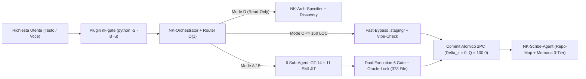
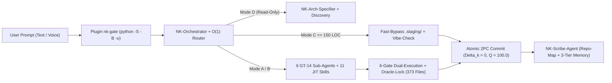

# NK Hub Generation (`v1.0.0-Generation`)
## L'Ambiente di Sviluppo Multi-Agente Ordinato, Sicuro e Autonomo per Google Antigravity 2.0

> 🌍 **Lingua / Language:** **[🇮🇹 Italiano (Qui sotto)](#-1-presentazione-veloce-in-90-secondi)** | **[🇬🇧 English Version (Below)](#-english-version--nk-hub-generation-v100-generation)** | **[📖 Guida Installazione ZIP](../nk_docs_and_setup/GUIDA_INSTALLAZIONE.md)** | **[🗺️ Mappa Libreria](../nk_docs_and_setup/00_MAPPA_LIBRERIA_NK.md)** | **[📋 Patch Notes](../nk_genome/PATCH_NOTES.md)**
>
> 📦 **SCARICA CON 1 CLICK L'AMBIENTE COMPLETO (`.ZIP`, `v1.0.0-Generation`, Milestone `NK-GEN-1.0.0`):**  
> 👉 **[Scarica NK_Hub_OneClick_Package.zip (Download Diretto dal Repository)](https://github.com/erbaldo86/NK-Hub/raw/main/nk_docs_and_setup/NK_Hub_OneClick_Package.zip)**  
> *(L'archivio contiene `.agents/`, `NK_Hub/` e `NK_External_Projects/` con profilo predefinito `NK_MODEL_PROFILE=generation` e fallback `carbon`.)*

---

## ⚡ 1. Presentazione Veloce in 90 Secondi

### Perché nasce `NK Hub Generation`?
Creare software con l'IA parte veloce. Appena un progetto reale cresce emergono però tre problemi ricorrenti:
1. **Cartelle nel caos:** file di sistema, script, test e app utente finiscono mescolati nella stessa radice.
2. **Modifiche che rompono il codice sano:** l'agente modifica direttamente i file attivi senza collaudarli in isolamento.
3. **Perdita di memoria e test addolciti:** nelle sessioni lunghe l'IA dimentica regole o indebolisce i test.

**`NK Hub Generation` (`v1.0.0-Generation`) elimina questi tre problemi.** Trasforma Google Antigravity 2.0 in una regia deterministica con `6` Sub-Agenti Nativi `GT-14` e `11` Playbook `SKILL.md` JIT. Il profilo attivo è `NK_MODEL_PROFILE=generation` (con fallback automatico su `carbon`). La squadra progetta e costruisce dentro `.staging/`. Promuove i file in produzione tramite commit atomico `Win32 2PC` solo quando ogni verifica reale passa al `100%`.

### 💬 Esempio Reale in 30 Secondi: Come Dialoghi con `NK Hub Generation`
> 1. **Tu scrivi in chat (o detti col microfono):**  
>    *"Crea un'applicazione web per gestire i preventivi dei clienti ed esportarli in PDF."*
> 2. **`NK Hub Generation` mostra subito lo Specchio Concettuale `Gate L0`:**  
>    *"Obiettivo chiaro (`R1..Rn`): creo l'app isolata in `NK_External_Projects/PreventiviApp`. Preparo piano `Pentad 4+1`, database e UI in `.staging/`. Confermi con 1 click?"*
> 3. **Tu clicchi su `Conferma`:**  
>    La squadra progetta, costruisce in `.staging/` ed esegue gli audit `Dual-Execution` e i test isolati su NVMe. Ripara eventuali errori e consegna l'applicazione verificata nella tua cartella.

### I Benefici Immediati a Colpo d'Occhio

| Cosa Succede con un Agente AI Standard | Cosa Succede con `NK Hub Generation` (`v1.0.0-Generation`) |
| :--- | :--- |
| File di sistema sparsi insieme alle app | **Libreria Ordinata:** motore in `NK_Hub/`, app utente isolate in `NK_External_Projects/` |
| L'IA parte subito su richieste ambigue | **Gate L0 a 1 Click:** riassume intenzioni, piano e regole prima di scrivere codice |
| Scritture dirette sui file attivi | **Collaudo `.staging/` + Commit Atomico `2PC`:** zero corruzioni parziali del codice sano |
| Un solo agente scrive e si auto-valuta | **`6` Sub-Agenti Nativi `GT-14`:** chi scrive è separato via hardware da chi audita |
| Rischio che l'IA indebolisca i test | **Sigillo `oracle-lock` (`373` file `SHA-256`):** blocca i test contro manomissioni e gaming |
| Degrado in sessioni lunghe o crash su Drive FS | **Profilo `generation` + Pytest Isolato NVMe:** scudi `ACS` e test sicuri su `%TEMP%` |

---

## ✨ 2. Nuova Generazione: Il Salto Evolutivo rispetto al Modello Precedente

`NK Hub Generation` (`v1.0.0-Generation`) non è un semplice aggiornamento incrementale. Rinnova l'intero modello precedente (`5` agenti, `16` skill, `15` nodi, `93` test, hook separati e `Tetralogia`).

| Dimensione Architetturale | Generazione Precedente | `NK Hub Generation` (`v1.0.0-Generation`) |
| :--- | :--- | :--- |
| **Sub-Agenti e Confine `GT-14`** | `5` agenti (`NK-Specifier-Agent` misto con MCP) | **`6` Sub-Agenti Nativi `GT-14`:** separa `NK-Arch-Specifier` (`write: false`, L0/`Mode D`) da `NK-Specifier-Agent` (`write: true`, UX/DAG/OpenAPI). Zero MCP sui `6` worker foglia (`CRIT-01`) |
| **Catalogo Skill e Dashboard** | `16` skill e dashboard a `15` nodi (`[0]`..`[14]`) | **`11` Playbook `SKILL.md` JIT + Dashboard a `10` Nodi (`[0]`..`[9]`)** coordinati da `NK-Orchestrator` |
| **Sistema Hook Runtime** | Script hook distribuiti senza plugin unico | **Plugin unificato `.agents/plugins/nk-gate/` (`hooks.json`)** con `5` hook in `python -S -B -u` |
| **Protezione Contesto (`ACS`)** | Soglie base `standard` | **Guardiano `nk_acs_fastguard.py` (`Z1/Z2/Z3`)** (`120`/`150`/`180` step, `160k`/`185k`/`205k` tok) + profilo `generation` (`150/250` step, `250k/500k` tok, `tier1_token_cap=1200`) |
| **Genoma e Struttura Piani** | `Tetralogia` a `4` documenti | **`Pentad Sovrana 4+1`** (`idea_canvas.md`, `concept_map.md`, `structural_tree.md`, `implementation_plan.md`, `repo_map.md`) con **Genoma 3-Tier** (`8` moduli + `7` shard JSON) |
| **Architettura Motore `scripts/`** | `34` moduli top-level monolitici | **`34` facciate top-level (`37` moduli su `5` domini, `260` `.py` totali).** Sottopacchetti aciclici `_internal/` (`<= 500` LOC) e `schemas/` Pydantic v2 strict |
| **Runner Test su Windows** | `pytest` diretto sulla cartella del workspace | **Runner Isolato NVMe `--pytest-isolated`** su `%TEMP%` (`WIN32_DETACHED_FLAGS`) per azzerare i crash `0xC000013A` su Drive FS |
| **Suite Test e Copertura** | `93` test in `18` moduli | **`513/513 PASS` (`0` skipped) in `41` moduli `test_*.py` (`45` `.py`)** con **Branch Coverage `89.32%`**, Statement **`94.39%`**, Combined **`92.89%`** |
| **Portabilità Cross-OS** | Ottimizzata principalmente per Windows | **Hardening Cross-Platform CI (`ubuntu-latest` + `windows-latest`):** `Win32NamedMutex` con fallback `POSIX flock`, normalizzazione `CRLF/LF` e zero skip |

### I Salti Chiave della Nuova Generazione
1. **Separazione `DOM-02` e Chiusura `CRIT-01`:** `NK-Arch-Specifier` esplora idee (`NK-Ideator`, `SCAMPER`, `Mode D`) in sola lettura. `NK-Specifier-Agent` compila `Pentad Sovrana 4+1`, UX/UI `8px/HSL`, DAG di Kahn e OpenAPI `3.0` in `.staging/nk_genome/`. Solo `DOM-01` esegue `research`, `browser` e `image-generator`.
2. **Modularità Aciclica senza Context Rot:** `37` moduli indicizzati delegano a sottopacchetti `_internal/` sotto `500` LOC senza cicli Tarjan (`C_k = 0`). Il caricamento `3-Tier` carica al Turno `0` solo `00_GENOME_INDEX.md` (`<= 950` tok).
3. **Zero Crash Windows e Copertura Verificata:** `platform_runner.py --pytest-isolated` clona il codice su NVMe `%TEMP%`. Esegue i `513` test Zero-Mock in `~68.3s` con `89.32%` branch coverage.

---

## 📦 3. Guida Rapida all'Installazione (3 Passi + Workspace + 16 Trigger)

Scarica il pacchetto pronto all'uso **[NK_Hub_OneClick_Package.zip](https://github.com/erbaldo86/NK-Hub/raw/main/nk_docs_and_setup/NK_Hub_OneClick_Package.zip)** e consulta la [GUIDA_INSTALLAZIONE.md](../nk_docs_and_setup/GUIDA_INSTALLAZIONE.md) inclusa.

### Installazione in 3 Passi
1. **Estrai lo ZIP:** estrai `NK_Hub_OneClick_Package.zip` nella cartella principale di lavoro (ad esempio `Antigravity/`). Otterrai tre cartelle pulite: `.agents/` (bridge radice), `NK_Hub/` (motore) e `NK_External_Projects/` (tue applicazioni).
2. **Avvia l'Installer Automatico:** apri il terminale dentro `NK_Hub/` ed esegui lo script per il tuo sistema operativo.
   ```powershell
   # Su Windows (PowerShell)
   cd NK_Hub
   .\nk_docs_and_setup\install.ps1
   ```
   ```bash
   # Su Linux o macOS (Bash)
   cd NK_Hub
   bash ./nk_docs_and_setup/install.sh
   ```
   *(Imposta `NK_MODEL_PROFILE=generation` o `carbon`, installa [`requirements.txt`](../nk_docs_and_setup/requirements.txt) e sincronizza `.agents/`. Esegue poi bootstrap, verifica `O(1)` e `--strict-verify`).*
3. **Apri il Workspace e Accendi il Motore:** apri [`nk_docs_and_setup/Antigravity.code-workspace`](../nk_docs_and_setup/Antigravity.code-workspace) in Google Antigravity 2.0. Digita poi uno dei **`16` Trigger di Avvio**:
   * **Trigger Legacy (`8`):** `"avvia ambiente nk"`, `"avvia nk hub"`, `"avvia nk"`, `"avvia hub"`, `"start nk"`, `"start hub"`, `"attiva nk"`, `"attiva ambiente nk"`.
   * **Trigger Generation (`8`):** `"avvia generation"`, `"avvia nk generation"`, `"avvia nk hub generation"`, `"avvia ambiente generation"`, `"start generation"`, `"start nk generation"`, `"attiva generation"`, `"attiva ambiente generation"`.
   * Si aprirà in `< 50 ms` la **Dashboard a `10` Nodi (`[0]`..`[9]`)** pronta a ricevere le tue richieste.

---

## 🎯 4. Due Modi di Viverlo, I 6 Pilastri e Flusso Reale `Mode A`

`NK Hub Generation` offre un'esperienza guidata per chi crea senza tecnicismi e garanzie deterministiche per chi progetta architetture complesse.

### 🧑‍💻 4.A Per l'Utente Vibe Coding (Semplice e Guidato)

| Cosa Vuoi Fare | Cosa Scrivi nella Chat di Antigravity | Cosa Fa `NK Hub Generation` in Automatico |
| :--- | :--- | :--- |
| **Accendere la cabina** | `"avvia generation"` o `"avvia ambiente nk"` | Verifica bootstrap e integrità in `~31-46 ms` e mostra la dashboard `[0]..[9]`. |
| **Creare una nuova app** | *"Crea un'app per gestire le scadenze dei clienti"* | Genera la cartella in `NK_External_Projects/`, compila la `Pentad 4+1`, costruisce UI e DB in `.staging/`. |
| **Modifica rapida (`Mode C`)** | *"Aggiungi un pulsante verde per esportare in CSV"* | Attiva la corsia rapida (`<= 150` LOC), valida l'AST e applica la modifica sicura. |
| **Analisi e ricerca (`Mode D`)** | *"Analizza i colli di bottiglia della cache SQLite"* | Attiva la corsia in sola lettura `Mode D` senza scritture né overhead `2PC`. |
| **Risolvere un bug (`Mode B`)** | *"Quando salvo un record ottengo errore 500"* | Isola la riga esatta con `SBFL Ochiai`, ripara in `.staging/` e certifica i test. |

* **Dettatura vocale intelligente:** il normalizzatore vocale (`scripts/vibe_sprint_router.py`) corregge automaticamente eventuali parole incollate dal microfono STT prima dell'instradamento.
* **Ambiente protetto:** le app vivono sempre in `NK_External_Projects/` e ogni modifica a `NK_Hub/` passa da `.staging/`.

### 🛠️ 4.B Per il Senior Architect (Garanzie Ingegneristiche)

| Limite degli Agenti AI Standard | Soluzione Deterministica in `NK Hub Generation` (`v1.0.0-Generation`) |
| :--- | :--- |
| **Context Rot nelle sessioni lunghe** | **Topologia `2-Tier` + `ACS` + `3-Tier` Genome:** `6` foglie isolate (`subagent: false`), guardiano `nk_acs_fastguard.py` (`Z1/Z2/Z3`) sotto `python -S`, budget `Tier-0 <= 950` tok e `Tier-1 <= 1.200` tok. |
| **Auto-valutazione e Reward Hacking** | **`Dual-Execution` `GT-14` + `oracle-lock`:** `3` nodi read-only (`write: false`, `mcp: false`) leggono telemetria JSON in `nk_diagnostics/`; `373` file sigillati in `SHA-256`. |
| **Corruzioni parziali su I/O** | **Transazioni Atomiche `2PC`:** `win32_2pc_engine.py` usa `Win32NamedMutex` (`c_void_p`) su Windows e fallback `POSIX flock` su Linux/macOS. Supporta `BatchJournalV2` e rollback. |
| **Latenza alta su micro-patch** | **`Mode C` Fast-Bypass + Cache `O(1)`:** analisi AST (`max_depth <= 1`, `<= 150` LOC) e verifica shard `DOM-00..DOM-06.json` in `< 1.0 ms` cached. |
| **Crash `conhost.exe` su Drive FS** | **Pytest Isolato NVMe + `SBFL Ochiai`:** `--pytest-isolated` clona il workspace su `%TEMP%` con `WIN32_DETACHED_FLAGS`; payload diagnostico `< 80` token. |

### 🌟 4.C I 6 Pilastri Ingegneristici e SLA Misurati

1. **Isolamento Fisico e Genoma `3-Tier` (`Pentad Sovrana 4+1`):**
   Motore in `NK_Hub/`, app in `NK_External_Projects/<Nome>/` e bridge zero-discovery in `.agents/`. Il genoma separa `00_GENOME_INDEX.md` (`Tier-0`), la `Pentad Sovrana 4+1` (`Tier-1`) e `8` moduli + `7` shard (`Tier-2`).
2. **Separazione Hardware `GT-14` e Plugin `nk-gate`:**
   Il manifesto [`.agents/plugins.json`](../.agents/plugins.json) monta l'unico plugin [`.agents/plugins/nk-gate/hooks.json`](../.agents/plugins/nk-gate/hooks.json). Tutti i `6` sub-agenti foglia disabilitano `enable_subagent_tools` ed `enable_mcp_tools` (`CRIT-01`).
3. **Gate L0 a 1 Click (`Single-Gate`) e `Mode C` Fast-Bypass:**
   `scripts/vibe_sprint_router.py` valida ogni richiesta tramite `MetaPromptGateContract` (`ConfigDict(strict=True, extra="forbid")`) ed esegue modifiche entro `150` righe via `--vibe-check`.
4. **Onestà Epistemica $100\times$ e Guardie `SAST-GAMING-D01..D04`:**
   `scripts/ast_guard_validator.py` blocca `PYTEST_CURRENT_TEST` (`D01`), ispezione stack frame (`D02`), fixture cablate (`D03`) e ramificazioni sulla dimensione dei dati di test (`D04`). La matrice premia con `+100` il fix reale, assegna `0` a `report-conflict` (`HALT_EPISTEMIC_CONFLICT`) e penalizza con `-10.000` il test-gaming.
5. **Convergenza Matematica Tensor-RSI ($\Delta_k = 0, Q(S_k) = 100.0$) e `Win32 2PC`:**
   `scripts/rsi_convergence_engine.py` valuta il vettore lineare $\Delta_k(p)$ e la fitness iperbolica $Q(S_k)$ per i `5` profili `P1..P5`:
   $$\Delta_k(p) = \sum_{i=1}^{7} w_i^{(p)} d_{i,k} + 20 E_{\text{PoC},k}$$
   $$+ 12 D_{\text{sem},k} + 100 D_{\text{gam},k} + 25 R_{\text{hal},k}$$
   La promozione atomica tramite `scripts/win32_2pc_engine.py` scatta solo con $\Delta_k = 0$ e $Q(S_k) = 100.0$.
6. **Prestazioni e Copertura Certificate (`v1.0.0-Generation`, Baseline `quality_baseline.json`):**
   * **Bootstrap Fast-Stat (`scripts/nk_session_bootstrap.py`):** `~31-46 ms` (cache cross-sessione `TTL 900s`).
   * **Verifica Indice `O(1)` (`scripts/nk_registry_indexer.py --verify`):** `< 1.0 ms` in cache (`~90 ms` cold).
   * **Preflight & AST Guard:** `scripts/preflight_health_check.py --check-only` in `~445 ms`; `scripts/ast_guard_validator.py --target all` su `305` file (`0` violazioni).
   * **Sigillo Anti-Manomissione (`oracle-lock`):** [`nk_tracking/oracle_lock.json`](../nk_tracking/oracle_lock.json) sigilla `373` file in `SHA-256`.
   * **Suite Permanente Zero-Mock (`tests/`):** **`513/513 PASS` (`0` skipped)** su `41` moduli `test_*.py` (`45` `.py`). Copertura: **`89.32%` Branch**, **`94.39%` Statement**, **`92.89%` Combined**. Eseguita in `~68.3s` su NVMe via `--pytest-isolated` e certificata su CI `ubuntu-latest` + `windows-latest` ($\Delta_k = 0$, $Q(S_k) = 100.0$).

### 🚀 4.D Pipeline End-to-End `Mode A` in `v1.0.0-Generation` (`Pentad 4+1` & FSM a 5 Turni)

Ecco il ciclo completo reale di un nuovo progetto o di una grande evoluzione architetturale in `Mode A`:
1. **Turno 1 (`Gate L0` & Ideazione `Mode D`):** `NK-Orchestrator` compila lo Specchio Concettuale `Gate L0` tramite `vibe_sprint_router.py --meta-prompt-gate`. `NK-Arch-Specifier` (`NK-Ideator`, sola lettura) esegue analisi `SCAMPER` e `STORM` leggendo i dati raccolti da `DOM-01` (`research`).
2. **Turno 2 (`Draft` & Specifica `Pentad Sovrana 4+1`):** `NK-Specifier-Agent` (`NK-System-Architect`) scrive `idea_canvas.md`, `concept_map.md`, `structural_tree.md`, `implementation_plan.md` e `nk_genome/modules/` dentro `.staging/nk_genome/`. Definisce design system `8px/HSL` WCAG AAA, `Generative UI`, DAG aciclici di Kahn e contratti OpenAPI `3.0` / Pydantic v2.
3. **Turni 3 e 4 (`Attack Swarm` & Allineamento `1:1`):** `NK-RSI-Auditor` e `NK-Security-DAST-Auditor` validano l'allineamento `1:1` della `Pentad 4+1` e il DAG ($C_k = 0$). Congelano i test con `oracle-lock freeze`.
4. **Turno 5 (`Final Handoff` & Build `.staging/`):** `NK-Builder-Agent` sviluppa backend `async/SQLite WAL`, UI `React/Next.js/Tailwind` o skill in `.staging/` (`NK_External_Projects/`). Esegue quindi `auto_heal_pipeline.py` e `platform_runner.py --pytest-isolated`.
5. **Audit `Dual-Execution` `6` Gate, Commit `2PC` & Scribe:** `DOM-01` esegue `ast_guard_validator.py`, `dast_sandbox_runner.py`, E2E `browser` e `--emit-gt14-bundle --with-dast`. Raggiunto $\Delta_k = 0$ e $Q(S_k) = 100.0$, `win32_2pc_engine.py --promote-staging` promuove il batch. `NK-Scribe-Agent` aggiorna `repo_map.md`, `PATCH_NOTES.md` e memoria `3-Tier` RRF.

---

## 🔬 5. Riferimento Tecnico Completo



### 5.1 Le `4` Modalità Automatiche (`scripts/vibe_sprint_router.py`)

| Modalità | Quando Si Attiva | Corsia Esecutiva | Controlli Applicati |
| :--- | :--- | :--- | :--- |
| **`Mode D` (Discovery & Audit)** | Domande, analisi, benchmark o ricerche | `Single-Gate` in sola lettura (`NK-Arch-Specifier` / Auditor) | Lookup `O(1)` (`< 1.0 ms`) + payload `DOM-01` |
| **`Mode C` (Vibe-Sprint Rapido)** | Piccole modifiche (`<= 150` LOC, `max_depth <= 1`) | Fast-Bypass o `NK-Builder-Agent` in `.staging/` | Guardia AST (`D01..D04`) + `--vibe-check` |
| **`Mode B` (Bugfix & Refactor)** | Correzione bug o refactor multi-file | `NK-Builder-Agent` + Audit `Dual-Execution` | `oracle-lock` + `SBFL Ochiai` (`< 80` tok) |
| **`Mode A` (Progetto Completo)** | Nuova app esterna o evoluzione sistemica | Sciame completo dei `6` Sub-Agenti `GT-14` | `Pentad 4+1`, FSM 5 turni, 6 Gate, `2PC` |

### 5.2 I `6` Sub-Agenti Nativi (`GT-14`, `.agents/agents/*/agent.md` + Plugin `nk-gate`)

Tutti i `6` sub-agenti foglia operano in topologia `2-Tier` con `enable_subagent_tools: false` e `enable_mcp_tools: false`. Solo `DOM-01 Orchestrator-Direct` invoca `research`, `browser` (`chrome-devtools-mcp`) e `image-generator`, salvando i payload in `nk_diagnostics/`.

| Sub-Agente Nativo | Dominio | Permessi (`GT-14`) | Ruolo Esatto e Perimetro Scrittura |
| :--- | :---: | :--- | :--- |
| **[NK-Arch-Specifier](../.agents/agents/NK-Arch-Specifier/agent.md)** | `DOM-02` | **`write: false`**, `mcp: false` | Ideazione `L0` (`NK-Ideator`), analisi `SCAMPER`, discovery `Mode D` e ricerca approfondita su payload `DOM-01` (NON scrive DAG/OpenAPI). |
| **[NK-Specifier-Agent](../.agents/agents/NK-Specifier-Agent/agent.md)** | `DOM-02` | `write: true`, `mcp: false` | Specifica UX/UI (`8px`/HSL WCAG AAA, `Generative UI`), DAG di Kahn, OpenAPI `3.0` / Pydantic v2 e `Pentad 4+1` in `.staging/nk_genome/`. |
| **[NK-Builder-Agent](../.agents/agents/NK-Builder-Agent/agent.md)** | `DOM-03` | `write: true`, `mcp: false` | Sviluppo backend Python async / SQLite WAL, Frontend React/Next.js/Tailwind e forgiatura Playbook esclusivamente dentro `.staging/`. |
| **[NK-Security-DAST-Auditor](../.agents/agents/NK-Security-DAST-Auditor/agent.md)** | `DOM-04` | **`write: false`**, `mcp: false` | Audit SAST `L1/L2/L3`, stress test DAST sandbox, telemetria Browser E2E (`DOM-01` / `chrome-devtools-mcp`) e diagnosi RCA `SBFL Ochiai`. |
| **[NK-RSI-Auditor](../.agents/agents/NK-RSI-Auditor/agent.md)** | `DOM-04` | **`write: false`**, `mcp: false` | Critic read-only per `6` Gate `CRV`, allineamento `1:1` Turno 4, DAG di Kahn, drift `SHA-256` e $\Delta_k = 0$. |
| **[NK-Scribe-Agent](../.agents/agents/NK-Scribe-Agent/agent.md)** | `DOM-05` | `write: true`, `mcp: false` | Sincronizzazione SSOT in `.staging/`, `Pentad 4+1`, AST `repo_map.md`, `PATCH_NOTES.md`, ratchet e memoria episodica a `3` livelli `RRF`. |

### 5.3 La Dashboard a `10` Nodi (`[0]`..`[9]`) e gli `11` Playbook Skill (`.agents/skills/NK-*/SKILL.md`)

| Nodo | Playbook Skill | Dominio | Sub-Agente Assegnato | Compito Specifico del Playbook |
| :---: | :--- | :---: | :--- | :--- |
| **Hub** | [NK-Orchestrator](../.agents/skills/NK-Orchestrator/SKILL.md) | `DOM-01` | `Orchestrator-Direct` | Coordina routing `2-Tier`, FSM a `5` turni, `Dual-Execution`, `oracle-lock` e commit `2PC`. |
| **`[0]`** | [NK-Ideator](../.agents/skills/NK-Ideator/SKILL.md) | `DOM-02` | `NK-Arch-Specifier` | Sviluppa l'idea iniziale (`idea_canvas.md`), `SCAMPER`, `STORM` e discovery `Mode D`. |
| **`[1]`** | [NK-System-Architect](../.agents/skills/NK-System-Architect/SKILL.md) | `DOM-02` | `NK-Specifier-Agent` | Progetta `Pentad Sovrana 4+1`, griglia `8px/HSL`, `Generative UI`, DAG di Kahn e OpenAPI `3.0`. |
| **`[2]`** | [NK-Agent-Instruction-Forge](../.agents/skills/NK-Agent-Instruction-Forge/SKILL.md) | `DOM-03` | `NK-Builder-Agent` | Crea e aggiorna `SKILL.md` e `agent.md` in standard italiano ASD-STE100. |
| **`[3]`** | [NK-Python-Async-Builder](../.agents/skills/NK-Python-Async-Builder/SKILL.md) | `DOM-03` | `NK-Builder-Agent` | Sviluppa backend Python async, Pydantic v2 strict, SQLite WAL e `Fast-Healing` in `.staging/`. |
| **`[4]`** | [NK-Delta-Architect](../.agents/skills/NK-Delta-Architect/SKILL.md) | `DOM-03` | `NK-Builder-Agent` | Realizza interfacce Full-Stack (`TypeScript`, `React`, `Next.js`, `Tailwind`) e refactor chirurgici. |
| **`[5]`** | [NK-Security-Auditor](../.agents/skills/NK-Security-Auditor/SKILL.md) | `DOM-04` | `NK-Security-DAST-Auditor` | Ispeziona sicurezza statica `SAST L1/L2/L3`, vettori gaming `D01..D04` e flag CLI (`CoVe`). |
| **`[6]`** | [NK-Oracle-Evaluator](../.agents/skills/NK-Oracle-Evaluator/SKILL.md) | `DOM-04` | `NK-RSI-Auditor` | Valuta `6` Gate CRV, allineamento `1:1` Turno 4, DAG di Kahn e integrità `SHA-256`. |
| **`[7]`** | [NK-Dynamic-Sandbox-StressTester](../.agents/skills/NK-Dynamic-Sandbox-StressTester/SKILL.md) | `DOM-04` | `NK-Security-DAST-Auditor` | Analizza stress test DAST in sandbox Windows e telemetria Browser E2E (`DOM-01`). |
| **`[8]`** | [NK-Bug-Diagnostic-Engine](../.agents/skills/NK-Bug-Diagnostic-Engine/SKILL.md) | `DOM-04` | `NK-Security-DAST-Auditor` | Isola la causa radice dei bug tramite `SBFL Ochiai` (`< 80` tok) e filtra i falsi bug. |
| **`[9]`** | [NK-Scribe-Memory](../.agents/skills/NK-Scribe-Memory/SKILL.md) | `DOM-05` | `NK-Scribe-Agent` | Sincronizza Genoma `3-Tier`, shard JSON, `repo_map.md`, `PATCH_NOTES.md` e memoria `RRF`. |

### 5.4 Architettura `scripts/` (`34` Top-Level, `37` Moduli Indicizzati, `260` `.py`) e Suite `tests/`

Ogni modulo top-level funge da facciata CLI su `scripts/_internal/` (`<= 500` LOC) e `scripts/schemas/` (`4` schemi `L0` Pydantic v2):

1. **Governance, Routing, Hook & 2PC (`DOM-01`):** `nk_session_bootstrap.py`, `nk_registry_indexer.py`, `vibe_sprint_router.py`, `nk_hook_gate.py`, `nk_acs_fastguard.py`, `win32_2pc_engine.py`, `preflight_health_check.py`, `nk_swarm_messenger.py`. Schemi: `schemas/dual_ledgers.py`, `schemas/dual_ledgers_models.py`, `schemas/nk_catalog_contracts.py`, `schemas/nk_ipc_contracts.py`.
2. **Ideazione, Mappatura AST & Scaffolding (`DOM-02`):** `ast_repo_mapper.py`, `external_project_scaffolder.py` (isola le app in `NK_External_Projects/`) e `env_capability_probe.py`.
3. **Build, Fast-Healing & Runner NVMe (`DOM-03`):** `auto_heal_pipeline.py`, `healing_snapshot_rollback.py`, `invisible_healing_loop.py`, `platform_runner.py` (`--pytest-isolated`), `safe_cleanup_dev_servers.py`, `deterministic_api_cache.py` e `async_heartbeat_signaler.py`.
4. **Sicurezza, Sandbox & Convergenza RSI (`DOM-04`):** `ast_guard_validator.py`, `dast_sandbox_runner.py`, `oracle_evaluator_l3.py`, `sbfl_engine.py`, `sbfl_pytest_bridge.py`, `rsi_convergence_engine.py` e `nk_transcript_tools.py`.
5. **Memoria 3-Tier, Telemetria & Baseline (`DOM-05`):** `memory_3tier_engine.py`, `quality_baseline_manager.py`, `nk_context_sentry.py`, `nk_active_runtime_sentinel.py`, `nk_compliance_checker.py`, `nk_auto_inning.py`, `nk_session_handoff.py` e `micro_hud_renderer.py`.
6. **Suite Permanente `tests/` (`41` moduli `test_*.py`, `45` file `.py` totali):** `513/513 PASS` (`0` skipped), Branch Coverage **`89.32%`**, Statement **`94.39%`**, Combined **`92.89%`**. Eseguita su NVMe via `platform_runner.py --pytest-isolated` (`~68.3s`) e validata su CI GitHub Actions (`ubuntu-latest` + `windows-latest` in [`.github/workflows/ci.yml`](workflows/ci.yml)).

---

## 📋 6. Patch Notes (`v1.0.0-Generation`: Prima Release)

> **Rilascio Inaugurale:** `v1.0.0-Generation` (`2026-11-17`, Milestone `NK-GEN-1.0.0`).
> Questa è la prima release inaugurale di `NK Hub Generation` e non contiene storici di versioni precedenti.
> Le future modifiche saranno registrate in testa al registro ufficiale [`nk_genome/PATCH_NOTES.md`](../nk_genome/PATCH_NOTES.md).

---
*NK Hub Generation (`v1.0.0-Generation`) | Milestone `NK-GEN-1.0.0` | Certificato `513/513 PASS` (`89.32%` Branch) Zero-Mock | $\Delta_k = 0, Q(S_k) = 100.0$*

---

# 🇬🇧 English Version : NK Hub Generation (`v1.0.0-Generation`)
## The Organized, Safe, and Autonomous Multi-Agent Development Environment for Google Antigravity 2.0

> 🌍 **Language / Lingua:** **[🇮🇹 Vai alla Versione Italiana](#-1-presentazione-veloce-in-90-secondi)** | **[📖 1-Click ZIP Install Guide](../nk_docs_and_setup/GUIDA_INSTALLAZIONE.md)** | **[🗺️ Library Map](../nk_docs_and_setup/00_MAPPA_LIBRERIA_NK.md)** | **[📋 Patch Notes](../nk_genome/PATCH_NOTES.md)**
>
> 📦 **1-CLICK DOWNLOAD OF THE COMPLETE ENVIRONMENT (`.ZIP`, `v1.0.0-Generation`, Milestone `NK-GEN-1.0.0`):**  
> 👉 **[Download NK_Hub_OneClick_Package.zip (Direct Repository Download)](https://github.com/erbaldo86/NK-Hub/raw/main/nk_docs_and_setup/NK_Hub_OneClick_Package.zip)**  
> *(The archive includes `.agents/`, `NK_Hub/`, and `NK_External_Projects/` with default `NK_MODEL_PROFILE=generation` and `carbon` fallback.)*

---

## ⚡ 1. 90-Second Quick Look

### Why was `NK Hub Generation` created?
Building software with AI starts fast. As real projects grow, three recurring issues appear:
1. **Cluttered directories:** engine files, scripts, tests, and user apps end up mixed inside one root folder.
2. **Destructive live edits:** the agent edits production files directly without isolated verification first.
3. **Context rot and weakened tests:** during long sessions, AI forgets rules or softens assertions to pass.

**`NK Hub Generation` (`v1.0.0-Generation`) eliminates all three issues.** It transforms Google Antigravity 2.0 into a deterministic control room with `6` `GT-14` Native Sub-Agents and `11` JIT `SKILL.md` Playbooks. The active profile is `NK_MODEL_PROFILE=generation` (with automatic `carbon` fallback). The swarm plans and builds inside `.staging/`. It promotes changes via atomic `Win32 2PC` only when `100%` of real checks pass.

### 💬 30-Second Live Example: How You Talk to `NK Hub Generation`
> 1. **You type in chat (or dictate via microphone):**  
>    *"Create a web application to manage customer quotes and export them as PDF."*
> 2. **`NK Hub Generation` immediately displays the L0 Conceptual Mirror (`Gate L0`):**  
>    *"Goal understood (`R1..Rn`): I will scaffold the isolated app in `NK_External_Projects/QuoteApp`. Next, I will build the `Pentad 4+1` plan, database, and UI in `.staging/`. Confirm with 1 click?"*
> 3. **You click `Confirm`:**  
>    The team builds inside `.staging/`, runs `Dual-Execution` audits, and executes isolated NVMe tests. It auto-heals failures and delivers the verified application into your folder.

### Immediate Benefits at a Glance

| Standard AI Agent Behavior | What Happens with `NK Hub Generation` (`v1.0.0-Generation`) |
| :--- | :--- |
| Engine files mixed with user apps | **Clean Physical Layout:** `NK_Hub/` engine and isolated `NK_External_Projects/` apps |
| Immediate execution on vague prompts | **1-Click L0 Gate:** summarizes intent, plan, and rules before touching code |
| Direct writes on production files | **Isolated `.staging/` + Atomic `2PC` Commit:** zero partial corruption |
| Same agent writes and grades code | **`6` `GT-14` Native Sub-Agents:** builders are hardware-separated from auditors |
| Risk of AI weakening tests to pass | **`oracle-lock` Seal (`373` `SHA-256` files):** blocks test tampering and gaming |
| Long-session rot or Drive FS crashes | **`generation` Profile + NVMe Isolated Pytest:** `ACS` shields and `%TEMP%` test runner |

---

## ✨ 2. New Generation: The Evolutionary Leap from the Previous Model

`NK Hub Generation` (`v1.0.0-Generation`) is not a minor incremental update. It overhauls the previous model (`5` agents, `16` skills, `15` nodes, `93` tests, `Tetralogy`).

| Architectural Dimension | Previous Generation | `NK Hub Generation` (`v1.0.0-Generation`) |
| :--- | :--- | :--- |
| **Sub-Agents & `GT-14` Boundary** | `5` agents (`NK-Specifier-Agent` mixed with MCP) | **`6` `GT-14` Native Sub-Agents:** splits `NK-Arch-Specifier` (`write: false`, L0/`Mode D`) from `NK-Specifier-Agent` (`write: true`, UX/DAG/OpenAPI). Zero MCP on `6` leaves (`CRIT-01`) |
| **Skill Catalog & Dashboard** | `16` skills and `15`-node dashboard (`[0]`..`[14]`) | **`11` JIT `SKILL.md` Playbooks + `10`-Node Dashboard (`[0]`..`[9]`)** orchestrated by `NK-Orchestrator` |
| **Runtime Hook System** | Distributed hook scripts without unified plugin | **Centralized `.agents/plugins/nk-gate/` (`hooks.json`)** running `5` hooks via `python -S -B -u` |
| **Context Protection (`ACS`)** | Basic `standard` threshold guards | **`nk_acs_fastguard.py` Shields (`Z1/Z2/Z3`)** (`120`/`150`/`180` steps, `160k`/`185k`/`205k` tok) + `generation` profile (`150/250` steps, `250k/500k` tok, `tier1_token_cap=1200`) |
| **Genome & Planning Layout** | `4`-document `Tetralogy` | **`Pentad Sovrana 4+1`** (`idea_canvas.md`, `concept_map.md`, `structural_tree.md`, `implementation_plan.md`, `repo_map.md`) with **3-Tier Genome** (`8` modules + `7` JSON shards) |
| **Core `scripts/` Architecture** | `34` monolithic top-level modules | **`34` top-level facades (`37` indexed modules, `260` `.py` total).** Uses acyclic `_internal/` (`<= 500` LOC) and Pydantic v2 `schemas/` |
| **Windows Test Runner** | Direct `pytest` execution inside workspace | **NVMe Isolated Runner `--pytest-isolated`** on `%TEMP%` (`WIN32_DETACHED_FLAGS`) eliminating Drive FS `0xC000013A` crashes |
| **Test Suite & Coverage** | `93` tests across `18` modules | **`513/513 PASS` (`0` skipped) across `41` `test_*.py` modules (`45` `.py`)** with **`89.32%` Branch Coverage**, **`94.39%` Statement**, **`92.89%` Combined** |
| **Cross-OS Hardening** | Primarily Windows-oriented | **Cross-Platform CI (`ubuntu-latest` + `windows-latest`):** `Win32NamedMutex` with `POSIX flock` fallback, `CRLF/LF` normalization, zero skips |

### Core Breakthroughs of the New Generation
1. **`DOM-02` Split & `CRIT-01` Closure:** `NK-Arch-Specifier` drives L0 ideation (`NK-Ideator`, `SCAMPER`, `Mode D`) in read-only mode. `NK-Specifier-Agent` writes `Pentad Sovrana 4+1`, `8px/HSL` UX/UI, Kahn DAGs, and OpenAPI `3.0` into `.staging/nk_genome/`. Only `DOM-01` invokes `research`, `browser`, and `image-generator`.
2. **Acyclic Modularity without Context Rot:** `37` indexed modules delegate to `_internal/` submodules under `500` LOC with zero Tarjan cycles (`C_k = 0`). Tiered `3-Tier` loading injects only `00_GENOME_INDEX.md` (`<= 950` tok) at Turn `0`.
3. **Crash-Free Windows Testing & Proven Coverage:** `platform_runner.py --pytest-isolated` mirrors the workspace to NVMe `%TEMP%`. Runs `513` Zero-Mock tests in `~68.3s` with `89.32%` branch coverage.

---

## 📦 3. Quick Installation Guide (3 Steps + Workspace + 16 Triggers)

Download **[NK_Hub_OneClick_Package.zip](https://github.com/erbaldo86/NK-Hub/raw/main/nk_docs_and_setup/NK_Hub_OneClick_Package.zip)** and inspect the included [GUIDA_INSTALLAZIONE.md](../nk_docs_and_setup/GUIDA_INSTALLAZIONE.md).

### Setup in 3 Easy Steps
1. **Extract the ZIP:** extract `NK_Hub_OneClick_Package.zip` into your main workspace folder (e.g. `Antigravity/`). You get three clean directories: `.agents/` (root bridge), `NK_Hub/` (engine), and `NK_External_Projects/` (your apps).
2. **Run the Automated Installer:** open a terminal inside `NK_Hub/` and run your OS installer.
   ```powershell
   # Windows (PowerShell)
   cd NK_Hub
   .\nk_docs_and_setup\install.ps1
   ```
   ```bash
   # Linux or macOS (Bash)
   cd NK_Hub
   bash ./nk_docs_and_setup/install.sh
   ```
   *(Sets `NK_MODEL_PROFILE=generation` or `carbon`, installs [`requirements.txt`](../nk_docs_and_setup/requirements.txt), and syncs `.agents/`. Runs bootstrap, O(1) verify, and `--strict-verify`.)*
3. **Open the Workspace & Launch the Engine:** open [`nk_docs_and_setup/Antigravity.code-workspace`](../nk_docs_and_setup/Antigravity.code-workspace) in Google Antigravity 2.0 and type any of the **`16` Startup Triggers**:
   * **Legacy Triggers (`8`):** `"avvia ambiente nk"`, `"avvia nk hub"`, `"avvia nk"`, `"avvia hub"`, `"start nk"`, `"start hub"`, `"attiva nk"`, `"attiva ambiente nk"`.
   * **Generation Triggers (`8`):** `"avvia generation"`, `"avvia nk generation"`, `"avvia nk hub generation"`, `"avvia ambiente generation"`, `"start generation"`, `"start nk generation"`, `"attiva generation"`, `"attiva ambiente generation"`.
   * The **10-Node Dashboard (`[0]`..`[9]`)** opens in under `50 ms`.

---

## 🎯 4. Two Ways to Experience It, 6 Core Pillars & Real `Mode A` Pipeline

`NK Hub Generation` serves non-technical creators with a guided surface while enforcing strict deterministic guarantees for senior engineers.

### 🧑‍💻 4.A For Vibe Coders (Guided and Effortless)

| What You Want to Do | What You Type in Antigravity Chat | What `NK Hub Generation` Does Automatically |
| :--- | :--- | :--- |
| **Start the control room** | `"start generation"` or `"avvia generation"` | Validates bootstrap and registry in `~31-46 ms` and opens the `[0]..[9]` dashboard. |
| **Build a brand-new app** | *"Create an app to track client deadlines"* | Scaffolds `NK_External_Projects/`, writes `Pentad 4+1`, builds UI and DB in `.staging/`. |
| **Make a quick tweak (`Mode C`)** | *"Add a green button to export the table to CSV"* | Activates the fast lane (`<= 150` LOC), checks the AST, and stages a safe edit. |
| **Research or analyze (`Mode D`)** | *"Analyze bottlenecks in the SQLite cache module"* | Runs the read-only `Mode D` lane with zero writes and zero `2PC` overhead. |
| **Fix a defect (`Mode B`)** | *"Clicking Save triggers a 500 error, fix it"* | Pinpoints the faulty line via `SBFL Ochiai`, patches in `.staging/`, and certifies tests. |

* **Voice dictation friendly:** the built-in voice normalizer (`scripts/vibe_sprint_router.py`) splits glued STT words before routing.
* **Protected workspace:** user apps live inside `NK_External_Projects/`, and edits to `NK_Hub/` always run through `.staging/`.

### 🛠️ 4.B For Senior Architects (Engineering Guarantees)

| Standard AI Coding Limitation | Deterministic Solution in `NK Hub Generation` (`v1.0.0-Generation`) |
| :--- | :--- |
| **Context Rot in long sessions** | **`2-Tier` Topology + `ACS` + `3-Tier` Genome:** `6` isolated leaves (`subagent: false`), `nk_acs_fastguard.py` (`Z1/Z2/Z3`) under `python -S`, `Tier-0 <= 950` tok, `Tier-1 <= 1,200` tok. |
| **Self-grading & Reward Hacking** | **`Dual-Execution` `GT-14` + `oracle-lock`:** `3` read-only nodes (`write: false`, `mcp: false`) inspect JSON telemetry in `nk_diagnostics/`; `373` files sealed in `SHA-256`. |
| **Partial writes & I/O corruption** | **Atomic `2PC` Transactions:** `win32_2pc_engine.py` enforces 64-bit `Win32NamedMutex` (`c_void_p`) on Windows and `POSIX flock` fallback on Linux/macOS with `BatchJournalV2` rollback. |
| **High latency on small edits** | **`Mode C` Fast-Bypass + `O(1)` Cache:** AST depth triage (`max_depth <= 1`, `<= 150` LOC) and `< 1.0 ms` cached shard verification across `DOM-00..DOM-06.json`. |
| **Drive FS `conhost.exe` crashes** | **NVMe Isolated Pytest + `SBFL Ochiai`:** `--pytest-isolated` mirrors the repo to `%TEMP%` via `WIN32_DETACHED_FLAGS`; diagnostic payloads fit under `80` tokens. |

### 🌟 4.C The 6 Engineering Pillars & Measured SLAs

1. **Physical Isolation & `3-Tier` Genome (`Pentad Sovrana 4+1`):**
   Engine lives in `NK_Hub/`, user apps in `NK_External_Projects/<Name>/`, and zero-discovery bridge in `.agents/`. The genome separates `00_GENOME_INDEX.md` (`Tier-0`), `Pentad Sovrana 4+1` (`Tier-1`), and `8` modules + `7` shards (`Tier-2`).
2. **Hardware `GT-14` Boundary & Unified `nk-gate` Plugin:**
   [`.agents/plugins.json`](../.agents/plugins.json) mounts a single plugin [`.agents/plugins/nk-gate/hooks.json`](../.agents/plugins/nk-gate/hooks.json). All `6` leaf sub-agents disable `enable_subagent_tools` and `enable_mcp_tools` (`CRIT-01`).
3. **1-Click L0 Gate (`Single-Gate`) & `Mode C` Fast-Bypass:**
   `scripts/vibe_sprint_router.py` compiles a strict `MetaPromptGateContract` (`ConfigDict(strict=True, extra="forbid")`) and validates edits under `150` lines via `--vibe-check`.
4. **$100\times$ Epistemic Honesty & `SAST-GAMING-D01..D04` Guards:**
   `scripts/ast_guard_validator.py` blocks `PYTEST_CURRENT_TEST` (`D01`), stack frame inspection (`D02`), hardcoded fixtures (`D03`), and test-size branching (`D04`). Scoring grants `+100` for real fixes, `0` for `report-conflict` (`HALT_EPISTEMIC_CONFLICT`), and `-10,000` for test gaming.
5. **Mathematical Tensor-RSI Convergence ($\Delta_k = 0, Q(S_k) = 100.0$) & `Win32 2PC`:**
   `scripts/rsi_convergence_engine.py` computes the defect vector $\Delta_k(p)$ and hyperbolic fitness $Q(S_k)$ across `5` profiles `P1..P5`:
   $$\Delta_k(p) = \sum_{i=1}^{7} w_i^{(p)} d_{i,k} + 20 E_{\text{PoC},k}$$
   $$+ 12 D_{\text{sem},k} + 100 D_{\text{gam},k} + 25 R_{\text{hal},k}$$
   Atomic promotion via `scripts/win32_2pc_engine.py` triggers exclusively when $\Delta_k = 0$ and $Q(S_k) = 100.0$.
6. **Measured Performance & Coverage (`v1.0.0-Generation`, SSOT `quality_baseline.json`):**
   * **Fast-Stat Bootstrap (`scripts/nk_session_bootstrap.py`):** `~31-46 ms` (cross-session cache `TTL 900s`).
   * **`O(1)` Registry Verify (`scripts/nk_registry_indexer.py --verify`):** `< 1.0 ms` cached (`~90 ms` cold).
   * **Preflight & AST Guard:** `scripts/preflight_health_check.py --check-only` in `~445 ms`; `scripts/ast_guard_validator.py --target all` on `305` files (`0` violations).
   * **Anti-Tamper Seal (`oracle-lock`):** [`nk_tracking/oracle_lock.json`](../nk_tracking/oracle_lock.json) protects `373` files via `SHA-256`.
   * **Permanent Zero-Mock Suite (`tests/`):** **`513/513 PASS` (`0` skipped)** across `41` `test_*.py` modules (`45` `.py`). Coverage: **`89.32%` Branch**, **`94.39%` Statement**, **`92.89%` Combined**. Runs in `~68.3s` on NVMe via `--pytest-isolated` and on `ubuntu-latest` + `windows-latest` CI ($\Delta_k = 0$, $Q(S_k) = 100.0$).

### 🚀 4.D Real End-to-End `Mode A` Pipeline (`Pentad 4+1` & 5-Turn FSM)

Here is the exact lifecycle of a new app or major architectural evolution in `Mode A`:
1. **Turn 1 (`Gate L0` & `Mode D` Ideation):** `NK-Orchestrator` compiles the L0 Conceptual Mirror via `vibe_sprint_router.py --meta-prompt-gate`. `NK-Arch-Specifier` (`NK-Ideator`, read-only) executes `SCAMPER` and `STORM` ideation over `DOM-01` `research` payloads.
2. **Turn 2 (`Draft` & `Pentad Sovrana 4+1` Spec):** `NK-Specifier-Agent` (`NK-System-Architect`) writes `idea_canvas.md`, `concept_map.md`, `structural_tree.md`, `implementation_plan.md`, and `nk_genome/modules/` in `.staging/nk_genome/`. It specifies `8px/HSL` WCAG AAA tokens, `Generative UI`, acyclic Kahn DAGs, and OpenAPI `3.0` / Pydantic v2 strict contracts.
3. **Turns 3 & 4 (`Attack Swarm` & `1:1` Alignment):** `NK-RSI-Auditor` and `NK-Security-DAST-Auditor` verify `1:1` `Pentad 4+1` alignment, DAG acyclicity ($C_k = 0$), and freeze tests via `oracle-lock freeze`.
4. **Turn 5 (`Final Handoff` & `.staging/` Build):** `NK-Builder-Agent` builds `async Python/SQLite WAL` backends, `React/Next.js/Tailwind` UIs, or skills in `.staging/` (`NK_External_Projects/`). It runs `auto_heal_pipeline.py` and `--pytest-isolated`.
5. **`Dual-Execution` 6-Gate Audit, `2PC` Commit & Scribe:** `DOM-01` runs `ast_guard_validator.py`, `dast_sandbox_runner.py`, `browser` E2E, and `--emit-gt14-bundle --with-dast`. Once $\Delta_k = 0$ and $Q(S_k) = 100.0$, `win32_2pc_engine.py --promote-staging` promotes atomically. `NK-Scribe-Agent` updates `repo_map.md`, `PATCH_NOTES.md`, and `3-Tier` RRF memory.

---

## 🔬 5. Complete Technical Reference



### 5.1 The `4` Automatic Operating Modes (`scripts/vibe_sprint_router.py`)

| Mode | Trigger Condition | Execution Lane | Verification Gates |
| :--- | :--- | :--- | :--- |
| **`Mode D` (Discovery & Audit)** | Questions, audits, benchmarks, research | Read-only `Single-Gate` (`NK-Arch-Specifier` / Auditors) | `O(1)` Lookup (`< 1.0 ms`) + `DOM-01` payloads |
| **`Mode C` (Vibe-Sprint Fast Lane)** | Small edits (`<= 150` LOC, `max_depth <= 1`) | Fast-Bypass or `NK-Builder-Agent` in `.staging/` | AST Guard (`D01..D04`) + `--vibe-check` |
| **`Mode B` (Bugfix & Refactor)** | Targeted bugfix or multi-file refactor | `NK-Builder-Agent` + `Dual-Execution` Audit | `oracle-lock` + `SBFL Ochiai` (`< 80` tok) |
| **`Mode A` (Full-Stack Project)** | New external app or major evolution | Full `6`-Agent `GT-14` Native Swarm | `Pentad 4+1`, 5-Turn FSM, 6 Gates, `2PC` |

### 5.2 The `6` Native Sub-Agents (`GT-14`, `.agents/agents/*/agent.md` + `nk-gate` Plugin)

All `6` leaf sub-agents run in a flat `2-Tier` topology with `enable_subagent_tools: false` and `enable_mcp_tools: false` (`RULE-01` / `CRIT-01`). Only `DOM-01 Orchestrator-Direct` invokes built-in `research`, `browser` (`chrome-devtools-mcp`), and `image-generator`, writing payloads into `nk_diagnostics/` for read-only inspection.

| Native Sub-Agent | Domain | Permissions (`GT-14`) | Exact Role & Write Perimeter |
| :--- | :---: | :--- | :--- |
| **[NK-Arch-Specifier](../.agents/agents/NK-Arch-Specifier/agent.md)** | `DOM-02` | **`write: false`**, `mcp: false` | L0 ideation (`NK-Ideator`), `SCAMPER` analysis, `Mode D` discovery, and deep analysis of `DOM-01` payloads (does NOT write DAG/OpenAPI). |
| **[NK-Specifier-Agent](../.agents/agents/NK-Specifier-Agent/agent.md)** | `DOM-02` | `write: true`, `mcp: false` | Systemic UX/UI (`8px`/HSL WCAG AAA, `Generative UI`), acyclic Kahn DAGs, OpenAPI `3.0` / Pydantic v2, and `Pentad Sovrana 4+1` in `.staging/nk_genome/`. |
| **[NK-Builder-Agent](../.agents/agents/NK-Builder-Agent/agent.md)** | `DOM-03` | `write: true`, `mcp: false` | Async Python / SQLite WAL backends, React/Next.js/Tailwind frontends, and Playbook forging strictly inside `.staging/`. |
| **[NK-Security-DAST-Auditor](../.agents/agents/NK-Security-DAST-Auditor/agent.md)** | `DOM-04` | **`write: false`**, `mcp: false` | `SAST L1/L2/L3` audits, DAST sandbox stress analysis, Browser E2E telemetry (`DOM-01` / `chrome-devtools-mcp`), and `SBFL Ochiai` RCA. |
| **[NK-RSI-Auditor](../.agents/agents/NK-RSI-Auditor/agent.md)** | `DOM-04` | **`write: false`**, `mcp: false` | Read-only critic for `6` `CRV` Gates, Turn 4 `1:1` alignment, Kahn DAG integrity, `SHA-256` drift, and $\Delta_k = 0$ convergence. |
| **[NK-Scribe-Agent](../.agents/agents/NK-Scribe-Agent/agent.md)** | `DOM-05` | `write: true`, `mcp: false` | SSOT synchronization in `.staging/`, `Pentad 4+1`, AST `repo_map.md`, `PATCH_NOTES.md`, ratchet, and 3-Tier `RRF` memory. |

### 5.3 The `10`-Node Dashboard (`[0]`..`[9]`) & `11` Skill Playbooks (`.agents/skills/NK-*/SKILL.md`)

| Node | Skill Playbook | Domain | Assigned Sub-Agent | Procedural Responsibility |
| :---: | :--- | :---: | :--- | :--- |
| **Hub** | [NK-Orchestrator](../.agents/skills/NK-Orchestrator/SKILL.md) | `DOM-01` | `Orchestrator-Direct` | Governs `2-Tier` routing, `5`-turn FSM, `Dual-Execution`, `oracle-lock`, and `2PC` commits. |
| **`[0]`** | [NK-Ideator](../.agents/skills/NK-Ideator/SKILL.md) | `DOM-02` | `NK-Arch-Specifier` | Drives L0 ideation (`idea_canvas.md`), `SCAMPER`, `STORM`, and `Mode D` discovery. |
| **`[1]`** | [NK-System-Architect](../.agents/skills/NK-System-Architect/SKILL.md) | `DOM-02` | `NK-Specifier-Agent` | Designs `Pentad Sovrana 4+1`, `8px/HSL` UI, `Generative UI`, Kahn DAGs, and OpenAPI `3.0`. |
| **`[2]`** | [NK-Agent-Instruction-Forge](../.agents/skills/NK-Agent-Instruction-Forge/SKILL.md) | `DOM-03` | `NK-Builder-Agent` | Authors and updates `SKILL.md` and `agent.md` in ASD-STE100 standard. |
| **`[3]`** | [NK-Python-Async-Builder](../.agents/skills/NK-Python-Async-Builder/SKILL.md) | `DOM-03` | `NK-Builder-Agent` | Builds async Python backends, strict Pydantic v2, SQLite WAL, and `Fast-Healing` in `.staging/`. |
| **`[4]`** | [NK-Delta-Architect](../.agents/skills/NK-Delta-Architect/SKILL.md) | `DOM-03` | `NK-Builder-Agent` | Builds Full-Stack UIs (`TypeScript`, `React`, `Next.js`, `Tailwind`) and surgical refactors. |
| **`[5]`** | [NK-Security-Auditor](../.agents/skills/NK-Security-Auditor/SKILL.md) | `DOM-04` | `NK-Security-DAST-Auditor` | Audits `SAST L1/L2/L3`, `D01..D04` gaming vectors, and CLI `CoVe` flags. |
| **`[6]`** | [NK-Oracle-Evaluator](../.agents/skills/NK-Oracle-Evaluator/SKILL.md) | `DOM-04` | `NK-RSI-Auditor` | Evaluates `6` CRV Gates, Turn 4 `1:1` alignment, Kahn DAGs, and `SHA-256` integrity. |
| **`[7]`** | [NK-Dynamic-Sandbox-StressTester](../.agents/skills/NK-Dynamic-Sandbox-StressTester/SKILL.md) | `DOM-04` | `NK-Security-DAST-Auditor` | Audits DAST Windows sandbox reports and `DOM-01` Browser E2E telemetry. |
| **`[8]`** | [NK-Bug-Diagnostic-Engine](../.agents/skills/NK-Bug-Diagnostic-Engine/SKILL.md) | `DOM-04` | `NK-Security-DAST-Auditor` | Pinpoints root causes via `SBFL Ochiai` (`< 80` tok) and filters false bug reports. |
| **`[9]`** | [NK-Scribe-Memory](../.agents/skills/NK-Scribe-Memory/SKILL.md) | `DOM-05` | `NK-Scribe-Agent` | Syncs `3-Tier` Genome, JSON shards, `repo_map.md`, `PATCH_NOTES.md`, and `RRF` memory. |

### 5.4 `scripts/` Architecture (`34` Top-Level, `37` Indexed Modules, `260` `.py`) & `tests/` Suite

Every top-level facade delegates to acyclic `scripts/_internal/` submodules (`<= 500` LOC) and `scripts/schemas/` (`4` Pydantic v2 `L0` schemas):

1. **Governance, Routing, Hooks & 2PC (`DOM-01`):** `nk_session_bootstrap.py`, `nk_registry_indexer.py`, `vibe_sprint_router.py`, `nk_hook_gate.py`, `nk_acs_fastguard.py`, `win32_2pc_engine.py`, `preflight_health_check.py`, `nk_swarm_messenger.py`, and `4` schemas (`schemas/dual_ledgers.py`, `schemas/dual_ledgers_models.py`, `schemas/nk_catalog_contracts.py`, `schemas/nk_ipc_contracts.py`).
2. **Ideation, AST Mapping & Scaffolding (`DOM-02`):** `ast_repo_mapper.py`, `external_project_scaffolder.py` (isolates apps in `NK_External_Projects/`), and `env_capability_probe.py`.
3. **Build, Fast-Healing & NVMe Runner (`DOM-03`):** `auto_heal_pipeline.py`, `healing_snapshot_rollback.py`, `invisible_healing_loop.py`, `platform_runner.py` (`--pytest-isolated`), `safe_cleanup_dev_servers.py`, `deterministic_api_cache.py`, and `async_heartbeat_signaler.py`.
4. **Security, Sandbox & RSI Convergence (`DOM-04`):** `ast_guard_validator.py`, `dast_sandbox_runner.py`, `oracle_evaluator_l3.py`, `sbfl_engine.py`, `sbfl_pytest_bridge.py`, `rsi_convergence_engine.py`, and `nk_transcript_tools.py`.
5. **3-Tier Memory, Telemetry & Baseline (`DOM-05`):** `memory_3tier_engine.py`, `quality_baseline_manager.py`, `nk_context_sentry.py`, `nk_active_runtime_sentinel.py`, `nk_compliance_checker.py`, `nk_auto_inning.py`, `nk_session_handoff.py`, and `micro_hud_renderer.py`.
6. **Permanent `tests/` Suite (`41` `test_*.py` modules, `45` `.py` files total):** `513/513 PASS` (`0` skipped), **`89.32%` Branch Coverage**, **`94.39%` Statement**, **`92.89%` Combined**. Executed on NVMe via `platform_runner.py --pytest-isolated` (`~68.3s`) and validated on GitHub Actions CI (`ubuntu-latest` + `windows-latest` in [`.github/workflows/ci.yml`](workflows/ci.yml)).

---

## 📋 6. Patch Notes (`v1.0.0-Generation`: Inaugural Release)

> **Inaugural Release:** `v1.0.0-Generation` (`2026-11-17`, Milestone `NK-GEN-1.0.0`).
> This is the inaugural release of `NK Hub Generation` and intentionally carries no legacy update history.
> Future changes will be prepended to the official SSOT changelog [`nk_genome/PATCH_NOTES.md`](../nk_genome/PATCH_NOTES.md).

---
*NK Hub Generation (`v1.0.0-Generation`) | Milestone `NK-GEN-1.0.0` | Certified `513/513 PASS` (`89.32%` Branch) Zero-Mock | $\Delta_k = 0, Q(S_k) = 100.0$*
