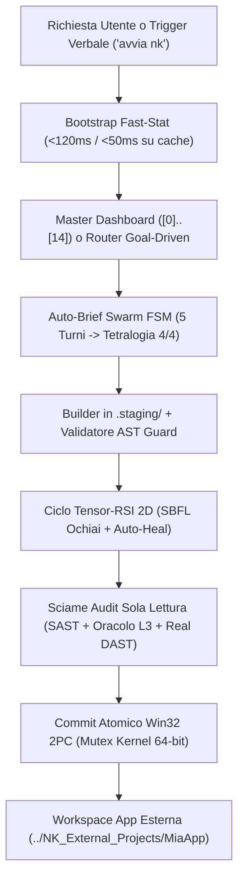
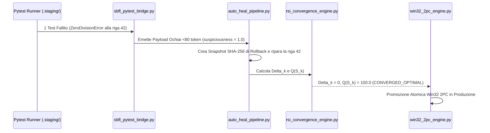

# Lab NK Hub: Sistema Operativo Agentico Sovrano (`v3.1.0-Tensor-RSI` / `v3.0.0-STE100-Unified`)

> 🌍 **Scegli la Lingua / Choose Your Language:** **[🇮🇹 Italiano (Attuale)](README.it.md)** | **[🇬🇧 Read in English (README.md)](README.md)** | **[📦 Guida Installazione Rapida](GUIDA_INSTALLAZIONE.md)**

> **Sistema Operativo Cognitivo Sovrano, Orchestratore Swarm 2-Tier e Motore Tensor-RSI 2D per Google Antigravity**

[](#parte-7-storico-changelog-e-matrice-dei-108-golden-tests-108108-pass)
[](#parte-7-storico-changelog-e-matrice-dei-108-golden-tests-108108-pass)
[](#parte-6-fondamenti-matematici-e-motore-tensor-rsi-2d-sezione-senior-e-auditor)
[](#tutorial-3-modifiche-rapide-ui-e-script-in--500-ms-mode-c-vibe-sprint)
[](#tutorial-1-avviare-lambiente-in--120-ms-rule-005)
[](#parte-5-protocolli-architetturali-e-regole-di-sistema-crv-40-e-tensor-rsi)
[](#parte-4-architettura-del-motore-core-e-30-moduli-script-33-file-python)
[](#parte-7-storico-changelog-e-matrice-dei-108-golden-tests-108108-pass)

---

## 🚀 Perché Nexus Keystone Cambia Tutto (Sintesi in 60 Secondi)

I normali assistenti AI di programmazione entrano in crisi quando il progetto supera pochi file.
Saturano la finestra di contesto, inventano comandi inesistenti, rompono il codice funzionante e nascondono i bug con mock finti.

**Nexus Keystone (`NK-Hub`)** trasforma **Google Antigravity** in una fabbrica software autonoma capace di auto-ripararsi.
Al posto di un singolo prompt fragile, ottieni uno **Sciame di 16 Skill** governato da motori Python deterministici.

| Limite degli Assistenti AI Tradizionali | Come `NK-Hub v3.1.0-Tensor-RSI` Risolve il Problema |
| :--- | :--- |
| **File di Produzione Danneggiati** | Nessun agente tocca la produzione direttamente (`[RULE-00]`). Il codice nasce in `.staging/` e passa in produzione tramite Mutex Win32 a 64-bit (`win32_2pc_engine.py`). |
| **Test Finti che Nascondono Bug Reali** | `[RULE-01.2]` vieta `MagicMock` e stub sintetici. Ogni test gira su processi reali del sistema operativo con cache SQLite WAL persistente. |
| **Tentativi Infiniti alla Cieca** | Quando un test fallisce, `sbfl_pytest_bridge.py` calcola lo spettro **Ochiai** e individua la riga esatta del bug in `< 80` token. |
| **Saturazione del Contesto** | La topologia **2-Tier Hub-and-Spoke** delega ricerche e build ai sub-agenti, limitando i messaggi di ritorno a `1.800` caratteri (`[RULE-SWARM-HYGIENE]`). |
| **Lentezza sulle Piccole Modifiche** | Il motore **Tensor-RSI 2D** esegue `--vibe-check` in un singolo processo sul raggio d'impatto del DAG in `< 500 ms`. |
| **Contaminazione del Repository** | `[RULE-PROJECT-ISOLATION]` mantiene `NK-Hub` puro al 100%. Tutte le tue applicazioni nascono in cartelle esterne dedicate. |
| **Amnesia tra Sessioni Diverse** | La **Memoria Episodica a 3 Livelli** (`BM25 + Dense Cosine RRF`) pre-carica le lezioni in `tier1_active_capsule.json` a latenza `0 ms`. |

### 🧭 Scegli il Tuo Percorso di Lettura

| Profilo Lettore | Sezioni Consigliate | Cosa Imparerai in Questa Guida |
| :--- | :--- | :--- |
| **🟢 Utente Nuovo / Valutatore** | **[Parte 1](#parte-1-per-principianti-concetti-glossario-e-avvio-in-3-comandi)** e **[Parte 2](#parte-2-tutorial-interattivo-passo-passo-4-esempi-pratici-reali)** | Spiegazione semplice, glossario senza gergo, avvio rapido e 4 tutorial pratici pronti all'uso. |
| **🔵 Architetto di Prodotto / Flussi** | **[Parte 3](#parte-3-catalogo-panoramico-delle-16-skill-vocazionali)** e **[Parte 5](#parte-5-protocolli-architetturali-e-regole-di-sistema-crv-40-e-tensor-rsi)** | Le 16 skill vocazionali (`[0]`..`[14]`), la macchina a stati Auto-Brief a 5 turni e il Vibe Coding. |
| **🟣 Ingegnere AI Senior / Auditor** | **[Parte 4](#parte-4-architettura-del-motore-core-e-30-moduli-script-33-file-python)**, **[Parte 6](#parte-6-fondamenti-matematici-e-motore-tensor-rsi-2d-sezione-senior-e-auditor)** e **[Parte 7](#parte-7-storico-changelog-e-matrice-dei-108-golden-tests-108108-pass)** | I 33 file Python core, le equazioni Tensor-RSI 2D, la matematica SBFL, gli SLA e i 108 Golden Tests. |

---

## Parte 1: Per Principianti (Concetti, Glossario e Avvio in 3 Comandi)

### Cos'è Nexus Keystone in Parole Semplici?
Immagina **Nexus Keystone (`NK-Hub`)** come una **Torre di Controllo Aereo e Fabbrica Software Automatizzata**.
Le applicazioni che vuoi costruire sono gli aeroplani.
La Torre di Controllo disegna il progetto, assembla il codice in un hangar protetto (`.staging/`) ed esegue collaudi reali.
Se un componente fallisce il test, il motore diagnostico trova subito la riga guasta e la ripara da solo.
Solo quando ogni verifica raggiunge il `100.0%`, la torre sposta il codice finito nella cartella esterna della tua applicazione.

### Glossario Amichevole Zero-Gergo

| Termine in `NK-Hub` | Significato Semplice Quotidiano | Ruolo Tecnico nel Sistema |
| :--- | :--- | :--- |
| **`NK-Hub` (Torre di Controllo)** | Il cervello centrale che coordina tutti gli specialisti. | Meta-piattaforma di orchestrazione che impone regole, routing e cancelli di qualità. |
| **Cartella Progetto Esterna** | La cartella separata dove nasce la tua vera applicazione. | Directory isolata (`../NK_External_Projects/<NomeApp>`) imposta da `[RULE-PROJECT-ISOLATION]`. |
| **Area di Staging (`.staging/`)** | Il banco di lavoro sicuro dove il codice viene collaudato. | Buffer pre-produzione validato da AST Guard e pytest prima del commit atomico. |
| **Nodi Vocazionali (`[0]`..`[14]`)** | 15 esperti AI specializzati (Designer, Builder, Auditor, ecc.). | Skill modulari in `.agents/skills/NK-*/SKILL.md` con permessi rigorosi di lettura e scrittura. |
| **Tetralogia Sovrana (4/4)** | I 4 documenti vivi che descrivono il progetto. | `concept_map.md`, `structural_tree.md`, `implementation_plan.md` e `repo_map.md` (più `idea_canvas.md`). |
| **Tensor-RSI 2D** | Il motore di auto-miglioramento che azzera gli errori fino a `100`. | Motore matematico ($\Delta_k = 0, Q(S_k) = 100.0$) articolato su `4` livelli e `5` profili di dominio. |
| **Commit Win32 2PC** | L'interruttore anti-crash che salva i file solo se tutto funziona. | Promozione atomica con Named Mutex del kernel Windows a 64-bit e registro `.wal`. |

### Flusso Visivo ad Alto Livello


### Avvio Rapido in 3 Comandi da Terminale

1. **Esegui il Bootstrap di Sessione Fast-Stat (`< 120` ms a freddo / `< 50` ms su cache hit):**
   ```powershell
   python -u scripts/nk_session_bootstrap.py
   ```
2. **Esegui il Controllo di Salute e la Verifica Convergenza RSI in Sola Lettura:**
   ```powershell
   python -u scripts/preflight_health_check.py --check-only
   python -u scripts/rsi_convergence_engine.py --verify
   ```
3. **Crea lo Scaffolding di un Nuovo Progetto Esterno:**
   ```powershell
   python -u scripts/external_project_scaffolder.py --name MiaApp --target "../NK_External_Projects/MiaApp"
   ```

---

## Parte 2: Tutorial Interattivo Passo-Passo (4 Esempi Pratici Reali)

Questa sezione ti guida attraverso quattro esempi concreti per valutare sul campo come lavora `NK-Hub`.

### Tutorial 1: Avviare l'Ambiente in `< 120 ms` (`[RULE-00.5]`)

Quando apri il repository in Google Antigravity, scrivi in chat uno qualsiasi degli **8 trigger verbali ufficiali**:
> **Trigger Verbali:** `"avvia ambiente nk"`, `"avvia nk hub"`, `"avvia nk"`, `"avvia hub"`, `"start nk"`, `"start hub"`, `"attiva nk"`, `"attiva ambiente nk"`

**Cosa esegue il sistema automaticamente in 3 passi:**
1. **Passo 1 (Cancello Fast-Stat):** L'agente esegue `scripts/nk_session_bootstrap.py` in `< 120` ms (`< 50` ms su cache hit). Verifica l'isolamento della root, pulisce i `.wal` scaduti e imposta `NK_MODEL_PROFILE=argon`.
2. **Passo 2 (Master Dashboard a 15 Nodi):** L'agente mostra il menù interattivo dei 15 specialisti (`[0]` fino a `[14]`):
   - **`[0] NK-Ideator`**: Ideazione Concettuale, Analisi SCAMPER, STORM e `/grill-me` (L0).
   - **`[1] NK-App-UX-Architect`**: Macro-Architettura UX/UI, Design System 8px/HSL e Generative UI (L3).
   - **`[2] NK-Backend-Architect`**: Topologie Backend 2-Tier DAG di Kahn, Pydantic v2 e OpenAPI 3.0 (L2).
   - **`[3] NK-Agent-Instruction-Forge`**: Metaprompting L1 e Forgia Skill in ASD-STE100 (`/learn`, `/boost`).
   - **`[4] NK-Python-Async-Builder`**: Builder Python Asincrono Primario e Fast-Healing in `.staging/` (L2).
   - **`[5] NK-Delta-Architect`**: Refiner Chirurgico Post-Rilascio in `.staging/` (Worker Foglia a 1 Livello).
   - **`[6] NK-Security-Auditor`**: Critic Swarm SAST L1/L2/L3 in Sola Lettura e Verifica CoVe.
   - **`[7] NK-Oracle-Evaluator`**: Oracolo Deterministico Cold Audit (Gate 1-6) e Ispettore DOM L3 (`/browser`).
   - **`[8] NK-Dynamic-Sandbox-StressTester`**: Esecutore Real DAST in Sandbox `%TEMP%\nk_sandbox_*`.
   - **`[9] NK-Bug-Diagnostic-Engine`**: Localizzatore Guasti SBFL Ochiai (`< 80` token) e Analisi RCA.
   - **`[10] NK-Plan-Aligner`**: Certificatore Turno 4 della Tetralogia Sovrana 4/4 e Gate `--verify`.
   - **`[11] NK-State-Router`**: Verificatore Topologico DAG di Kahn e Rilevatore Drift SHA-256.
   - **`[12] NK-Scribe`**: Cronista Post-Commit, Sincronizzatore Changelog SSOT e AST Repo-Map.
   - **`[13] NK-Episodic-Memory-Engine`**: Motore Memoria 3-Tier (`ARCH`, `SEC`, `OPS`, `DEVX`) e Recupero RRF.
   - **`[14] NK-Session-Controller`**: Supervisore di Sessione, Sovereign Critic, Loop RSI e Cold Reviewer a 6 Gate.
3. **Passo 3 (Scelta Operativa a Due Vie):**
   - **Modalità Diretta:** Digita un numero da **`[0]` a `[14]`** per interpellare direttamente un singolo nodo.
   - **Modalità Goal-Driven:** Descrivi il tuo obiettivo in linguaggio naturale e lascia che lo sciame lavori per te.

---

### Tutorial 2: Creare una Nuova App Esterna da Zero (`/plan` $\to$ `/goal`)

Supponiamo che tu voglia creare una nuova applicazione completa partendo da una semplice descrizione.

1. **Scrivi nella chat di Antigravity:**
   ```text
   /plan Crea una web app FastAPI per gestire preventivi clienti con database SQLite ed esportazione PDF
   ```
2. **Isolamento Automatico del Progetto (`[RULE-PROJECT-ISOLATION]`):**
   L'Hub invoca `scripts/external_project_scaffolder.py` e crea la cartella esterna `../NK_External_Projects/PreventiviApp` con l'albero DDD completo (`src/core`, `src/api`, `tests/`, `nk_genome/`).
3. **Macchina a Stati Auto-Brief a 5 Turni (`[RULE-03]`):**
   - **Turno 1 (Bozza):** `NK-Ideator`, `NK-App-UX-Architect` e `NK-Backend-Architect` redigono `idea_canvas.md`, `concept_map.md` e `structural_tree.md`.
   - **Turno 2 (Sciame d'Attacco):** `NK-Security-Auditor` e `NK-Dynamic-Sandbox-StressTester` cercano falle architetturali prima di scrivere codice.
   - **Turno 3 (Raffinamento):** Gli architetti correggono i punti deboli e blindano i contratti Pydantic v2.
   - **Turno 4 (Allineamento 1:1):** `NK-Plan-Aligner` certifica `implementation_plan.md` ed espone l'artefatto interattivo con il pulsante **`Proceed`** (`[RULE-01.11]`).
   - **Turno 5 (Handoff):** Clicchi su **`Proceed`** per avviare subito la pipeline autonoma `/goal`.
4. **Costruzione e Promozione Atomica (`[RULE-01.12]`):**
   `NK-Python-Async-Builder` scrive il codice in `.staging/`, esegue i test reali, porta Tensor-RSI a $\Delta_k = 0$ e promuove i file con `win32_2pc_engine.py`.

---

### Tutorial 3: Modifiche Rapide UI e Script in `< 500 ms` (`Mode C` Vibe-Sprint)

Cosa succede se vuoi solo aggiungere un bottone UI o una piccola funzione (`<= 150` righe di codice)?
Il sistema salta le cerimonie pesanti ed entra in corsia rapida **Mode C**.

1. **Scrivi nella chat:**
   ```text
   Aggiungi un badge di stato colorato e il calcolo IVA istantaneo nella scheda preventivo
   ```
2. **Smistamento Automatico Mode C (`scripts/vibe_sprint_router.py`):**
   ```powershell
   python -u scripts/vibe_sprint_router.py --prompt "Aggiungi un badge di stato" --files ui_card.py
   ```
   Il router misura la profondità AST (`max_depth <= 1`) e il numero di righe (`<= 150` LOC), attivando **`MODE_C_VIBE_SPRINT`**.
3. **Pre-Riscaldamento Memoria in `0 ms` e Vibe-Check in `< 500 ms`:**
   - Il router carica le lezioni attive da `nk_tracking/memory_3tier/tier1_active_capsule.json` in `< 2 ms`.
   - Il builder modifica il file in `.staging/` e lancia il cancello singolo Tensor-RSI:
     ```powershell
     python -u scripts/rsi_convergence_engine.py --vibe-check .staging/scripts/vibe_sprint_router.py --json
     ```
   - La verifica AST, il controllo SAST e il linter STE100 terminano in **`~65 ms`** (ben sotto il limite di `500 ms`).

---

### Tutorial 4: Diagnosi e Auto-Riparazione dei Bug (`Mode B` + SBFL Ochiai)

Supponiamo che un test fallisca per una divisione per zero nel calcolo dello sconto.



1. **Localizzazione Chirurgica (`< 80` Token):**
   Invece di intasare il modello con lunghe tracce d'errore, `sbfl_pytest_bridge.py` estrae un payload JSON compatto:
   ```json
   {"loc": "src/pricing.py:42", "err": "ZeroDivisionError: division by zero", "ochiai": 1.0}
   ```
2. **Snapshot Monotono e Rollback Automatico:**
   Prima di applicare la patch, `healing_snapshot_rollback.py` salva uno snapshot SHA-256 in `snapshot_manifest.json`.
   Se la modifica peggiora i test o introduce errori AST, il sistema ripristina lo stato precedente all'istante (`G2`).

### Tabella Riassuntiva delle Modalità di Sviluppo

| Modalità | Condizione di Attivazione | Velocità e Ambito | Cancelli di Verifica Attivi |
| :--- | :--- | :--- | :--- |
| **`Mode C` (Vibe-Sprint)** | `<= 150` LOC, `AST max_depth <= 1`, `0` import critici | Verifica `< 500 ms`, max `2` retry RSI | `ASTGuardValidator` + `--vibe-check` (`VIBE_SPRINT_MICRO_RSI`) |
| **`Mode B` (CRV Lite)** | Bugfix backend o refactoring mirato multi-file | Loop `< 15 s`, max `3` retry RSI | Staging + `SBFLPytestBridge` + `AutoHealPipeline` (`CODE_RSI`) |
| **`Mode A` (Sovereign CRV 4.0)** | `/plan`, `/goal`, nuova app o rilascio architetturale | FSM a 5 Turni + 4 Macro-Fasi, max `5` retry RSI | Cold Audit a 6 Gate + SAST L1-L3 + Real DAST + Win32 2PC |

---

## Parte 3: Catalogo Panoramico delle 16 Skill Vocazionali

Ogni skill in `.agents/skills/NK-*/SKILL.md` applica `[RULE-STE100]`, `[RULE-RSI.1]` e i confini degli strumenti `GT-14`.

| Nome Skill | Nodo | Ruolo e Ambito Architetturale | Fase CRV / FSM | Confine Strumenti (`GT-14`) | Profilo Tensor-RSI (`<rsi_micro_loop>`) | File Ausiliari Linkati |
| :--- | :---: | :--- | :---: | :--- | :--- | :--- |
| [NK-Master-Hub](.agents/skills/NK-Master-Hub/SKILL.md) | L3 | Router DAG 2-Tier e Committer Win32 2PC | Macro 3 e 4 | Sovereign Committer | `L1` / `CODE_RSI` (`2/3/5`) | Nessuno |
| [NK-Ideator](.agents/skills/NK-Ideator/SKILL.md) | `[0]` | Ideazione, SCAMPER, STORM e `/grill-me` | FSM Turno 1 | Confinato a `nk_genome/` | `L1` / `SPEC_RSI` (`1/2/3`) | `resources/idea_canvas_template.md` |
| [NK-App-UX-Architect](.agents/skills/NK-App-UX-Architect/SKILL.md) | `[1]` | Design System 8px/HSL e Generative UI | FSM Turno 1 | Confinato a `nk_genome/` | `L1` / `UI_UX_RSI` (`2/2/3`) | Nessuno |
| [NK-Backend-Architect](.agents/skills/NK-Backend-Architect/SKILL.md) | `[2]` | DAG Backend 2-Tier, OpenAPI 3.0 e Pydantic v2 | FSM Turno 1 e 3 | Confinato a `nk_genome/` | `L1` / `SPEC_RSI` (`1/2/3`) | Nessuno |
| [NK-Agent-Instruction-Forge](.agents/skills/NK-Agent-Instruction-Forge/SKILL.md) | `[3]` | Forgia Skill ASD-STE100 e Meta-RSI (`/learn`) | FSM Turno 1 e 3 | Staging + Golden Eval | `L3` / `STE100_RSI` (`1/1/2`) | Nessuno |
| [NK-Python-Async-Builder](.agents/skills/NK-Python-Async-Builder/SKILL.md) | `[4]` | Builder Primario Python Asincrono in `.staging/` | Macro 1 | Scrittura in `.staging/` | `L1` / `CODE_RSI` (`2/3/5`) | Nessuno |
| [NK-Delta-Architect](.agents/skills/NK-Delta-Architect/SKILL.md) | `[5]` | Refiner Chirurgico a 4 Blocchi in `.staging/` | Macro 1 | Scrittura in `.staging/` | `L1` / `VIBE_SPRINT` (`2/3/5`) | `resources/delta_brief_template.md` |
| [NK-Security-Auditor](.agents/skills/NK-Security-Auditor/SKILL.md) | `[6]` | Critic Swarm SAST L1/L2/L3 e Verifica CoVe | Macro 2 | 100% Sola Lettura | `L0` / `CODE_RSI` (`1/2/3`) | `resources/audit_checklists_l1_l2_l3.md` |
| [NK-Oracle-Evaluator](.agents/skills/NK-Oracle-Evaluator/SKILL.md) | `[7]` | Cold Evaluator (Gate 1-6) e Ispettore DOM L3 | Macro 2 | 100% Sola Lettura | `L1` / `UI_UX_RSI` (`1/2/3`) | `references/anti_pattern_guards.md`, `references/verification_oracles.md` |
| [NK-Dynamic-Sandbox-StressTester](.agents/skills/NK-Dynamic-Sandbox-StressTester/SKILL.md) | `[8]` | Concorrenza Real DAST in `%TEMP%\nk_sandbox_*` | Macro 2 | 100% Sola Lettura | `L1` / `CODE_RSI` (`1/2/3`) | Nessuno |
| [NK-Bug-Diagnostic-Engine](.agents/skills/NK-Bug-Diagnostic-Engine/SKILL.md) | `[9]` | Localizzatore RCA SBFL Ochiai e Gate Falsi Bug | Macro 1 e 2 | 100% Sola Lettura | `L1` / `CODE_RSI` (`1/2/3`) | `resources/false_bug_rejection_rules.yaml`, `resources/rca_dual_language_template.md` |
| [NK-Plan-Aligner](.agents/skills/NK-Plan-Aligner/SKILL.md) | `[10]` | Allineatore Tetralogia 4/4 e Gate `--verify` | FSM Turno 4 | 100% Sola Lettura | `L1` / `SPEC_RSI` (`1/1/2`) | Nessuno |
| [NK-State-Router](.agents/skills/NK-State-Router/SKILL.md) | `[11]` | Verificatore DAG di Kahn e Drift SHA-256 | Macro 3 | 100% Sola Lettura | `L0` / `CODE_RSI` (`1/1/2`) | Nessuno |
| [NK-Scribe](.agents/skills/NK-Scribe/SKILL.md) | `[12]` | Sincronizzatore SSOT, Repo-Map e Publisher Git | Post-Macro 3 | Doc e Tracking (`[RULE-00.2]`) | `L1` / `STE100_RSI` (`1/1/2`) | `resources/activity_anchor_schema.md`, `resources/scribe_knowledge.md` |
| [NK-Episodic-Memory-Engine](.agents/skills/NK-Episodic-Memory-Engine/SKILL.md) | `[13]` | Memoria 3-Tier (`ARCH, SEC, OPS, DEVX`) e Capsule | Post-Macro 3 | Solo Registro Memoria | `L2` / `SPEC_RSI` (`1/1/2`) | Nessuno |
| [NK-Session-Controller](.agents/skills/NK-Session-Controller/SKILL.md) | `[14]` | Supervisore Sessione, FSM a 5 Turni e Cold Review | FSM Turni 1-5 | Sovereign Critic | `L2` / `SPEC_RSI` (`2/3/5`) | `clean_handoff_protocol.md`, `handoff_anchor_schema.md`, `prompt_templates.md`, `saturation_thresholds.yaml` |

---

## Parte 4: Architettura del Motore Core e 30 Moduli Script (`33 File Python`)

Tutti i `33` file Python in `scripts/` usano contratti Pydantic v2 strict e superano `108/108` Golden Tests Zero-Mock.

### 1. Difesa Runtime, Governance di Sessione e Convergenza Tensor-RSI
- [`scripts/nk_session_bootstrap.py`](scripts/nk_session_bootstrap.py): Cancello Fast-Stat (`< 50` ms su cache hit tramite `transcript_mtime` e `transcript_size`), pulizia `.wal`, verifica isolamento root e attivazione `NK_MODEL_PROFILE=argon`.
- [`scripts/rsi_convergence_engine.py`](scripts/rsi_convergence_engine.py): Motore Tensor-RSI 2D con `RSIProfileRegistry`, calcolo di $\Delta_k$ e $Q(S_k)$ e guardie `G1..G6`. Include `--vibe-check <target>`, CoVe CLI AST Gate (`verify_cli_flags_cove`) e validatore STE100 (`--verify`).
- [`scripts/nk_active_runtime_sentinel.py`](scripts/nk_active_runtime_sentinel.py): Sentinella step Dual-Profile (`60/85/100` standard, `120/180/250` argon) con filtro dei transcript dei sub-agenti (`EXT-02`).
- [`scripts/nk_context_sentry.py`](scripts/nk_context_sentry.py): Sentinella token/step Dual-Profile (`70/100` standard, `150/250` argon senza `thinking`) e filtro ritorni sub-agenti (`2000` char MTU).
- [`scripts/nk_compliance_checker.py`](scripts/nk_compliance_checker.py): Revisore transcript con `DDI_DIRECT_STREAK_LIMIT = 12`, esenzione AST su `write_calls == 0`, lettura di `rsi_telemetry.jsonl` e guardie `GT-08`/`GT-10`.
- [`scripts/preflight_health_check.py`](scripts/preflight_health_check.py): Sonda diagnostica di manutenzione con modalità `--check-only` per CI e verifica fail-closed (`BS-01`).
- [`scripts/platform_runner.py`](scripts/platform_runner.py): Esecutore sicuro di sottoprocessi con iniezione `-u` su liste e stringhe (`BS-04`) e flussi UTF-8.
- [`scripts/env_capability_probe.py`](scripts/env_capability_probe.py): Sonda di ambiente che separa `core_hub_modules` da `optional_app_modules` (`GT-09`).

### 2. Swarm IPC, Compattazione e Handoff
- [`scripts/nk_swarm_messenger.py`](scripts/nk_swarm_messenger.py): Formattatore messaggi inter-agente con taglio a `1.800` caratteri MSS (`GT-04`), fallback Head-Tail (`400 + 800`) e salvataggio su disco.
- [`scripts/nk_session_handoff.py`](scripts/nk_session_handoff.py): Generatore handoff zero-amnesia con chiamate `git` ancorate a `cwd=str(_workspace_root)`, flag `--transcript`/`--output-dir` opzionali e totale test dinamico.
- [`scripts/nk_auto_inning.py`](scripts/nk_auto_inning.py): Chiusura inning che passa `--transcript` e `--json` a `nk_compliance_checker.py` con `compliance_score = 0` fail-closed su errore.
- [`scripts/async_heartbeat_signaler.py`](scripts/async_heartbeat_signaler.py): Demone heartbeat e watchdog a `45` secondi dotato di CLI (`--task-id`, `--interval`, `--max-beats`, `--once`).

### 3. Mutazione Atomica e Commit Win32 2PC
- [`scripts/win32_2pc_engine.py`](scripts/win32_2pc_engine.py): Motore 2PC con Named Mutex Win32 a 64-bit, `MOVEFILE_COPY_ALLOWED`, guardia `age > 10s` e pre-check `--verify-baseline`.
- [`scripts/healing_snapshot_rollback.py`](scripts/healing_snapshot_rollback.py): Gestore snapshot con `snapshot_manifest.json` persistente su disco, prefisso SHA-256 a 8 caratteri e rollback monotono.
- [`scripts/safe_cleanup_dev_servers.py`](scripts/safe_cleanup_dev_servers.py): Terminatore di dev server con default `_workspace_root` (`--workspace-root`, `--dry-run`, `--json`) che protegge i processi esterni.

### 4. Diagnostica, Verifica e Fast-Healing
- [`scripts/sbfl_engine.py`](scripts/sbfl_engine.py): Motore SBFL Ochiai, Tarantula e DStar (`< 80` token) dotato di filtro AST Def-Use e interfaccia CLI.
- [`scripts/sbfl_pytest_bridge.py`](scripts/sbfl_pytest_bridge.py): Parser traceback compatibile con spazi nei path Windows e `suspiciousness == 1.0` (`GT-07`).
- [`scripts/auto_heal_pipeline.py`](scripts/auto_heal_pipeline.py): Pipeline di riparazione autonoma collegata a `ASTGuardValidator` e `RSIConvergenceEngine` con telemetria in `rsi_telemetry.jsonl`.
- [`scripts/invisible_healing_loop.py`](scripts/invisible_healing_loop.py): Wrapper di auto-riparazione in `.staging/` che delega a `auto_heal_pipeline.py`.
- [`scripts/oracle_evaluator_l3.py`](scripts/oracle_evaluator_l3.py): Valutatore DOM L3 compatibile con i void tag HTML5 e i percorsi Windows (`U-27`).
- [`scripts/micro_hud_renderer.py`](scripts/micro_hud_renderer.py): Renderizzatore telemetrico a riga singola CP1252/UTF-8 allineato a `MicroUIHUDState`.
- [`scripts/dast_sandbox_runner.py`](scripts/dast_sandbox_runner.py): Runner isolato con Job Objects Win32 a 64-bit in `%TEMP%\nk_sandbox_*`.

### 5. Memoria, Cache, AST e Schemi
- [`scripts/memory_3tier_engine.py`](scripts/memory_3tier_engine.py): Memoria a 3 livelli con `DOMAIN_ALIAS_MAP` (`ARCH, SEC, OPS, DEVX`), cap `350`/`1200` token (`GT-05`), sincronizzazione `tier1_active_capsule.json` e CLI completa (`--recall`, `--append`, `--tier1-sync`).
- [`scripts/deterministic_api_cache.py`](scripts/deterministic_api_cache.py): Cache SQLite WAL con connessione persistente e interfaccia CLI (`--force-refresh`, `--stats`, `--clear`).
- [`scripts/quality_baseline_manager.py`](scripts/quality_baseline_manager.py): Gestore Ratchet fail-closed (`108` Golden Tests) che controlla `sast_critical_violations` e `rsi_residual_delta` (`--file`, `--update`, `--check-only`).
- [`scripts/ast_guard_validator.py`](scripts/ast_guard_validator.py): Validatore statico AST con tracciamento `function_depth`, alias `--stage-dir` e controllo `SASTConstructChecker` (`eval`, `exec`, `pickle.loads`, `yaml.load`, `MagicMock`).
- [`scripts/ast_repo_mapper.py`](scripts/ast_repo_mapper.py): Mappatore AST PageRank con salvataggio `edges` e snapshot `argon_mode_a` a `4.000` token (`GT-06`).
- [`scripts/external_project_scaffolder.py`](scripts/external_project_scaffolder.py): Generatore di progetti esterni che blocca qualsiasi percorso interno a `NK-Hub` (`BS-03`).
- [`scripts/vibe_sprint_router.py`](scripts/vibe_sprint_router.py): Router Mode A/B/C che calcola la profondità AST `max_depth` (`<= 150` LOC) ed esegue `load_prewarmed_capsule()` in `< 2 ms`.
- [`scripts/schemas/dual_ledgers.py`](scripts/schemas/dual_ledgers.py) e [`scripts/schemas/nk_ipc_contracts.py`](scripts/schemas/nk_ipc_contracts.py): Verifica PID a 64-bit (`ERROR_ACCESS_DENIED` safe) e contratti IPC Pydantic v2 unificati (`RSIDefectVector`, `OchiaiDiagnosticPayload`).

---

## Parte 5: Protocolli Architetturali e Regole di Sistema (CRV 4.0 e Tensor-RSI)

### Mandati Vincolanti di Sistema (`.agents/AGENTS.md`)
1. **`[RULE-PROJECT-ISOLATION]`**: Nessun codice applicativo risiede dentro `NK-Hub`. Ogni app vive in `G:/Il mio Drive/NK_External_Projects/<Nome>/`.
2. **`[RULE-00.4]` e `[RULE-00.5]`**: Ogni sessione parte con `nk_session_bootstrap.py` (`< 120` ms) e mostra la Master Dashboard a 15 nodi sui trigger verbali.
3. **`[RULE-00]` e `[RULE-00.1]`**: Zero modifiche non autorizzate in produzione. Specifier e Auditor operano in sola lettura; i Builder scrivono solo in `.staging/`.
4. **`[RULE-STE100]`**: Italiano Tecnico ASD-STE100 obbligatorio (`<= 20` parole per frase operativa, forma attiva, zero trattini spaziati).
5. **`[RULE-REACTIVE-SILENCE]`**: Vietati i cicli di polling (`manage_task(Action="status")`). Gli agenti cedono il turno o usano timer reattivi.
6. **`[RULE-01]` e `[RULE-SWARM-HYGIENE]`**: Delega 2-Tier a singolo livello (`enable_subagent_tools=False`), Fast-Track a `12` chiamate e limite `1.800` caratteri MSS.
7. **`[RULE-01.2]` e `[RULE-01.10]`**: Esecuzione reale Zero-Mock e ratchet permanente che protegge i `108` Golden Tests al `100.0%` di successo.
8. **`[RULE-RSI]` e `[RULE-RSI.1]`**: Convergenza continua Tensor-RSI 2D ($\Delta_k = 0, Q(S_k) = 100.0$) su `4` livelli e `5` profili di dominio.

### Protocollo CRV 4.0 (4 Macro-Fasi) e 6 Cancelli di Cold Review

| Fase / Gate | Nodo Responsabile | Azione Deterministica di Verifica |
| :--- | :--- | :--- |
| **Macro-Fase 1: Build e Stage** | `NK-Python-Async-Builder` / `NK-Delta-Architect` | Scrive in `.staging/`, esegue `ast_guard_validator.py --stage-dir` e `auto_heal_pipeline.py`. |
| **Macro-Fase 2: Unified Dynamic Audit** | `NK-Oracle-Evaluator`, `NK-Security-Auditor`, `NK-StressTester` | Esegue i 6 Gate di Cold Review (`Scope`, `Code Grounding`, `Brief Grounding`, `Preservation`, `Truth/DAST`, `RSI Convergence`). |
| **Macro-Fase 3: Commit Atomico 2PC** | `NK-Master-Hub` | Verifica `quality_baseline.json` e promuove `.staging/` in produzione tramite `win32_2pc_engine.py`. |
| **Macro-Fase 4: Teardown Deterministico** | `NK-Master-Hub` e `NK-Scribe` | Rimuove `%TEMP%\nk_sandbox_*`, pulisce `.staging/` e aggiorna `repo_map.md` (`4000` tok) e `PATCH_NOTES.md`. |

### Calibrazione Runtime Dual-Profile (`standard` vs `argon`)

| Parametro / Soglia | Profilo `standard` (Default Golden Tests) | Profilo `argon` (Runtime di Produzione) |
| :--- | :---: | :---: |
| **Context Sentry (`WARN / HARD`)** | `70 / 100` step (`GT-01`) | `150 / 250` step (`250k / 500k` token, escluso `thinking`) |
| **Active Runtime Sentinel (`GREEN / CAUTION / CRIT / RED`)** | `<60 / 60-84 / 85-99 / >=100` step (`GT-02`) | `<120 / 120-179 / 180-249 / >=250` step |
| **Cap Token Memoria Episodica Tier-1** | `350` token (`GT-05`) | `1.200` token (`tier1_active_capsule.json`) |
| **Budget Token AST Repo-Map (`Mode C / B / A`)** | `0 / 256 / 512 / 1.024` token (`GT-06`) | `0 / 512 / 1.500 / 4.000` token |

---

## Parte 6: Fondamenti Matematici e Motore Tensor-RSI 2D (Sezione Senior e Auditor)

### 1. Doppia Metrica Accoppiata di Convergenza RSI ($\Delta_k$ e $Q(S_k)$)
Ad ogni iterazione $k$, `scripts/rsi_convergence_engine.py` valuta il vettore dei difetti $v_k = (\text{SAST}_k, T_{\text{fail},k}, C_k, H_k, M_k, L_k, G_k)$:

$$\Delta_k(p) = w_{\text{SAST}}^{(p)} \cdot \text{SAST}_k + w_{\text{test}}^{(p)} \cdot (T_{\text{fail},k} + C_k) + w_{H}^{(p)} \cdot H_k + w_{M}^{(p)} \cdot M_k + w_{L}^{(p)} \cdot L_k + w_{G}^{(p)} \cdot G_k$$

$$Q(S_k) = \text{round}\left(60.0 \cdot \frac{T_{\text{pass},k}}{\max(T_{\text{total},k}, 1)} + \frac{40.0}{1.0 + \Delta_k(p) / 25.0},\; 4\right)$$

Il ciclo termina con `CONVERGED_OPTIMAL` esclusivamente quando $\Delta_k(p) == 0$ e $Q(S_k) == 100.0$ (`G1`).
Qualsiasi regressione sui cancelli rigidi ($\text{SAST}_k > \text{SAST}_{k-1}$ o $T_{\text{fail},k} + C_k > T_{\text{fail},k-1} + C_{k-1}$) attiva il rollback istantaneo (`G2`).

### 2. Architettura Tensor-RSI 2D (`4 Livelli L0..L3` $\times$ `5 Profili P1..P5`)

#### Asse Verticale: 4 Orizzonti Temporali Operativi (`L0..L3`)

| Livello | Nome | Orizzonte Esecutivo | Meccanismo Primario e Artefatto |
| :---: | :--- | :--- | :--- |
| **`L0`** | **Pre-Execution Static Gate** | Controllo pre-flight `< 80 ms` | `ASTGuardValidator` (`SASTConstructChecker`) + `verify_cli_flags_cove()` + `verify_ste100_compliance()`. |
| **`L1`** | **Intra-Task Micro-Loop** | `< 500 ms` (`Mode C`) / `< 15 s` (`Mode B`) | `auto_heal_pipeline.py` + `sbfl_pytest_bridge.py` + `rsi_convergence_engine.py --vibe-check`. |
| **`L2`** | **Inter-Session Reflexion** | Post-commit (`0 ms` avvio sessione) | `memory_3tier_engine.py --tier1-sync` salva `tier1_active_capsule.json`, pre-caricato da `vibe_sprint_router.py`. |
| **`L3`** | **Meta-RSI Skill Evolution** | Audit post-mortem (`/learn`, `/boost`) | `NK-Agent-Instruction-Forge` valida le modifiche alle skill contro `tests/evals/skill_golden_eval_set.json`. |

#### Asse Orizzontale: 5 Profili di Dominio in `RSIProfileRegistry` (`P1..P5`)

| ID Profilo | Dominio Target e Skill | Pesi $(w_{\text{SAST}}, w_{\text{test}}, w_H, w_M, w_L, w_G)$ | Max Retry (`Mode C / B / A`) |
| :--- | :--- | :---: | :---: |
| **`CODE_RSI`** (Default `GT-11`) | Backend Python (`[4]`, `[6]`, `[8]`, `[9]`, `[11]`, Hub) | `(15, 10, 5, 2, 1, 1)` | `2 / 3 / 5` |
| **`VIBE_SPRINT_MICRO_RSI`** | Mode C UI Rapida e Refiner (`[5]`, `--vibe-check`) | `(15, 10, 5, 0, 1, 0)` | `2 / 2 / 3` |
| **`SPEC_RSI`** | Architettura e Tetralogia 4/4 (`[0]`, `[2]`, `[10]`, `[13]`, `[14]`) | `(15, 5, 10, 2, 1, 5)` | `1 / 2 / 3` |
| **`UI_UX_RSI`** | Frontend, Design System e DOM L3 (`[1]`, `[7]`) | `(15, 8, 6, 2, 2, 1)` | `2 / 2 / 3` |
| **`STE100_RSI`** | Documentazione, Changelog e Skill Forge (`[3]`, `[12]`) | `(15, 5, 8, 1, 3, 5)` | `1 / 1 / 2` |

### 3. Formule SBFL Spectrum Ochiai e Recupero Ibrido RRF
- **Localizzazione Guasti Ochiai (`scripts/sbfl_engine.py`):**
  $$S_{\text{Ochiai}}(s) = \frac{e_f(s)}{\sqrt{(e_f(s) + n_f(s)) \cdot (e_f(s) + e_p(s))}}$$
- **Reciprocal Rank Fusion (`scripts/memory_3tier_engine.py`, $k=60$):**
  $$\text{RRF\_Score}(d) = \sum_{m \in \{\text{BM25}, \text{Cosine}\}} \frac{1}{60 + r_m(d)}$$

### 4. Matrice Rigida delle Latenze SLA (Misurate su Windows 11 64-bit)

| Operazione / Motore | SLA Target | Prestazione Misurata in `v3.1.0-Tensor-RSI` |
| :--- | :---: | :---: |
| **Bootstrap di Sessione Fast-Stat (`nk_session_bootstrap.py`)** | `< 120 ms` (`< 50 ms` su cache) | **`18 ms - 42 ms`** |
| **Vibe-Check Singolo Processo in Mode C (`--vibe-check`)** | `< 500 ms` | **`65 ms`** |
| **Pre-Caricamento Capsula (`load_prewarmed_capsule`)** | `< 5 ms` | **`< 1.5 ms`** |
| **Verifica Completa Ecosistema RSI e CoVe (`--verify`)** | `< 2.000 ms` | **`410 ms`** |
| **Promozione Atomica Win32 2PC (`win32_2pc_engine.py`)** | `< 350 ms` | **`85 ms`** |
| **Suite Permanente di 108 Golden Tests (`pytest tests/ -q`)** | `< 25 s` | **`19.53 s` (`108/108 PASS`)** |

---

## Parte 7: Storico Changelog e Matrice dei 108 Golden Tests (`108/108 PASS`)

### Sintesi dello Storico delle Release
- **v3.1.0-Tensor-RSI (Attuale)**: Introduce il motore Tensor-RSI 2D (`[RULE-RSI.1]`), `RSIProfileRegistry`, `--vibe-check` (`< 500 ms`), CoVe CLI AST e `tier1_active_capsule.json`. Aggiunge `idea_canvas.md`, rigenera `repo_map.md` a `4.000` token ed espande la suite a **108 Golden Tests** (`108/108 PASS`).
- **v3.0.0-STE100-Unified**: Introduce `[RULE-STE100]`, `[RULE-RSI]`, profilo `argon`, topologia 2-Tier e pulizia di `39` file ausiliari. Ripara i `29` script core sotto `GT-01..GT-10` ed espande la suite a **100 Golden Tests** (`100/100 PASS`).
- **v2.6.1-Controller-Hotfix**: Chiusura risorse SQLite, snapshot anti-collisione, filtro task in background e 79 Golden Tests.
- **v2.6.0-DualEngine-Symbiosis**: Integrazione `/plan` e `/goal`, 4 scudi avversariali, 3 pilastri fast-healing e 79 Golden Tests.
- **v2.5.2-Hardened**: Mandato `[RULE-00.5]`, `oracle_evaluator_l3.py`, `micro_hud_renderer.py` e 78 Golden Tests.

### Matrice Certificata dei 108 Golden Tests (`108/108 PASS`)

| # | File di Test (`tests/`) | Test | Invarianti e Guardie Protette | Stato |
| :---: | :--- | :---: | :--- | :---: |
| 1 | `tests/test_ast_guard_validator.py` | 6 | Integrità Scope AST, `function_depth` (`U-20`), PEP 634/695 | 100.0% PASS |
| 2 | `tests/test_ast_repo_mapper.py` | 10 | PageRank, cache `edges` (`U-21`), Budget Graduati (`GT-06`) | 100.0% PASS |
| 3 | `tests/test_auto_heal_pipeline.py` | 6 | Bridge SBFL (`GT-07`), Manifesto Snapshot Persistente (`U-23`) | 100.0% PASS |
| 4 | `tests/test_active_sentinel_suite.py` | 4 | Stati Sentinella (`GT-02`), Taglio MSS `1800` (`GT-04`), Auto-Inning | 100.0% PASS |
| 5 | `tests/test_context_sentry.py` | 5 | Semaforo `70/100` (`GT-01`), Filtro Ritorni Sub-Agenti (`U-02`) | 100.0% PASS |
| 6 | `tests/test_dast_sandbox.py` | 5 | Job Objects Win32 a 64-bit (`U-24`), Tree Kill e Watchdog | 100.0% PASS |
| 7 | `tests/test_memory_3tier.py` | 7 | `DOMAIN_ALIAS_MAP` (`U-46`), `tier1_active_capsule.json`, Cap `350` (`GT-05`) | 100.0% PASS |
| 8 | `tests/test_platform_upgrades.py` | 4 | Probe `total_probed` (`GT-09`), Safe Runner, `pytest.ini` | 100.0% PASS |
| 9 | `tests/test_sbfl_engine.py` | 7 | Precisione Ochiai/Tarantula/DStar, Payload `< 80` Token, CLI | 100.0% PASS |
| 10 | `tests/test_schemas_and_contracts.py` | 5 | Pydantic v2 Strict, Controllo PID 64-bit (`U-25`), Contratti IPC | 100.0% PASS |
| 11 | `tests/test_super_brief_upgrades.py` | 6 | Bootstrap, Scaffolder, Cache, Default Compliance `100` (`GT-10`) | 100.0% PASS |
| 12 | `tests/test_unified_onboarding_mandate.py` | 4 | `[RULE-00.5]` 8 Trigger, 15 Nodi Hub, Confine 10 (`GT-08`) | 100.0% PASS |
| 13 | `tests/test_win32_2pc.py` | 7 | Mutex Win32 64-bit, `MOVEFILE_COPY_ALLOWED`, Isolamento `mkdtemp` | 100.0% PASS |
| 14 | `tests/stress/test_real_sandbox_stress.py` | 4 | Swarm Flooder, Spammer Monolitico `> 12` (`GT-03`), Escalator (`GT-01`) | 100.0% PASS |
| 15 | `tests/test_rsi_convergence_engine.py` | 11 | `RSIProfileRegistry`, `--vibe-check`, CoVe AST, Heartbeat CLI, `GT-11..12` | 100.0% PASS |
| 16 | `tests/test_preflight_health_check.py` | 2 | Esito `FAIL` su Baseline Corrotto (`BS-01`) e Flag `--check-only` | 100.0% PASS |
| 17 | `tests/test_quality_baseline_manager.py` | 3 | JSON Corrotto (`BS-02`), `LOWER_IS_BETTER_KEYS`, Flag CLI (`GT-13`) | 100.0% PASS |
| 18 | `tests/test_external_scaffolder.py` | 2 | Rifiuto Path Interni a `NK-Hub` (`BS-03`) e Creazione `nk_genome/` | 100.0% PASS |
| 19 | `tests/test_platform_runner.py` | 2 | Iniezione `-u` su Comando Stringa (`BS-04`) e Tree-Kill su Timeout | 100.0% PASS |
| 20 | `tests/test_deterministic_api_cache.py` | 2 | Connessione SQLite WAL Persistente (`BS-05`) e Scadenza TTL | 100.0% PASS |
| 21 | `tests/test_safe_cleanup_dev_servers.py` | 2 | Filtro CWD/Cmdline (`U-13`) e Protezione PID Corrente | 100.0% PASS |
| 22 | `tests/test_env_capability_probe.py` | 1 | Separazione `core_hub_modules` vs `optional_app_modules` e `GT-09` | 100.0% PASS |
| 23 | `tests/test_vibe_sprint_router.py` | 2 | AST `max_depth` (`U-10`), Routing Mode A/B/C e Capsule Pre-Warming | 100.0% PASS |
| 24 | `tests/test_oracle_l3_and_hud.py` | 1 | Void Tag HTML5 e Split Path Windows (`U-27`) + Rendering Micro-HUD | 100.0% PASS |
| **Totale** | **24 File di Test Permanenti** | **108** | **Copertura 100% dei 30 Moduli Core (Zero-Mock)** | **108/108 PASS** |

---
*Generato da NK-Scribe | Nexus Keystone Hub (`v3.1.0-Tensor-RSI` / `v3.0.0-STE100-Unified`)*
