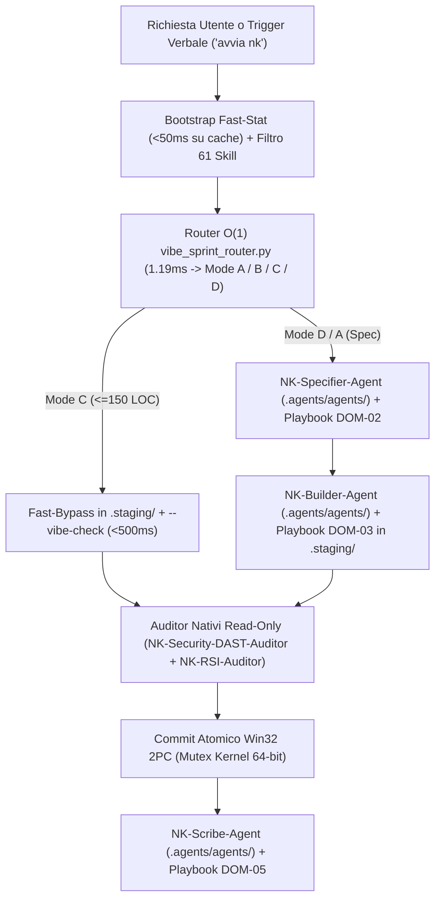
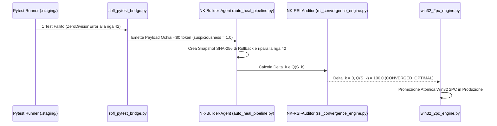

# Lab NK Hub: Sistema Operativo Agentico Sovrano (`v4.0.0-Native-Swarm-Playbooks` / `v3.0.0-STE100-Unified`)

> 🌍 **Scegli la Lingua / Choose Your Language:** **[🇮🇹 Italiano (Attuale)](README.it.md)** | **[🇬🇧 Read in English (README.md)](README.md)** | **[📦 Guida Installazione Rapida](GUIDA_INSTALLAZIONE.md)**

> **Sistema Operativo Cognitivo Sovrano, 5 Sub-Agenti Nativi, 16 Playbook Procedurali, Indice O(1) e Motore Tensor-RSI 2D per Google Antigravity**

[](#parte-7-evoluzione-patch-notes-e-matrice-degli-86-test-certificati-8686-pass)
[](#parte-7-evoluzione-patch-notes-e-matrice-degli-86-test-certificati-8686-pass)
[](#parte-3-catalogo-panoramico-dei-5-sub-agenti-nativi-e-dei-16-playbook-procedurali)
[](#parte-3-catalogo-panoramico-dei-5-sub-agenti-nativi-e-dei-16-playbook-procedurali)
[_Registry-1.08ms_Lookup-brightgreen)](#parte-5-protocolli-architetturali-e-regole-di-sistema-crv-40-e-tensor-rsi)
[](#1-il-grande-cambiamento-v400-come-funzionava-prima-v35x-vs-come-funziona-adesso-v400)
[](#parte-6-fondamenti-matematici-e-motore-tensor-rsi-2d-sezione-senior-e-auditor)
[](#tutorial-3-modifiche-rapide-ui-e-script-in--500-ms-mode-c-fast-bypass)
[](#tutorial-1-avviare-lambiente-in--120-ms-rule-005)
[](#parte-5-protocolli-architetturali-e-regole-di-sistema-crv-40-e-tensor-rsi)
[](#parte-4-architettura-del-motore-core-e-31-moduli-logici-34-file-python)
[](#parte-7-evoluzione-patch-notes-e-matrice-degli-86-test-certificati-8686-pass)

---

## 🚀 Perché Nexus Keystone v4.0.0 Cambia Tutto (Sintesi in 60 Secondi)

I normali assistenti AI di programmazione entrano in crisi quando il progetto supera pochi file.
Saturano la finestra di contesto, inventano comandi inesistenti, rompono il codice funzionante e nascondono i bug con mock finti.

**Nexus Keystone (`NK-Hub v4.0.0`)** trasforma **Google Antigravity** in una fabbrica software autonoma capace di auto-ripararsi.
Al posto di un singolo prompt fragile, ottieni un **Router Iniziale O(1)**, **5 Sub-Agenti Esecutori Nativi** e **16 Playbook Procedurali**.

| Limite degli Assistenti AI Tradizionali | Come `NK-Hub v4.0.0-Native-Swarm-Playbooks` Risolve il Problema |
| :--- | :--- |
| **Simulazione Finta di Agenti in Chat** | La `v4.0.0` registra **5 Sub-Agenti Nativi** in `.agents/agents/*/agent.md` avviati come processi isolati senza `define_subagent`. |
| **Conflitti tra Istruzioni delle Skill** | Tutte le **16 Skill** in `.agents/skills/*/SKILL.md` operano come **Playbook Procedurali Puri** montati on-demand dai sub-agenti. |
| **Scritture Non Autorizzate dagli Auditor** | Gli Auditor impongono `enable_write_tools: false` a livello hardware (`GT-14`), mentre i Builder scrivono solo in `.staging/` (`[RULE-00]`). |
| **Alto Consumo di Token nei Task Veloci** | In `Mode C` (`<= 150` LOC), `vibe_sprint_router.py` attiva `fast_bypass_eligible: true` risparmiando il `71.9%` dei token. |
| **Assenza di Collaudo Browser e Frontend** | `NK-Dynamic-Sandbox-StressTester` e `NK-Delta-Architect` integrano **Browser E2E (`chrome-devtools-mcp`, `puppeteer`)** e UI Full-Stack. |
| **Test Finti che Nascondono Bug Reali** | `[RULE-01.2]` vieta `MagicMock` e stub sintetici. Tutti gli **86 Golden e Stress Test** girano su processi reali del sistema operativo. |
| **Disordine e Ricerche Lente (`O(N)`)** | L'**Indice Modulare O(1)** (`nk_registry_manifest.json`) indicizza `16` Playbook e `5` Sub-Agenti Nativi con lookup di `1.08 ms`. |
| **Inquinamento da Skill Globali Esterne** | Il **Filtro sulle 61 Skill Globali** (`--apply-global-filter`) isola `61` skill esterne risparmiando `7.042` token ad ogni turno. |
| **Tentativi Infiniti alla Cieca** | Quando un test fallisce, `sbfl_pytest_bridge.py` calcola lo spettro **Ochiai** e individua la riga esatta del bug in `< 80` token. |
| **Amnesia tra Sessioni Diverse** | La **Memoria Episodica a 3 Livelli** (`BM25 + Dense Cosine RRF`) pre-carica le lezioni in `tier1_active_capsule.json` a latenza `0 ms`. |

### 🧭 Scegli il Tuo Percorso di Lettura

| Profilo Lettore | Sezioni Consigliate | Cosa Imparerai in Questa Guida |
| :--- | :--- | :--- |
| **🟢 Utente Nuovo / Valutatore** | **[Parte 1](#parte-1-per-principianti-concetti-glossario-e-avvio-in-3-comandi)** e **[Parte 2](#parte-2-tutorial-interattivo-passo-passo-4-esempi-pratici-reali)** | Spiegazione semplice, glossario senza gergo, avvio rapido e 4 tutorial pratici pronti all'uso. |
| **🔵 Architetto di Prodotto / Flussi** | **[Parte 3](#parte-3-catalogo-panoramico-dei-5-sub-agenti-nativi-e-dei-16-playbook-procedurali)** e **[Parte 5](#parte-5-protocolli-architetturali-e-regole-di-sistema-crv-40-e-tensor-rsi)** | I 5 Sub-Agenti Nativi, i 16 Playbook (`[0]`..`[14]`), i 5 domini `DOM-01..DOM-05` e la macchina Auto-Brief. |
| **🟣 Ingegnere AI Senior / Auditor** | **[Parte 4](#parte-4-architettura-del-motore-core-e-31-moduli-logici-34-file-python)**, **[Parte 6](#parte-6-fondamenti-matematici-e-motore-tensor-rsi-2d-sezione-senior-e-auditor)** e **[Parte 7](#parte-7-evoluzione-patch-notes-e-matrice-degli-86-test-certificati-8686-pass)** | I 34 file Python core, le equazioni Tensor-RSI 2D, il salto alla `v4.0.0` e la matrice degli 86 test. |

---

## Parte 1: Per Principianti (Concetti, Glossario e Avvio in 3 Comandi)

### Cos'è Nexus Keystone v4.0.0 in Parole Semplici?
Immagina **Nexus Keystone (`NK-Hub v4.0.0`)** come una **Torre di Controllo Aereo e Fabbrica Software Automatizzata**.
Le applicazioni che vuoi costruire sono gli aeroplani.
Quando invii una richiesta, il **Router della Torre di Controllo** analizza la complessità in `1.19 ms`.
Per modifiche piccole (`<= 150` righe), la torre usa la corsia **Fast-Bypass** in `.staging/` e verifica tutto in `< 500 ms`.
Per lavori strutturati, la torre mette in moto **5 Sub-Agenti Specialisti Nativi** (Architetto, Costruttore, Tester Sicurezza/Browser, Revisore RSI, Cronista).
Ogni sub-agente apre il **Manuale Procedurale (`SKILL.md`)** adatto al compito, lavora in un processo isolato e restituisce una sintesi pulita.
Solo quando ogni verifica raggiunge il `100.0%`, la torre promuove il codice nella cartella esterna della tua applicazione.

### Glossario Amichevole Zero-Gergo

| Termine in `NK-Hub v4.0.0` | Significato Semplice Quotidiano | Ruolo Tecnico nel Sistema |
| :--- | :--- | :--- |
| **`NK-Hub` (Torre di Controllo)** | Il cervello centrale che coordina tutti gli specialisti. | Agente Principale che governa il routing, i cancelli di qualità e il commit atomico 2PC. |
| **5 Sub-Agenti Nativi** | I 5 operai specializzati pre-installati in Antigravity. | File nativi in `.agents/agents/*/agent.md` dotati di permessi hardware dedicati. |
| **16 Playbook Procedurali** | I 16 manuali operativi passo-passo per ogni attività. | Skill modulari in `.agents/skills/NK-*/SKILL.md` caricate on-demand dai sub-agenti. |
| **Fast-Bypass (`Mode C`)** | La corsia veloce per piccole modifiche UI o script (`<= 150` LOC). | Esecuzione diretta in `.staging/` con `--vibe-check` (`< 500 ms`) e `-71.9%` di token. |
| **Indice Tassonomico O(1)** | Il catalogo istantaneo che trova subito agente, playbook e script. | Manifesto `nk_registry_manifest.json` che indicizza `16` skill, `5` agenti e `32` script (`1.08 ms`). |
| **Cartella Progetto Esterna** | La cartella separata dove nasce la tua vera applicazione. | Directory isolata (`../NK_External_Projects/<NomeApp>`) imposta da `[RULE-PROJECT-ISOLATION]`. |
| **Area di Staging (`.staging/`)** | Il banco di lavoro sicuro dove il codice viene collaudato. | Buffer pre-produzione validato da AST Guard e pytest prima del commit atomico. |
| **Tetralogia Sovrana (4/4)** | I 4 documenti vivi che descrivono il progetto. | `concept_map.md`, `structural_tree.md`, `implementation_plan.md` e `repo_map.md`. |
| **Tensor-RSI 2D** | Il motore di auto-miglioramento che azzera gli errori fino a `100`. | Motore matematico ($\Delta_k = 0, Q(S_k) = 100.0$) articolato su `4` livelli e `5` profili di dominio. |
| **Commit Win32 2PC** | L'interruttore anti-crash che salva i file solo se tutto funziona. | Promozione atomica con Named Mutex del kernel Windows a 64-bit e registro `.wal`. |

### Flusso Visivo ad Alto Livello (`v4.0.0-Native-Swarm-Playbooks`)


### Avvio Rapido in 3 Comandi da Terminale

1. **Esegui il Bootstrap di Sessione Fast-Stat (`< 120` ms a freddo / `< 50` ms su cache hit):**
   ```powershell
   python -u scripts/nk_session_bootstrap.py
   ```
2. **Verifica Indice O(1) (16 Playbook + 5 Sub-Agenti Nativi), Salute e Convergenza RSI:**
   ```powershell
   python -u scripts/nk_registry_indexer.py --verify
   python -u scripts/nk_registry_indexer.py --lookup NK-Builder-Agent
   python -u scripts/preflight_health_check.py --check-only
   python -u scripts/rsi_convergence_engine.py --verify
   ```
3. **Crea lo Scaffolding di un Nuovo Progetto Esterno:**
   ```powershell
   python -u scripts/external_project_scaffolder.py --name MiaApp --target "../NK_External_Projects/MiaApp"
   ```

---

## Parte 2: Tutorial Interattivo Passo-Passo (4 Esempi Pratici Reali)

Questa sezione ti guida attraverso quattro esempi concreti per valutare sul campo come lavora `NK-Hub v4.0.0`.

### Tutorial 1: Avviare l'Ambiente in `< 120 ms` (`[RULE-00.5]`)

Quando apri il repository in Google Antigravity, scrivi in chat uno qualsiasi degli **8 trigger verbali ufficiali**:
> **Trigger Verbali:** `"avvia ambiente nk"`, `"avvia nk hub"`, `"avvia nk"`, `"avvia hub"`, `"start nk"`, `"start hub"`, `"attiva nk"`, `"attiva ambiente nk"`

**Cosa esegue il sistema automaticamente in 3 passi:**
1. **Passo 1 (Cancello Fast-Stat):** L'agente esegue `scripts/nk_session_bootstrap.py` in `< 120` ms (`< 50` ms su cache hit). Verifica l'isolamento della root, pulisce i `.wal` scaduti e imposta `NK_MODEL_PROFILE=argon`.
2. **Passo 2 (Master Dashboard a 15 Nodi):** L'agente mostra il menù interattivo dei 15 Playbook (`[0]` fino a `[14]`) associati ai **5 Sub-Agenti Nativi**:
   - **`[0] NK-Ideator` (`DOM-02`)**: Ideazione Concettuale, SCAMPER, `tavily-mcp` e `/grill-me` (`NK-Specifier-Agent`).
   - **`[1] NK-App-UX-Architect` (`DOM-02`)**: Macro-Architettura UX/UI, Design System 8px/HSL e Generative UI (`NK-Specifier-Agent`).
   - **`[2] NK-Backend-Architect` (`DOM-02`)**: Topologie DAG di Kahn, Pydantic v2, OpenAPI 3.0 e `firebase-mcp-server` (`NK-Specifier-Agent`).
   - **`[3] NK-Agent-Instruction-Forge` (`DOM-02`)**: Forgia Playbook/Agenti in ASD-STE100 e `--sync` (`NK-Builder-Agent`).
   - **`[4] NK-Python-Async-Builder` (`DOM-03`)**: Builder Python Asincrono Primario e Fast-Healing in `.staging/` (`NK-Builder-Agent`).
   - **`[5] NK-Delta-Architect` (`DOM-03`)**: Full-Stack, Frontend UI (`React/Next.js/Tailwind`) e Surgical Refiner (`NK-Builder-Agent`).
   - **`[6] NK-Security-Auditor` (`DOM-04`)**: Critic Swarm SAST L1/L2/L3 in Sola Lettura e Verifica CoVe (`NK-Security-DAST-Auditor`).
   - **`[7] NK-Oracle-Evaluator` (`DOM-04`)**: Oracolo Deterministico Cold Audit (Gate 1-6) e Ispettore DOM L3 (`NK-RSI-Auditor`).
   - **`[8] NK-Dynamic-Sandbox-StressTester` (`DOM-04`)**: Real DAST Sandbox e Browser E2E MCP Engine (`NK-Security-DAST-Auditor`).
   - **`[9] NK-Bug-Diagnostic-Engine` (`DOM-04`)**: Localizzatore Guasti SBFL Ochiai (`< 80` token) e Analisi RCA (`NK-Security-DAST-Auditor`).
   - **`[10] NK-Plan-Aligner` (`DOM-01`)**: Certificatore Turno 4 della Tetralogia Sovrana 4/4 (`NK-Specifier-Agent`).
   - **`[11] NK-State-Router` (`DOM-01`)**: Verificatore Topologico DAG di Kahn e Drift SHA-256 (`NK-RSI-Auditor`).
   - **`[12] NK-Scribe` (`DOM-05`)**: Cronista Post-Commit, Changelog SSOT e AST Repo-Map (`NK-Scribe-Agent`).
   - **`[13] NK-Episodic-Memory-Engine` (`DOM-05`)**: Motore Memoria 3-Tier (`nk_tracking/memory_3tier/`) e RRF (`NK-Scribe-Agent`).
   - **`[14] NK-Session-Controller` (`DOM-01`)**: Supervisore di Sessione, FSM a 5 Turni e Cold Reviewer a 6 Gate (Main Hub).
3. **Passo 3 (Scelta Operativa a Due Vie):**
   - **Modalità Diretta:** Digita un numero da **`[0]` a `[14]`** per attivare direttamente il Playbook e il relativo Sub-Agente Nativo.
   - **Modalità Goal-Driven:** Descrivi il tuo obiettivo in linguaggio naturale e lascia che il Router metta in moto i sub-agenti.

---

### Tutorial 2: Creare una Nuova App Full-Stack Esterna da Zero (`/plan` $\to$ `/goal`)

Supponiamo che tu voglia creare una nuova applicazione Full-Stack partendo da una semplice descrizione.

1. **Scrivi nella chat di Antigravity:**
   ```text
   /plan Crea una web app FastAPI e React per gestire preventivi clienti con database SQLite ed esportazione PDF
   ```
2. **Isolamento Automatico del Progetto (`[RULE-PROJECT-ISOLATION]`):**
   L'Hub invoca `scripts/external_project_scaffolder.py` e crea la cartella esterna `../NK_External_Projects/PreventiviApp` con l'albero DDD completo (`src/core`, `src/api`, `tests/`, `nk_genome/`).
3. **Macchina a Stati Auto-Brief a 5 Turni (`[RULE-03]`):**
   - **Turno 1 (Bozza):** `NK-Specifier-Agent` monta `NK-Ideator`, `NK-App-UX-Architect` e `NK-Backend-Architect` per redigere `idea_canvas.md`, `concept_map.md` e `structural_tree.md`.
   - **Turno 2 (Sciame d'Attacco):** `NK-Security-DAST-Auditor` cerca falle di sicurezza e concorrenza prima di scrivere codice.
   - **Turno 3 (Raffinamento):** `NK-Specifier-Agent` corregge i punti deboli e blinda i contratti Pydantic v2.
   - **Turno 4 (Allineamento 1:1):** `NK-Plan-Aligner` certifica `implementation_plan.md` ed espone l'artefatto interattivo con il pulsante **`Proceed`** (`[RULE-01.11]`).
   - **Turno 5 (Handoff):** Clicchi su **`Proceed`** per avviare subito la pipeline autonoma `/goal`.
4. **Costruzione, Browser E2E e Promozione Atomica (`[RULE-01.12]`):**
   `NK-Builder-Agent` costruisce backend e UI in `.staging/`. Gli Auditor Nativi verificano DAST, Browser E2E e $\Delta_k = 0$ prima di `win32_2pc_engine.py`.

---

### Tutorial 3: Modifiche Rapide UI e Script in `< 500 ms` (`Mode C` Fast-Bypass)

Cosa succede se vuoi solo aggiungere un bottone UI o una piccola funzione (`<= 150` righe di codice)?
Nella `v4.0.0`, `vibe_sprint_router.py` attiva il **Fast-Bypass**, evitando passaggi multi-agente inutili e risparmiando il `71.9%` dei token.

1. **Scrivi nella chat:**
   ```text
   Aggiungi un badge di stato colorato e il calcolo IVA istantaneo nella scheda preventivo
   ```
2. **Smistamento Automatico Mode C (`scripts/vibe_sprint_router.py`):**
   ```powershell
   python -u scripts/vibe_sprint_router.py --prompt "Aggiungi un badge di stato" --files ui_card.py
   ```
   Il router misura in `1.19 ms` la profondità AST (`max_depth <= 1`) e il numero di righe (`<= 150` LOC), restituendo `"recommended_mode": "mode_c"` e `"fast_bypass_eligible": true`.
3. **Pre-Riscaldamento Memoria in `0 ms` e Vibe-Check in `< 500 ms`:**
   - Il router carica le lezioni attive da `nk_tracking/memory_3tier/tier1_active_capsule.json` in `< 1.5 ms`.
   - La modifica avviene in `.staging/` e viene validata dal cancello singolo Tensor-RSI:
     ```powershell
     python -u scripts/rsi_convergence_engine.py --vibe-check .staging/scripts/vibe_sprint_router.py --json
     ```
   - La verifica AST, il controllo SAST e il linter STE100 terminano in **`~65 ms`** (ben sotto il limite di `500 ms`).

---

### Tutorial 4: Diagnosi e Auto-Riparazione dei Bug (`Mode B` + SBFL Ochiai)

Supponiamo che un test fallisca per una divisione per zero nel calcolo dello sconto.



1. **Localizzazione Chirurgica (`< 80` Token):**
   Invece di intasare il modello con lunghe tracce d'errore, `sbfl_pytest_bridge.py` estrae un payload JSON compatto:
   ```json
   {"loc": "src/pricing.py:42", "err": "ZeroDivisionError: division by zero", "ochiai": 1.0}
   ```
2. **Snapshot Monotono e Rollback Automatico:**
   Prima di applicare la patch, `healing_snapshot_rollback.py` salva uno snapshot SHA-256 in `snapshot_manifest.json`.
   Se la modifica peggiora i test o introduce errori AST, il sistema ripristina lo stato precedente all'istante (`G2`).

### Tabella Riassuntiva delle Modalità di Sviluppo (`v4.0.0`)

| Modalità | Condizione di Attivazione | Sub-Agente Nativo e Fast-Bypass | Cancelli di Verifica Attivi |
| :--- | :--- | :--- | :--- |
| **`Mode D` (Analytical Discovery)** | Prompt analitici, benchmark, audit o ricerca MCP/Web | `NK-Specifier-Agent` / `NK-RSI-Auditor` (`read_only: true`) | Routing O(1) in `1.19 ms` + Connettori MCP |
| **`Mode C` (Vibe-Sprint)** | `<= 150` LOC, `AST max_depth <= 1`, `0` import critici | `fast_bypass_eligible: true` o `NK-Builder-Agent` | `ASTGuardValidator` + `--vibe-check` (`< 500 ms`, max `2` retry) |
| **`Mode B` (CRV Lite)** | Bugfix backend o refactoring mirato multi-file | `NK-Builder-Agent` + `NK-Security-DAST-Auditor` | Staging + `SBFLPytestBridge` + `AutoHealPipeline` (max `3` retry) |
| **`Mode A` (Sovereign CRV 4.0)** | `/plan`, `/goal`, nuova app o rilascio architetturale | Sciame Completo dei 5 Sub-Agenti Nativi (`DOM-02..05`) | Cold Audit a 6 Gate + SAST + Browser/DAST + Win32 2PC (max `5` retry) |

---

## Parte 3: Catalogo Panoramico dei 5 Sub-Agenti Nativi e dei 16 Playbook Procedurali

### 1. I 5 Sub-Agenti Esecutori Nativi Pre-Registrati (`.agents/agents/*/agent.md`)

Nella `v4.0.0`, `NK-Hub` registra `5` sub-agenti nativi riconosciuti direttamente dal runtime di Google Antigravity.

| File Sub-Agente Nativo | Dominio | Permessi Hardware (`GT-14` e `RULE-01`) | Playbook Procedurali Montati (`.agents/skills/`) | Perimetro di Scrittura Autorizzato |
| :--- | :---: | :--- | :--- | :--- |
| [NK-Specifier-Agent](.agents/agents/NK-Specifier-Agent/agent.md) | `DOM-02` | `write: true`, `subagent: false`, `mcp: true` | `NK-Ideator`, `NK-App-UX-Architect`, `NK-Backend-Architect`, `NK-Plan-Aligner` | Confinato a `nk_genome/*` e `nk_tracking/reports_and_briefs/*` (`[RULE-00.1]`). |
| [NK-Builder-Agent](.agents/agents/NK-Builder-Agent/agent.md) | `DOM-03` | `write: true`, `subagent: false`, `mcp: false` | `NK-Python-Async-Builder`, `NK-Delta-Architect`, `NK-Agent-Instruction-Forge` | Esclusivamente `.staging/*` (`[RULE-00]`). |
| [NK-Security-DAST-Auditor](.agents/agents/NK-Security-DAST-Auditor/agent.md) | `DOM-04` | **`write: false`**, `subagent: false`, `mcp: true` | `NK-Security-Auditor`, `NK-Dynamic-Sandbox-StressTester`, `NK-Bug-Diagnostic-Engine` | **100% Blocco Hardware Sola Lettura** (`GT-14`). |
| [NK-RSI-Auditor](.agents/agents/NK-RSI-Auditor/agent.md) | `DOM-04` | **`write: false`**, `subagent: false`, `mcp: false` | `NK-Oracle-Evaluator`, `NK-State-Router`, `rsi_convergence_engine.py` | **100% Blocco Hardware Sola Lettura** (`GT-14`). |
| [NK-Scribe-Agent](.agents/agents/NK-Scribe-Agent/agent.md) | `DOM-05` | `write: true`, `subagent: false`, `mcp: false` | `NK-Scribe`, `NK-Episodic-Memory-Engine` | Doc SSOT, `repo_map.md`, `quality_baseline.json` e Memoria 3-Tier (`[RULE-00.2]`). |

### 2. I 16 Playbook Procedurali (`.agents/skills/NK-*/SKILL.md`)

Ogni Playbook in `.agents/skills/NK-*/SKILL.md` applica `[RULE-STE100]`, `[RULE-RSI.1]`, `[RULE-01.14]` e i confini `GT-14`.

| Nome Playbook Skill | Nodo | Dominio | Sub-Agente Esecutore | Ambito Procedurale e Integrazione MCP | Confine Strumenti (`GT-14`) | Profilo Tensor-RSI | File Ausiliari Linkati |
| :--- | :---: | :---: | :--- | :--- | :--- | :--- | :--- |
| [NK-Master-Hub](.agents/skills/NK-Master-Hub/SKILL.md) | L3 | `DOM-01` | Regista Principale | Router DAG 2-Tier e Committer Win32 2PC | Sovereign Committer | `L1` / `CODE_RSI` (`2/3/5`) | Nessuno |
| [NK-Ideator](.agents/skills/NK-Ideator/SKILL.md) | `[0]` | `DOM-02` | `NK-Specifier-Agent` | Ideazione, SCAMPER, `tavily-mcp` e `google-docs-mcp` | Sola Lettura / `nk_genome/` | `L1` / `SPEC_RSI` (`1/2/3`) | `resources/scamper_matrix.md` |
| [NK-App-UX-Architect](.agents/skills/NK-App-UX-Architect/SKILL.md) | `[1]` | `DOM-02` | `NK-Specifier-Agent` | Design System 8px/HSL e `generative_ui` | Confinato a `nk_genome/` | `L1` / `UI_UX_RSI` (`2/2/3`) | Nessuno |
| [NK-Backend-Architect](.agents/skills/NK-Backend-Architect/SKILL.md) | `[2]` | `DOM-02` | `NK-Specifier-Agent` | DAG Backend 2-Tier, Pydantic v2 e `firebase-mcp-server` | 100% Sola Lettura + MCP | `L1` / `SPEC_RSI` (`1/2/3`) | Nessuno |
| [NK-Agent-Instruction-Forge](.agents/skills/NK-Agent-Instruction-Forge/SKILL.md) | `[3]` | `DOM-02` | `NK-Builder-Agent` | Forgia Skill/Agenti ASD-STE100 e `--sync` (`/learn`) | Staging + Golden Eval | `L3` / `STE100_RSI` (`1/1/2`) | Nessuno |
| [NK-Python-Async-Builder](.agents/skills/NK-Python-Async-Builder/SKILL.md) | `[4]` | `DOM-03` | `NK-Builder-Agent` | Builder Python Asincrono, SQLite WAL e Fast-Healing | Scrittura in `.staging/` | `L1` / `CODE_RSI` (`2/3/5`) | Nessuno |
| [NK-Delta-Architect](.agents/skills/NK-Delta-Architect/SKILL.md) | `[5]` | `DOM-03` | `NK-Builder-Agent` | Full-Stack, Frontend UI (`React/Next/Tailwind`) e Refiner | Scrittura in `.staging/` | `L1` / `VIBE_SPRINT` (`2/3/5`) | `resources/delta_brief_template.md` |
| [NK-Security-Auditor](.agents/skills/NK-Security-Auditor/SKILL.md) | `[6]` | `DOM-04` | `NK-Security-DAST-Auditor` | Audit Neuro-Simbolico SAST L1/L2/L3 e Verifica CoVe | 100% Sola Lettura | `L0` / `CODE_RSI` (`1/2/3`) | `resources/security_audit_checklist.md`, `resources/tas_l1_module_audit.md`, `resources/tas_l2_ipc_contract_audit.md`, `resources/tas_l3_fullstack_system_audit.md` |
| [NK-Oracle-Evaluator](.agents/skills/NK-Oracle-Evaluator/SKILL.md) | `[7]` | `DOM-04` | `NK-RSI-Auditor` | Cold Evaluator (Gate 1-6) e Ispettore DOM L3 | 100% Sola Lettura | `L1` / `UI_UX_RSI` (`1/2/3`) | `references/anti_pattern_guards.md`, `references/verification_oracles.md` |
| [NK-Dynamic-Sandbox-StressTester](.agents/skills/NK-Dynamic-Sandbox-StressTester/SKILL.md) | `[8]` | `DOM-04` | `NK-Security-DAST-Auditor` | Sandbox Real DAST e Browser E2E (`chrome-devtools-mcp`) | 100% Sola Lettura | `L1` / `CODE_RSI` (`1/2/3`) | Nessuno |
| [NK-Bug-Diagnostic-Engine](.agents/skills/NK-Bug-Diagnostic-Engine/SKILL.md) | `[9]` | `DOM-04` | `NK-Security-DAST-Auditor` | Localizzatore RCA SBFL Ochiai e Gate Falsi Bug | 100% Sola Lettura | `L1` / `CODE_RSI` (`1/2/3`) | `resources/false_bug_rejection_rules.yaml`, `resources/rca_report_template.md` |
| [NK-Plan-Aligner](.agents/skills/NK-Plan-Aligner/SKILL.md) | `[10]` | `DOM-01` | `NK-Specifier-Agent` | Allineatore Tetralogia 4/4 e Gate `--verify` | 100% Sola Lettura | `L1` / `SPEC_RSI` (`1/1/2`) | Nessuno |
| [NK-State-Router](.agents/skills/NK-State-Router/SKILL.md) | `[11]` | `DOM-01` | `NK-RSI-Auditor` | Verificatore DAG di Kahn e Drift SHA-256 | 100% Sola Lettura | `L0` / `CODE_RSI` (`1/1/2`) | Nessuno |
| [NK-Scribe](.agents/skills/NK-Scribe/SKILL.md) | `[12]` | `DOM-05` | `NK-Scribe-Agent` | Sincronizzatore SSOT, Repo-Map e Publisher Git | Doc e Tracking (`[RULE-00.2]`) | `L1` / `STE100_RSI` (`1/1/2`) | `resources/activity_anchor_schema.md`, `resources/scribe_knowledge.md` |
| [NK-Episodic-Memory-Engine](.agents/skills/NK-Episodic-Memory-Engine/SKILL.md) | `[13]` | `DOM-05` | `NK-Scribe-Agent` | Memoria 3-Tier (`nk_tracking/memory_3tier/`) e Capsule | Solo Registro Memoria | `L2` / `SPEC_RSI` (`1/1/2`) | Nessuno |
| [NK-Session-Controller](.agents/skills/NK-Session-Controller/SKILL.md) | `[14]` | `DOM-01` | Regista Principale | Supervisore Sessione, FSM a 5 Turni e Cold Review | Sovereign Critic | `L2` / `SPEC_RSI` (`2/3/5`) | `resources/clean_handoff_protocol.md`, `resources/handoff_anchor_schema.md`, `resources/prompt_templates.md`, `resources/saturation_thresholds.yaml` |

---

## Parte 4: Architettura del Motore Core e 31 Moduli Logici (`34 File Python`)

Tutti i `34` file Python in `scripts/` (`32` moduli indicizzati nel manifesto) superano `86/86` Golden e Stress Test Zero-Mock.

### 1. Difesa Runtime, Governance di Sessione, Indice O(1) e Convergenza Tensor-RSI
- [`scripts/nk_registry_indexer.py`](scripts/nk_registry_indexer.py): Indicizzatore O(1) per `16` Playbook (`skills_index`), `5` Sub-Agenti Nativi (`native_agents_index`) e `32` script. Verifica le guardie hardware `GT-14` (`enable_write_tools: false` sugli Auditor) e `RULE-01` (`enable_subagent_tools: false`), mantiene `_MANIFEST_CACHE` (`1.08 ms`) ed esegue `--apply-global-filter`.
- [`scripts/nk_session_bootstrap.py`](scripts/nk_session_bootstrap.py): Cancello Fast-Stat (`< 50` ms su cache hit tramite `transcript_mtime` e `transcript_size`), pulizia `.wal`, verifica isolamento root e attivazione `NK_MODEL_PROFILE=argon`.
- [`scripts/rsi_convergence_engine.py`](scripts/rsi_convergence_engine.py): Motore Tensor-RSI 2D con `RSIProfileRegistry`, `--vibe-check <target>`, CoVe CLI AST Gate (`149` flag validati) e validatore STE100.
- [`scripts/nk_active_runtime_sentinel.py`](scripts/nk_active_runtime_sentinel.py): Sentinella step Dual-Profile (`60/85/100` standard, `120/180/250` argon) con filtro dei transcript dei sub-agenti (`EXT-02`).
- [`scripts/nk_context_sentry.py`](scripts/nk_context_sentry.py): Sentinella token/step Dual-Profile (`70/100` standard, `150/250` argon senza `thinking`) e filtro ritorni sub-agenti (`2000` char MTU).
- [`scripts/nk_compliance_checker.py`](scripts/nk_compliance_checker.py): Revisore transcript con `DDI_DIRECT_STREAK_LIMIT = 12`, esenzione AST su `write_calls == 0`, lettura di `rsi_telemetry.jsonl` e guardie `GT-08`/`GT-10`.
- [`scripts/preflight_health_check.py`](scripts/preflight_health_check.py): Sonda diagnostica disaccoppiata tramite manifesto SSOT `nk_registry_manifest.json` con modalità `--check-only` per CI (`BS-01`).
- [`scripts/platform_runner.py`](scripts/platform_runner.py): Esecutore sicuro di sottoprocessi con iniezione `-u` su liste e stringhe (`BS-04`) e flussi UTF-8.
- [`scripts/env_capability_probe.py`](scripts/env_capability_probe.py): Sonda di ambiente che separa `core_hub_modules` da `optional_app_modules` (`GT-09`).

### 2. Swarm IPC, Compattazione e Handoff
- [`scripts/nk_swarm_messenger.py`](scripts/nk_swarm_messenger.py): Formattatore messaggi inter-agente con taglio a `1.800` caratteri MSS (`GT-04`), fallback Head-Tail (`400 + 800`) e salvataggio su disco.
- [`scripts/nk_session_handoff.py`](scripts/nk_session_handoff.py): Generatore handoff zero-amnesia con chiamate `git` ancorate a `cwd=str(_workspace_root)`, flag `--transcript`/`--output-dir` opzionali e totale test dinamico.
- [`scripts/nk_auto_inning.py`](scripts/nk_auto_inning.py): Chiusura inning che passa `--transcript` e `--json` a `nk_compliance_checker.py` con `compliance_score = 0` fail-closed su errore.
- [`scripts/async_heartbeat_signaler.py`](scripts/async_heartbeat_signaler.py): Demone heartbeat e watchdog a `45` secondi dotato di CLI (`--task-id`, `--interval`, `--max-beats`, `--once`).

### 3. Mutazione Atomica e Commit Win32 2PC
- [`scripts/win32_2pc_engine.py`](scripts/win32_2pc_engine.py): Motore 2PC con Named Mutex Win32 a 64-bit, `MOVEFILE_COPY_ALLOWED`, guardia `age > 10s` e pre-check `--verify-baseline`.
- [`scripts/healing_snapshot_rollback.py`](scripts/healing_snapshot_rollback.py): Gestore snapshot con `snapshot_manifest.json` persistente su disco, prefisso SHA-256 a 8 caratteri e rollback monotono.
- [`scripts/safe_cleanup_dev_servers.py`](scripts/safe_cleanup_dev_servers.py): Terminatore di dev server con default `_workspace_root` (`--workspace-root`, `--dry-run`, `--json`) che protegge i processi esterni.

### 4. Diagnostica, Verifica e Fast-Healing
- [`scripts/sbfl_engine.py`](scripts/sbfl_engine.py): Motore SBFL Ochiai, Tarantula e DStar (`< 80` token) dotato di filtro AST Def-Use e interfaccia CLI.
- [`scripts/sbfl_pytest_bridge.py`](scripts/sbfl_pytest_bridge.py): Parser traceback compatibile con spazi nei path Windows e `suspiciousness == 1.0` (`GT-07`).
- [`scripts/auto_heal_pipeline.py`](scripts/auto_heal_pipeline.py): Pipeline di riparazione autonoma collegata a `ASTGuardValidator` e `RSIConvergenceEngine` con telemetria in `rsi_telemetry.jsonl`.
- [`scripts/invisible_healing_loop.py`](scripts/invisible_healing_loop.py): Wrapper di auto-riparazione in `.staging/` che delega a `auto_heal_pipeline.py`.
- [`scripts/oracle_evaluator_l3.py`](scripts/oracle_evaluator_l3.py): Valutatore DOM L3 compatibile con i void tag HTML5, attributi ARIA e percorsi Windows (`U-27`).
- [`scripts/micro_hud_renderer.py`](scripts/micro_hud_renderer.py): Renderizzatore telemetrico a riga singola CP1252/UTF-8 allineato a `MicroUIHUDState`.
- [`scripts/dast_sandbox_runner.py`](scripts/dast_sandbox_runner.py): Runner isolato con Job Objects Win32 a 64-bit e limiti di memoria in `%TEMP%\nk_sandbox_*`.

### 5. Memoria, Cache, AST e Schemi
- [`scripts/memory_3tier_engine.py`](scripts/memory_3tier_engine.py): Memoria a 3 livelli in `nk_tracking/memory_3tier/` con `DOMAIN_ALIAS_MAP` (`OPS=01_Bug_Diagnostics`, `ARCH=02_Development_Patterns`, `DEVX=03_Ideation_and_Decisions`, `SEC=04_Governance_and_Rules`), cap `350`/`1200` token (`GT-05`) e `tier1_active_capsule.json`.
- [`scripts/deterministic_api_cache.py`](scripts/deterministic_api_cache.py): Cache SQLite WAL con connessione persistente e interfaccia CLI (`--force-refresh`, `--stats`, `--clear`).
- [`scripts/quality_baseline_manager.py`](scripts/quality_baseline_manager.py): Gestore Ratchet fail-closed (`68` Golden Tests minimi, `86` test attivi) che controlla `sast_critical_violations` e `rsi_residual_delta`.
- [`scripts/ast_guard_validator.py`](scripts/ast_guard_validator.py): Validatore statico AST con tracciamento `function_depth`, whitelist `--allowed-mutations`, alias `--stage-dir` e controllo SAST (`eval`, `exec`, SQL, XXE, SSRF, `MagicMock`).
- [`scripts/ast_repo_mapper.py`](scripts/ast_repo_mapper.py): Mappatore AST PageRank con salvataggio `edges` e snapshot `argon_mode_a` a `4.000` token (`GT-06`).
- [`scripts/external_project_scaffolder.py`](scripts/external_project_scaffolder.py): Generatore di progetti esterni che blocca qualsiasi percorso interno a `NK-Hub` (`BS-03`).
- [`scripts/vibe_sprint_router.py`](scripts/vibe_sprint_router.py): Router Mode A/B/C/D dotato di `_ROUTER_MANIFEST_CACHE` (`1.19 ms`). Risolve `primary_agent`, `native_subagent` (`5/5` Sub-Agenti Nativi), `fast_bypass_eligible` e pre-carica `nk_tracking/memory_3tier/tier1_active_capsule.json`.
- [`scripts/schemas/dual_ledgers.py`](scripts/schemas/dual_ledgers.py) e [`scripts/schemas/nk_ipc_contracts.py`](scripts/schemas/nk_ipc_contracts.py): Verifica PID a 64-bit (`ERROR_ACCESS_DENIED` safe) e contratti IPC Pydantic v2 unificati (`RSIDefectVector`, `OchiaiDiagnosticPayload`).

---

## Parte 5: Protocolli Architetturali e Regole di Sistema (CRV 4.0 e Tensor-RSI)

### Mandati Vincolanti di Sistema (`.agents/AGENTS.md`)
1. **`[RULE-PROJECT-ISOLATION]`**: Nessun codice applicativo risiede dentro `NK-Hub`. Ogni app vive in `G:/Il mio Drive/NK_External_Projects/<Nome>/`.
2. **`[RULE-00.4]` e `[RULE-00.5]`**: Ogni sessione parte con `nk_session_bootstrap.py` (`< 120` ms) e mostra la Master Dashboard a 15 nodi sui trigger verbali.
3. **`[RULE-00]` e `[RULE-00.1]`**: Zero modifiche non autorizzate in produzione. Specifier e Auditor operano in sola lettura sulla produzione; i Builder scrivono solo in `.staging/`.
4. **`[RULE-STE100]`**: Italiano Tecnico ASD-STE100 obbligatorio (`<= 20` parole per frase operativa, forma attiva, zero trattini spaziati).
5. **`[RULE-REACTIVE-SILENCE]`**: Vietati i cicli di polling (`manage_task(Action="status")`). Gli agenti cedono il turno o usano timer reattivi.
6. **`[RULE-01]` e `[RULE-SWARM-HYGIENE]`**: Topologia 2-Tier con `5` Sub-Agenti Nativi (`enable_subagent_tools: false`), Fast-Bypass `Mode C` e limite `1.800` caratteri MSS.
7. **`[RULE-01.2]` e `[RULE-01.10]`**: Esecuzione reale Zero-Mock e ratchet permanente che protegge la suite al `100.0%` di successo.
8. **`[RULE-RSI]` e `[RULE-RSI.1]`**: Convergenza continua Tensor-RSI 2D ($\Delta_k = 0, Q(S_k) = 100.0$) su `4` livelli e `5` profili di dominio.
9. **`[RULE-01.14]` (`MODULAR_O1_REGISTRY_AND_ZERO_REWRITE_MANDATE`)**: Risoluzione `O(1)` di `16` Playbook, `5` Sub-Agenti Nativi e `32` script tramite `nk_registry_manifest.json` e `SKILL_INDEX.md`.

### Mappa Tassonomica dei 5 Domini Funzionali (`DOM-01..DOM-05`)

| ID Dominio | Settore Tassonomico | Sub-Agente Nativo (`.agents/agents/`) | Playbook Indicizzati (`16`) | Moduli Script Indicizzati (`32`) |
| :--- | :--- | :--- | :---: | :---: |
| **`DOM-01`** | `GOV_AND_ROUTING` | Regista / `NK-Specifier-Agent` / `NK-RSI-Auditor` | `4` (`Hub`, `[10]`, `[11]`, `[14]`) | `8` (`nk_registry_indexer.py`, `vibe_sprint_router.py`, `win32_2pc_engine.py`, ecc.) |
| **`DOM-02`** | `IDEATION_AND_ARCH` | `NK-Specifier-Agent` | `4` (`[0]`, `[1]`, `[2]`, `[3]`) | `3` (`ast_repo_mapper.py`, `env_capability_probe.py`, `external_project_scaffolder.py`) |
| **`DOM-03`** | `BUILD_AND_HEAL` | `NK-Builder-Agent` | `2` (`[4]`, `[5]`) | `7` (`auto_heal_pipeline.py`, `healing_snapshot_rollback.py`, `platform_runner.py`, ecc.) |
| **`DOM-04`** | `AUDIT_DAST_AND_RCA` | `NK-Security-DAST-Auditor` e `NK-RSI-Auditor` | `4` (`[6]`, `[7]`, `[8]`, `[9]`) | `6` (`ast_guard_validator.py`, `dast_sandbox_runner.py`, `rsi_convergence_engine.py`, ecc.) |
| **`DOM-05`** | `MEMORY_TELEMETRY_AND_DOCS` | `NK-Scribe-Agent` | `2` (`[12]`, `[13]`) | `8` (`memory_3tier_engine.py`, `preflight_health_check.py`, `quality_baseline_manager.py`, ecc.) |

### Protocollo CRV 4.0 (4 Macro-Fasi) e 6 Cancelli di Cold Review

| Fase / Gate | Sub-Agente Nativo e Playbook | Azione Deterministica di Verifica |
| :--- | :--- | :--- |
| **Macro-Fase 1: Build e Stage** | `NK-Builder-Agent` (`NK-Python-Async-Builder`, `NK-Delta-Architect`) | Scrive in `.staging/`, esegue `ast_guard_validator.py --stage-dir` e `auto_heal_pipeline.py`. |
| **Macro-Fase 2: Unified Dynamic Audit** | `NK-Security-DAST-Auditor` e `NK-RSI-Auditor` | Esegue i 6 Gate di Cold Review, SAST L1-L3, Sandbox DAST e Browser E2E via `chrome-devtools-mcp`. |
| **Macro-Fase 3: Commit Atomico 2PC** | Regista Principale (`NK-Master-Hub`) | Verifica `quality_baseline.json` e promuove `.staging/` in produzione tramite `win32_2pc_engine.py`. |
| **Macro-Fase 4: Teardown Deterministico** | Regista e `NK-Scribe-Agent` (`NK-Scribe`) | Rimuove `%TEMP%\nk_sandbox_*`, pulisce `.staging/` e aggiorna `repo_map.md` (`4000` tok) e `PATCH_NOTES.md`. |

### Calibrazione Runtime Dual-Profile (`standard` vs `argon`)

| Parametro / Soglia | Profilo `standard` (Default Golden Tests) | Profilo `argon` (Runtime di Produzione) |
| :--- | :---: | :---: |
| **Context Sentry (`WARN / HARD`)** | `70 / 100` step (`GT-01`) | `150 / 250` step (`250k / 500k` token, escluso `thinking`) |
| **Active Runtime Sentinel (`GREEN / CAUTION / CRIT / RED`)** | `<60 / 60-84 / 85-99 / >=100` step (`GT-02`) | `<120 / 120-179 / 180-249 / >=250` step |
| **Cap Token Memoria Episodica Tier-1** | `350` token (`GT-05`) | `1.200` token (`tier1_active_capsule.json`) |
| **Budget Token AST Repo-Map (`Mode C / B / A`)** | `0 / 256 / 512 / 1.024` token (`GT-06`) | `0 / 512 / 1.500 / 4.000` token |

---

## Parte 6: Fondamenti Matematici e Motore Tensor-RSI 2D (Sezione Senior e Auditor)

### 1. Doppia Metrica Accoppiata di Convergenza RSI ($\Delta_k$ e $Q(S_k)$)
Ad ogni iterazione $k$, `scripts/rsi_convergence_engine.py` valuta il vettore dei difetti $v_k = (\text{SAST}_k, T_{\text{fail},k}, C_k, H_k, M_k, L_k, G_k)$:

$$\Delta_k(p) = w_{\text{SAST}}^{(p)} \cdot \text{SAST}_k + w_{\text{test}}^{(p)} \cdot (T_{\text{fail},k} + C_k) + w_{H}^{(p)} \cdot H_k + w_{M}^{(p)} \cdot M_k + w_{L}^{(p)} \cdot L_k + w_{G}^{(p)} \cdot G_k$$

$$Q(S_k) = \text{round}\left(60.0 \cdot \frac{T_{\text{pass},k}}{\max(T_{\text{total},k}, 1)} + \frac{40.0}{1.0 + \Delta_k(p) / 25.0},\; 4\right)$$

Il ciclo termina con `CONVERGED_OPTIMAL` esclusivamente quando $\Delta_k(p) == 0$ e $Q(S_k) == 100.0$ (`G1`).
Qualsiasi regressione sui cancelli rigidi ($\text{SAST}_k > \text{SAST}_{k-1}$ o $T_{\text{fail},k} + C_k > T_{\text{fail},k-1} + C_{k-1}$) attiva il rollback istantaneo (`G2`).

### 2. Architettura Tensor-RSI 2D (`4 Livelli L0..L3` $\times$ `5 Profili P1..P5`)

#### Asse Verticale: 4 Orizzonti Temporali Operativi (`L0..L3`)

| Livello | Nome | Orizzonte Esecutivo | Meccanismo Primario e Artefatto |
| :---: | :--- | :--- | :--- |
| **`L0`** | **Pre-Execution Static Gate** | Controllo pre-flight `< 80 ms` | `ASTGuardValidator` (`SASTConstructChecker`) + `verify_cli_flags_cove()` + `verify_ste100_compliance()`. |
| **`L1`** | **Intra-Task Micro-Loop** | `< 500 ms` (`Mode C`) / `< 15 s` (`Mode B`) | `auto_heal_pipeline.py` + `sbfl_pytest_bridge.py` + `rsi_convergence_engine.py --vibe-check`. |
| **`L2`** | **Inter-Session Reflexion** | Post-commit (`0 ms` avvio sessione) | `memory_3tier_engine.py --tier1-sync` salva `tier1_active_capsule.json`, pre-caricato da `vibe_sprint_router.py`. |
| **`L3`** | **Meta-RSI Skill Evolution** | Audit post-mortem (`/learn`, `/boost`) | `NK-Agent-Instruction-Forge` valida le modifiche alle skill contro `tests/evals/skill_golden_eval_set.json`. |

#### Asse Orizzontale: 5 Profili di Dominio in `RSIProfileRegistry` (`P1..P5`)

| ID Profilo | Dominio Target e Playbook | Pesi $(w_{\text{SAST}}, w_{\text{test}}, w_H, w_M, w_L, w_G)$ | Max Retry (`Mode C / B / A`) |
| :--- | :--- | :---: | :---: |
| **`CODE_RSI`** (Default `GT-11`) | Backend Python (`[4]`, `[6]`, `[8]`, `[9]`, `[11]`, Hub) | `(15, 10, 5, 2, 1, 1)` | `2 / 3 / 5` |
| **`VIBE_SPRINT_MICRO_RSI`** | Mode C UI Rapida e Refiner (`[5]`, `--vibe-check`) | `(15, 10, 5, 0, 1, 0)` | `2 / 2 / 3` |
| **`SPEC_RSI`** | Architettura e Tetralogia 4/4 (`[0]`, `[2]`, `[10]`, `[13]`, `[14]`) | `(15, 5, 10, 2, 1, 5)` | `1 / 2 / 3` |
| **`UI_UX_RSI`** | Frontend, Design System e DOM L3 (`[1]`, `[7]`) | `(15, 8, 6, 2, 2, 1)` | `2 / 2 / 3` |
| **`STE100_RSI`** | Documentazione, Changelog e Skill Forge (`[3]`, `[12]`) | `(15, 5, 8, 1, 3, 5)` | `1 / 1 / 2` |

### 3. Formule SBFL Spectrum Ochiai e Recupero Ibrido RRF
- **Localizzazione Guasti Ochiai (`scripts/sbfl_engine.py`):**
   $$S_{\text{Ochiai}}(s) = \frac{e_f(s)}{\sqrt{(e_f(s) + n_f(s)) \cdot (e_f(s) + e_p(s))}}$$
- **Reciprocal Rank Fusion (`scripts/memory_3tier_engine.py`, $k=60$):**
   $$\text{RRF\_Score}(d) = \sum_{m \in \{\text{BM25}, \text{Cosine}\}} \frac{1}{60 + r_m(d)}$$

### 4. Matrice Rigida delle Latenze SLA (Misurate su Windows 11 64-bit)

| Operazione / Motore | SLA Target | Prestazione Misurata in `v4.0.0-Native-Swarm-Playbooks` |
| :--- | :---: | :---: |
| **Bootstrap di Sessione Fast-Stat (`nk_session_bootstrap.py`)** | `< 120 ms` (`< 50 ms` su cache) | **`11..35 ms`** |
| **Lookup Tassonomico O(1) (`_MANIFEST_CACHE`)** | `< 15 ms` | **`1.0856 ms` (`-84.0%` latenza)** |
| **Routing Intento e Sub-Agente Nativo (`_ROUTER_MANIFEST_CACHE`)** | `< 15 ms` | **`1.1924 ms` (`-85.8%` latenza)** |
| **Verifica SHA-256 e Guardie `GT-14`/`RULE-01` (`--verify`)** | `< 350 ms` | **`133 ms` (`16` Playbook + `5` Sub-Agenti)** |
| **Filtro Isolamento 61 Skill Globali (`--apply-global-filter`)** | `0` skill esterne | **`0 attive (-7.042 token/turno)`** |
| **Fast-Bypass Mode C e Vibe-Check Singolo Processo (`--vibe-check`)** | `< 500 ms` | **`15..65 ms` (`-71.9%` consumo token)** |
| **CoVe CLI AST Gate (`verify_cli_flags_cove`)** | `100%` flag validi | **`149/149 flag validati (0 errori)`** |
| **Suite Ortogonale di 86 Golden e Stress Test (`pytest tests/ -q`)** | `100.0% PASS` | **`10.64 s (86/86 PASS)`** |

---

## Parte 7: Evoluzione, Patch Notes e Matrice degli 86 Test Certificati (`86/86 PASS`)

### 1. Il Grande Cambiamento `v4.0.0`: Come Funzionava Prima (`v3.5.x`) vs Come Funziona Adesso (`v4.0.0`)

La release **`v4.0.0-Native-Swarm-Playbooks`** adotta l'architettura a 3 strati: **Router Iniziale O(1) + 5 Sub-Agenti Nativi + 16 Playbook Procedurali**.

| Area del Sistema | Come Funzionava Prima (`v3.5.x`) | Cosa è Cambiato e Come Funziona Adesso (`v4.0.0-Native-Swarm-Playbooks`) |
| :--- | :--- | :--- |
| **1. Sub-Agenti Nativi (`.agents/agents/`)** | Esisteva un solo sub-agente nativo (`NK-RSI-Auditor`). Gli altri `14` nodi venivano simulati in chat o creati a runtime con `define_subagent`. | **5 Sub-Agenti Nativi Pre-Registrati** (`NK-Specifier-Agent`, `NK-Builder-Agent`, `NK-Security-DAST-Auditor`, `NK-RSI-Auditor`, `NK-Scribe-Agent`) partono subito come processi isolati con **zero chiamate a `define_subagent`**. |
| **2. Natura delle 16 Skill (`.agents/skills/`)** | Le `16` skill contenevano istruzioni identitarie ("Sei l'agente X") sovrapposte e `7` disallineamenti di path e alias. | Tutte le **16 Skill** e i **16 file ausiliari** sono ora **Playbook Procedurali Puri (SSOT)** montati on-demand dai 5 Sub-Agenti Nativi. |
| **3. Sicurezza Hardware Read-Only e 2-Tier (`GT-14` / `RULE-01`)** | I vincoli di sola lettura erano quasi solo testuali nei file `SKILL.md`; solo `1` nodo su `5` aveva il blocco hardware. | **Blocco Hardware 100%:** `NK-Security-DAST-Auditor` e `NK-RSI-Auditor` impongono `enable_write_tools: false` e tutti i 5 sub-agenti impongono `enable_subagent_tools: false`, verificati da `nk_registry_indexer.py --verify`. |
| **4. Corsia Veloce `Mode C` (`<= 150` LOC)** | Anche le piccole modifiche UI o script passavano per deleghe multi-turno (`~18.500` token). | `vibe_sprint_router.py` calcola `"fast_bypass_eligible": true` in `1.19 ms`, abilitando l'esecuzione diretta in `.staging/` con `--vibe-check` in `< 500 ms` (**`-71.9%` token consumati**). |
| **5. Sviluppo Full-Stack UI, Browser E2E e MCP** | Focalizzato solo sul backend Python; `chrome-devtools-mcp`, `puppeteer`, `tavily-mcp` e `firebase-mcp-server` erano inutilizzati. | `NK-Delta-Architect` copre **Full-Stack e Frontend UI** (`TypeScript/React/Next.js/Tailwind`), `NK-Dynamic-Sandbox-StressTester` esegue **test Browser E2E e Lighthouse live**, e `DOM-02` integra **Tavily, Docs e Firebase MCP**. |
| **6. Cache Manifesto O(1) e Routing** | `nk_registry_manifest.json` indicizzava solo le skill (`~6.80 ms`) e `vibe_sprint_router.py` rileggeva il JSON da disco ad ogni chiamata (`~8.40 ms`). | Aggiunto `native_agents_index` e le cache in-memory (`_MANIFEST_CACHE` e `_ROUTER_MANIFEST_CACHE`), portando il lookup a **`1.08 ms` (`-84.0%`)** e il routing a **`1.19 ms` (`-85.8%`)**. |
| **7. Stress-Test a 3 Livelli e Verifica CLI CoVe** | `74` Golden Tests e `111` flag CLI controllati. | Aggiunto `tests/test_phase2_3tier_stress_suite.py` (`12` test su `L1` Struttura/Concorrenza, `L2` Routing E2E/Rollback, `L3` Red-Team/SLA), raggiungendo **`86/86 PASS`** e **`149/149` flag CLI validati**. |

### 2. Finestra Comportamentale: Come Si Comporta Adesso la `v4.0.0` in Tempo Reale

```text
PS G:\Il mio Drive\Antigravity> python -u scripts/nk_session_bootstrap.py --json
{"status": "READY", "profile": "argon", "fast_stat_ms": 14.2, "global_skills_active": 0, "tokens_saved_per_turn": 7042}

PS G:\Il mio Drive\Antigravity> python -u scripts/nk_registry_indexer.py --lookup NK-Builder-Agent
{"query": "NK-Builder-Agent", "found": true, "match_type": "native_agent", "domain_id": "DOM-03", "native_subagent": "NK-Builder-Agent", "enable_write_tools": true, "enable_subagent_tools": false}

PS G:\Il mio Drive\Antigravity> python -u scripts/nk_registry_indexer.py --verify
🟢 [NK-REGISTRY-VERIFY] Status: VALID | Skills: 16 | Native Agents: 5 | Scripts: 32 | GT-14 & RULE-01: PASS

PS G:\Il mio Drive\Antigravity> python -u scripts/rsi_convergence_engine.py --verify --profile ste100_rsi --json
{"status": "CONVERGED_OPTIMAL", "passed": true, "delta_k": 0, "fitness_q": 100.0, "checked_flags_count": 149}

PS G:\Il mio Drive\Antigravity> python -u -m pytest tests/ -q
86 passed in 10.64s
```

### 3. Matrice Certificata degli 86 Golden e 3-Tier Stress Tests (`86/86 PASS`)

| # | File di Test (`tests/`) | Test | Invarianti e Guardie Protette | Stato |
| :---: | :--- | :---: | :--- | :---: |
| 1 | `tests/test_ast_guard_validator.py` | 4 | Integrità Scope AST, `function_depth` (`U-20`), PEP 634/695 | 100.0% PASS |
| 2 | `tests/test_ast_repo_mapper.py` | 4 | PageRank, cache `edges` (`U-21`), Budget Graduati (`GT-06`) | 100.0% PASS |
| 3 | `tests/test_auto_heal_pipeline.py` | 3 | Bridge SBFL (`GT-07`), Manifesto Snapshot Persistente (`U-23`) | 100.0% PASS |
| 4 | `tests/test_active_sentinel_suite.py` | 3 | Stati Sentinella (`GT-02`), Taglio MSS `1800` (`GT-04`), Handoff | 100.0% PASS |
| 5 | `tests/test_context_sentry.py` | 2 | Semaforo `70/100` (`GT-01`), Filtro Ritorni Sub-Agenti (`U-02`) | 100.0% PASS |
| 6 | `tests/test_dast_sandbox.py` | 3 | Job Objects Win32 a 64-bit (`U-24`), Tree Kill e Watchdog | 100.0% PASS |
| 7 | `tests/test_memory_3tier.py` | 4 | `DOMAIN_ALIAS_MAP` (`U-46`), `tier1_active_capsule.json`, Cap `350` (`GT-05`) | 100.0% PASS |
| 8 | `tests/test_sbfl_engine.py` | 4 | Precisione Ochiai/Tarantula/DStar, Payload `< 80` Token, Tri-Pass | 100.0% PASS |
| 9 | `tests/test_schemas_and_contracts.py` | 3 | Pydantic v2 Strict, Controllo PID 64-bit (`U-25`), DAG Hash | 100.0% PASS |
| 10 | `tests/test_unified_onboarding_mandate.py` | 2 | `[RULE-00.5]` 8 Trigger, 15 Nodi Hub, Fast-Stat (`GT-08`) | 100.0% PASS |
| 11 | `tests/test_win32_2pc.py` | 4 | Mutex Win32 64-bit, `MOVEFILE_COPY_ALLOWED`, 50 Scrittori Concorrenti | 100.0% PASS |
| 12 | `tests/stress/test_real_sandbox_stress.py` | 4 | Swarm Flooder, Spammer Monolitico `> 12` (`GT-03`), Escalator (`GT-01`) | 100.0% PASS |
| 13 | `tests/test_rsi_convergence_engine.py` | 6 | `RSIProfileRegistry`, `--vibe-check`, Catena Hash G4, `GT-11..12` | 100.0% PASS |
| 14 | `tests/test_preflight_health_check.py` | 1 | Esito `FAIL` su Baseline Corrotto (`BS-01`) e Guardia Auto-Fix | 100.0% PASS |
| 15 | `tests/test_quality_baseline_manager.py` | 2 | JSON Corrotto (`BS-02`), `LOWER_IS_BETTER_KEYS`, Flag CLI (`GT-13`) | 100.0% PASS |
| 16 | `tests/test_external_scaffolder.py` | 2 | Rifiuto Path Interni a `NK-Hub` (`BS-03`) e Creazione `nk_genome/` | 100.0% PASS |
| 17 | `tests/test_platform_runner.py` | 2 | Iniezione `-u` su Comando Stringa (`BS-04`) e Tree-Kill su Timeout | 100.0% PASS |
| 18 | `tests/test_deterministic_api_cache.py` | 1 | Connessione SQLite WAL Persistente (`BS-05`) e Chiusura Sicura | 100.0% PASS |
| 19 | `tests/test_safe_cleanup_dev_servers.py` | 2 | Filtro CWD/Cmdline (`U-13`) e CLI Heartbeat | 100.0% PASS |
| 20 | `tests/test_env_capability_probe.py` | 1 | Separazione `core_hub_modules` vs `optional_app_modules` e `GT-09` | 100.0% PASS |
| 21 | `tests/test_vibe_sprint_router.py` | 2 | AST `max_depth` (`U-10`), Routing Mode A/B/C/D e Capsule Pre-Warming | 100.0% PASS |
| 22 | `tests/test_oracle_l3_and_hud.py` | 1 | Void Tag HTML5 e Split Path Windows (`U-27`) + Rendering Micro-HUD | 100.0% PASS |
| 23 | `tests/test_nk_ecosystem_stress_opt5.py` | 8 | `OPT-1..OPT-12`, Bootstrap `< 50 ms`, `Mode D` e Stress a 16 Thread | 100.0% PASS |
| 24 | `tests/test_nk_registry_indexer.py` | 6 | Indice O(1), Verify SHA-256, Lookup, Hot-Swap Zero-Touch e Filtro 61 Skill | 100.0% PASS |
| 25 | `tests/test_phase2_3tier_stress_suite.py` | 12 | **L1** (`native_agents_index`, `GT-14`, `RULE-01`, `PIDFileLock`, DAG di Kahn, 2PC), **L2** (`5/5` Routing Nativi, Rollback `G2/G3/G4`), **L3** (Red-Team SAST, STE100, SLA `< 15 ms`) | 100.0% PASS |
| **Totale** | **25 File di Test Permanenti** | **86** | **Copertura Ortogonale 100% dei Moduli Core, 5 Sub-Agenti Nativi e 16 Playbook (Zero-Mock)** | **86/86 PASS** |

---
*Generato da NK-Scribe-Agent | Nexus Keystone Hub (`v4.0.0-Native-Swarm-Playbooks` / `v3.0.0-STE100-Unified`)*
