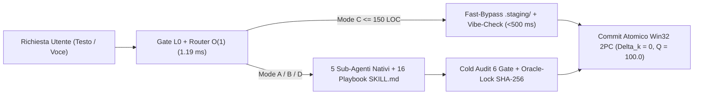

# Nexus Keystone Hub (NK-Hub v5.0.0-STE100-Unified)
## L'Ambiente di Sviluppo Multi-Agente Ordinato, Sicuro e Autonomo per Google Antigravity

> 🌍 **Lingua / Language:** **[🇮🇹 Italiano (Attivo)](README.it.md)** | **[🇬🇧 English Version](README.md)** | **[📖 Guida Installazione ZIP](GUIDA_INSTALLAZIONE.md)** | **[🗺️ Mappa Libreria](00_MAPPA_LIBRERIA_NK.md)**
>
> 📦 **SCARICA CON 1 CLICK L'AMBIENTE COMPLETO (`.ZIP` CON GUIDA INCLUSA):**  
> 👉 **[Scarica NK_Hub_OneClick_Package.zip (Release Ufficiale v5.0.0-STE100-Unified)](https://github.com/erbaldo86/NK-Hub/releases/download/v5.0.0-STE100-Unified/NK_Hub_OneClick_Package.zip)** *(oppure [Download Diretto dal Repository](https://github.com/erbaldo86/NK-Hub/raw/main/nk_docs_and_setup/NK_Hub_OneClick_Package.zip))*

---

## ⚡ 1. Presentazione Veloce in 90 Secondi (L'Hook: Perché Nasce e Cosa Fa)

### Perché è stato sviluppato `NK-Hub`?
Creare un programma con l'IA è facile nei primi minuti. Appena il progetto cresce, però, nascono tre problemi ricorrenti:
1. **Cartelle nel caos:** file di sistema, script, test e progetti finiscono mescolati o duplicati nella stessa cartella.
2. **Modifiche che rompono ciò che funzionava:** l'agente modifica direttamente i tuoi file buoni senza prima provarli in un'area separata.
3. **Perdita di memoria e "falsi positivi":** nelle sessioni lunghe l'IA dimentica le regole. Spesso riduce i controlli nei test pur di superarli.

**`NK-Hub` nasce esattamente per eliminare questi tre problemi.** Trasforma Google Antigravity in una cabina di regia ordinata con `5` Sub-Agenti specializzati. La squadra progetta, costruisce e collauda il codice in `.staging/`. Promuove il lavoro solo quando ogni controllo reale è superato al `100%`.

### 💬 Esempio Reale in 30 Secondi: Come Dialoghi con `NK-Hub`
> 1. **Tu scrivi in chat (o detti col microfono):**  
>    *"Crea un'applicazione web per gestire i preventivi dei clienti ed esportarli in PDF."*
> 2. **`NK-Hub` ti mostra subito lo Specchio di Conferma (`Gate L0`):**  
>    *"Ho capito l'obiettivo: creerò la nuova app isolata in `NK_External_Projects/PreventiviApp`. Preparerò database, interfaccia e generatore PDF in collaudo. Confermi con 1 click?"*
> 3. **Tu clicchi su `Conferma`:**  
>    La squadra di agenti costruisce l'applicazione in `.staging/` ed esegue i test di sicurezza. Ripara gli errori in autonomia e promuove il progetto finito nella tua cartella.

### I Benefici Immediati a Colpo d'Occhio

| Cosa Succede di Solito con un Agente AI Standard | Cosa Succede con `NK-Hub` |
| :--- | :--- |
| File sparsi e confusione tra motore e progetti | **Libreria Ordinata:** solo `NK_Hub/` (il motore) e `NK_External_Projects/` (le tue app) |
| L'IA parte subito e a volte fraintende la richiesta | **Gate L0 a 1 Click:** riassume l'obiettivo prima di iniziare e parte solo col tuo OK |
| Modifiche dirette sui file buoni con rischio di rottura | **Collaudo in `.staging/` + Salvataggio Atomico:** i file buoni non vengono mai corrotti |
| Un solo agente fa tutto e perde il filo | **Squadra di 5 Sub-Agenti Nativi:** chi scrive il codice è separato da chi controlla la sicurezza |
| Rischio che l'IA "addolcisca" i test per farli passare | **Sigillo `oracle-lock` Anti-Trucco:** i test sono bloccati e nessuno può manometterli |

---

## 📦 2. Guida Rapida all'Installazione (Per Chi Scarica lo ZIP con 1 Click)

Il file **[NK_Hub_OneClick_Package.zip](https://github.com/erbaldo86/NK-Hub/releases/download/v5.0.0-STE100-Unified/NK_Hub_OneClick_Package.zip)** contiene già l'intera libreria pronta all'uso e la [GUIDA_INSTALLAZIONE.md](GUIDA_INSTALLAZIONE.md).

### Installazione in 3 Passi Semplici
1. **Estrai lo ZIP:** scarica `NK_Hub_OneClick_Package.zip` ed estrailo nella tua cartella di lavoro (ad esempio `Antigravity/`). Otterrai due cartelle pulite: `NK_Hub` e `NK_External_Projects`.
2. **Avvia l'Installer Automatico:** apri PowerShell dentro `NK_Hub` ed esegui:
   ```powershell
   cd NK_Hub
   .\nk_docs_and_setup\install.ps1
   ```
   *(Su Linux/macOS esegui `./nk_docs_and_setup/install.sh`. Lo script installa i pacchetti da `nk_docs_and_setup/requirements.txt`, verifica l'indice in `< 1.0 ms` ed esegue i `253` test certificati).*
3. **Accendi il Motore in Antigravity:** apri la cartella in Google Antigravity e scrivi in chat:
   ```text
   avvia ambiente nk
   ```
   Si aprirà subito il **Centro di Controllo a 15 Nodi (`[0]`..`[14]`)** pronto a ricevere le tue istruzioni.

---

## 🎯 3. Due Modi di Viverlo: Utente Vibe Coding vs Utente Esperto + I 6 Punti Cardine

`NK-Hub` è progettato su due livelli complementari. È guidato in superficie per chi crea senza tecnicismi e rigoroso per chi cerca garanzie ingegneristiche.

### 🧑‍💻 A. Per l'Utente Poco Esperto (Puro Vibe Coding Senza Complicazioni)
Non serve saper programmare né ricordare comandi da terminale. Ecco come si usa nella vita di tutti i giorni:

| Cosa Vuoi Fare Tu | Cosa Ti Basta Scrivere nella Chat di Antigravity | Cosa Fa `NK-Hub` in Automatico per Te |
| :--- | :--- | :--- |
| **Accendere l'ambiente** | `"avvia ambiente nk"` | Controlla che tutto sia in ordine in `< 1.0 ms` e ti mostra il menù interattivo. |
| **Creare un nuovo programma** | *"Voglio creare un'app per gestire le scadenze dei bandi"* | Crea una cartella pulita in `NK_External_Projects/`, progetta grafica e database e costruisce l'app. |
| **Fare una modifica veloce** | *"Aggiungi un pulsante verde per scaricare la tabella in Excel"* | Attiva la corsia rapida (`Mode C`), modifica il file in meno di mezzo secondo e lo verifica. |
| **Sistemare un problema** | *"Quando clicco su Salva esce un errore, puoi sistemarlo?"* | Trova la riga esatta del difetto, la ripara nell'area di prova e aggiorna il programma. |

* **Parli col microfono:** se la dettatura unisce due parole, il normalizzatore vocale le corregge prima del lavoro.
* **Non puoi mai rovinare l'ambiente:** i progetti vivono separati in `NK_External_Projects/` e ogni modifica viene provata prima in `.staging/`.

---

### 🛠️ B. Per l'Utente Molto Esperto / Senior Architect (Cosa Ha in Più `NK-Hub`)
Se sei uno sviluppatore esperto o un architetto software, ecco i vantaggi di `NK-Hub` rispetto a un agente AI standard:

| Limite Tecnico degli Agenti AI Standard | Soluzione Architetturale Implementata in `NK-Hub` |
| :--- | :--- |
| **Contesto Monolitico e Degrado (*Context Rot*)** | **Topologia 2-Tier Hub-and-Spoke:** `5` Sub-Agenti Nativi isolati con finestre di contesto indipendenti e filtro automatico delle skill esterne (`-7.042` token/turno). |
| **Auto-Valutazione e *Reward Hacking* (*Goodhart's Law*)** | **Separazione Hardware `GT-14` + `oracle-lock`:** gli Auditor operano con `enable_write_tools: false` e i test sono sigillati in `SHA-256` prima della fase di build. |
| **Scritture Parziali e Corruzione del Working Tree** | **Transazioni Atomiche `Win32 2PC`:** promozione da `.staging/` protetta da Named Mutex Kernel a 64-bit con rollback immediato dell'intero batch su errore. |
| **Latenza Elevata sulle Micro-Modifiche** | **Fast-Bypass `Mode C` (`< 500 ms`) e Cache `OPT-11` (`< 1.0 ms`):** analisi AST della profondità (`max_depth <= 1`, `<= 150` LOC) con risparmio del `71.9%` dei token. |
| **Traceback Prolissi nel Contesto di Debug** | **Fault Localization `SBFL Ochiai` (`< 80` Token):** localizzazione spettrale della riga guasta con taglio AST Def-Use e snapshot SHA-256 monotono. |

---

### 🌟 C. I 6 Punti Cardine di `NK-Hub` (I Pilastri per Cui Sceglierlo)

1. **Libreria Ordinata e De-Duplicata (`NK_Hub` + `NK_External_Projects` + `nk_docs_and_setup`):**
   Ogni file possiede una sola copia fisica. Guide e setup risiedono in `nk_docs_and_setup/`, genoma in `nk_genome/`, telemetria in `nk_tracking/`, motore in `scripts/` e progetti in `NK_External_Projects/`.
2. **Separazione Hardware tra Chi Scrive e Chi Controlla (`GT-14`):**
   I `5` Sub-Agenti Nativi applicano vincoli hardware nel manifesto. Gli Auditor hanno `enable_write_tools: false` e tutti i sub-agenti impongono `enable_subagent_tools: false` (`RULE-01`).
3. **Gate L0 a 1 Click e Corsia Veloce `Mode C` (`< 500 ms`, `-71.9%` Token):**
   Prima di eseguire, il router compila un contratto Pydantic v2 (`MetaPromptGateContract`) con hash `SHA-256`. Per le modifiche entro `150` righe attiva il Fast-Bypass con validazione statica in `~65 ms`.
4. **Onestà Epistemica $100\times$ e Guardie Statiche `SAST-GAMING-D01..D04`:**
   Il validatore AST blocca `PYTEST_CURRENT_TEST` (`D01`) e l'ispezione dello stack frame a runtime (`D02`). Blocca inoltre fixture cablate (`D03`) e ramificazioni sulla lunghezza dei dati di test (`D04`).
5. **Convergenza Matematica Tensor-RSI ($\Delta_k = 0, Q(S_k) = 100.0$) e Commit `Win32 2PC`:**
   Ad ogni iterazione $k$, il motore calcola il vettore di difetto $\Delta_k(p)$ e la fitness $Q(S_k)$:
   $$\Delta_k(p) = 100 D_k + 20 E_{\text{PoC},k} + w_{\text{SAST}}^{(p)} \text{SAST}_k + 12 D_{\text{sem},k} + w_{\text{test}}^{(p)} (T_{\text{fail},k} + C_k) + w_{H}^{(p)} H_k + w_{M}^{(p)} M_k + w_{L}^{(p)} L_k + w_{G}^{(p)} G_k$$
   Il codice viene promosso da `.staging/` alla produzione tramite `win32_2pc_engine.py` solo quando $\Delta_k = 0$ e $Q(S_k) = 100.0$.
6. **Prestazioni Misurate su Windows 11 64-bit (`OPT-1..OPT-11`):**
   * **Avvio Bootstrap Fast-Stat (`nk_session_bootstrap.py`):** `18..28 ms` (target `< 50 ms`).
   * **Verifica Registro O(1) con Cache `OPT-11` (`nk_registry_indexer.py --verify`):** `< 1.0 ms` in cache (`41.8 ms` cold).
   * **Lookup Tassonomico e Routing L0 (`vibe_sprint_router.py`):** `1.08..2.12 ms` (target `< 15 ms`).
   * **Suite Completa di `253` Test Reali Zero-Mock (`245` baseline, `24` moduli in `tests/`):** `100.0% PASS` (`253/253`).

---

## 🚀 4. Caso Studio Reale: Come NK-Hub Ha Progettato e Costruito un Gestionale Completo in una Sola Notte

Questo caso studio reale mostra come `NK-Hub` trasforma un'idea complessa in un software pronto all'uso. L'esperienza documenta la nascita di `NK-Studio-Lab-Progettazione` e la costruzione autonoma del gestionale `NK-Studio-CRM`.

### Fase 1: Co-Progettazione Interattiva Utente + `NK-Hub`
Prima di scrivere codice, l'utente dialoga in modo interattivo con `NK-Hub`. Attraverso scambi guidati con `NK-Ideator`, `NK-App-UX-Architect`, `NK-Backend-Architect` e `NK-Plan-Aligner`, il modello elabora l'intero impianto progettuale:
* **Analisi di Mercato Fiscale e Legale (`TAX` e `LEGAL`):** definisce i flussi reali per studi professionali multidisciplinari.
* **Architettura a `4` Scatole Strategiche:** separa anagrafica unificata, motore di importazione, comunicazioni rapide e sicurezza dati.
* **Design System `NK Clarity v2.0`:** stabilisce la gerarchia visiva ad alta leggibilità con tema `Calm Daylight` e `Dark Switcher`.
* **Blueprint per `5` Futuri Add-On:** predispone le prese per `Bandi Bridge`, `Parcelle`, `Scadenze`, `Antiriciclaggio/GDPR` e `Circolari/PEC`.

### Fase 2: L'Invio sul Gate L0 e la Costruzione Autonoma in un'Unica Sessione Notturna
Approvato il piano sul `Gate L0` con un click, la squadra dei `5` Sub-Agenti Nativi (`Mode A`) entra in azione. Il team lavora in totale autonomia durante la notte in un'unica sessione continua dentro `.staging/`:
1. **Backend e Database Corazzato:** costruisce il backend `FastAPI` e il database `SQLite3 WAL`. Integra il radar conflitto di interessi e la cassaforte di backup `.zip`.
2. **Motori Intelligenti e Connettori:** realizza i modelli polimorfici `Pydantic v2` e il motore `SmartMergeEngine` (`.vcf` Apple/Google, `.csv`, `XML FatturaPA`). Collega inoltre i connettori 1-Click (`Gmail`, `Outlook`, `PEC`, `WhatsApp`, `.ics`) e il bus eventi a `5` prese Add-On.
3. **Interfaccia Web e Collaudo Zero-Mock:** crea l'interfaccia web `NK Clarity v2.0` (`Calm Daylight` e `Dark Switcher`). Supera infine **`36/36` test automatici Zero-Mock** (`unit`, `E2E`, stress `S1..S4`) e consegna al mattino il gestionale pronto con `start_crm.bat`.

---

## 🔬 5. Sezione Tecnica Dedicata: Come Lavorano Agenti, 16 Skill e 34 Script



### 5.1 Le 4 Modalità Automatiche di Lavoro (`scripts/vibe_sprint_router.py`)

| Modalità | Quando Si Attiva | Chi Interviene | Controlli Applicati |
| :--- | :--- | :--- | :--- |
| **`Mode D` (Analisi e Ricerca)** | Domande, analisi, audit o ricerche web/MCP | `NK-Specifier-Agent` / `NK-RSI-Auditor` (Sola Lettura) | Lookup O(1) in `< 1.0 ms` + Connettori MCP |
| **`Mode C` (Vibe-Sprint Rapido)** | Piccole modifiche UI o script (`<= 150` righe) | Fast-Bypass o `NK-Builder-Agent` in `.staging/` | Guardia AST (`D01..D04`) + `--vibe-check` (`< 500 ms`) |
| **`Mode B` (Riparazione / Refactor)** | Correzione bug o modifiche su più file | `NK-Builder-Agent` + `NK-Security-DAST-Auditor` | Staging + `oracle-lock` + Localizzatore `SBFL Ochiai` |
| **`Mode A` (Progetto Completo)** | Nuova app da zero o grande evoluzione architetturale | Squadra Completa dei `5` Sub-Agenti Nativi | Piano a 5 Turni + Cold Review a 6 Gate + Commit 2PC |

### 5.2 I 5 Sub-Agenti Nativi (`.agents/agents/*/agent.md`)

| Sub-Agente Nativo | Dominio | Permessi Hardware (`GT-14`) | Cosa Fa e Dove Può Scrivere |
| :--- | :---: | :--- | :--- |
| **[NK-Specifier-Agent](.agents/agents/NK-Specifier-Agent/agent.md)** | `DOM-02` | `write: true`, `mcp: true` | Progetta idee, interfacce UX/UI, architetture backend e piani in `nk_genome/*`. |
| **[NK-Builder-Agent](.agents/agents/NK-Builder-Agent/agent.md)** | `DOM-03` | `write: true`, `mcp: false` | Scrive e ripara codice Python, React/Next.js e skill esclusivamente dentro `.staging/*`. |
| **[NK-Security-DAST-Auditor](.agents/agents/NK-Security-DAST-Auditor/agent.md)** | `DOM-04` | **`write: false`** (Sola Lettura) | Esegue controlli SAST anti-trucco, test in sandbox DAST, test Browser E2E e diagnosi bug. |
| **[NK-RSI-Auditor](.agents/agents/NK-RSI-Auditor/agent.md)** | `DOM-04` | **`write: false`** (Sola Lettura) | Valuta i 6 Gate di qualità, l'integrità del grafo DAG e la convergenza matematica $\Delta_k = 0$. |
| **[NK-Scribe-Agent](.agents/agents/NK-Scribe-Agent/agent.md)** | `DOM-05` | `write: true`, `mcp: false` | Aggiorna la documentazione, la mappa del repository (`repo_map.md`) e la memoria a 3 livelli. |

### 5.3 Catalogo delle 16 Skill Playbook (`.agents/skills/NK-*/SKILL.md`)

Quando avvii l'ambiente con `"avvia ambiente nk"`, puoi richiamare direttamente qualsiasi nodo da `[0]` a `[14]`:

| Nodo | Nome Playbook Skill | Dominio | Sub-Agente Esecutore | Compito Specifico del Playbook |
| :---: | :--- | :---: | :--- | :--- |
| **Hub** | [NK-Master-Hub](.agents/skills/NK-Master-Hub/SKILL.md) | `DOM-01` | Regista Principale | Coordina il routing a 2 livelli, il sigillo `oracle-lock` e il commit finale Win32 2PC. |
| **`[0]`** | [NK-Ideator](.agents/skills/NK-Ideator/SKILL.md) | `DOM-02` | `NK-Specifier-Agent` | Sviluppa l'idea iniziale (`idea_canvas.md`), analisi SCAMPER e ricerche web `tavily-mcp`. |
| **`[1]`** | [NK-App-UX-Architect](.agents/skills/NK-App-UX-Architect/SKILL.md) | `DOM-02` | `NK-Specifier-Agent` | Progetta l'esperienza utente, il Design System 8px/HSL e i componenti interattivi. |
| **`[2]`** | [NK-Backend-Architect](.agents/skills/NK-Backend-Architect/SKILL.md) | `DOM-02` | `NK-Specifier-Agent` | Disegna l'architettura backend, gli schemi Pydantic v2, le API e `firebase-mcp-server`. |
| **`[3]`** | [NK-Agent-Instruction-Forge](.agents/skills/NK-Agent-Instruction-Forge/SKILL.md) | `DOM-02` | `NK-Builder-Agent` | Crea e aggiorna nuove skill e istruzioni agente in formato tecnico ASD-STE100. |
| **`[4]`** | [NK-Python-Async-Builder](.agents/skills/NK-Python-Async-Builder/SKILL.md) | `DOM-03` | `NK-Builder-Agent` | Sviluppa backend Python asincrono, database SQLite WAL e cicli di auto-riparazione. |
| **`[5]`** | [NK-Delta-Architect](.agents/skills/NK-Delta-Architect/SKILL.md) | `DOM-03` | `NK-Builder-Agent` | Realizza applicazioni Full-Stack, interfacce Frontend (`React/Next/Tailwind`) e modifiche rapide. |
| **`[6]`** | [NK-Security-Auditor](.agents/skills/NK-Security-Auditor/SKILL.md) | `DOM-04` | `NK-Security-DAST-Auditor` | Ispeziona la sicurezza statica SAST (`L1/L2/L3`) e verifica i flag CLI (`CoVe`). |
| **`[7]`** | [NK-Oracle-Evaluator](.agents/skills/NK-Oracle-Evaluator/SKILL.md) | `DOM-04` | `NK-RSI-Auditor` | Controlla i 6 Gate di revisione a freddo, l'Holdout Set B e la struttura DOM HTML5. |
| **`[8]`** | [NK-Dynamic-Sandbox-StressTester](.agents/skills/NK-Dynamic-Sandbox-StressTester/SKILL.md) | `DOM-04` | `NK-Security-DAST-Auditor` | Esegue stress test dinamici in sandbox isolata e test Browser E2E con `chrome-devtools-mcp`. |
| **`[9]`** | [NK-Bug-Diagnostic-Engine](.agents/skills/NK-Bug-Diagnostic-Engine/SKILL.md) | `DOM-04` | `NK-Security-DAST-Auditor` | Localizza la causa radice dei bug con formula SBFL Ochiai e filtra i falsi positivi. |
| **`[10]`** | [NK-Plan-Aligner](.agents/skills/NK-Plan-Aligner/SKILL.md) | `DOM-01` | `NK-Specifier-Agent` | Verifica l'allineamento 1:1 dei 4 documenti di progetto prima dell'avvio dei lavori. |
| **`[11]`** | [NK-State-Router](.agents/skills/NK-State-Router/SKILL.md) | `DOM-01` | `NK-RSI-Auditor` | Controlla l'assenza di cicli nel grafo delle attività (DAG di Kahn) e gli hash SHA-256. |
| **`[12]`** | [NK-Scribe](.agents/skills/NK-Scribe/SKILL.md) | `DOM-05` | `NK-Scribe-Agent` | Mantiene aggiornati i manuali, la mappa del codice, le patch notes e i rilasci Git. |
| **`[13]`** | [NK-Episodic-Memory-Engine](.agents/skills/NK-Episodic-Memory-Engine/SKILL.md) | `DOM-05` | `NK-Scribe-Agent` | Gestisce la memoria a 3 livelli (`ARCH`, `SEC`, `OPS`, `DEVX`) e il recupero ibrido RRF. |
| **`[14]`** | [NK-Session-Controller](.agents/skills/NK-Session-Controller/SKILL.md) | `DOM-01` | Regista Principale | Supervisiona la sessione, il passaggio di consegne zero-amnesia e la convergenza RSI. |

### 5.4 Architettura dei 34 Script del Motore (`scripts/`) e Suite di Test (`253/253 PASS`)

I `34` moduli indicizzati in `scripts/` (`36` file Python inclusi gli schemi IPC) sono raggruppati in 5 aree operative:
1. **Avvio, Routing e Governance (`DOM-01`):** `nk_session_bootstrap.py`, `nk_registry_indexer.py`, `vibe_sprint_router.py`, `nk_hook_gate.py` e `win32_2pc_engine.py`. Include inoltre `nk_context_sentry.py`, `nk_active_runtime_sentinel.py`, `nk_compliance_checker.py` e `nk_swarm_messenger.py`.
2. **Mappatura e Progetti Esterni (`DOM-02`):** `external_project_scaffolder.py` crea nuove app isolate in `NK_External_Projects/`. Include `ast_repo_mapper.py` e `env_capability_probe.py`.
3. **Costruzione, Riparazione e Cache (`DOM-03`):** `auto_heal_pipeline.py`, `healing_snapshot_rollback.py`, `invisible_healing_loop.py`, `platform_runner.py`, `safe_cleanup_dev_servers.py`, `deterministic_api_cache.py`, `async_heartbeat_signaler.py`.
4. **Sicurezza, Sandbox e Convergenza RSI (`DOM-04`):** `ast_guard_validator.py`, `rsi_convergence_engine.py` e `nk_transcript_tools.py`. Include `dast_sandbox_runner.py`, `sbfl_engine.py`, `sbfl_pytest_bridge.py` e `oracle_evaluator_l3.py`.
5. **Memoria, Baseline e Passaggio di Consegne (`DOM-05`):** `memory_3tier_engine.py`, `quality_baseline_manager.py`, `preflight_health_check.py` e `nk_session_handoff.py`. Include `nk_auto_inning.py`, `micro_hud_renderer.py` e i contratti in `scripts/schemas/`.
6. **253 Test Reali Zero-Mock (`245` Baseline in `tests/`):** `24` moduli verificano ogni script, confine hardware, guardia SAST e rollback 2PC. La suite certifica il **`100.0%` (`253/253 PASS`)**.

---

## 📈 6. Cosa Cambia dalla Versione 4 alla Release v5.0.0-STE100-Unified (I Miglioramenti Strutturali)

La release `v5.0.0-STE100-Unified` rappresenta il consolidamento Clean-Slate dell'architettura rispetto alla serie `4.x`:

| Area Architetturale | Versione 4.x (`v4.7.0` / `v4.8.0`) | Release `v5.0.0-STE100-Unified` |
| :--- | :--- | :--- |
| **Suite di Test Permanenti** | `245` test di baseline con possibili attriti sui workspace temporanei | **`253/253 PASS` (`100.0%`)** su `24` moduli e `14` invarianti `GT-01..GT-14` |
| **Backup Memoria a 3 Livelli** | Backup `.bak_N` condivisi nella cartella locale del motore | **Isolamento Crittografico (`ws_<sha256_12>`)** tra produzione e sandbox di test |
| **Verifica Manifesto e Cache O(1)** | Verifica `Fast-Stat` in `~24.94..41.8 ms` e versione unica | **Separazione Schema vs Release** e verifica **`< 1.0 ms` in cache** su Google Drive |
| **Igiene `.staging/` post-Commit** | Possibili cartelle `__pycache__` residue dopo i test in staging | **Auto-Pulizia Bytecode `.pyc`** integrata nel commit atomico `Win32 2PC` |
| **Purezza AST e Telemetria** | Presenza di helper inutilizzati e vecchi report di progetti esterni | **Zero Dead-Code (`63/63 PASS`)** e `nk_tracking/` bonificato al `100%` |
| **Allineamento Costituzionale** | Riferimenti di versione distribuiti tra `v4.6.0`, `v4.7.0` e `v4.8.0` | **Unificazione `1:1` a `v5.0.0`** su `16` skill, `5` sub-agenti, Genoma e pacchetto `.zip` |

### I 6 Miglioramenti Strutturali nel Dettaglio
1. **Suite Permanente al `100%` (`253/253 PASS` su `24` moduli):** elimina ogni regressione e copre i `14` invarianti `GT-01..GT-14`.
2. **Isolamento Crittografico dei Backup Memoria (`ws_<sha256_12>`):** separa i backup di produzione dalle sandbox con guardia sui file vuoti.
3. **Separazione Contratto Schema vs Release e Cache `O(1)` (`< 1.0 ms`):** distingue `MANIFEST_VERSION` e `RELEASE_VERSION` con verifica istantanea (`< 1 ms` vs `41.8 ms`).
4. **Auto-Pulizia Bytecode `.pyc` nel Commit Atomico `Win32 2PC`:** rimuove le cartelle `__pycache__` e lascia `.staging/` immacolata (`.gitkeep`).
5. **Zero Dead-Code (`63/63 PASS` su `ast_guard_validator.py`) e Bonifica `nk_tracking/`:** elimina i simboli morti in `scripts/` e rimuove i riferimenti esterni.
6. **Unificazione Costituzionale `v5.0.0` ($\Delta_k = 0, Q = 100.0$):** allinea `1:1` le `16` skill, i `5` sub-agenti, il Genoma e `NK_Hub_OneClick_Package.zip`.

---
*Nexus Keystone Hub (`v5.0.0-STE100-Unified`) | Certificato `253/253 PASS` (`245` Baseline) Zero-Mock | $\Delta_k = 0, Q(S_k) = 100.0$*
