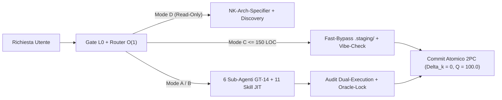

# NK Hub Generation (`v1.0.0-Generation`)
## L'Ambiente Multi-Agente Ordinato, Sicuro e Autonomo per Google Antigravity 2.0

> 🌍 **Lingua / Language:** **[🇮🇹 Italiano (Attivo)](README.it.md)** | **[🇬🇧 English Version](README.md)** | **[📖 Guida Installazione ZIP](GUIDA_INSTALLAZIONE.md)** | **[🗺️ Mappa Libreria](00_MAPPA_LIBRERIA_NK.md)** | **[📋 Patch Notes](../nk_genome/PATCH_NOTES.md)**
>
> 📦 **SCARICA CON 1 CLICK L'AMBIENTE COMPLETO (`.ZIP`, `v1.0.0-Generation`, Milestone `NK-GEN-1.0.0`):**  
> 👉 **[Scarica NK_Hub_OneClick_Package.zip (Download Diretto dal Repository)](https://github.com/erbaldo86/NK-Hub/raw/main/nk_docs_and_setup/NK_Hub_OneClick_Package.zip)**  
> *(Contiene `.agents/`, `NK_Hub/` e `NK_External_Projects/` con profilo predefinito `NK_MODEL_PROFILE=generation` e fallback `carbon`.)*

---

## ⚡ 1. Presentazione Veloce in 90 Secondi

### Perché nasce `NK Hub Generation`?
Creare software con l'IA parte veloce. Quando il progetto cresce emergono però tre problemi ricorrenti:
1. **Cartelle disordinate:** file di sistema, script, test e app finiscono mescolati nella stessa radice.
2. **Modifiche dirette rischiose:** l'agente altera i file attivi senza prima collaudarli in isolamento.
3. **Perdita di contesto e test-gaming:** nelle sessioni lunghe l'IA dimentica vincoli o indebolisce i test.

**`NK Hub Generation` (`v1.0.0-Generation`) elimina questi problemi.** Trasforma Google Antigravity 2.0 in una regia deterministica con `6` Sub-Agenti Nativi `GT-14` e `11` Playbook `SKILL.md` JIT. Il profilo attivo è `NK_MODEL_PROFILE=generation` con fallback su `carbon`. La squadra lavora in `.staging/` e promuove il codice via `Win32 2PC` solo con verifiche al `100%`.

### Benefici Immediati a Colpo d'Occhio

| Comportamento Agente AI Standard | Soluzione `NK Hub Generation` (`v1.0.0-Generation`) |
| :--- | :--- |
| File di sistema mescolati alle app | **Isolamento Ordinato:** bridge `.agents/`, motore `NK_Hub/` e app `NK_External_Projects/` |
| Avvio immediato con rischio di fraintendimento | **Gate L0 a 1 Click:** riassume requisiti, piano e regole prima di iniziare |
| Scritture dirette sui file di produzione | **Collaudo `.staging/` + Commit `2PC`:** zero corruzioni parziali |
| Auto-valutazione dello stesso agente | **Protocollo `Dual-Execution` (`GT-14`):** Auditor in sola lettura su telemetria JSON |
| Rischio di manomissione dei test | **Sigillo `oracle-lock` (`373` file):** test, script e governance bloccati con `SHA-256` |
| Crash `conhost.exe` su Drive FS Windows | **Pytest Isolato NVMe (`[RULE-WIN32-ISOLATED-PYTEST]`):** esegue su `%TEMP%` via `--pytest-isolated` |

---

## ✨ 2. Il Salto Evolutivo (`v1.0.0-Generation` rispetto alla Generazione Precedente)

`NK Hub Generation` (`v1.0.0-Generation`) rinnova da zero l'architettura precedente (`5` agenti, `16` skill, `15` nodi, `93` test, hook separati e `Tetralogia`):

| Area | Generazione Precedente | `NK Hub Generation` (`v1.0.0-Generation`) |
| :--- | :--- | :--- |
| **Sub-Agenti (`GT-14`)** | `5` agenti misti | **`6` Sub-Agenti Nativi:** separa `NK-Arch-Specifier` (`write: false`) da `NK-Specifier-Agent` (`write: true`); zero MCP sulle foglie (`CRIT-01`) |
| **Skill & Dashboard** | `16` skill, `15` nodi (`[0]..[14]`) | **`11` Skill JIT e Dashboard a `10` Nodi (`[0]`..`[9]`)** sotto `NK-Orchestrator` |
| **Hook & Scudo Contesto** | Hook separati, limiti `standard` | **Plugin unico [`nk-gate`](../.agents/plugins/nk-gate/hooks.json) (`python -S -B -u`) + `ACS` (`Z1/Z2/Z3`)** e `generation` (`150/250` step, `tier1_token_cap=1200`) |
| **Genoma & Struttura Codice** | `Tetralogia`, `34` script monolitici | **`Pentad Sovrana 4+1`** (`3-Tier`) + **`34` facciate (`37` moduli indicizzati, `260` `.py`)** con `_internal/` aciclico (`<= 500` LOC) |
| **Suite Test & Cross-OS** | `93` test (`18` moduli) | **`513/513 PASS` (`0` skipped, `41` `test_*.py` / `45` `.py`), Branch Coverage `89.32%`**, `--pytest-isolated` NVMe, CI `ubuntu-latest` + `windows-latest` |

---

## 📦 3. Installazione Rapida in 3 Passi

1. **Estrai lo ZIP:** estrai `NK_Hub_OneClick_Package.zip` dentro `Antigravity/` ottenendo `.agents/`, `NK_Hub/` e `NK_External_Projects/`.
2. **Esegui l'Installer:** apri il terminale dentro `NK_Hub/` e lancia lo script per il tuo sistema operativo.
   ```powershell
   # Su Windows (PowerShell)
   cd NK_Hub
   .\nk_docs_and_setup\install.ps1
   ```
   ```bash
   # Su Linux o macOS (Bash)
   cd NK_Hub
   bash ./nk_docs_and_setup/install.sh
   ```
   *(Imposta `NK_MODEL_PROFILE=generation` con fallback `carbon`, installa [`requirements.txt`](requirements.txt), sincronizza `.agents/` e avvia `--strict-verify`.)*
3. **Avvia il Motore:** apri [`nk_docs_and_setup/Antigravity.code-workspace`](Antigravity.code-workspace) in Google Antigravity 2.0. Scrivi uno dei `16` trigger per aprire la **Dashboard a `10` nodi (`[0]`..`[9]`)**:
   * **Trigger legacy (`8`):** `"avvia ambiente nk"`, `"avvia nk hub"`, `"avvia nk"`, `"avvia hub"`, `"start nk"`, `"start hub"`, `"attiva nk"`, `"attiva ambiente nk"`.
   * **Trigger Generation (`8`):** `"avvia generation"`, `"avvia nk generation"`, `"avvia nk hub generation"`, `"avvia ambiente generation"`, `"start generation"`, `"start nk generation"`, `"attiva generation"`, `"attiva ambiente generation"`.

---

## 🎯 4. I 6 Punti Cardine di `NK Hub Generation`

1. **Profilo Nativo `generation` (`NK_MODEL_PROFILE=generation`):** espande Context Sentry a `150/250` step, `250k/500k` token e Tier-1 a `1.200` token (fallback `carbon`).
2. **Hook Unificato (`nk-gate`):** [`.agents/plugins.json`](../.agents/plugins.json) monta l'unico [`.agents/plugins/nk-gate/hooks.json`](../.agents/plugins/nk-gate/hooks.json) in `python -S -B -u` con `nk_acs_fastguard.py` (`Z1/Z2/Z3`).
3. **Separazione `Dual-Execution` (`GT-14`):** gli Auditor read-only operano con `enable_write_tools: false` ed `enable_mcp_tools: false` su telemetria JSON di `DOM-01` in `nk_diagnostics/`.
4. **Esecuzione Isolata NVMe (`--pytest-isolated`):** su Windows `scripts/platform_runner.py --pytest-isolated` replica i test su `%TEMP%` evitando crash `0xC000013A`.
5. **Genoma `Pentad Sovrana 4+1` e Tensor-RSI ($\Delta_k = 0, Q(S_k) = 100.0$):** promuove con `scripts/win32_2pc_engine.py` (`Win32NamedMutex` e `POSIX flock`) solo a zero difetti.
6. **SLA Misurati e Certificati:**
   * **Bootstrap Fast-Stat (`scripts/nk_session_bootstrap.py`):** `~31-46 ms` warm (`TTL 900s`).
   * **Verifica Indice `O(1)` (`scripts/nk_registry_indexer.py --verify`):** `< 1.0 ms` cached (`~90 ms` cold) su `7` shard (`DOM-00..DOM-06`).
   * **Preflight & AST Guard:** `scripts/preflight_health_check.py --check-only` in `~445 ms`; `scripts/ast_guard_validator.py --target all` su `305` file (`0` violazioni).
   * **Sigillo Lock & Suite Zero-Mock:** `373` file sigillati in [`oracle_lock.json`](../nk_tracking/oracle_lock.json). Esegue `513/513 PASS` (`0` skipped) su `41` moduli `test_*.py` (`45` `.py`) in `~68.3s` NVMe. Copertura in [`quality_baseline.json`](../nk_tracking/quality_baseline.json): `89.32%` branch, `94.39%` statement, `92.89%` combined.

---

## 🔬 5. Riferimento Tecnico: 4 Modalità, 6 Sub-Agenti, 11 Skill e Mappa `scripts/` + `tests/`



### 5.1 Le `4` Modalità Automatiche (`scripts/vibe_sprint_router.py`)

| Modalità | Condizione di Attivazione | Corsia Esecutiva | Gate di Verifica |
| :--- | :--- | :--- | :--- |
| **`Mode D` (Discovery & Audit)** | Domande, audit, benchmark e ricerche | `Single-Gate` read-only (`NK-Arch-Specifier` / Auditor) | Lookup `O(1)` (`< 1.0 ms`) + payload `DOM-01` |
| **`Mode C` (Vibe-Sprint Rapido)** | Modifiche chirurgiche (`<= 150` LOC, `max_depth <= 1`) | Fast-Bypass o `NK-Builder-Agent` in `.staging/` | Guardia AST (`D01..D04`) + `--vibe-check` |
| **`Mode B` (Bugfix & Refactor)** | Bugfix mirato o refactor multi-file | `NK-Builder-Agent` + Audit `Dual-Execution` | `oracle-lock` + `SBFL Ochiai` (`< 80` tok) |
| **`Mode A` (Progetto Completo)** | Nuova app esterna o evoluzione sistemica | Sciame completo dei `6` Sub-Agenti `GT-14` | `Pentad 4+1`, FSM 5 turni, 6 Gate, `2PC` |

### 5.2 I `6` Sub-Agenti Nativi (`.agents/agents/*/agent.md` + Plugin `nk-gate`)

Tutti i `6` sub-agenti foglia impongono `enable_subagent_tools: false` ed `enable_mcp_tools: false` (`RULE-01` / `CRIT-01`). Solo `DOM-01 Orchestrator-Direct` esegue `research`, `browser` (`chrome-devtools-mcp`) e `image-generator` depositando i payload in `nk_diagnostics/`.

| Sub-Agente Nativo | Dominio | Permessi (`GT-14`) | Ruolo Esatto e Perimetro Scrittura |
| :--- | :---: | :--- | :--- |
| **[NK-Arch-Specifier](../.agents/agents/NK-Arch-Specifier/agent.md)** | `DOM-02` | **`write: false`**, `mcp: false` | Ideazione `L0` (`NK-Ideator`), analisi `SCAMPER`, discovery `Mode D` e analisi ricerche `DOM-01` (NON scrive DAG/OpenAPI). |
| **[NK-Specifier-Agent](../.agents/agents/NK-Specifier-Agent/agent.md)** | `DOM-02` | `write: true`, `mcp: false` | Compila UX/UI (`8px/HSL` WCAG AAA, `Generative UI`), DAG aciclici di Kahn, OpenAPI `3.0` / Pydantic v2 e `Pentad Sovrana 4+1` in `.staging/nk_genome/*`. |
| **[NK-Builder-Agent](../.agents/agents/NK-Builder-Agent/agent.md)** | `DOM-03` | `write: true`, `mcp: false` | Sviluppa backend Python async / SQLite WAL, UI React/Next.js/Tailwind e skill esclusivamente in `.staging/*`. |
| **[NK-Security-DAST-Auditor](../.agents/agents/NK-Security-DAST-Auditor/agent.md)** | `DOM-04` | **`write: false`**, `mcp: false` | Analizza `SAST L1/L2/L3`, stress test DAST sandbox, telemetria Browser E2E (`DOM-01` / `chrome-devtools-mcp`) e RCA `SBFL Ochiai`. |
| **[NK-RSI-Auditor](../.agents/agents/NK-RSI-Auditor/agent.md)** | `DOM-04` | **`write: false`**, `mcp: false` | Critic read-only per `6` Gate CRV, allineamento `1:1` Turno 4, integrità DAG di Kahn, drift `SHA-256` e $\Delta_k = 0$. |
| **[NK-Scribe-Agent](../.agents/agents/NK-Scribe-Agent/agent.md)** | `DOM-05` | `write: true`, `mcp: false` | Aggiorna manuali SSOT in `.staging/`, `Pentad 4+1`, AST `repo_map.md`, `PATCH_NOTES.md`, ratchet e memoria 3-Tier `RRF`. |

### 5.3 La Dashboard a `10` Nodi (`[0]`..`[9]`) e gli `11` Playbook Skill

| Nodo | Playbook Skill | Dominio | Sub-Agente Assegnato | Responsabilità Procedurale |
| :---: | :--- | :---: | :--- | :--- |
| **Hub** | [NK-Orchestrator](../.agents/skills/NK-Orchestrator/SKILL.md) | `DOM-01` | `Orchestrator-Direct` | Governa routing `2-Tier`, FSM `5` turni, `Dual-Execution` e `2PC`. |
| **`[0]`** | [NK-Ideator](../.agents/skills/NK-Ideator/SKILL.md) | `DOM-02` | `NK-Arch-Specifier` | Guida ideazione `L0`, `SCAMPER`, `STORM` e discovery `Mode D` read-only. |
| **`[1]`** | [NK-System-Architect](../.agents/skills/NK-System-Architect/SKILL.md) | `DOM-02` | `NK-Specifier-Agent` | Progetta `Pentad Sovrana 4+1`, `8px/HSL`, `Generative UI`, DAG di Kahn e OpenAPI `3.0`. |
| **`[2]`** | [NK-Agent-Instruction-Forge](../.agents/skills/NK-Agent-Instruction-Forge/SKILL.md) | `DOM-03` | `NK-Builder-Agent` | Forgia skill e istruzioni agente in ASD-STE100. |
| **`[3]`** | [NK-Python-Async-Builder](../.agents/skills/NK-Python-Async-Builder/SKILL.md) | `DOM-03` | `NK-Builder-Agent` | Costruisce backend Python async e SQLite WAL in `.staging/`. |
| **`[4]`** | [NK-Delta-Architect](../.agents/skills/NK-Delta-Architect/SKILL.md) | `DOM-03` | `NK-Builder-Agent` | Realizza UI Full-Stack e refactor chirurgici in `.staging/`. |
| **`[5]`** | [NK-Security-Auditor](../.agents/skills/NK-Security-Auditor/SKILL.md) | `DOM-04` | `NK-Security-DAST-Auditor` | Analizza `SAST L1/L2/L3` e flag `CoVe` in sola lettura. |
| **`[6]`** | [NK-Oracle-Evaluator](../.agents/skills/NK-Oracle-Evaluator/SKILL.md) | `DOM-04` | `NK-RSI-Auditor` | Valuta `6` Gate Cold Review, allineamento `1:1` e lock `SHA-256`. |
| **`[7]`** | [NK-Dynamic-Sandbox-StressTester](../.agents/skills/NK-Dynamic-Sandbox-StressTester/SKILL.md) | `DOM-04` | `NK-Security-DAST-Auditor` | Ispeziona report sandbox DAST e telemetria browser E2E (`DOM-01`). |
| **`[8]`** | [NK-Bug-Diagnostic-Engine](../.agents/skills/NK-Bug-Diagnostic-Engine/SKILL.md) | `DOM-04` | `NK-Security-DAST-Auditor` | Isola la causa radice dai payload `SBFL Ochiai` (`< 80` tok). |
| **`[9]`** | [NK-Scribe-Memory](../.agents/skills/NK-Scribe-Memory/SKILL.md) | `DOM-05` | `NK-Scribe-Agent` | Aggiorna changelog SSOT, shard, `repo_map.md`, baseline e memoria `3-Tier` RRF. |

### 5.4 Architettura `scripts/` (`34` Top-Level, `37` Moduli Indicizzati, `260` `.py`) e Suite `tests/`

Ogni facciata top-level delega a sottopacchetti aciclici `scripts/_internal/` (`<= 500` LOC) e `scripts/schemas/` (`4` schemi `L0` Pydantic v2 strict):

1. **`DOM-01` (Governance, Routing & 2PC):** `nk_session_bootstrap.py`, `nk_registry_indexer.py`, `vibe_sprint_router.py`, `nk_hook_gate.py`, `nk_acs_fastguard.py`, `win32_2pc_engine.py`, `preflight_health_check.py`, `nk_swarm_messenger.py` e `scripts/schemas/` (`dual_ledgers.py`, `dual_ledgers_models.py`, `nk_catalog_contracts.py`, `nk_ipc_contracts.py`).
2. **`DOM-02` (Ideazione, Mappa AST & Scaffolding):** `ast_repo_mapper.py`, `external_project_scaffolder.py` (isola app in `NK_External_Projects/`) ed `env_capability_probe.py`.
3. **`DOM-03` (Build, Healing & Runner NVMe):** `auto_heal_pipeline.py`, `healing_snapshot_rollback.py`, `invisible_healing_loop.py`, `platform_runner.py`, `safe_cleanup_dev_servers.py`, `deterministic_api_cache.py` e `async_heartbeat_signaler.py`.
4. **`DOM-04` (Sicurezza, DAST & Convergenza RSI):** `ast_guard_validator.py`, `dast_sandbox_runner.py`, `oracle_evaluator_l3.py`, `sbfl_engine.py`, `sbfl_pytest_bridge.py`, `rsi_convergence_engine.py` e `nk_transcript_tools.py`.
5. **`DOM-05` (Memoria, Telemetria & Ratchet):** `memory_3tier_engine.py`, `quality_baseline_manager.py`, `nk_context_sentry.py`, `nk_active_runtime_sentinel.py`, `nk_compliance_checker.py`, `nk_auto_inning.py`, `nk_session_handoff.py` e `micro_hud_renderer.py`.
6. **Suite Permanente `tests/` (`41` moduli `test_*.py`, `45` `.py` totali):** certifica `513/513 PASS` (`0` skipped). Raggiunge **`89.32%` Branch**, **`94.39%` Statement** e **`92.89%` Combined** su NVMe (`--pytest-isolated`, `~68.3s`) e CI ([`.github/workflows/ci.yml`](../.github/workflows/ci.yml)).

---
*NK Hub Generation (`v1.0.0-Generation`) | Milestone `NK-GEN-1.0.0` | Zero-Mock `513/513 PASS` (`89.32%` Branch) | $\Delta_k = 0, Q(S_k) = 100.0$*
