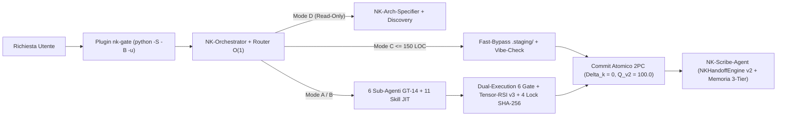

# NK Hub Generation (`v3.0.2-Generation`)
## L'Ambiente Multi-Agente Ordinato, Sicuro e Autonomo per Google Antigravity 2.0

> 🌍 **Lingua / Language:** **[🇮🇹 Italiano (Attivo)](README.it.md)** | **[🇬🇧 English Version](README.md)** | **[📖 Guida Installazione ZIP](GUIDA_INSTALLAZIONE.md)** | **[🗺️ Mappa Libreria](00_MAPPA_LIBRERIA_NK.md)** | **[📋 Patch Notes](../nk_genome/PATCH_NOTES.md)**
>
> 📦 **SCARICA CON 1 CLICK L'AMBIENTE COMPLETO (`.ZIP`, `v3.0.2-Generation`, Milestone `NK-GEN-3.0.2-FORENSIC-HARDENING-CLEAN`, `Core ABI 1.0.0-Generation`):**  
> 👉 **[Scarica NK_Hub_OneClick_Package.zip (Download Diretto dal Repository)](https://github.com/erbaldo86/NK-Hub/raw/main/nk_docs_and_setup/NK_Hub_OneClick_Package.zip)**  
> *(Contiene `.agents/`, `NK_Hub/` e la configurazione multi-radice verso `NK Proget/Locale/` con `NK_MODEL_PROFILE=generation` e fallback `carbon`.)*

---

## ⚡ 1. Presentazione Veloce in 90 Secondi

### Perché nasce `NK Hub Generation`?
Creare software con l'IA parte veloce. Quando il progetto cresce emergono però tre problemi ricorrenti:
1. **Cartelle disordinate:** File di sistema, script, test e app finiscono mescolati nella stessa radice.
2. **Modifiche dirette rischiose:** L'agente altera i file attivi senza prima collaudarli in isolamento.
3. **Perdita di contesto e test-gaming:** Nelle sessioni lunghe l'IA dimentica vincoli o indebolisce i test.

**`NK Hub Generation` (`v3.0.2-Generation`, `Core ABI 1.0.0-Generation`) elimina questi problemi.**
Trasforma Google Antigravity 2.0 in una regia deterministica con `6` Sub-Agenti Nativi `GT-14` e `11` Playbook `SKILL.md` JIT.
Il profilo predefinito usa `NK_MODEL_PROFILE=generation` con fallback `carbon` (`neon`, `pro`, `flash`, `argon`, `standard`).
La squadra lavora in `.staging/` e promuove il codice via `Win32 2PC` solo con verifiche al `100%`.

### Benefici Immediati a Colpo d'Occhio

| Comportamento Agente AI Standard | Soluzione `NK Hub Generation` (`v3.0.2-Generation`) |
| :--- | :--- |
| File di sistema mescolati alle app | **Isolamento Ordinato:** Bridge `.agents/`, `NK_Hub/`, `NK Proget/Locale/` (`compat NK_External_Projects/`) e mirror `NK Proget/Online/` RO |
| Avvio immediato con rischio di fraintendimento | **Gate L0 a 1 Click:** Riassume requisiti, piano e regole prima di iniziare |
| Scritture dirette sui file di produzione | **Collaudo `.staging/` + Commit `2PC`:** Zero corruzioni parziali con blocco assoluto su `NK Proget/Online/` |
| Auto-valutazione dello stesso agente | **Protocollo `Dual-Execution` (`GT-14`):** Auditor in sola lettura su telemetria JSON sotto `Tensor-RSI v3` |
| Rischio di manomissione dei test | **`4` Sigilli `SHA-256`:** Bloccano `tests/`, `oracle_holdout/`, `scripts/` e `configs/tensor_rsi/` |
| Crash `conhost.exe` su Drive FS Windows | **Pytest Isolato NVMe (`[RULE-WIN32-ISOLATED-PYTEST]`):** Esegue su `%TEMP%` via `--pytest-isolated` con `PYTEST_DISABLE_PLUGIN_AUTOLOAD=1` |

---

## ✨ 2. Upgrade e Salto Qualitativo (`v1.0.0-Generation` -> `v3.0.2-Generation`)

`NK Hub Generation` (`v3.0.2-Generation`) mantiene intatta la `Core ABI 1.0.0-Generation` (`6` Sub-Agenti, `11` Skill, `10` nodi, `16` trigger, `5` domini). La release potenzia ogni livello operativo rispetto a `v1.0.0-Generation`:

| Dimensione Misurata / Architetturale | `v1.0.0-Generation` (`NK-GEN-1.0.0`, `2026-11-17`) | `v3.0.2-Generation` (`NK-GEN-3.0.2-FORENSIC-HARDENING-CLEAN`, `2026-11-24`) |
| :--- | :--- | :--- |
| **Control Plane & Convergenza** | `Win32 2PC` base e fondazione `RSI` | **`Tensor-RSI v3`** (`trsi1` HMAC, `ParetoGate`, `CladeBandit K=4`, `Jeffreys LCB90`, clamp `NaN/Inf`) + **`Q_v2 = 100.0`** su **`14` gate `G_hard`** ($\Delta_k = 0$) |
| **Anti-Replay & Sigilli Promozione** | `1` sigillo iniziale (`oracle_lock.json`) | **`4` sigilli `SHA-256`** (`oracle_lock.json`, `oracle_lock_holdout.json`, `governance_lock.json`, `tensor_rsi_lock.json`) + **`nonce_store`** (`Win32NamedMutex`) + gate `ACTIVE.json` |
| **Handoff & Epistemic Firewall** | Anchor di sessione base | **`NKHandoffEngine v2`** (whitelist `35` chiavi) + **`Epistemic Firewall`** (`AP-12..16`, `strip_l3_persuasive_narrative`, precedenza `2PC_ATOMIC_PROMOTION`) |
| **Suite Permanente Zero-Mock (`tests/`)** | Baseline iniziale (`NK-GEN-2.0.0-W1`: `522/522` in `70.43s`) | **`384/384 PASS`** in **`20.0s`** (`<= 28.0s`; `-m fast <= 8.0s` con `PYTEST_DISABLE_PLUGIN_AUTOLOAD=1`; `385/385` con sharding NVMe `6` worker) su **`40` suite** |
| **Copertura & Mutation Audit** | `stmt 89.29%`, `true_branch 80.09%`, `combined 86.56%` (`W1`) | **`stmt 91.25%`** (`>= 90.5%`), **`true_branch 83.43%`** (`>= 82.0%`), **`combined 88.98%`** (`>= 88.0%`), **`Mutation Audit 97.22%`** (`21/21` moduli, `245/252` killed) |
| **App Esterne & `NK Proget/`** | Isolamento legacy `NK_External_Projects/` | **`526/526` test app `PASS`** su `4/4` repo in **`NK Proget/Locale/`** (`264` + `128` + `133` + `1`), con **`NK Proget/Online/`** in sola lettura (`CRIT-01`) |
| **Moduli `scripts/` & Genoma** | `39` script pre-debloat, `Pentad 4+1` | **`34` moduli** su **`5` domini** (`29` facciate CLI + **`5` schemi `L0`**), `_internal/` aciclico (`<= 500` LOC), `7` shard JSON (`DOM-00..06`) |

---

## 📦 3. Installazione Rapida in 3 Passi

1. **Estrai lo ZIP:** Estrai `NK_Hub_OneClick_Package.zip` ottenendo `.agents/`, `NK_Hub/` e la configurazione per `NK Proget/Locale/`.
2. **Esegui l'Installer:** Apri il terminale dentro `NK_Hub/` e lancia lo script per il tuo sistema operativo.
   ```powershell
   # Su Windows (PowerShell)
   cd NK_Hub
   .\nk_docs_and_setup\install.ps1
   ```
   ```bash
   # Su Linux o macOS (Bash)
   cd NK_Hub
   bash ./nk_docs_and_setup/install.sh
   ```
   *(Imposta `NK_MODEL_PROFILE=generation` con fallback `carbon`. Installa [`requirements.txt`](requirements.txt), sincronizza `.agents/` e avvia `--strict-verify`.)*
3. **Avvia il Motore:** Apri [`nk_docs_and_setup/Antigravity.code-workspace`](Antigravity.code-workspace) in Google Antigravity 2.0. Scrivi uno dei `16` trigger per aprire la **Dashboard a `10` nodi (`[0]`..`[9]`)**:
   * **Trigger legacy (`8`):** `"avvia ambiente nk"`, `"avvia nk hub"`, `"avvia nk"`, `"avvia hub"`, `"start nk"`, `"start hub"`, `"attiva nk"`, `"attiva ambiente nk"`.
   * **Trigger Generation (`8`):** `"avvia generation"`, `"avvia nk generation"`, `"avvia nk hub generation"`, `"avvia ambiente generation"`, `"start generation"`, `"start nk generation"`, `"attiva generation"`, `"attiva ambiente generation"`.

---

## 🎯 4. I 6 Punti Cardine di `NK Hub Generation`

1. **Profilo Nativo `generation` (`NK_MODEL_PROFILE=generation`):** Imposta Context Sentry a `150/250` step, `250k/500k` token e Tier-1 a `1.200` token (fallback `carbon`). Supporta anche `neon`, `pro`, `flash`, `argon` e `standard`.
2. **Hook Unificato (`nk-gate`):** [`.agents/plugins.json`](../.agents/plugins.json) monta l'unico [`.agents/plugins/nk-gate/hooks.json`](../.agents/plugins/nk-gate/hooks.json) in `python -S -B -u` con `nk_acs_fastguard.py` (`Z0..Z3`, `160k/185k/205k`).
3. **Separazione `Dual-Execution` (`GT-14`):** Gli Auditor read-only operano con `enable_write_tools: false` ed `enable_mcp_tools: false` su telemetria JSON in `nk_diagnostics/`.
4. **Esecuzione Isolata NVMe (`--pytest-isolated`):** Su Windows `scripts/platform_runner.py --pytest-isolated` replica i test su `%TEMP%` con `PYTEST_DISABLE_PLUGIN_AUTOLOAD=1` evitando crash `0xC000013A`.
5. **Genoma `Pentad Sovrana 4+1` e Control Plane `Tensor-RSI v3` ($\Delta_k = 0, Q_{v2} = 100.0$):** `scripts/tensor_rsi.py` orchestra ticket `trsi1` HMAC, `ParetoGate`, `Jeffreys LCB90` e clamp `NaN/Inf`. `scripts/win32_2pc_engine.py` promuove solo dopo verifica di `ACTIVE.json` e `nonce_store.py` sotto `Win32NamedMutex` e `POSIX flock`.
6. **SLA Verificati e Riferimenti `SSOT`:**
   * **Bootstrap Fast-Stat (`scripts/nk_session_bootstrap.py`):** Verifica root in cache `TTL 900s` con invalidazione full-tree e `NKHandoffEngine v2`.
   * **Verifica Indice `O(1)` (`scripts/nk_registry_indexer.py --verify`):** Valida manifest compatto (`34` moduli, `11` skill, `5` domini) e `7` shard (`DOM-00..DOM-06`).
   * **Preflight & AST Guard:** `scripts/preflight_health_check.py --check-only` e `scripts/ast_guard_validator.py --target all` certificano assenza di cicli e violazioni.
   * **Quadruplo Sigillo e Baseline `Schema v2`:** `4` sigilli `SHA-256` ([`oracle_lock.json`](../nk_tracking/oracle_lock.json), `oracle_lock_holdout.json`, `governance_lock.json`, `tensor_rsi_lock.json`) bloccano codice, holdout e config. I valori live (`384/384` in `20.0s`, `stmt 91.25%`, `true_branch 83.43%`, `combined 88.98%`) risiedono in [`quality_baseline.json`](../nk_tracking/quality_baseline.json).

---

## 🔬 5. Riferimento Tecnico: 4 Modalità, 6 Sub-Agenti, 11 Skill e Mappa `scripts/` + `tests/`



### 5.1 Le `4` Modalità Automatiche (`scripts/vibe_sprint_router.py`)

| Modalità | Condizione di Attivazione | Corsia Esecutiva | Gate di Verifica |
| :--- | :--- | :--- | :--- |
| **`Mode D` (Discovery & Audit)** | Domande, audit, benchmark e ricerche | `Single-Gate` read-only (`NK-Arch-Specifier` / Auditor) | Lookup `O(1)` + payload `DOM-01` |
| **`Mode C` (Vibe-Sprint Rapido)** | Modifiche chirurgiche (`<= 150` LOC, `max_depth <= 1`) | Fast-Bypass o `NK-Builder-Agent` in `.staging/` | Guardia AST (`D01..D04`) + `--vibe-check` |
| **`Mode B` (Bugfix & Refactor)** | Bugfix mirato o refactor multi-file | `NK-Builder-Agent` + Audit `Dual-Execution` | `4` lock + `SBFL Ochiai` (`< 80` tok) |
| **`Mode A` (Progetto Completo)** | Nuova app in `NK Proget/Locale/` o evoluzione | Sciame completo dei `6` Sub-Agenti `GT-14` | `Pentad 4+1`, FSM 5 turni, `14` `G_hard`, `2PC` |

### 5.2 I `6` Sub-Agenti Nativi (`.agents/agents/*/agent.md` + Plugin `nk-gate`)

Tutti i `6` sub-agenti foglia impongono `enable_subagent_tools: false` ed `enable_mcp_tools: false` (`RULE-01` / `CRIT-01`).
Solo `DOM-01 Orchestrator-Direct` esegue `research`, `browser` (`chrome-devtools-mcp`) e `image-generator` depositando i payload in `nk_diagnostics/`.

| Sub-Agente Nativo | Dominio | Permessi (`GT-14`) | Ruolo Esatto e Perimetro Scrittura |
| :--- | :---: | :--- | :--- |
| **[NK-Arch-Specifier](../.agents/agents/NK-Arch-Specifier/agent.md)** | `DOM-02` | **`write: false`**, `mcp: false` | Ideazione `L0`, analisi `SCAMPER`, discovery `Mode D` e analisi ricerche `DOM-01` (NON scrive DAG/OpenAPI). |
| **[NK-Specifier-Agent](../.agents/agents/NK-Specifier-Agent/agent.md)** | `DOM-02` | `write: true`, `mcp: false` | Compila UX/UI (`8px/HSL`, `Generative UI`), DAG di Kahn, OpenAPI `3.0` e `Pentad Sovrana 4+1` in `.staging/nk_genome/`. |
| **[NK-Builder-Agent](../.agents/agents/NK-Builder-Agent/agent.md)** | `DOM-03` | `write: true`, `mcp: false` | Sviluppa backend Python async / SQLite WAL, UI React/Next.js/Tailwind e skill esclusivamente in `.staging/`. |
| **[NK-Security-DAST-Auditor](../.agents/agents/NK-Security-DAST-Auditor/agent.md)** | `DOM-04` | **`write: false`**, `mcp: false` | Analizza `SAST L1/L2/L3`, stress test DAST sandbox, telemetria Browser E2E e RCA `SBFL Ochiai`. |
| **[NK-RSI-Auditor](../.agents/agents/NK-RSI-Auditor/agent.md)** | `DOM-04` | **`write: false`**, `mcp: false` | Critic read-only per `6` Gate CRV, allineamento `1:1` Turno 4, DAG di Kahn, `SHA-256` e $\Delta_k = 0$. |
| **[NK-Scribe-Agent](../.agents/agents/NK-Scribe-Agent/agent.md)** | `DOM-05` | `write: true`, `mcp: false` | Aggiorna manuali SSOT in `.staging/`, `Pentad 4+1`, AST `repo_map.md`, `PATCH_NOTES.md`, ratchet e memoria `3-Tier`. |

### 5.3 La Dashboard a `10` Nodi (`[0]`..`[9]`) e gli `11` Playbook Skill

| Nodo | Playbook Skill | Dominio | Sub-Agente Assegnato | Responsabilità Procedurale |
| :---: | :--- | :---: | :--- | :--- |
| **Hub** | [NK-Orchestrator](../.agents/skills/NK-Orchestrator/SKILL.md) | `DOM-01` | `Orchestrator-Direct` | Governa routing `2-Tier`, FSM `5` turni, `Dual-Execution` e `2PC`. |
| **`[0]`** | [NK-Ideator](../.agents/skills/NK-Ideator/SKILL.md) | `DOM-02` | `NK-Arch-Specifier` | Guida ideazione `L0`, `SCAMPER`, `STORM` e discovery `Mode D` read-only. |
| **`[1]`** | [NK-System-Architect](../.agents/skills/NK-System-Architect/SKILL.md) | `DOM-02` | `NK-Specifier-Agent` | Progetta `Pentad Sovrana 4+1`, `8px/HSL`, `Generative UI`, DAG di Kahn e OpenAPI `3.0`. |
| **`[2]`** | [NK-Agent-Instruction-Forge](../.agents/skills/NK-Agent-Instruction-Forge/SKILL.md) | `DOM-03` | `NK-Builder-Agent` | Forgia skill e istruzioni agente in ASD-STE100. |
| **`[3]`** | [NK-Python-Async-Builder](../.agents/skills/NK-Python-Async-Builder/SKILL.md) | `DOM-03` | `NK-Builder-Agent` | Costruisce backend Python async e SQLite WAL in `.staging/`. |
| **`[4]`** | [NK-Delta-Architect](../.agents/skills/NK-Delta-Architect/SKILL.md) | `DOM-03` | `NK-Builder-Agent` | Realizza UI Full-Stack e refactor chirurgici in `.staging/`. |
| **`[5]`** | [NK-Security-Auditor](../.agents/skills/NK-Security-Auditor/SKILL.md) | `DOM-04` | `NK-Security-DAST-Auditor` | Analizza `SAST L1/L2/L3` e flag `CoVe` in sola lettura. |
| **`[6]`** | [NK-Oracle-Evaluator](../.agents/skills/NK-Oracle-Evaluator/SKILL.md) | `DOM-04` | `NK-RSI-Auditor` | Valuta `6` Gate Cold Review, allineamento `1:1` e `4` lock `SHA-256`. |
| **`[7]`** | [NK-Dynamic-Sandbox-StressTester](../.agents/skills/NK-Dynamic-Sandbox-StressTester/SKILL.md) | `DOM-04` | `NK-Security-DAST-Auditor` | Ispeziona report sandbox DAST e telemetria browser E2E (`DOM-01`). |
| **`[8]`** | [NK-Bug-Diagnostic-Engine](../.agents/skills/NK-Bug-Diagnostic-Engine/SKILL.md) | `DOM-04` | `NK-Security-DAST-Auditor` | Isola la causa radice dai payload `SBFL Ochiai` (`< 80` tok). |
| **`[9]`** | [NK-Scribe-Memory](../.agents/skills/NK-Scribe-Memory/SKILL.md) | `DOM-05` | `NK-Scribe-Agent` | Aggiorna changelog SSOT, shard, `repo_map.md`, baseline e memoria `3-Tier` RRF. |

### 5.4 Architettura `scripts/` (`34` Moduli / `5` Domini / `5` Schemi `L0`) e Piramide `tests/` (`40` Suite)

Ogni facciata delega a sottopacchetti aciclici `scripts/_internal/` (`<= 500` LOC) e `scripts/schemas/` (`5` schemi `L0`). Il registro indicizza `34` moduli su `5` domini:

1. **`DOM-01` (Governance, Routing, `Tensor-RSI v3` & `2PC`):** `nk_session_bootstrap.py`, `nk_registry_indexer.py`, `vibe_sprint_router.py`, `nk_hook_gate.py`, `nk_acs_fastguard.py`, `win32_2pc_engine.py`, `preflight_health_check.py`, `tensor_rsi.py` e `scripts/schemas/` (`dual_ledgers.py`, `dual_ledgers_models.py`, `nk_catalog_contracts.py`, `nk_ipc_contracts.py`).
2. **`DOM-02` (Ideazione, Mappa AST & Scaffolding):** `ast_repo_mapper.py`, `external_project_scaffolder.py` (target `NK Proget/Locale/`, compat `NK_External_Projects/`, blocco `NK Proget/Online/`) ed `env_capability_probe.py`.
3. **`DOM-03` (Build, Healing & Runner NVMe):** `auto_heal_pipeline.py`, `builder_mutation_gate.py`, `healing_snapshot_rollback.py`, `platform_runner.py`, `safe_cleanup_dev_servers.py`, `deterministic_api_cache.py` e `async_heartbeat_signaler.py`.
4. **`DOM-04` (Sicurezza, DAST & Convergenza RSI):** `ast_guard_validator.py`, `dast_sandbox_runner.py`, `oracle_evaluator_l3.py`, `sbfl_pytest_bridge.py`, `rsi_convergence_engine.py` e `nk_transcript_tools.py`.
5. **`DOM-05` (Memoria, Handoff, Telemetria & Ratchet):** `memory_3tier_engine.py`, `quality_baseline_manager.py`, `nk_context_sentry.py`, `nk_compliance_checker.py`, `nk_session_handoff.py` e `scripts/schemas/handoff_contracts.py`.
6. **Piramide Permanente `40` Suite `tests/` (`Schema v2` + CI):** Esegue `384/384 PASS` in `20.0s` (`tier 1 -m fast <= 8.0s`, `tier 1+2 <= 28.0s`) su NVMe (`--pytest-isolated`, `PYTEST_DISABLE_PLUGIN_AUTOLOAD=1`). La CI ([`.github/workflows/ci.yml`](../.github/workflows/ci.yml)) verifica i `4` sigilli e impone `combined >= 88.0%` (`88.98%` live) e `true_branch >= 82.0%` (`83.43%` live). Le metriche live risiedono in [`quality_baseline.json`](../nk_tracking/quality_baseline.json).

---

## 📋 6. Sintesi Patch Notes (`v1.0.0` -> `v3.0.2`)

* **`NK-GEN-1.0.0..1.0.3` (`2026-11-17..18`):** Avvia `NK Hub Generation` (`Core ABI 1.0.0-Generation`), la topologia `GT-14`, il runner NVMe isolato e `HookGateV2`.
* **`NK-GEN-1.1.0..1.1.1` (`HANDOFF-V2`, `2026-11-19`):** Introduce `NKHandoffEngine v2` (whitelist `35` chiavi) e `Epistemic Firewall` pure-stdlib (`AP-14..16`).
* **`NK-GEN-1.2.0..1.3.1` (`BUILDER-RSI` & `HARDENING`, `2026-11-22`):** Riduce gli script top-level (`39 -> 33`), dimezza i tempi live (`131.38s -> 57.46s`) e attiva DAST fail-closed.
* **`NK-GEN-2.0.0-W0..W3` & `NK-GEN-2.1.0-W6` (`2026-11-22..23`):** Introduce la piramide NVMe (`<= 8.0s` / `<= 28.0s`), il ratchet `Schema v2`, `3` lock `SHA-256` e `Mutation Audit 97.22%` (`21/21` moduli).
* **`NK-GEN-3.0.0` (`TENSOR-CORE`, `2026-11-24`):** Attiva `Tensor-RSI v3`, ticket `trsi1` HMAC, `nonce_store.py` anti-replay, `4°` sigillo `tensor_rsi_lock.json` e pavimento branch `82.0%`.
* **`NK-GEN-3.0.1` (`PROGET-MIGRATION`, `2026-11-24`):** Blocca `NK Proget/Online/` in sola lettura (`CRIT-01`) e abilita `.staging/` in `Locale/`. Supera `526/526` test su `4/4` app.
* **`NK-GEN-3.0.2-FORENSIC-HARDENING-CLEAN` (`2026-11-24..25`):** Applica clamp `NaN/Inf`, `Jeffreys LCB90`, `PYTEST_DISABLE_PLUGIN_AUTOLOAD=1`, potatura orfani (`18` file), precedenza post-compattazione e `384/384 PASS` (`20.0s`). Storico completo in **[📋 PATCH_NOTES.md](../nk_genome/PATCH_NOTES.md)**.

---
*NK Hub Generation (`v3.0.2-Generation`) | Milestone `NK-GEN-3.0.2-FORENSIC-HARDENING-CLEAN` | Core ABI `1.0.0-Generation` | SSOT: `nk_tracking/quality_baseline.json` | $\Delta_k = 0, Q_{v2}(S_k) = 100.0$*
