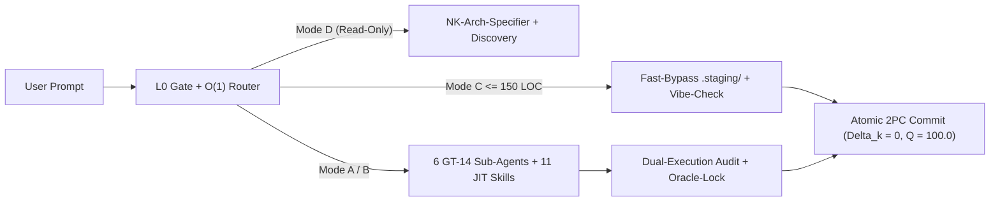

# NK Hub Generation (`v1.0.0-Generation`)
## The Organized, Safe, and Autonomous Multi-Agent Environment for Google Antigravity 2.0

> 🌍 **Language / Lingua:** **[🇬🇧 English (Active)](README.md)** | **[🇮🇹 Versione Italiana](README.it.md)** | **[📖 1-Click ZIP Install Guide](GUIDA_INSTALLAZIONE.md)** | **[🗺️ Library Map](00_MAPPA_LIBRERIA_NK.md)** | **[📋 Patch Notes](../nk_genome/PATCH_NOTES.md)**
>
> 📦 **1-CLICK DOWNLOAD OF THE COMPLETE ENVIRONMENT (`.ZIP`, `v1.0.0-Generation`, Milestone `NK-GEN-1.0.0`):**  
> 👉 **[Download NK_Hub_OneClick_Package.zip (Direct Repository Download)](https://github.com/erbaldo86/NK-Hub/raw/main/nk_docs_and_setup/NK_Hub_OneClick_Package.zip)**  
> *(Contains `.agents/`, `NK_Hub/`, and `NK_External_Projects/` with default `NK_MODEL_PROFILE=generation` and `carbon` fallback.)*

---

## ⚡ 1. 90-Second Quick Look

### Why `NK Hub Generation` Exists
Building software with AI starts fast. As projects grow, three recurring problems slow progress:
1. **Messy folders:** engine files, scripts, tests, and user apps mix in one root directory.
2. **Unsafe live edits:** the agent edits production files directly without isolated verification.
3. **Context loss and test gaming:** long sessions forget rules or weaken tests.

**`NK Hub Generation` (`v1.0.0-Generation`) eliminates all three problems.** It organizes Google Antigravity 2.0 around `6` `GT-14` Native Sub-Agents and `11` JIT `SKILL.md` Playbooks with `NK_MODEL_PROFILE=generation` (fallback `carbon`). The swarm builds inside `.staging/` and promotes via atomic `Win32 2PC` only when `100%` of real checks pass.

### Immediate Benefits at a Glance

| Standard AI Agent Behavior | What Happens with `NK Hub Generation` (`v1.0.0-Generation`) |
| :--- | :--- |
| Mixed engine files and user apps | **Clean Workspace Layout:** `.agents/` bridge, `NK_Hub/` engine, and `NK_External_Projects/` apps |
| Immediate execution on ambiguous prompts | **1-Click L0 Gate:** summarizes requirements, plan, and rules before starting |
| Direct live edits risk partial corruption | **Isolated `.staging/` + Atomic `2PC`:** live files stay consistent |
| Single agent writes and self-grades code | **`Dual-Execution` (`GT-14`):** read-only Auditors inspect JSON telemetry |
| Risk of weakening tests to pass | **`oracle-lock` Seal (`373` files):** tests, scripts, and governance stay `SHA-256` locked |
| Drive FS `conhost.exe` crashes on Windows | **NVMe Isolated Pytest (`[RULE-WIN32-ISOLATED-PYTEST]`):** mirrors to `%TEMP%` via `--pytest-isolated` |

---

## ✨ 2. The Evolutionary Leap (`v1.0.0-Generation` vs Previous Generation)

`NK Hub Generation` (`v1.0.0-Generation`) marks an architectural leap over the previous model (`5` agents, `16` skills, `15` nodes, `93` tests, `Tetralogy`):

| Area | Previous Generation | `NK Hub Generation` (`v1.0.0-Generation`) |
| :--- | :--- | :--- |
| **Sub-Agents (`GT-14`)** | `5` mixed agents | **`6` Native Sub-Agents:** splits `NK-Arch-Specifier` (`write: false`) from `NK-Specifier-Agent` (`write: true`); zero MCP on leaves (`CRIT-01`) |
| **Skills & Dashboard** | `16` skills, `15` nodes (`[0]..[14]`) | **`11` JIT Skills & `10`-Node Dashboard (`[0]`..`[9]`)** under `NK-Orchestrator` |
| **Hooks & Context Shield** | Scattered hooks, `standard` limits | **Unified [`nk-gate`](../.agents/plugins/nk-gate/hooks.json) (`python -S -B -u`) + `ACS` (`Z1/Z2/Z3`)** + `generation` (`150/250` steps, `tier1_token_cap=1200`) |
| **Genome & Code Layout** | `Tetralogy`, `34` monolithic scripts | **`Pentad Sovrana 4+1`** (`3-Tier` Genome) + **`34` facades (`37` indexed modules, `260` `.py`)** with acyclic `_internal/` (`<= 500` LOC) |
| **Test Suite & Cross-OS** | `93` tests (`18` modules) | **`513/513 PASS` (`0` skipped, `41` `test_*.py` / `45` `.py`), `89.32%` Branch Coverage**, `--pytest-isolated` NVMe, `ubuntu-latest` + `windows-latest` CI |

---

## 📦 3. Quick Setup in 3 Steps

1. **Extract the ZIP:** extract `NK_Hub_OneClick_Package.zip` into your workspace folder (`Antigravity/`) to obtain `.agents/`, `NK_Hub/`, and `NK_External_Projects/`.
2. **Run the Installer:** open a terminal inside `NK_Hub/` and run the installer for your OS.
   ```powershell
   # Windows (PowerShell)
   cd NK_Hub
   .\nk_docs_and_setup\install.ps1
   ```
   ```bash
   # Linux or macOS (Bash)
   cd NK_Hub
   bash ./nk_docs_and_setup/install.sh
   ```
   *(Sets `NK_MODEL_PROFILE=generation` with `carbon` fallback, installs [`requirements.txt`](requirements.txt), syncs the `.agents/` root bridge, and runs `--strict-verify`).*
3. **Start the Hub:** open [`nk_docs_and_setup/Antigravity.code-workspace`](Antigravity.code-workspace) in Google Antigravity 2.0. Type any of the `16` startup triggers to open the **10-Node Dashboard (`[0]`..`[9]`)**:
   * **Legacy Triggers (`8`):** `"avvia ambiente nk"`, `"avvia nk hub"`, `"avvia nk"`, `"avvia hub"`, `"start nk"`, `"start hub"`, `"attiva nk"`, `"attiva ambiente nk"`.
   * **Generation Triggers (`8`):** `"avvia generation"`, `"avvia nk generation"`, `"avvia nk hub generation"`, `"avvia ambiente generation"`, `"start generation"`, `"start nk generation"`, `"attiva generation"`, `"attiva ambiente generation"`.

---

## 🎯 4. The 6 Core Pillars of `NK Hub Generation`

1. **Native `generation` Profile (`NK_MODEL_PROFILE=generation`):** sets Context Sentry limits to `150/250` steps and `250k/500k` tokens. Sets Tier-1 memory to `1,200` tokens (fallback `carbon`).
2. **Unified Hook Plugin (`nk-gate`):** [`.agents/plugins.json`](../.agents/plugins.json) mounts a single [`.agents/plugins/nk-gate/hooks.json`](../.agents/plugins/nk-gate/hooks.json) running `5` hooks via `python -S -B -u` alongside `nk_acs_fastguard.py` (`Z1/Z2/Z3`).
3. **Hardware `Dual-Execution` (`GT-14`):** read-only Auditors run with `enable_write_tools: false` and `enable_mcp_tools: false` over JSON telemetry emitted by `DOM-01` into `nk_diagnostics/`.
4. **Windows NVMe Isolated Pytest (`--pytest-isolated`):** `python -B -u scripts/platform_runner.py --pytest-isolated` mirrors the workspace to `%TEMP%` to prevent Drive FS `0xC000013A` crashes.
5. **Genome `Pentad Sovrana 4+1` & Tensor-RSI ($\Delta_k = 0, Q(S_k) = 100.0$):** promotes via `scripts/win32_2pc_engine.py` (`Win32NamedMutex` and `POSIX flock`) exclusively at zero defects.
6. **Measured SLA Benchmarks:**
   * **Session Bootstrap (`scripts/nk_session_bootstrap.py`):** `~31-46 ms` warm (`TTL 900s`).
   * **O(1) Registry Verify (`scripts/nk_registry_indexer.py --verify`):** `< 1.0 ms` cached (`~90 ms` cold) across `7` shards (`DOM-00..DOM-06`).
   * **Preflight & AST Guard:** `scripts/preflight_health_check.py --check-only` in `~445 ms`; `scripts/ast_guard_validator.py --target all` on `305` files (`0` violations).
   * **Oracle-Lock & Zero-Mock Suite:** `373` files locked in [`oracle_lock.json`](../nk_tracking/oracle_lock.json). Runs `513/513 PASS` (`0` skipped) across `41` `test_*.py` modules (`45` `.py`) in `~68.3s` NVMe. Coverage in [`quality_baseline.json`](../nk_tracking/quality_baseline.json): `89.32%` branch, `94.39%` statement, `92.89%` combined.

---

## 🔬 5. Technical Reference: 4 Modes, 6 Sub-Agents, 11 Skills & `scripts/` + `tests/` Map



### 5.1 The `4` Automatic Operating Modes (`scripts/vibe_sprint_router.py`)

| Mode | Trigger Condition | Execution Lane | Verification Gates |
| :--- | :--- | :--- | :--- |
| **`Mode D` (Discovery & Audit)** | Questions, audits, benchmarks, web research | Read-only `Single-Gate` (`NK-Arch-Specifier` / Auditors) | `O(1)` Lookup (`< 1.0 ms`) + `DOM-01` payloads |
| **`Mode C` (Vibe-Sprint Fast Lane)** | Small tweaks (`<= 150` LOC, `max_depth <= 1`) | Fast-Bypass or `NK-Builder-Agent` in `.staging/` | AST Guard (`D01..D04`) + `--vibe-check` |
| **`Mode B` (Bugfix & Refactor)** | Targeted bugfix or multi-file refactor | `NK-Builder-Agent` + `Dual-Execution` Audit | `oracle-lock` + `SBFL Ochiai` (`< 80` tok) |
| **`Mode A` (Full-Stack Project)** | New external app or major evolution | Full `6`-Agent `GT-14` Native Swarm | `Pentad 4+1`, 5-Turn FSM, 6 Gates, `2PC` |

### 5.2 The `6` Native Sub-Agents (`.agents/agents/*/agent.md` + `nk-gate` Plugin)

All `6` leaf sub-agents enforce `enable_subagent_tools: false` and `enable_mcp_tools: false` (`RULE-01` / `CRIT-01`). Only `DOM-01 Orchestrator-Direct` executes built-in `research`, `browser` (`chrome-devtools-mcp`), and `image-generator`, routing payloads to `nk_diagnostics/`.

| Native Sub-Agent | Domain | Permissions (`GT-14`) | Role and Authorized Write Perimeter |
| :--- | :---: | :--- | :--- |
| **[NK-Arch-Specifier](../.agents/agents/NK-Arch-Specifier/agent.md)** | `DOM-02` | **`write: false`**, `mcp: false` | Drives L0 ideation (`NK-Ideator`), `SCAMPER`, `Mode D` discovery, and research analysis over `DOM-01` payloads (does NOT write DAG/OpenAPI). |
| **[NK-Specifier-Agent](../.agents/agents/NK-Specifier-Agent/agent.md)** | `DOM-02` | `write: true`, `mcp: false` | Designs systemic UX/UI (`8px/HSL` WCAG AAA, `Generative UI`), acyclic Kahn DAGs, OpenAPI `3.0` / Pydantic v2, and `Pentad Sovrana 4+1` in `.staging/nk_genome/*`. |
| **[NK-Builder-Agent](../.agents/agents/NK-Builder-Agent/agent.md)** | `DOM-03` | `write: true`, `mcp: false` | Builds async Python / SQLite WAL backends, React/Next.js/Tailwind UIs, and Playbook skills strictly inside `.staging/*`. |
| **[NK-Security-DAST-Auditor](../.agents/agents/NK-Security-DAST-Auditor/agent.md)** | `DOM-04` | **`write: false`**, `mcp: false` | Audits `SAST L1/L2/L3`, DAST sandbox stress reports, Browser E2E telemetry (`DOM-01` / `chrome-devtools-mcp`), and `SBFL Ochiai` RCA. |
| **[NK-RSI-Auditor](../.agents/agents/NK-RSI-Auditor/agent.md)** | `DOM-04` | **`write: false`**, `mcp: false` | Read-only critic auditing `6` CRV Gates, Turn 4 `1:1` alignment, Kahn DAG integrity, `SHA-256` drift, and $\Delta_k = 0$. |
| **[NK-Scribe-Agent](../.agents/agents/NK-Scribe-Agent/agent.md)** | `DOM-05` | `write: true`, `mcp: false` | Updates SSOT docs in `.staging/`, `Pentad 4+1`, AST `repo_map.md`, `PATCH_NOTES.md`, ratchet, and 3-Tier `RRF` memory. |

### 5.3 The `10`-Node Dashboard (`[0]`..`[9]`) & `11` Playbook Skills

| Node | Skill Playbook | Domain | Native Sub-Agent | Core Responsibility |
| :---: | :--- | :---: | :--- | :--- |
| **Hub** | [NK-Orchestrator](../.agents/skills/NK-Orchestrator/SKILL.md) | `DOM-01` | `Orchestrator-Direct` | Governs `2-Tier` routing, `5`-turn FSM, `Dual-Execution`, and `2PC` commits. |
| **`[0]`** | [NK-Ideator](../.agents/skills/NK-Ideator/SKILL.md) | `DOM-02` | `NK-Arch-Specifier` | Drives L0 ideation, `SCAMPER`, `STORM`, and read-only `Mode D` discovery. |
| **`[1]`** | [NK-System-Architect](../.agents/skills/NK-System-Architect/SKILL.md) | `DOM-02` | `NK-Specifier-Agent` | Designs `Pentad Sovrana 4+1`, `8px/HSL` UI, `Generative UI`, Kahn DAG, and OpenAPI `3.0`. |
| **`[2]`** | [NK-Agent-Instruction-Forge](../.agents/skills/NK-Agent-Instruction-Forge/SKILL.md) | `DOM-03` | `NK-Builder-Agent` | Forges skills and agent instructions in ASD-STE100 standard. |
| **`[3]`** | [NK-Python-Async-Builder](../.agents/skills/NK-Python-Async-Builder/SKILL.md) | `DOM-03` | `NK-Builder-Agent` | Builds async Python backends and SQLite WAL modules in `.staging/`. |
| **`[4]`** | [NK-Delta-Architect](../.agents/skills/NK-Delta-Architect/SKILL.md) | `DOM-03` | `NK-Builder-Agent` | Implements Full-Stack UI and surgical refactors in `.staging/`. |
| **`[5]`** | [NK-Security-Auditor](../.agents/skills/NK-Security-Auditor/SKILL.md) | `DOM-04` | `NK-Security-DAST-Auditor` | Audits `SAST L1/L2/L3` and CLI `CoVe` flags in read-only mode. |
| **`[6]`** | [NK-Oracle-Evaluator](../.agents/skills/NK-Oracle-Evaluator/SKILL.md) | `DOM-04` | `NK-RSI-Auditor` | Evaluates `6` Cold Review Gates, `1:1` alignment, and `SHA-256` locks. |
| **`[7]`** | [NK-Dynamic-Sandbox-StressTester](../.agents/skills/NK-Dynamic-Sandbox-StressTester/SKILL.md) | `DOM-04` | `NK-Security-DAST-Auditor` | Inspects DAST sandbox reports and `DOM-01` Browser E2E telemetry. |
| **`[8]`** | [NK-Bug-Diagnostic-Engine](../.agents/skills/NK-Bug-Diagnostic-Engine/SKILL.md) | `DOM-04` | `NK-Security-DAST-Auditor` | Isolates root causes from `SBFL Ochiai` payloads (`< 80` tok). |
| **`[9]`** | [NK-Scribe-Memory](../.agents/skills/NK-Scribe-Memory/SKILL.md) | `DOM-05` | `NK-Scribe-Agent` | Synchronizes `PATCH_NOTES.md`, shards, `repo_map.md`, and 3-Tier `RRF` memory. |

### 5.4 `scripts/` Architecture (`34` Top-Level, `37` Indexed Modules, `260` `.py`) & `tests/` Suite

Every top-level facade delegates to acyclic `scripts/_internal/` submodules (`<= 500` LOC) and `scripts/schemas/` (`4` strict Pydantic v2 `L0` schemas):

1. **`DOM-01` (Governance, Routing & 2PC):** `nk_session_bootstrap.py`, `nk_registry_indexer.py`, `vibe_sprint_router.py`, `nk_hook_gate.py`, `nk_acs_fastguard.py`, `win32_2pc_engine.py`, `preflight_health_check.py`, `nk_swarm_messenger.py`, and `scripts/schemas/` (`dual_ledgers.py`, `dual_ledgers_models.py`, `nk_catalog_contracts.py`, `nk_ipc_contracts.py`).
2. **`DOM-02` (Ideation, AST Map & Scaffolding):** `ast_repo_mapper.py`, `external_project_scaffolder.py` (targets `NK_External_Projects/`), and `env_capability_probe.py`.
3. **`DOM-03` (Build, Healing & NVMe Runner):** `auto_heal_pipeline.py`, `healing_snapshot_rollback.py`, `invisible_healing_loop.py`, `platform_runner.py`, `safe_cleanup_dev_servers.py`, `deterministic_api_cache.py`, and `async_heartbeat_signaler.py`.
4. **`DOM-04` (Security, DAST & RSI Convergence):** `ast_guard_validator.py`, `dast_sandbox_runner.py`, `oracle_evaluator_l3.py`, `sbfl_engine.py`, `sbfl_pytest_bridge.py`, `rsi_convergence_engine.py`, and `nk_transcript_tools.py`.
5. **`DOM-05` (Memory, Telemetry & Ratchet):** `memory_3tier_engine.py`, `quality_baseline_manager.py`, `nk_context_sentry.py`, `nk_active_runtime_sentinel.py`, `nk_compliance_checker.py`, `nk_auto_inning.py`, `nk_session_handoff.py`, and `micro_hud_renderer.py`.
6. **Permanent `tests/` Suite (`41` `test_*.py` modules, `45` `.py` total):** certifies `513/513 PASS` (`0` skipped). Achieves **`89.32%` Branch**, **`94.39%` Statement**, and **`92.89%` Combined** coverage on NVMe (`--pytest-isolated`, `~68.3s`) and CI ([`.github/workflows/ci.yml`](../.github/workflows/ci.yml)).

---
*NK Hub Generation (`v1.0.0-Generation`) | Milestone `NK-GEN-1.0.0` | Zero-Mock `513/513 PASS` (`89.32%` Branch) | $\Delta_k = 0, Q(S_k) = 100.0$*
