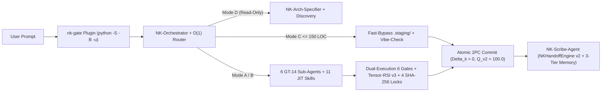

# NK Hub Generation (`v3.0.2-Generation`)
## The Organized, Safe, and Autonomous Multi-Agent Environment for Google Antigravity 2.0

> 🌍 **Language / Lingua:** **[🇬🇧 English (Active)](README.md)** | **[🇮🇹 Versione Italiana](README.it.md)** | **[📖 1-Click ZIP Install Guide](GUIDA_INSTALLAZIONE.md)** | **[🗺️ Library Map](00_MAPPA_LIBRERIA_NK.md)** | **[📋 Patch Notes](../nk_genome/PATCH_NOTES.md)**
>
> 📦 **1-CLICK DOWNLOAD OF THE COMPLETE ENVIRONMENT (`.ZIP`, `v3.0.2-Generation`, Milestone `NK-GEN-3.0.2-FORENSIC-HARDENING-CLEAN`, `Core ABI 1.0.0-Generation`):**  
> 👉 **[Download NK_Hub_OneClick_Package.zip (Direct Repository Download)](https://github.com/erbaldo86/NK-Hub/raw/main/nk_docs_and_setup/NK_Hub_OneClick_Package.zip)**  
> *(Contains `.agents/`, `NK_Hub/`, and multi-root workspace configuration targeting `NK Proget/Locale/` with default `NK_MODEL_PROFILE=generation` and `carbon` fallback.)*

---

## ⚡ 1. 90-Second Quick Look

### Why `NK Hub Generation` Exists
Building software with AI starts fast. As projects grow, three recurring problems slow progress:
1. **Messy folders:** engine files, scripts, tests, and user apps mix in one root directory.
2. **Unsafe live edits:** the agent alters production files directly without isolated verification.
3. **Context loss and test gaming:** long sessions forget constraints or weaken tests.

**`NK Hub Generation` (`v3.0.2-Generation`, `Core ABI 1.0.0-Generation`) eliminates all three problems.** It organizes Google Antigravity 2.0 around `6` `GT-14` Native Sub-Agents and `11` JIT `SKILL.md` Playbooks with `NK_MODEL_PROFILE=generation` (fallback `carbon`, also supporting `neon`, `pro`, `flash`, `argon`, `standard`). The swarm builds inside `.staging/` and promotes via atomic `Win32 2PC` only when `100%` of real checks pass.

### Immediate Benefits at a Glance

| Standard AI Agent Behavior | What Happens with `NK Hub Generation` (`v3.0.2-Generation`) |
| :--- | :--- |
| Mixed engine files and user apps | **Clean Multi-Root Isolation:** `.agents/` bridge, `NK_Hub/` engine, `NK Proget/Locale/` apps (compat `NK_External_Projects/`), and read-only `NK Proget/Online/` mirror |
| Immediate execution on ambiguous prompts | **1-Click L0 Gate:** summarizes requirements, plan, and rules before starting |
| Direct live edits risk partial corruption | **Isolated `.staging/` + Atomic `2PC`:** live files stay consistent and `NK Proget/Online/` remains strictly read-only |
| Single agent writes and self-grades code | **`Dual-Execution` (`GT-14`):** read-only Auditors inspect JSON telemetry under `Tensor-RSI v3` |
| Risk of weakening tests to pass | **`4` `SHA-256` Locks:** seal `tests/`, `nk_tracking/oracle_holdout/`, `scripts/`, and `nk_genome/configs/tensor_rsi/` |
| Drive FS `conhost.exe` crashes on Windows | **NVMe Isolated Pytest (`[RULE-WIN32-ISOLATED-PYTEST]`):** mirrors to `%TEMP%` via `--pytest-isolated` with `PYTEST_DISABLE_PLUGIN_AUTOLOAD=1` |

---

## ✨ 2. Upgrade & Qualitative Leap (`v1.0.0-Generation` -> `v3.0.2-Generation`)

`NK Hub Generation` (`v3.0.2-Generation`) keeps `Core ABI 1.0.0-Generation` intact (`6` `GT-14` Sub-Agents, `11` JIT Skills, `10`-Node Dashboard, `16` startup triggers, `5` domains) while hardening every runtime, security, and verification layer over `v1.0.0-Generation`:

| Measured / Architectural Dimension | `v1.0.0-Generation` (`NK-GEN-1.0.0`, `2026-11-17`) | `v3.0.2-Generation` (`NK-GEN-3.0.2-FORENSIC-HARDENING-CLEAN`, `2026-11-24`) |
| :--- | :--- | :--- |
| **Control Plane & Convergence** | Base `Win32 2PC` + `RSI` foundation | **`Tensor-RSI v3`** (`trsi1` HMAC, `ParetoGate`, `CladeBandit K=4`, `Jeffreys LCB90`, `NaN/Inf` clamp) + **`Q_v2 = 100.0`** across **`14` `G_hard` gates** ($\Delta_k = 0$) |
| **Anti-Replay & Promotion Locks** | `1` initial lock (`oracle_lock.json`) | **`4` `SHA-256` locks** (`oracle_lock.json`, `oracle_lock_holdout.json`, `governance_lock.json`, `tensor_rsi_lock.json`) + **`nonce_store`** (`Win32NamedMutex`) + `ACTIVE.json` gate |
| **Handoff & Epistemic Firewall** | Basic session anchor | **`NKHandoffEngine v2`** (`35`-key strict whitelist) + **`Epistemic Firewall`** (`AP-12..16`, `strip_l3_persuasive_narrative`, `2PC_ATOMIC_PROMOTION` precedence) |
| **Permanent Zero-Mock Suite (`tests/`)** | Baseline reset (`NK-GEN-2.0.0-W1`: `522/522` in `70.43s`) | **`384/384 PASS`** in **`20.0s`** (`<= 28.0s` ceiling; `-m fast <= 8.0s` with `PYTEST_DISABLE_PLUGIN_AUTOLOAD=1`; `385/385` in 6-worker NVMe sharding) across **`40` suites** |
| **Code Coverage & Mutation Audit** | `stmt 89.29%`, `true_branch 80.09%`, `combined 86.56%` (`W1`) | **`stmt 91.25%`** (`>= 90.5%`), **`true_branch 83.43%`** (`>= 82.0%`), **`combined 88.98%`** (`>= 88.0%`), **`Mutation Audit 97.22%`** (`21/21` modules, `245/252` killed) |
| **External Apps & `NK Proget/`** | Legacy `NK_External_Projects/` isolation | **`526/526` external app tests `PASS`** across `4/4` repos in **`NK Proget/Locale/`** (`264` + `128` + `133` + `1`), with **`NK Proget/Online/`** locked read-only (`CRIT-01`) |
| **Indexed `scripts/` & Genome** | `39` pre-debloat scripts, `Pentad 4+1` | **`34` modules** across **`5` domains** (`29` CLI facades + **`5` `L0` schemas**), acyclic `_internal/` (`<= 500` LOC), `7` JSON shards (`DOM-00..06`) |

---

## 📦 3. Quick Setup in 3 Steps

1. **Extract the ZIP:** extract `NK_Hub_OneClick_Package.zip` alongside `NK Proget/Locale/` to obtain `.agents/` and `NK_Hub/`.
2. **Run the Installer:** open a terminal inside `NK_Hub/` and run the installer for your OS.
   ```powershell
   # Windows (PowerShell)
   cd NK_Hub
   .\nk_docs_and_setup\install.ps1
   ```
   ```bash
   # Linux or macOS (Bash)
   cd NK_Hub
   bash ./nk_docs_and_setup/install.sh
   ```
   *(Sets `NK_MODEL_PROFILE=generation` with `carbon` fallback, installs [`requirements.txt`](requirements.txt), syncs the `.agents/` root bridge, and runs `--strict-verify`.)*
3. **Start the Hub:** open [`nk_docs_and_setup/Antigravity.code-workspace`](Antigravity.code-workspace) in Google Antigravity 2.0. Type any of the `16` startup triggers to open the **10-Node Dashboard (`[0]`..`[9]`)**:
   * **Legacy Triggers (`8`):** `"avvia ambiente nk"`, `"avvia nk hub"`, `"avvia nk"`, `"avvia hub"`, `"start nk"`, `"start hub"`, `"attiva nk"`, `"attiva ambiente nk"`.
   * **Generation Triggers (`8`):** `"avvia generation"`, `"avvia nk generation"`, `"avvia nk hub generation"`, `"avvia ambiente generation"`, `"start generation"`, `"start nk generation"`, `"attiva generation"`, `"attiva ambiente generation"`.

---

## 🎯 4. The 6 Core Pillars of `NK Hub Generation`

1. **Multi-Profile Support (`NK_MODEL_PROFILE=generation`):** defaults Context Sentry to `150/250` steps, `250k/500k` tokens, and Tier-1 to `1,200` tokens (`carbon` fallback), with presets for `neon`, `pro`, `flash`, `argon`, and `standard`.
2. **Unified Hook Plugin (`nk-gate`):** [`.agents/plugins.json`](../.agents/plugins.json) mounts a single [`.agents/plugins/nk-gate/hooks.json`](../.agents/plugins/nk-gate/hooks.json) running via `python -S -B -u` alongside `nk_acs_fastguard.py` (`Z0..Z3`, `160k/185k/205k`).
3. **Hardware `Dual-Execution` (`GT-14`):** read-only Auditors run with `enable_write_tools: false` and `enable_mcp_tools: false` over JSON telemetry emitted by `DOM-01` into `nk_diagnostics/`.
4. **Windows NVMe Isolated Pytest (`--pytest-isolated`):** `python -B -u scripts/platform_runner.py --pytest-isolated` mirrors the workspace to `%TEMP%` with `PYTEST_DISABLE_PLUGIN_AUTOLOAD=1`, preventing Drive FS `0xC000013A` crashes.
5. **Genome `Pentad Sovrana 4+1` & `Tensor-RSI v3` Control Plane ($\Delta_k = 0, Q_{v2} = 100.0$):** `scripts/tensor_rsi.py` enforces signed `trsi1` HMAC tickets, `ParetoGate`, `Jeffreys LCB90`, and `NaN/Inf` clamping. `scripts/win32_2pc_engine.py` promotes only after verifying `ACTIVE.json` and `nonce_store.py` anti-replay under `Win32NamedMutex` and `POSIX flock`.
6. **Verified SLA Gates & SSOT Telemetry:**
   * **Session Bootstrap (`scripts/nk_session_bootstrap.py`):** warm Fast-Stat cache (`TTL 900s`) with full-tree invalidation and `NKHandoffEngine v2`.
   * **O(1) Registry Verify (`scripts/nk_registry_indexer.py --verify`):** validates the compact manifest (`34` modules, `11` skills, `5` domains) and `7` shards (`DOM-00..DOM-06`).
   * **Preflight & AST Guard:** `scripts/preflight_health_check.py --check-only` and `scripts/ast_guard_validator.py --target all` enforce acyclic modules (`<= 500` LOC) and zero critical violations.
   * **Quadruple SHA-256 Lock & Baseline Schema `v2`:** `4` locks ([`oracle_lock.json`](../nk_tracking/oracle_lock.json), `oracle_lock_holdout.json`, `governance_lock.json`, `tensor_rsi_lock.json`) guard tests, holdouts, scripts, and Tensor-RSI configs. Live metrics (`384/384` in `20.0s`, `stmt 91.25%`, `true_branch 83.43%`, `combined 88.98%`) reside in [`quality_baseline.json`](../nk_tracking/quality_baseline.json).

---

## 🔬 5. Technical Reference: 4 Modes, 6 Sub-Agents, 11 Skills & `scripts/` + `tests/` Map



### 5.1 The `4` Automatic Operating Modes (`scripts/vibe_sprint_router.py`)

| Mode | Trigger Condition | Execution Lane | Verification Gates |
| :--- | :--- | :--- | :--- |
| **`Mode D` (Discovery & Audit)** | Questions, audits, benchmarks, web research | Read-only `Single-Gate` (`NK-Arch-Specifier` / Auditors) | `O(1)` Lookup + `DOM-01` payloads |
| **`Mode C` (Vibe-Sprint Fast Lane)** | Small tweaks (`<= 150` LOC, `max_depth <= 1`) | Fast-Bypass or `NK-Builder-Agent` in `.staging/` | AST Guard (`D01..D04`) + `--vibe-check` |
| **`Mode B` (Bugfix & Refactor)** | Targeted bugfix or multi-file refactor | `NK-Builder-Agent` + `Dual-Execution` Audit | `4` SHA-256 locks + `SBFL Ochiai` (`< 80` tok) |
| **`Mode A` (Full-Stack Project)** | New app in `NK Proget/Locale/` or evolution | Full `6`-Agent `GT-14` Native Swarm | `Pentad 4+1`, 5-Turn FSM, `14` `G_hard`, `2PC` |

### 5.2 The `6` Native Sub-Agents (`.agents/agents/*/agent.md` + `nk-gate` Plugin)

All `6` leaf sub-agents enforce `enable_subagent_tools: false` and `enable_mcp_tools: false` (`RULE-01` / `CRIT-01`). Only `DOM-01 Orchestrator-Direct` executes built-in `research`, `browser` (`chrome-devtools-mcp`), and `image-generator`, routing payloads to `nk_diagnostics/`.

| Native Sub-Agent | Domain | Permissions (`GT-14`) | Role and Authorized Write Perimeter |
| :--- | :---: | :--- | :--- |
| **[NK-Arch-Specifier](../.agents/agents/NK-Arch-Specifier/agent.md)** | `DOM-02` | **`write: false`**, `mcp: false` | Drives L0 ideation (`NK-Ideator`), `SCAMPER`, `Mode D` discovery, and research analysis over `DOM-01` payloads (does NOT write DAG/OpenAPI). |
| **[NK-Specifier-Agent](../.agents/agents/NK-Specifier-Agent/agent.md)** | `DOM-02` | `write: true`, `mcp: false` | Designs systemic UX/UI (`8px/HSL` WCAG AAA, `Generative UI`), acyclic Kahn DAGs, OpenAPI `3.0` / Pydantic v2, and `Pentad Sovrana 4+1` in `.staging/nk_genome/*`. |
| **[NK-Builder-Agent](../.agents/agents/NK-Builder-Agent/agent.md)** | `DOM-03` | `write: true`, `mcp: false` | Builds async Python / SQLite WAL backends, React/Next.js/Tailwind UIs, and Playbook skills strictly inside `.staging/*`. |
| **[NK-Security-DAST-Auditor](../.agents/agents/NK-Security-DAST-Auditor/agent.md)** | `DOM-04` | **`write: false`**, `mcp: false` | Audits `SAST L1/L2/L3`, DAST sandbox stress reports, Browser E2E telemetry (`DOM-01` / `chrome-devtools-mcp`), and `SBFL Ochiai` RCA. |
| **[NK-RSI-Auditor](../.agents/agents/NK-RSI-Auditor/agent.md)** | `DOM-04` | **`write: false`**, `mcp: false` | Read-only critic auditing `6` CRV Gates, Turn 4 `1:1` alignment, Kahn DAG integrity, `SHA-256` drift, and $\Delta_k = 0$. |
| **[NK-Scribe-Agent](../.agents/agents/NK-Scribe-Agent/agent.md)** | `DOM-05` | `write: true`, `mcp: false` | Updates SSOT docs in `.staging/`, `Pentad 4+1`, AST `repo_map.md`, `PATCH_NOTES.md`, ratchet, and 3-Tier `RRF` memory. |

### 5.3 The `10`-Node Dashboard (`[0]`..`[9]`) & `11` Playbook Skills

| Node | Skill Playbook | Domain | Native Sub-Agent | Core Responsibility |
| :---: | :--- | :---: | :--- | :--- |
| **Hub** | [NK-Orchestrator](../.agents/skills/NK-Orchestrator/SKILL.md) | `DOM-01` | `Orchestrator-Direct` | Governs `2-Tier` routing, `5`-turn FSM, `Dual-Execution`, and `2PC` commits. |
| **`[0]`** | [NK-Ideator](../.agents/skills/NK-Ideator/SKILL.md) | `DOM-02` | `NK-Arch-Specifier` | Drives L0 ideation, `SCAMPER`, `STORM`, and read-only `Mode D` discovery. |
| **`[1]`** | [NK-System-Architect](../.agents/skills/NK-System-Architect/SKILL.md) | `DOM-02` | `NK-Specifier-Agent` | Designs `Pentad Sovrana 4+1`, `8px/HSL` UI, `Generative UI`, Kahn DAG, and OpenAPI `3.0`. |
| **`[2]`** | [NK-Agent-Instruction-Forge](../.agents/skills/NK-Agent-Instruction-Forge/SKILL.md) | `DOM-03` | `NK-Builder-Agent` | Forges skills and agent instructions in ASD-STE100 standard. |
| **`[3]`** | [NK-Python-Async-Builder](../.agents/skills/NK-Python-Async-Builder/SKILL.md) | `DOM-03` | `NK-Builder-Agent` | Builds async Python backends and SQLite WAL modules in `.staging/`. |
| **`[4]`** | [NK-Delta-Architect](../.agents/skills/NK-Delta-Architect/SKILL.md) | `DOM-03` | `NK-Builder-Agent` | Implements Full-Stack UI and surgical refactors in `.staging/`. |
| **`[5]`** | [NK-Security-Auditor](../.agents/skills/NK-Security-Auditor/SKILL.md) | `DOM-04` | `NK-Security-DAST-Auditor` | Audits `SAST L1/L2/L3` and CLI `CoVe` flags in read-only mode. |
| **`[6]`** | [NK-Oracle-Evaluator](../.agents/skills/NK-Oracle-Evaluator/SKILL.md) | `DOM-04` | `NK-RSI-Auditor` | Evaluates `6` Cold Review Gates, `1:1` alignment, and `4` `SHA-256` locks. |
| **`[7]`** | [NK-Dynamic-Sandbox-StressTester](../.agents/skills/NK-Dynamic-Sandbox-StressTester/SKILL.md) | `DOM-04` | `NK-Security-DAST-Auditor` | Inspects DAST sandbox reports and `DOM-01` Browser E2E telemetry. |
| **`[8]`** | [NK-Bug-Diagnostic-Engine](../.agents/skills/NK-Bug-Diagnostic-Engine/SKILL.md) | `DOM-04` | `NK-Security-DAST-Auditor` | Isolates root causes from `SBFL Ochiai` payloads (`< 80` tok). |
| **`[9]`** | [NK-Scribe-Memory](../.agents/skills/NK-Scribe-Memory/SKILL.md) | `DOM-05` | `NK-Scribe-Agent` | Synchronizes `PATCH_NOTES.md`, shards, `repo_map.md`, and 3-Tier `RRF` memory. |

### 5.4 `scripts/` Architecture (`34` Modules / `5` Domains / `5` `L0` Schemas) & `40`-Suite `tests/` Pyramid

Every top-level facade delegates to acyclic `scripts/_internal/` submodules (`<= 500` LOC) and `scripts/schemas/` (`5` strict Pydantic v2 `L0` schemas), totaling `34` indexed modules across `5` domains:

1. **`DOM-01` (Governance, Routing, `Tensor-RSI v3` & `2PC`):** `nk_session_bootstrap.py`, `nk_registry_indexer.py`, `vibe_sprint_router.py`, `nk_hook_gate.py`, `nk_acs_fastguard.py`, `win32_2pc_engine.py`, `preflight_health_check.py`, `tensor_rsi.py`, and `scripts/schemas/` (`dual_ledgers.py`, `dual_ledgers_models.py`, `nk_catalog_contracts.py`, `nk_ipc_contracts.py`).
2. **`DOM-02` (Ideation, AST Map & Scaffolding):** `ast_repo_mapper.py`, `external_project_scaffolder.py` (targets `NK Proget/Locale/`, compat `NK_External_Projects/`, blocks `NK Proget/Online/`), and `env_capability_probe.py`.
3. **`DOM-03` (Build, Healing & NVMe Runner):** `auto_heal_pipeline.py`, `builder_mutation_gate.py`, `healing_snapshot_rollback.py`, `platform_runner.py`, `safe_cleanup_dev_servers.py`, `deterministic_api_cache.py`, and `async_heartbeat_signaler.py`.
4. **`DOM-04` (Security, DAST & RSI Convergence):** `ast_guard_validator.py`, `dast_sandbox_runner.py`, `oracle_evaluator_l3.py`, `sbfl_pytest_bridge.py`, `rsi_convergence_engine.py`, and `nk_transcript_tools.py`.
5. **`DOM-05` (Memory, Handoff, Telemetry & Ratchet):** `memory_3tier_engine.py`, `quality_baseline_manager.py`, `nk_context_sentry.py`, `nk_compliance_checker.py`, `nk_session_handoff.py`, and `scripts/schemas/handoff_contracts.py`.
6. **Permanent `40`-Suite `tests/` Pyramid (`Schema v2` + CI):** runs `384/384 PASS` in `20.0s` (`tier 1 -m fast <= 8.0s`, `tier 1+2 <= 28.0s`) on NVMe (`--pytest-isolated`, `PYTEST_DISABLE_PLUGIN_AUTOLOAD=1`). Cross-OS CI ([`.github/workflows/ci.yml`](../.github/workflows/ci.yml)) verifies all `4` `SHA-256` locks and enforces `combined >= 88.0%` (`88.98%` live) and `true_branch >= 82.0%` (`83.43%` live). Live metrics reside in [`quality_baseline.json`](../nk_tracking/quality_baseline.json).

---

## 📋 6. Patch Notes Summary (`v1.0.0` -> `v3.0.2`)

* **`NK-GEN-1.0.0..1.0.3` (`2026-11-17..18`):** Inaugurates `NK Hub Generation` (`Core ABI 1.0.0-Generation`), `GT-14` topology, isolated NVMe runner, and `HookGateV2`.
* **`NK-GEN-1.1.0..1.1.1` (`HANDOFF-V2`, `2026-11-19`):** Introduces `NKHandoffEngine v2` (`35`-key whitelist) and pure-stdlib `Epistemic Firewall` (`AP-14..16`).
* **`NK-GEN-1.2.0..1.3.1` (`BUILDER-RSI` & `HARDENING`, `2026-11-22`):** Prunes top-level scripts (`39 -> 33`), halves live latency (`131.38s -> 57.46s`), and enforces fail-closed DAST + holdouts.
* **`NK-GEN-2.0.0-W0..W3` & `NK-GEN-2.1.0-W6` (`2026-11-22..23`):** Establishes the NVMe test pyramid (`<= 8.0s` / `<= 28.0s`), `Schema v2` ratchet, `3` `SHA-256` locks, and `97.22%` Mutation Audit (`21/21` modules).
* **`NK-GEN-3.0.0` (`TENSOR-CORE`, `2026-11-24`):** Activates `Tensor-RSI v3`, signed `trsi1` HMAC tickets, `nonce_store.py` anti-replay, `4`th lock `tensor_rsi_lock.json`, and `82.0%` branch floor.
* **`NK-GEN-3.0.1` (`PROGET-MIGRATION`, `2026-11-24`):** Locks `NK Proget/Online/` read-only (`CRIT-01`), enables `.staging/` in `NK Proget/Locale/`, and verifies `526/526` tests across `4/4` external apps.
* **`NK-GEN-3.0.2-FORENSIC-HARDENING-CLEAN` (`2026-11-24..25`):** Enforces `NaN/Inf` clamp, `Jeffreys LCB90`, `PYTEST_DISABLE_PLUGIN_AUTOLOAD=1`, orphan pruning (`18` files), post-compaction precedence, and `384/384 PASS` (`20.0s`). Full history in **[📋 PATCH_NOTES.md](../nk_genome/PATCH_NOTES.md)**.

---
*NK Hub Generation (`v3.0.2-Generation`) | Milestone `NK-GEN-3.0.2-FORENSIC-HARDENING-CLEAN` | Core ABI `1.0.0-Generation` | SSOT: `nk_tracking/quality_baseline.json` | $\Delta_k = 0, Q_{v2}(S_k) = 100.0$*
