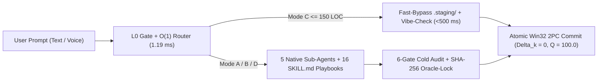

# Nexus Keystone Hub (NK-Hub v5.0.0-STE100-Unified)
## The Organized, Safe, and Autonomous Multi-Agent Development Environment for Google Antigravity

> 🌍 **Language / Lingua:** **[🇬🇧 English (Active)](README.md)** | **[🇮🇹 Versione Italiana](README.it.md)** | **[📖 1-Click ZIP Install Guide](GUIDA_INSTALLAZIONE.md)** | **[🗺️ Library Map](00_MAPPA_LIBRERIA_NK.md)**
>
> 📦 **1-CLICK DOWNLOAD OF THE COMPLETE ENVIRONMENT (`.ZIP` WITH INSTALL GUIDE):**  
> 👉 **[Download NK_Hub_OneClick_Package.zip (Official Release v5.0.0-STE100-Unified)](https://github.com/erbaldo86/NK-Hub/releases/download/v5.0.0-STE100-Unified/NK_Hub_OneClick_Package.zip)** *(or [Direct Download from Repository](https://github.com/erbaldo86/NK-Hub/raw/main/nk_docs_and_setup/NK_Hub_OneClick_Package.zip))*

---

## ⚡ 1. 90-Second Quick Look (The Hook: Why It Was Built & How It Works)

### Why was `NK-Hub` created?
When you build software with AI (Vibe Coding), the first few minutes feel effortless. As soon as a project grows, however, three recurring problems slow everything down:
1. **Messy folders:** system files, scripts, tests, and user projects end up scattered or duplicated in the same folder.
2. **Edits that break working code:** the AI modifies your live files directly without testing them in a safe area first.
3. **Context loss and fake test passes:** during long sessions, the AI forgets rules. It may also weaken tests to make them turn green.

**`NK-Hub` was built to eliminate all three problems.** It turns Google Antigravity into an organized control center with `5` specialized Sub-Agents. The team plans, builds, and tests code inside `.staging/`. It promotes changes only when `100%` of real checks pass.

### 💬 30-Second Live Example: How You Interact with `NK-Hub`
> 1. **You type in chat (or speak via voice dictation):**  
>    *"Create a web application to manage customer quotes and export them as PDF."*
> 2. **`NK-Hub` immediately shows the L0 Confirmation Mirror (`Gate L0`):**  
>    *"Goal understood: I will scaffold the isolated app in `NK_External_Projects/QuoteApp`. Next, I will build the database, UI, and PDF exporter in staging. Confirm with 1 click?"*
> 3. **You click `Confirm`:**  
>    The agent team builds the application in `.staging/` and runs security tests. It heals errors automatically and delivers the verified project into your folder.

### Immediate Benefits at a Glance

| What Usually Happens with a Standard AI Agent | What Happens with `NK-Hub` |
| :--- | :--- |
| Cluttered root folder mixing engine and user apps | **Clean Two-Folder Library:** `NK_Hub/` (the engine) and `NK_External_Projects/` (your apps) |
| The AI starts immediately and may misunderstand intent | **1-Click L0 Gate:** summarizes requirements upfront and starts only on your confirmation |
| Direct edits on live files risk breaking working code | **Isolated `.staging/` + Atomic Commit:** live files are never left in a half-broken state |
| One single agent tries to do everything and loses focus | **5 Native Sub-Agents:** the agent that writes code is separated from the agents that audit it |
| Risk of the AI weakening tests to fake success | **Anti-Gaming `oracle-lock` Seal:** tests are cryptographically locked against tampering |

---

## 📦 2. Quick Installation Guide (For 1-Click ZIP Users)

The **[NK_Hub_OneClick_Package.zip](https://github.com/erbaldo86/NK-Hub/releases/download/v5.0.0-STE100-Unified/NK_Hub_OneClick_Package.zip)** archive includes the entire organized environment and the bilingual [GUIDA_INSTALLAZIONE.md](GUIDA_INSTALLAZIONE.md).

### Setup in 3 Easy Steps
1. **Extract the ZIP:** download `NK_Hub_OneClick_Package.zip` and extract it into your main workspace folder (for example `Antigravity/`). You will see two clean folders: `NK_Hub` and `NK_External_Projects`.
2. **Run the Automated Installer:** open PowerShell inside `NK_Hub` and run:
   ```powershell
   cd NK_Hub
   .\nk_docs_and_setup\install.ps1
   ```
   *(On Linux/macOS run `./nk_docs_and_setup/install.sh`. The script installs dependencies from `nk_docs_and_setup/requirements.txt`, verifies the O(1) index in `< 1.0 ms`, and runs the `253` certified tests).*
3. **Launch the Engine in Antigravity:** open the folder in Google Antigravity and type in chat:
   ```text
   start nk
   ```
   *(or `"avvia ambiente nk"`).* The **15-Node Control Dashboard (`[0]`..`[14]`)** will appear in under `50 ms`.

---

## 🎯 3. Designed for Two Audiences: Vibe Coders vs. Expert Engineers + 6 Core Pillars

`NK-Hub` is built on two levels. It is effortless on the surface for creators and mathematically rigorous underneath for senior engineers.

### 🧑‍💻 A. For Non-Technical / Vibe Coding Users (Effortless Creation)
You do not need programming experience or terminal commands. Here is how you use it every day:

| What You Want to Do | What You Type in Antigravity Chat | What `NK-Hub` Does Automatically for You |
| :--- | :--- | :--- |
| **Start the environment** | `"start nk"` or `"avvia ambiente nk"` | Verifies system health in `< 1.0 ms` and opens the interactive 15-node dashboard. |
| **Create a brand-new app** | *"I want an app to track grant deadlines and alerts"* | Creates a clean folder in `NK_External_Projects/`, designs UI and database, and builds the app. |
| **Make a quick visual tweak** | *"Add a green button to export the table to Excel"* | Activates the fast lane (`Mode C`), stages and verifies the edit in under half a second. |
| **Fix an error** | *"Clicking Save shows an error, can you fix it?"* | Pinpoints the exact faulty line, repairs it in `.staging/`, and updates your app safely. |

* **Speak or type naturally:** if voice dictation merges words together, the built-in voice normalizer fixes them before routing.
* **Zero risk of breaking the engine:** your projects always live inside `NK_External_Projects/`, and every edit is tested in `.staging/` first.

---

### 🛠️ B. For Experienced Developers & Senior Architects (Why Use `NK-Hub`?)
If you are an experienced engineer wondering what `NK-Hub` adds over a standard AI coding assistant:

| Standard AI Coding Assistant Limitation | Deterministic Solution Engineered in `NK-Hub` |
| :--- | :--- |
| **Monolithic Context & Context Rot** | **2-Tier Hub-and-Spoke Topology:** `5` isolated Native Sub-Agents with independent context windows and automatic external skill filtering (`-7,042` tokens/turn). |
| **Self-Grading & Reward Hacking (*Goodhart's Law*)** | **Hardware `GT-14` Boundary + `oracle-lock`:** Auditors run with `enable_write_tools: false` and test suites are sealed in `SHA-256` before build execution. |
| **Partial Writes & Working Tree Corruption** | **Atomic `Win32 2PC` Transactions:** promotion from `.staging/` is guarded by a 64-bit Kernel Named Mutex with full batch rollback on failure. |
| **High Latency on Small Edits** | **`Mode C` Fast-Bypass (`< 500 ms`) & `OPT-11` Cache (`< 1.0 ms`):** AST depth triage (`max_depth <= 1`, `<= 150` LOC) saving `71.9%` of tokens. |
| **Massive Traceback Dumps in Debugging** | **`SBFL Ochiai` Fault Localization (`< 80` Tokens):** spectral fault localization with AST Def-Use slicing and monotonic SHA-256 snapshots. |

---

### 🌟 C. The 6 Core Pillars of `NK-Hub` (Key Engineering Advantages)

1. **Clean Physical Library Layout (`NK_Hub` + `NK_External_Projects` + `nk_docs_and_setup`):**
   Every file has a single physical copy and logical home. Manuals live in `nk_docs_and_setup/`, plans in `nk_genome/`, telemetry in `nk_tracking/`, scripts in `scripts/`, and user apps in `NK_External_Projects/`.
2. **Hardware Separation Between Builders and Auditors (`GT-14`):**
   The `5` Native Sub-Agents enforce strict YAML permissions: `NK-Security-DAST-Auditor` and `NK-RSI-Auditor` run with `enable_write_tools: false`, and all sub-agents enforce `enable_subagent_tools: false` (`RULE-01`).
3. **1-Click L0 Gate & `Mode C` Fast-Bypass (`< 500 ms`, `-71.9%` Token Usage):**
   Before execution, the router compiles a strict Pydantic v2 contract (`MetaPromptGateContract`) with a `SHA-256` intent hash. Edits under `150` lines run via Fast-Bypass in `~65 ms`.
4. **$100\times$ Epistemic Honesty & `SAST-GAMING-D01..D04` Static Guards:**
   The AST validator blocks reading `PYTEST_CURRENT_TEST` (`D01`) or inspecting runtime stack frames (`D02`). It also blocks hardcoded host fixtures (`D03`) and branching on test dataset size (`D04`).
5. **Mathematical Tensor-RSI Convergence ($\Delta_k = 0, Q(S_k) = 100.0$) & `Win32 2PC` Commit:**
   At each iteration $k$, the engine evaluates the defect vector $\Delta_k(p)$ and fitness $Q(S_k)$:
   $$\Delta_k(p) = 100 D_k + 20 E_{\text{PoC},k} + w_{\text{SAST}}^{(p)} \text{SAST}_k + 12 D_{\text{sem},k} + w_{\text{test}}^{(p)} (T_{\text{fail},k} + C_k) + w_{H}^{(p)} H_k + w_{M}^{(p)} M_k + w_{L}^{(p)} L_k + w_{G}^{(p)} G_k$$
   Code is promoted from `.staging/` to production via `win32_2pc_engine.py` exclusively when $\Delta_k = 0$ and $Q(S_k) = 100.0$.
6. **Measured SLA Benchmarks on Windows 11 64-bit (`OPT-1..OPT-11`):**
   * **Fast-Stat Session Bootstrap (`nk_session_bootstrap.py`):** `18..28 ms` (target `< 50 ms`).
   * **O(1) Registry Verification with `OPT-11` Cache (`nk_registry_indexer.py --verify`):** `< 1.0 ms` cached (`41.8 ms` cold).
   * **Taxonomic Lookup & L0 Routing (`vibe_sprint_router.py`):** `1.08..2.12 ms` (target `< 15 ms`).
   * **Full Suite of `253` Real Zero-Mock Tests (`245` baseline, `24` modules in `tests/`):** `100.0% PASS` (`253/253`).

---

## 🚀 4. Real-World Case Study: How NK-Hub Co-Designed and Built a Full ERP/CRM in a Single Overnight Session

This real-world case study demonstrates how `NK-Hub` turns a complex vision into production-ready software. It documents the interactive design in `NK-Studio-Lab-Progettazione` and the autonomous build of `NK-Studio-CRM`.

### Phase 1: Interactive Co-Design with the User (`User` + `NK-Hub`)
Before writing code, the user collaborates interactively with `NK-Hub`. Through guided exchanges with `NK-Ideator`, `NK-App-UX-Architect`, `NK-Backend-Architect`, and `NK-Plan-Aligner`, the model co-designs the full blueprint:
* **Tax and Legal Market Analysis (`TAX` and `LEGAL`):** maps real operational workflows for multidisciplinary professional firms.
* **4-Box Strategic Architecture:** separates unified directory, smart import engine, instant communications, and data vault.
* **`NK Clarity v2.0` Design System:** defines a high-readability visual hierarchy featuring `Calm Daylight` and `Dark Switcher` modes.
* **Blueprint for `5` Future Add-Ons:** prepares clean extension sockets for `Bandi Bridge`, `Parcelle`, `Scadenze`, `Antiriciclaggio/GDPR`, and `Circolari/PEC`.

### Phase 2: 1-Click Confirmation and Autonomous Overnight Build
Once the user approves the `Gate L0` plan with one click, the `5` Native Sub-Agents (`Mode A`) take over. The team works autonomously in a single continuous overnight session inside `.staging/`:
1. **Backend and Hardened Database:** builds the `FastAPI` backend and `SQLite3 WAL` database. Includes a conflict-of-interest radar and a `.zip` backup vault.
2. **Smart Engines and 1-Click Connectors:** implements polymorphic `Pydantic v2` models and the `SmartMergeEngine` (`.vcf` Apple/Google, `.csv`, `XML FatturaPA`). Adds 1-Click connectors (`Gmail`, `Outlook`, `PEC`, `WhatsApp`, `.ics`) and the 5-socket Add-On event bus.
3. **Web UI and Zero-Mock Certification:** builds the `NK Clarity v2.0` web interface (`Calm Daylight` and `Dark Switcher`). Passes **`36/36` automated Zero-Mock tests** (`unit`, `E2E`, stress `S1..S4`) and delivers the complete ERP/CRM ready via `start_crm.bat`.

---

## 🔬 5. Dedicated Technical Reference: Agents, 16 Skills & 34 Core Scripts



### 5.1 The 4 Automatic Operating Modes (`scripts/vibe_sprint_router.py`)

| Mode | Trigger Condition | Active Execution Lane | Verification Gates |
| :--- | :--- | :--- | :--- |
| **`Mode D` (Discovery & Audit)** | Read-only questions, audits, benchmarks, MCP search | `NK-Specifier-Agent` / `NK-RSI-Auditor` (Read-Only) | O(1) Lookup (`< 1.0 ms`) + MCP Connectors |
| **`Mode C` (Vibe-Sprint Fast Lane)** | Quick UI or script tweaks (`<= 150` LOC) | Fast-Bypass or `NK-Builder-Agent` in `.staging/` | AST Guard (`D01..D04`) + `--vibe-check` (`< 500 ms`) |
| **`Mode B` (CRV Lite Bugfix)** | Targeted backend bugfix or multi-file refactor | `NK-Builder-Agent` + `NK-Security-DAST-Auditor` | Staging + `oracle-lock` + `SBFL Ochiai` Auto-Heal |
| **`Mode A` (Sovereign Full-Stack)** | New external app or major architectural evolution | Full 5-Agent Native Swarm (`DOM-02..DOM-05`) | 5-Turn Plan + 6-Gate Cold Audit + Win32 2PC |

### 5.2 The 5 Pre-Registered Native Sub-Agents (`.agents/agents/*/agent.md`)

| Native Sub-Agent | Domain | Hardware Permissions (`GT-14`) | Role & Authorized Write Perimeter |
| :--- | :---: | :--- | :--- |
| **[NK-Specifier-Agent](.agents/agents/NK-Specifier-Agent/agent.md)** | `DOM-02` | `write: true`, `mcp: true` | Designs concepts, UX/UI systems, backend architectures, and plans inside `nk_genome/*`. |
| **[NK-Builder-Agent](.agents/agents/NK-Builder-Agent/agent.md)** | `DOM-03` | `write: true`, `mcp: false` | Writes and heals Python backend, React/Next.js UI, and skills strictly inside `.staging/*`. |
| **[NK-Security-DAST-Auditor](.agents/agents/NK-Security-DAST-Auditor/agent.md)** | `DOM-04` | **`write: false`** (Read-Only) | Runs SAST anti-gaming checks, DAST sandbox stress tests, Browser E2E checks, and SBFL RCA. |
| **[NK-RSI-Auditor](.agents/agents/NK-RSI-Auditor/agent.md)** | `DOM-04` | **`write: false`** (Read-Only) | Verifies the 6 Cold Review Gates, Kahn DAG integrity, and mathematical convergence ($\Delta_k = 0$). |
| **[NK-Scribe-Agent](.agents/agents/NK-Scribe-Agent/agent.md)** | `DOM-05` | `write: true`, `mcp: false` | Updates SSOT documentation, `repo_map.md`, `PATCH_NOTES.md`, and the 3-Tier memory store. |

### 5.3 Catalog of the 16 Procedural Skill Playbooks (`.agents/skills/NK-*/SKILL.md`)

| Node | Playbook Skill Name | Domain | Executing Sub-Agent | Procedural Responsibility |
| :---: | :--- | :---: | :--- | :--- |
| **Hub** | [NK-Master-Hub](.agents/skills/NK-Master-Hub/SKILL.md) | `DOM-01` | Main Agent (Hub) | Orchestrates 2-Tier routing, `oracle-lock` sealing, and final Win32 2PC promotion. |
| **`[0]`** | [NK-Ideator](.agents/skills/NK-Ideator/SKILL.md) | `DOM-02` | `NK-Specifier-Agent` | Conceptual ideation (`idea_canvas.md`), SCAMPER analysis, and `tavily-mcp` discovery. |
| **`[1]`** | [NK-App-UX-Architect](.agents/skills/NK-App-UX-Architect/SKILL.md) | `DOM-02` | `NK-Specifier-Agent` | UX/UI macro-architecture, 8px/HSL Design System, and interactive widgets. |
| **`[2]`** | [NK-Backend-Architect](.agents/skills/NK-Backend-Architect/SKILL.md) | `DOM-02` | `NK-Specifier-Agent` | Backend DAG topology, Pydantic v2 contracts, OpenAPI 3.0, and `firebase-mcp-server`. |
| **`[3]`** | [NK-Agent-Instruction-Forge](.agents/skills/NK-Agent-Instruction-Forge/SKILL.md) | `DOM-02` | `NK-Builder-Agent` | Authors and updates ASD-STE100 skills and agent definitions with `--sync`. |
| **`[4]`** | [NK-Python-Async-Builder](.agents/skills/NK-Python-Async-Builder/SKILL.md) | `DOM-03` | `NK-Builder-Agent` | Builds async Python backends, SQLite WAL persistence, and self-healing loops in `.staging/`. |
| **`[5]`** | [NK-Delta-Architect](.agents/skills/NK-Delta-Architect/SKILL.md) | `DOM-03` | `NK-Builder-Agent` | Builds Full-Stack apps, Frontend UIs (`React/Next/Tailwind`), and surgical refines. |
| **`[6]`** | [NK-Security-Auditor](.agents/skills/NK-Security-Auditor/SKILL.md) | `DOM-04` | `NK-Security-DAST-Auditor` | Performs L1/L2/L3 static security audits and CoVe CLI flag verification. |
| **`[7]`** | [NK-Oracle-Evaluator](.agents/skills/NK-Oracle-Evaluator/SKILL.md) | `DOM-04` | `NK-RSI-Auditor` | Evaluates Cold Review Gates 1-6, Blind Holdout Set B, and L3 HTML5 DOM compliance. |
| **`[8]`** | [NK-Dynamic-Sandbox-StressTester](.agents/skills/NK-Dynamic-Sandbox-StressTester/SKILL.md) | `DOM-04` | `NK-Security-DAST-Auditor` | Runs isolated DAST sandbox stress tests and live Browser E2E via `chrome-devtools-mcp`. |
| **`[9]`** | [NK-Bug-Diagnostic-Engine](.agents/skills/NK-Bug-Diagnostic-Engine/SKILL.md) | `DOM-04` | `NK-Security-DAST-Auditor` | Pinpoints root causes via SBFL Ochiai (`< 80` tokens) and filters false bug reports. |
| **`[10]`** | [NK-Plan-Aligner](.agents/skills/NK-Plan-Aligner/SKILL.md) | `DOM-01` | `NK-Specifier-Agent` | Certifies 1:1 alignment across the 4 genome planning documents before build handoff. |
| **`[11]`** | [NK-State-Router](.agents/skills/NK-State-Router/SKILL.md) | `DOM-01` | `NK-RSI-Auditor` | Verifies Kahn DAG topological order and detects SHA-256 file drift. |
| **`[12]`** | [NK-Scribe](.agents/skills/NK-Scribe/SKILL.md) | `DOM-05` | `NK-Scribe-Agent` | Synchronizes SSOT documentation, AST `repo_map.md`, `PATCH_NOTES.md`, and Git releases. |
| **`[13]`** | [NK-Episodic-Memory-Engine](.agents/skills/NK-Episodic-Memory-Engine/SKILL.md) | `DOM-05` | `NK-Scribe-Agent` | Manages 3-Tier episodic memory (`ARCH`, `SEC`, `OPS`, `DEVX`) and hybrid RRF recall. |
| **`[14]`** | [NK-Session-Controller](.agents/skills/NK-Session-Controller/SKILL.md) | `DOM-01` | Main Agent (Hub) | Supervises session lifecycle, zero-amnesia handoff, and Tensor-RSI convergence. |

### 5.4 Overview of the 34 Indexed Python Modules (`scripts/`) & Certified Test Suite (`253/253 PASS`)

1. **Governance, Routing & Atomic 2PC (`DOM-01`):** `nk_session_bootstrap.py`, `nk_registry_indexer.py`, `vibe_sprint_router.py`, `nk_hook_gate.py`, and `win32_2pc_engine.py`. Also includes `nk_context_sentry.py`, `nk_active_runtime_sentinel.py`, `nk_compliance_checker.py`, and `nk_swarm_messenger.py`.
2. **Architecture & Project Scaffolding (`DOM-02`):** `external_project_scaffolder.py` (scaffolds isolated apps in `NK_External_Projects/`), `ast_repo_mapper.py` (PageRank AST mapper & `< 0.20s` `--symbol` query), `env_capability_probe.py`.
3. **Build, Self-Healing & Caching (`DOM-03`):** `auto_heal_pipeline.py`, `healing_snapshot_rollback.py`, `invisible_healing_loop.py`, `platform_runner.py`, `safe_cleanup_dev_servers.py`, `deterministic_api_cache.py`, `async_heartbeat_signaler.py`.
4. **Security, DAST Sandbox & Tensor-RSI (`DOM-04`):** `ast_guard_validator.py`, `rsi_convergence_engine.py`, and `nk_transcript_tools.py`. Also includes `dast_sandbox_runner.py`, `sbfl_engine.py`, `sbfl_pytest_bridge.py`, and `oracle_evaluator_l3.py`.
5. **3-Tier Memory, Baseline & Handoff (`DOM-05`):** `memory_3tier_engine.py`, `quality_baseline_manager.py`, `preflight_health_check.py`, `nk_session_handoff.py`, `nk_auto_inning.py`, `micro_hud_renderer.py`, and Pydantic v2 contracts in `scripts/schemas/`.
6. **253 Zero-Mock Tests (`245` Baseline in `tests/`):** `24` orthogonal test modules verify every script, sub-agent boundary, SAST guard, and 2PC rollback. The suite passes at **`253/253 PASS` (`100.0%`)**.

---

## 📈 6. What Changed from Version 4 to Release v5.0.0-STE100-Unified (Structural Improvements)

Release `v5.0.0-STE100-Unified` delivers the Clean-Slate consolidation of the framework over the `4.x` series:

| Architectural Area | Version 4.x (`v4.7.0` / `v4.8.0`) | Release `v5.0.0-STE100-Unified` |
| :--- | :--- | :--- |
| **Permanent Test Suite** | `245` baseline tests with occasional temp-workspace friction | **`253/253 PASS` (`100.0%`)** across `24` modules and `14` invariants `GT-01..GT-14` |
| **3-Tier Memory Backups** | Shared `.bak_N` backups inside the local engine folder | **Cryptographic Isolation (`ws_<sha256_12>`)** between production and test sandboxes |
| **Manifest & O(1) Cache** | `Fast-Stat` check in `~24.94..41.8 ms` with single version field | **Schema vs Release Separation** and **`< 1.0 ms` cached check** on Google Drive |
| **Post-Commit `.staging/` Hygiene** | Possible leftover `__pycache__` folders after staging tests | **Automatic `.pyc` Bytecode Purge** inside `Win32 2PC` atomic commit |
| **AST Purity & Telemetry** | Residual unused helpers and legacy external project reports | **Zero Dead-Code (`63/63 PASS`)** and `100%` sanitized `nk_tracking/` |
| **Constitutional Alignment** | Version strings split across `v4.6.0`, `v4.7.0`, and `v4.8.0` | **1:1 `v5.0.0` Unification** across `16` skills, `5` sub-agents, Genome, and `.zip` bundle |

### The 6 Structural Improvements in Detail
1. **`100%` Permanent Test Suite (`253/253 PASS` across `24` modules):** eliminates all regressions and covers the `14` invariants `GT-01..GT-14`.
2. **Cryptographic Isolation of Memory Backups (`ws_<sha256_12>`):** separates production backups from test sandboxes and guards against `0`-byte overwrites.
3. **Schema vs Release Separation & `O(1)` Cache (`< 1.0 ms`):** decouples `MANIFEST_VERSION` from `RELEASE_VERSION` with `< 1.0 ms` cached verification.
4. **Automatic `.pyc` Bytecode Cleanup in `Win32 2PC` Atomic Commit:** purges `__pycache__` folders during promotion so `.staging/` stays immaculate.
5. **Zero Dead-Code (`63/63 PASS` on `ast_guard_validator.py`) & `nk_tracking/` Sanitization:** removes dead symbols in `scripts/` and purges external project artifacts.
6. **`v5.0.0` Constitutional Unification ($\Delta_k = 0, Q = 100.0$):** aligns `1:1` all `16` skills, `5` sub-agents, the Genome, and `NK_Hub_OneClick_Package.zip`.

---
*Nexus Keystone Hub (`v5.0.0-STE100-Unified`) | Certified `253/253 PASS` (`245` Baseline) Zero-Mock | $\Delta_k = 0, Q(S_k) = 100.0$*
