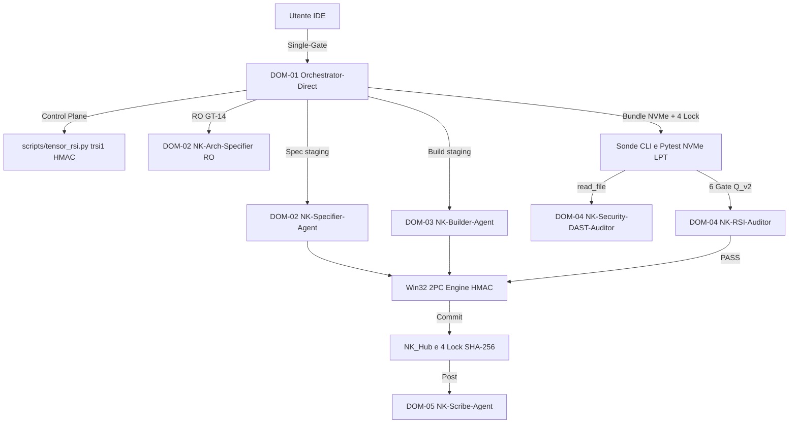

# `Concept Map`: C4 `2-Tier`, `GT-14` e `TAS v6.0` (`v1.0.0-Generation`)

## 1. Architettura `C4` e Topologia `2-Tier Hub-and-Spoke`

Il solo coordinatore `DOM-01` orchestra `6` sub-agenti foglia (`enable_subagent_tools: false`) e le deleghe built-in.
Il sistema espone `11` skill modulari JIT su `5` domini (`7` shard) e `10` nodi `[0]..[9]`.
`GT-14` separa analisi read-only, scrittura in `.staging/` e verifica tramite `gt14_evidence_pack.json` e `4` lock `SHA-256`.

## 2. Bounded Context (`DOM-01..DOM-05`) e Isolamento App

| ID | Dominio | Settore | Titolare | Perimetro |
| :--- | :--- | :--- | :--- | :--- |
| BC-01 | DOM-01 | GOV_AND_ROUTING | Orchestrator-Direct | Bootstrap, `16` shortcut, `tensor_rsi.py`, `nk-gate`, `2PC` |
| BC-02 | DOM-02 | IDEATION_AND_ARCH | Arch e Specifier | Mode D, `Pentad 4+1`, DAG Kahn, scaffolder `Locale/` |
| BC-03 | DOM-03 | BUILD_AND_HEAL | NK-Builder-Agent | Build `.staging/`, `platform_runner.py`, mutation, healing |
| BC-04 | DOM-04 | AUDIT_DAST_AND_RCA | Security e RSI | SAST `L1..L3`, DAST, SBFL `<= 80` tok, Oracolo `Q_v2` |
| BC-05 | DOM-05 | MEMORY_TELEMETRY_AND_DOCS | NK-Scribe-Agent | Memoria `3-Tier`, ACS, baseline `v2`, `nk_genome/` |

Le app utente vivono in `NK Proget/Locale/<Nome>/` (compat `NK_External_Projects/<Nome>/`) tramite `scripts/external_project_scaffolder.py`.
`NK Proget/Online/<Nome>/` resta mirror di rilascio in sola lettura bloccato da `nk_hook_gate.py` e `win32_2pc_engine.py`.

## 3. Protocolli Operativi (`GT-14`, `Tensor-RSI v3`, `2PC HMAC`, `NVMe`)

1. **Split `GT-14` e Guardie Anti-Bias:** Gli auditor read-only leggono `gt14_evidence_pack.json` dopo `strip_l3_persuasive_narrative` senza score storici.
   Formulano `>= 2` ipotesi falsificabili applicando `Fail-Closed` e `Minority-Veto`.
2. **Playbook JIT `DOM-04`:** Le skill `[5]..[8]` restano sotto `40` righe con `references/mode_*.md` (`<= 25` righe) e `retry_caps [0, 0, 0]`.
3. **Control Plane `Tensor-RSI v3` e Oracolo `Q_v2`:** `scripts/tensor_rsi.py` coordina `IntentTrack`, `PolicyTensor`, `ParetoGate` e `CladeBandit` con ticket `trsi1`.
   `scripts/rsi_convergence_engine.py` certifica `CONVERGED_OPTIMAL` solo con `G_hard == 1`, `Q_v2 == 100.0` e floor CI `88.0% / 82.0%`.
4. **`Win32 2PC` e `4` Lock `SHA-256`:** `scripts/win32_2pc_engine.py` verifica `nonce_store` `v2` e `tensor_sessions/ACTIVE.json`.
   `scripts/nk_transcript_tools.py` sigilla `oracle_lock.json`, `oracle_lock_holdout.json`, `governance_lock.json` e `tensor_rsi_lock.json`.
5. **Pytest NVMe e Baseline:** `scripts/platform_runner.py --pytest-isolated` applica `PYTEST_DISABLE_PLUGIN_AUTOLOAD=1`, `-m fast <= 8.0s` e `<= 28.0s`.
   I valori correnti risiedono in [quality_baseline.json](../nk_tracking/quality_baseline.json).
