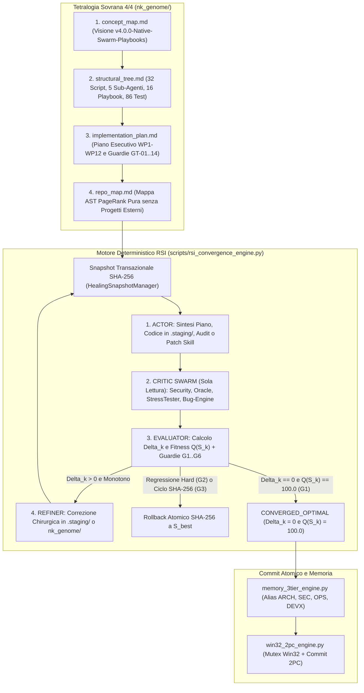

# NK Genome: Concept Map e Master Brief (`v4.3.0-Super-Plan-Triad-RSI` / `v4.0.0-Native-Swarm-Playbooks` / `v3.0.0-STE100-Unified`)

> **Badge di Certificazione:** 🛡️ [NK-BRIEF-STATUS: AUDITED_AND_OPTIMIZED 🟢] | [RSI-CONVERGENCE: CONVERGED_OPTIMAL (Δ=0, Q=100.0) 🟢]  
> **Milestone Anchor ID:** `NK-MS-20261024-SUPER-PLAN-TRIAD-v6.0.0-RSI` (`NK-MS-20261018-COLD-TRIAL-v4.0.0-RSI`)  
> **Versione Target:** `v4.3.0-Super-Plan-Triad-RSI` (`v4.0.0-Native-Swarm-Playbooks` / `v3.0.0-STE100-Unified` Compatible)  
> **Standard Linguistico:** ASD-STE100 Italiano Tecnico (`[RULE-STE100]`)  
> **Stato Produzione:** 100% Sola Lettura (`[RULE-00]`)

---

## 1. Visione Concettuale e Simbiosi con Gemini 4 Argon (High)

L'architettura `v4.3.0-Super-Plan-Triad-RSI` separa il Router O(1), i `5` Sub-Agenti Nativi e i `16` Playbook Procedurali (`[RULE-01]`). Il sistema trasforma Nexus Keystone in una piattaforma di miglioramento ricorsivo continuo (`[RULE-RSI]`). Questa architettura opera con **Gemini 4 Argon (High)** e protegge i `98` Golden e Stress Tests tramite `GT-01..GT-14`.

1. **Direttiva Linguistica Universale (`[RULE-STE100]`):**
   * Tutto l'ecosistema adotta lo standard **ASD-STE100 Italiano Tecnico**.
   * Ogni frase operativa contiene al massimo 20 parole e una sola istruzione.
   * Tutte le regole usano la forma attiva, vocaboli univoci e zero incisi con trattini.
   * Il peso di `.agents/AGENTS.md` e `.agents/rules/anti_crash_rules.md` resta confinato entro il budget costituzionale.
2. **Architettura Dual-Profile (`standard` vs `argon`) con Auto-Attivazione (`GT-01..GT-06`):**
   * Le firme predefinite dei moduli Python mantengono le soglie `standard` (`70/100` step, `350` token Tier-1, `0/256/512/1024` token Repo-Map). Questa scelta protegge i `68` Golden Tests ortogonali e i `18` test di stress ed estensione (`86` totali).
   * Lo script `scripts/nk_session_bootstrap.py` imposta automaticamente `NK_MODEL_PROFILE=argon` nelle sessioni operative.
   * Il profilo `argon` esclude `len(thinking)` dal conteggio token e innalza le soglie a `150/250` step (`250k/500k` token).
3. **Topologia 2-Tier Hub-and-Spoke e 5 Sub-Agenti Nativi (`U-01`, `MC-01`, `WP11`):**
   * Il workspace registra stabilmente `5` Sub-Agenti Nativi in `.agents/agents/*/agent.md` con `enable_subagent_tools: false`.
   * I `5` Sub-Agenti Nativi sono `NK-Specifier-Agent`, `NK-Builder-Agent`, `NK-Security-DAST-Auditor`, `NK-RSI-Auditor` e `NK-Scribe-Agent`.
   * Gli Auditor `NK-Security-DAST-Auditor` e `NK-RSI-Auditor` impongono il blocco hardware `enable_write_tools: false` (`GT-14`).
4. **Holistic Fast-Track (`GT-03`, `U-05`) e Swarm Message Hygiene (`GT-04`, `U-02`, `U-06`):**
   * Il limite di chiamate dirette consecutive sale a `DDI_DIRECT_STREAK_LIMIT = 12` (`<= 8` letture da `800` righe e `<= 4` comandi). Lo stress test a 15 chiamate continua a scattare regolarmente.
   * `nk_swarm_messenger.py` mantiene il payload a `1.800` caratteri (MSS) entro la busta di `2.000` caratteri (MTU).
   * `nk_context_sentry.py` applica la penalità di `-15` punti solo ai messaggi di ritorno dei sub-agenti.
   * Ogni sub-agente salva i propri report nella propria cartella `brain/<subagent-id>/scratch/`.
5. **Integrazione dei 9 Comandi Slash Nativi di Antigravity 2.0:**
   * Il sistema integra i 9 comandi reali: `/plan`, `/goal`, `/compact`, `/grill-me`, `/teamwork-preview`, `/learn`, `/boost`, `/schedule`, `/browser`.
   * Il sistema rimuove tutti i comandi inesistenti (`/implementation`, `/start`, `/board`, `/novice`, `/expert`, `/playtest`).
   * Il comando nativo `/compact` e `scripts/nk_session_handoff.py` sostituiscono il vecchio handoff manuale a doppia chat.
6. **Universal Meta-Prompt & Intent Brief Gate (`[RULE-00.6]`, `WP13-UNIFIED`):**
   * Il Gate L0 intercetta ogni input utente ed è attivo di default (`ALWAYS-ON`) con opt-out utente.
   * Il parser rimuove le disfluenze STT (`primaLa`), separa i sostantivi in `-zione` dai verbi e documenta le correzioni.
   * Il contratto `MetaPromptGateContract` separa il Meta-Prompt concettuale (`R1..Rn`, `Fuori ambito`) dal piano tecnico `implementation_plan.md`.
   * La macchina a `5` stati (`IDLE..BYPASSED`) applica TTL di `30` minuti, `5` esenzioni anti-loop e conferma 1-Click.
   * Il sistema propaga `intent_hash_sha256` in `<env_capsule>`, verifica `R1..Rn` in `NK-Plan-Aligner` e preserva `16` skill.
7. **Hardening Post-Audit Forense `Bandi` (`WP14`, `NK-MS-20261022-BANDI-FORENSIC-HARDENING-v4.2.0-RSI`):**
   * Il `Template 11` e `vibe_sprint_router.py` generano e validano prompt multi-fase nativi per lo sciame 2-Tier.
   * Il tag `!diretto` salta solo il Gate L0 (`bypass_scope: "L0_GATE_ONLY"`) senza mai disattivare `[RULE-00]` o `[RULE-01]`.
   * Lo script `nk_session_bootstrap.py` impone `PYTHONUTF8=1`, valida il TTL cache e conta esattamente le righe del transcript attivo.
   * Il motore `rsi_convergence_engine.py` ispeziona i progetti esterni con `--root`, rileva `\ufffd` e registra sempre `rsi_telemetry.jsonl`.
8. **Super Implementation Plan v6.0-Unified-Triad-RSI (`WP15`, `NK-MS-20261024-SUPER-PLAN-TRIAD-v6.0.0-RSI`):**
   * Lo script `scripts/nk_hook_gate.py` presidia gli hook runtime con `write-gate`, `fasttrack`, `integrity` SHA-256 e `stop-check`.
   * Lo script `scripts/nk_transcript_tools.py` esegue `locate` senza fallback `st_mtime`, `compliance`, `evidence`, `oracle-lock` e `lint-prompt`.
   * Il validatore `ast_guard_validator.py` espone `validate_pydantic_catalog_records()` per il Pre-Flight Schema Grounding dei modelli Pydantic v2.
   * La suite permanente raggiunge `98/98 PASS` includendo `tests/test_super_plan_v6_triad.py` con zero regressioni sulle guardie `GT-01..GT-14`.

---

## 2. Architettura del Motore RSI Continuo (`[RULE-RSI]`)

Il motore deterministico `scripts/rsi_convergence_engine.py` governa il ciclo di convergenza neuro-simbolico su tutte le attività dell'Hub.

### Formula Dual-Metric e Guardie del Motore RSI
1. **Doppia Metrica Accoppiata ($\Delta_k$ e $Q(S_k)$) con Canali TAS v4.0:**
   $$\Delta_k = 20 \cdot E_{\text{PoC},k} + 15 \cdot \text{SAST}_k + 12 \cdot D_{\text{sem},k} + 10 \cdot (T_{\text{fail},k} + C_k) + 5 \cdot H_k + 2 \cdot M_k + 1 \cdot (L_k + G_k)$$
   $$Q(S_k) = \text{round}\left(60.0 \cdot \frac{T_{\text{pass},k}}{T_{\text{total},k}} + \frac{40.0}{1.0 + \Delta_k / 25.0},\; 4\right)$$
   * Il termine `20 E_{PoC,k}` (`poc_confirmed_exploits`) penalizza gli exploit confermati dal Referee PoC nella Shadow Sandbox.
   * Il termine `12 D_{sem,k}` (`semantic_drift_findings`) penalizza il drift semantico tra specifica, UI, API e database.
2. **Sei Guardie Invarianti (`G1..G6`):**
   * **G1 (`Zero-Delta Stop`):** Il ciclo termina con `CONVERGED_OPTIMAL` solo quando `Delta_k == 0` e `Q(S_k) == 100.0`.
   * **G2 (`Strict Monotonic Hard Gate`):** Esegue il rollback via `HealingSnapshotManager` se peggiorano test, SAST, PoC o contratti.
   * **G3 (`Anti-Oscillation Guard`):** Salva gli hash SHA-256 in `visited_hashes` e blocca i cicli con `HALTED_CYCLE_DETECTED`.
   * **G4 (`Tamper-Evident Ledger`):** Registra ogni iterazione in `nk_tracking/rsi_telemetry.jsonl` con catena SHA-256 (`prev_hash` e `record_hash`).
   * **G5 (`Iteration Cap`):** Applica i limiti `K_max = 2` (`Mode C`), `3` (`Mode B`) e `4` (`Mode A`).
   * **G6 (`Validatore CLI`):** Il flag `--verify` valida i `16` file ausiliari, i `68` test e `[RULE-STE100]`.

---

## 3. Mappa delle 16 Skill Vocazionali e dei 16 File Ausiliari (`v3.0.0-STE100-Unified`)

| Indice | Skill (`.agents/skills/`) | Ruolo nella Topologia 2-Tier e nel Loop RSI | Allineamento `v3.4.0` (`v3.0.0-STE100-Unified`) |
| :---: | :--- | :--- | :--- |
| **L3** | **`NK-Master-Hub`** | Orchestratore Infrastrutturale e Committer 2PC | Preserva i nodi `[0]`..`[14]` e il footer a due vie (`GT-08`). Usa `ask_question` e `manage_task(Action="kill", TaskId="<id>")`. Elimina gli 8 file legacy in `scripts/` e `resources/`. |
| **`[0]`** | **`NK-Ideator`** | Actor L0 per Sintesi Concettuale | Usa `/grill-me` e `ask_question`. Scrive `concept_map.md` e `idea_canvas.md`. Linka `resources/idea_canvas_template.md` (`01/16`). |
| **`[1]`** | **`NK-App-UX-Architect`** | Actor L3 per UX, Design System e UI | Usa la Tetralogia 4/4 (rimosso `ui_design.md`). Integra `generate_image`, `<agent-embed>` (`generative_ui`) e `thinking_level: "HIGH"`. |
| **`[2]`** | **`NK-Backend-Architect`** | Actor L2 per DAG Backend e Contratti IPC | Valida schemi Pydantic v2 e contratti OpenAPI 3.0. Allinea l'output alla Tetralogia 4/4 in `nk_genome/`. |
| **`[3]`** | **`NK-Agent-Instruction-Forge`** | Meta-Refiner per Skill e Regole (`/learn`, `/boost`) | Applica lo standard `[RULE-STE100]` e verifica il budget di byte su `.agents/AGENTS.md` e sui 16 `SKILL.md`. |
| **`[4]`** | **`NK-Python-Async-Builder`** | Builder Primario e Refiner in `.staging/` | Legge fino a `800` righe per chiamata. Esegue `auto_heal_pipeline.py` e `rsi_convergence_engine.py` fino a $\Delta_k = 0$. |
| **`[5]`** | **`NK-Delta-Architect`** | Refiner Chirurgico in `.staging/` (1 Livello) | Opera come worker foglia (`enable_subagent_tools=False`). Linka `resources/delta_brief_template.md` (`02/16`) con Receipt v3.0. |
| **`[6]`** | **`NK-Security-Auditor`** | Critic Swarm TAS v4.0 SAST L1/L2/L3 (Sola Lettura) | Elimina i 21 file coi 4 nodi `Fixer`. Linka le 4 matrici modulari in `resources/` (`03/16..06/16`: routing, `L1`, `L2`, `L3`). |
| **`[7]`** | **`NK-Oracle-Evaluator`** | Critic Swarm e Oracolo Cold Audit (Gate 1-6) | Integra `/browser` (`chrome-devtools-mcp`) e `scripts/oracle_evaluator_l3.py`. Linka i 2 file in `references/` (`07/16..08/16`). |
| **`[8]`** | **`NK-Dynamic-Sandbox-StressTester`** | Critic Swarm DAST in `%TEMP%\nk_sandbox_<uuid>\` | Invoca `scripts/dast_sandbox_runner.py`. Elimina i 3 script legacy con fuzzer casuale in `resources/`. |
| **`[9]`** | **`NK-Bug-Diagnostic-Engine`** | Critic Swarm e Localizzatore RCA (SBFL Ochiai) | Invoca `scripts/sbfl_engine.py` e `scripts/sbfl_pytest_bridge.py` (`< 320` char, `GT-07`). Linka i 2 file in `resources/` (`09/16..10/16`). |
| **`[10]`** | **`NK-Plan-Aligner`** | Certificatore Turno 4 della Tetralogia 4/4 | Verifica l'allineamento 1:1 di `concept_map.md`, `structural_tree.md`, `implementation_plan.md` e `repo_map.md` con `rsi_convergence_engine.py --verify`. |
| **`[11]`** | **`NK-State-Router`** | Verificatore Topologico DAG di Kahn (Sola Lettura) | Opera come verificatore in sola lettura per `NK-Master-Hub`. Non acquisisce lock concorrenti al motore 2PC. |
| **`[12]`** | **`NK-Scribe`** | Cronista Post-Commit (`[RULE-00.2]`) | Usa il filtro `act` completo (`CREATE, MODIFY, DELETE, REFACTOR, AUDIT, FIX, SYNC`). Linka i 2 file in `resources/` (`11/16..12/16`). |
| **`[13]`** | **`NK-Episodic-Memory-Engine`** | Gestore Memoria 3-Tier (`ARCH`, `SEC`, `OPS`, `DEVX`) | Usa `DOMAIN_ALIAS_MAP` in `scripts/memory_3tier_engine.py` con cap `350` token standard (`GT-05`) e `1.200` token in profilo `argon`. |
| **`[14]`** | **`NK-Session-Controller`** | Sovrano Critico di Sessione e Cold Reviewer | Guida l'Auto-Brief FSM con convergenza RSI ($\Delta_k = 0$), la Cold Review a 6 Gate e `/compact`. Linka i 4 file validi in `resources/` (`13/16..16/16`). |
