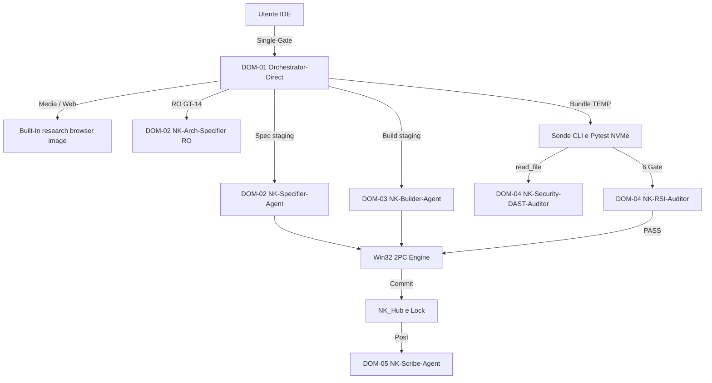

# `Concept Map`: C4 `2-Tier`, Split `GT-14` e `2PC` (`v1.0.0-Generation`)

## 1. Architettura `C4` e Topologia `2-Tier Hub-and-Spoke`

Il solo coordinatore `DOM-01` orchestra `6` sub-agenti foglia (`enable_subagent_tools: false`) e le deleghe built-in.
Il sistema espone `11` skill modulari JIT e `10` nodi operativi nella dashboard `[0]..[9]`.
Il protocollo `GT-14` separa analisi read-only, scrittura in `.staging/` e verifica tramite bundle diagnostico unificato.

## 2. Bounded Context (`DOM-01..DOM-05`) e Isolamento App

| ID | Dominio | Settore | Titolare | Perimetro |
| :--- | :--- | :--- | :--- | :--- |
| BC-01 | DOM-01 | GOV_AND_ROUTING | Orchestrator-Direct | Bootstrap, `16` shortcut, Single-Gate, hooks, 2PC |
| BC-02 | DOM-02 | IDEATION_AND_ARCH | Arch e Specifier | Mode D, ideazione, `Pentad Sovrana 4+1`, DAG, scaffolder |
| BC-03 | DOM-03 | BUILD_AND_HEAL | NK-Builder-Agent | Build staging, Forge, `platform_runner.py`, cache, healing |
| BC-04 | DOM-04 | AUDIT_DAST_AND_RCA | Security e RSI | Audit SAST, DAST, SBFL, Oracolo, Tensor-RSI |
| BC-05 | DOM-05 | MEMORY_TELEMETRY_AND_DOCS | NK-Scribe-Agent | Memoria 3-Tier, ACS, baseline, `nk_genome/` |

Le applicazioni esterne risiedono in `../NK_External_Projects/<Nome>/` tramite `scripts/external_project_scaffolder.py` (`[RULE-PROJECT-ISOLATION]`).

## 3. Protocolli Operativi (`GT-14`, `Single-Gate`, `2PC`, `NVMe Pytest`)

1. **Split `GT-14`:** `NK-Arch-Specifier` opera in sola lettura (`enable_write_tools: false`, zero `run_command`).
   `NK-Specifier-Agent` scrive solo in `.staging/nk_genome/` e `nk_tracking/reports_and_briefs/` senza shell ne MCP.
2. **Bundle `Dual-Execution` (`emit_gt14_bundle`):** `Orchestrator-Direct` esegue `scripts/rsi_convergence_engine.py` con flag opzionale `--with-dast`.
   Gli auditor leggono il JSON nella directory temporanea via `read_file` e rispondono via `send_message`.
3. **`Single-Gate`, `16` Shortcut e `ACS`:** `scripts/vibe_sprint_router.py` attiva `READONLY_MODE_D_BYPASS` e i `16` shortcut (`8` legacy + `8` `Generation`).
   Gli hook `python -S -B -u` leggono `saturation_thresholds.json` (`generation` con alias `carbon`: `160k/185k/205k` token, `120/150/180` step, `1200` tier1).
4. **`Win32 2PC` e Lock:** `scripts/win32_2pc_engine.py` acquisisce `Win32NamedMutex`, valida `BatchJournalV2` e promuove da `.staging/`.
   `PIDFileLock(acquire_timeout_sec)` gestisce il lock cooperativo senza attese infinite e allinea `shards/` e [quality_baseline.json](../nk_tracking/quality_baseline.json).
5. **Pytest NVMe e Memoria `3-Tier`:** `platform_runner.py --pytest-isolated` isola i test in `%TEMP%` evitando crash `0xC000013A`.
   `scripts/memory_3tier_engine.py` usa `BM25 + Cosine RRF`, mentre `scripts/nk_registry_indexer.py` reidrata gli shard in `O(1)`.
