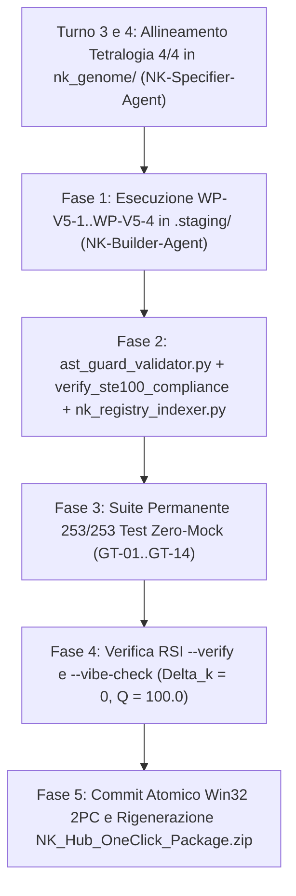

# 🛠️ Implementation Plan: Sovereign Clean-Slate Release (`IB-20261106-82CC73` / `v5.0.0-STE100-Unified`)

> **Badge di Certificazione:** 🛡️ [NK-BRIEF-STATUS: AUDITED_AND_OPTIMIZED 🟢] | [RSI-CONVERGENCE: CONVERGED_OPTIMAL (Δ=0, Q=100.0) 🟢]  
> **Milestone Anchor ID:** `NK-MS-20261106-SOVEREIGN-CLEAN-SLATE-RELEASE-v5.0.0-RSI` (`NK-MS-20261106-HOLISTIC-CLEANSE-AND-DEAD-CODE-PURGE-v4.8.0-RSI` / `NK-MS-20261031-HOLISTIC-STRESS-AND-TEST-CONSOLIDATION-v4.7.0-RSI` / `WP1-WP21`)  
> **Intent Brief ID:** `IB-20261106-82CC73` (`SHA256: 82cc735e89c4424548e0768358abb4fa704804587cac67bce2e92c6d40db81b3`)  
> **Versione Target:** `v5.0.0-STE100-Unified` (`v4.8.0-STE100-Unified` / `v4.7.0-STE100-Unified` / `v3.0.0-STE100-Unified` Compatible)  
> **Standard Linguistico:** ASD-STE100 Italiano Tecnico (`[RULE-STE100]`, frasi `<= 20` parole)  
> **Modalità Esecutiva:** `Mode A` con isolamento in `.staging/` (`[RULE-00]`) e delega 2-Tier a `NK-Builder-Agent` (`[RULE-01]`).

---

## 🗺️ 1. Tracciabilità Requisiti (`R1..R6`) e Flusso Esecutivo Multilivello

| Requisito Intent Brief (`IB-20261106-82CC73`) | Work Package Assegnato | Copertura |
| :--- | :--- | :---: |
| **`R1`:** Ripristino `253/253 PASS` e fix su `memory_3tier_engine.py`, `nk_registry_indexer.py` e `win32_2pc_engine.py`. | `WP-V5-1` | `100%` |
| **`R2`:** Rimozione dead-code residuo in `vibe_sprint_router.py`, `ast_repo_mapper.py` e `rsi_convergence_engine.py`. | `WP-V5-1` | `100%` |
| **`R3`:** Allineamento `v5.0.0-STE100-Unified` su `.agents/AGENTS.md`, regole, `16` skill, `5` agenti e plugin `nk-gate`. | `WP-V5-2` | `100%` |
| **`R4`:** Bonifica completa di `nk_tracking/`, `active_context.md`, `reports_and_briefs/`, `session_anchor.jsonl` e `quality_baseline.json`. | `WP-V5-3` | `100%` |
| **`R5`:** Allineamento 1:1 Tetralogia Sovrana 4/4, `PATCH_NOTES.md`, `nk_docs_and_setup/` e pacchetto `.zip`. | `WP-V5-4` | `100%` |
| **`R6`:** Certificazione TAS 6 Gate e convergenza RSI (`Delta_k = 0`, `Q(S_k) = 100.0`, `253/253 PASS`). | `WP-V5-1..WP-V5-4` | `100%` |

---

## 📦 2. Work Packages Esecutivi in `.staging/` (`WP-V5-1 .. WP-V5-4`)

### `WP-V5-1`: Ripristino 253/253 Test PASS, Hardening 2PC e Pulizia Dead-Code in `scripts/` (`R1`, `R2`, `DOM-03`)
* **File Target:** `memory_3tier_engine.py`, `nk_registry_indexer.py`, `win32_2pc_engine.py`, `vibe_sprint_router.py`, `ast_repo_mapper.py`, `rsi_convergence_engine.py`.
* **Azioni Atomiche:**
  1. Isola i backup `.bak_N` in `memory_3tier_engine.py` per workspace temporanei (`tmp_path`) fuori da `nk_tracking/`.
  2. Aggiungi la guardia sui file a `0` byte prima del ripristino backup in `memory_3tier_engine.py`.
  3. Mantieni `MANIFEST_VERSION = "4.7.0-STE100-Unified"` per compatibilità contratto e aggiungi `RELEASE_VERSION = "5.0.0-STE100-Unified"` in `nk_registry_indexer.py`.
  4. Pulisci le cartelle `__pycache__` dentro `_cleanup_promoted_staging` in `win32_2pc_engine.py` per eliminare residui in `.staging/`.
  5. Unifica `record_session_anchor_commit` nel flusso transazionale di `win32_2pc_engine.py`.
  6. Rimuovi il dead-code residuo in `vibe_sprint_router.py`, `ast_repo_mapper.py` e `rsi_convergence_engine.py`.

### `WP-V5-2`: Allineamento Costituzionale `v5.0.0-STE100-Unified` in `.agents/` (`R3`, `DOM-01 / DOM-02`)
* **File Target:** `.agents/AGENTS.md`, `.agents/rules/anti_crash_rules.md`, `16` `SKILL.md`, `.agents/skills/NK-Session-Controller/resources/prompt_templates.md`, `5` `agent.md`, `.agents/plugins/nk-gate/plugin.json`.
* **Azioni Atomiche:**
  1. Aggiorna `.agents/AGENTS.md` alla versione `v5.0.0-STE100-Unified` includendo la formula completa di `Delta_k`.
  2. Allinea `.agents/rules/anti_crash_rules.md` e `.agents/plugins/nk-gate/plugin.json` alla release `v5.0.0-STE100-Unified`.
  3. Sincronizza i `16` file `SKILL.md` e `prompt_templates.md` preservando il vincolo `GT-14` di sola lettura.
  4. Allinea i `5` profili `.agents/agents/*/agent.md` alla versione `v5.0.0-STE100-Unified` e ai percorsi canonici.

### `WP-V5-3`: Bonifica Olistica di `nk_tracking/` e Isolamento Progetti Esterni (`R4`, `DOM-05`)
* **File Target:** `nk_tracking/active_context.md`, `nk_tracking/reports_and_briefs/*`, `nk_tracking/anchor/session_anchor.jsonl`, `nk_tracking/quality_baseline.json`, `nk_tracking/rsi_telemetry.jsonl`.
* **Azioni Atomiche:**
  1. Aggiorna `nk_tracking/active_context.md` e rigenera l'handoff `Template 12` puro per `NK_Hub` senza riferimenti a `NK-Bandi`.
  2. Bonifica `nk_tracking/reports_and_briefs/` rimuovendo `TAS_Report_NK-Bandi_v1.2.1_20261101.md` e i vecchi brief `IB-20261101..20261105`.
  3. Registra il nuovo report `TAS_Report_NK_Hub_v5_0_0_20261106.md` e il brief attivo `IB-20261106-82CC73.md` in `nk_tracking/reports_and_briefs/`.
  4. Normalizza `nk_tracking/anchor/session_anchor.jsonl`, aggiorna `nk_tracking/quality_baseline.json` a `253` test e consolida `nk_tracking/rsi_telemetry.jsonl`.

### `WP-V5-4`: Allineamento Finale Tetralogia 4/4, Documentazione e Package One-Click (`R5`, `R6`, `DOM-02 / DOM-05`)
* **File Target:** `nk_genome/concept_map.md`, `nk_genome/structural_tree.md`, `nk_genome/implementation_plan.md`, `nk_genome/idea_canvas.md`, `nk_genome/repo_map.md`, `nk_genome/PATCH_NOTES.md`, `nk_docs_and_setup/*`, `NK_Hub_OneClick_Package.zip`.
* **Azioni Atomiche:**
  1. Allinea 1:1 `concept_map.md`, `structural_tree.md`, `implementation_plan.md`, `idea_canvas.md` e `repo_map.md` a `v5.0.0-STE100-Unified`.
  2. Registra la release `v5.0.0-STE100-Unified` (`NK-MS-20261106-SOVEREIGN-CLEAN-SLATE-RELEASE-v5.0.0-RSI`) in `nk_genome/PATCH_NOTES.md`.
  3. Aggiorna `README.md`, `README.it.md`, `00_MAPPA_LIBRERIA_NK.md`, `GUIDA_INSTALLAZIONE.md`, `install.ps1` e `install.sh` in `nk_docs_and_setup/`.
  4. Rigenera l'archivio `NK_Hub_OneClick_Package.zip` pulito e certificato per la distribuzione One-Click.

---

## ✅ 3. Guardie Golden Tests (`GT-01..GT-14`) e Criteri di Certificazione TAS (6 Gate)

1. **Gate 1 (Static & AST/SAST Guard):** `ast_guard_validator.py` certifica `0` violazioni e `0` simboli orfani in `scripts/`.
2. **Gate 2 (Golden & Stress Test Suite):** `python -m pytest` certifica `253/253 PASS` (`100.0%`) in `24` moduli proteggendo `GT-01..GT-14` (`68` pavimento `GT-13`).
3. **Gate 3 (Read-Only Auditor Invariant `GT-14`):** Le `5` skill read-only e i `2` sub-agenti auditor non espongono tool di scrittura.
4. **Gate 4 (Registry & Manifest Sync):** `nk_registry_indexer.py --verify` certifica `16` skill, `5` sub-agenti e `34` script.
5. **Gate 5 (Grounding & STE-100 Verification):** `rsi_convergence_engine.py --vibe-check` certifica `0` violazioni ASD-STE100 (`L_k == 0`, `H_k == 0`).
6. **Gate 6 (Win32 2PC & RSI Convergence):** `rsi_convergence_engine.py --verify` certifica `CONVERGED_OPTIMAL` (`Delta_k = 0`, `Q(S_k) = 100.0`).
