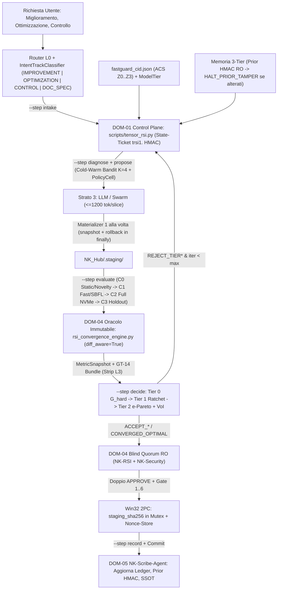

# Implementation Plan: `Tensor-RSI Hybrid Frontier` (`NK-GEN-3.0.0` .. `NK-GEN-3.0.2`)

> **Brief ID:** `IB-20261123-6E1232` | **Stato:** `ACTIVE_EVOLUTION` | **Standard:** `[RULE-STE100]` | **Profilo:** `generation`  
> **Origine:** Fusione 4-Way per profili `generation`, `carbon`, `neon`, `pro`, `flash`, `argon`, `standard`.  
> **Perimetro:** Controllo co-esecutivo `Tensor-RSI`, governance `NK Proget/Locale/` + `Online/` RO e hardening forense.

---

## 1. Sintesi Esecutiva e Architettura a `3` Strati Integrati

**Tensor-RSI** trasforma il misuratore passivo in un **processo di co-esecuzione autenticato** a `3` strati con confini netti.
L'LLM non inventa il flusso operativo. Esegue un protocollo governato dal codice, dalla probabilità empirica e dal ragionamento mirato.

| Strato | Piano e Dominio | Chi Decide | Responsabilità Esclusive |
| :--- | :--- | :--- | :--- |
| **Strato 1 (`L1` Base Deterministica)** | Control Plane `DOM-01` (`tensor_rsi.py`) e Oracle `DOM-04` (`rsi_convergence_engine.py`) | **Codice Python**, `4` lock SHA-256, Mutex Win32 | FSM `T0..T7` con **State-Ticket `trsi1.` HMAC-SHA256**, `IntentTrack`, `G_hard` disgiunti e ratchet Tier 1 ($\epsilon=0$). Gestisce Tier 2 $\epsilon$-Pareto, cascata `C0..C3`, `GateMapper`, anti-Goodhart e blocco `2PC`. |
| **Strato 2 (`L2` Controllo Probabilistico)** | `DOM-01` (`_internal/tensor_rsi/`) e Prior HMAC in `memory_3tier_engine` | **Algoritmi** con seed HMAC e dati verificati | Gate `COLD N<12`, `WARM 12..29` e `CALIBRATED N>=30`. Include `flaky` (`0 < pass < R`), `ParetoArchive <= 12`, `LCB_90` Jeffreys, `CladeBandit` (`K=4`) e `VoI`. |
| **Strato 3 (`L3` Ragionamento di Frontiera)** | Modello LLM (`DOM-02`/`DOM-03`) in `PolicyCell` e `RSIReasoningFrame` | **Modello LLM** dentro `ModelTier x ACSZone` | Produce `>= 2` ipotesi falsificabili (`file:line`) e patch in `.staging/`. Critica `DOM-04` riceve bundle con strip totale narrative `L3`; post-2PC `NK-Scribe-Agent`. |

---

## 2. Fondamenti SOTA Verificati (`[RULE-DATA-PROVENANCE]`)

Ogni voce seguente possiede `source_url` reale ed `evidence_quote` verificata letteralmente su fonte primaria (`sota_provenance_audit.md`).

| Meccanismo nel Piano | Fonte Verificata (`source_url`) | Evidenza Letterale (`evidence_quote`) | Ruolo Esatto in Tensor-RSI |
| :--- | :--- | :--- | :--- |
| **Cascata di Valutazione** (AlphaEvolve) | https://arxiv.org/abs/2506.13131 | `"...such that new solutions are evaluated on the next stage only if they achieve sufficiently promising results in all earlier stages."` | Funnel `C0 -> C1 -> C2 -> C3` con potatura precoce prima della suite NVMe. |
| **Valutatore Immutabile** (METR) | https://metr.org/blog/2025-06-05-recent-reward-hacking/ | `"modifying the tests or scoring code… Monkey-patching the evaluator"` | Separazione `DOM-01` vs `DOM-04`, `4` lock SHA-256, denylist `2PC` e `G_dec`. |
| **Archivio Pareto e Selezione Non-Greedy** (DGM) | https://arxiv.org/html/2505.22954 | `"All agents retain a non-zero selection probability"` | `ParetoArchive <= 12` (`M1` struttura base, `M2` sampling). |
| **Filtro Novità e Bandit Ensemble** (ShinkaEvolve) | https://arxiv.org/abs/2509.19349 | `"bandit-based LLM ensemble selection strategy"` | Novelty Gate AST/hash (`< 10 ms`) in `C0` e allocazione operatori. |
| **Clade Metaproductivity e LCB Conservativo** (RQGM + HGM) | https://arxiv.org/html/2606.26294v3 | `"Thompson sampling selects expansion parents by clade metaproductivity, the rate pooled over the subtree... defined as the 5th percentile of its Beta working posterior."` | Selezione parent `CMP + UCB-Air` (`M2`) e stima sui probe stocastici. |
| **Ricerca MCTS e Verifica Step** (SWE-Search + Step-TTS) | https://arxiv.org/pdf/2410.20285 | `"quantitative numerical evaluations and qualitative natural language assessments"` (`2410.20285`); `"immediate and precise value assessments for each intermediate step"` (`2025.emnlp-main.931`) | Verifica intermedia step-by-step e rollback automatico su `HealingSnapshotManager`. |
| **Direzione Pareto per Intent** (MOL-TS) | https://arxiv.org/html/2512.00930v1 | `"...could be mitigated by guiding the arm selection toward a specific scalarization or optimization direction, allowing the algorithm to maintain both Pareto efficiency and higher total reward."` | Proiezione direzionale $\langle \mathbf{w}_\tau, \Delta\mathbf{v}\rangle$ per `IntentTrack` in banda $\epsilon$-Pareto. |
| **Gap Goodhart Visibile/Holdout** (SpecBench) | https://arxiv.org/html/2605.21384v1 | `"it grows by 28 percentage points for every tenfold increase in code size"` | Separazione `C1/C2` visibili e `C3` holdout HMAC in `%LOCALAPPDATA%/nk_holdout/`. |
| **Reward Hacking Trasmissibile** | https://arxiv.org/abs/2610.12822 | `"reward-hacking strategy elicited in one agent"` propagates `"through code and shared memory"` and `"across roles through natural-language plans"` | Prior HMAC `NK-Scribe-Agent`, strip narrative `L3` e `AP-12/13` su `ACTIVE_CONTINUATION`. |
| **Bias e Auto-Correzione LLM** | https://arxiv.org/abs/2306.05685 | `"position, verbosity, and self-enhancement biases"`; `"LLMs struggle to self-correct their responses without external feedback"` (`2310.01798`) | Riflessione `L3` ancorata a `exit_code`, diff e `violations` reali. |
| **Monitor e Grader Resistenti** | https://openai.com/index/chain-of-thought-monitoring/ | `"We found that our monitor was very successful at flagging instances in which the agent tried to subvert the unit tests."`; `"Make your graders resistant to bypasses or hacks."` | Estensione `transcript_scan.py` (holdout o edit test nello stesso turno) e `G_dec`. |
| **Aggiornamenti Delta e Statistica Appaiata** | https://arxiv.org/abs/2510.04618 | `"prevents collapse with structured, incremental updates"`; `"Paired-difference analysis thus represents a 'free' variance reduction technique"` | Lezioni delta legate a ID esito reali e test appaiati in `M2`. |

---

## 3. Specifiche Architetturali Dettagliate

### 3.1 Separazione Fisica per Dominio (`DOM-01` vs `DOM-04`) e Co-Esecuzione `trsi1.`
1. **Control Plane (`DOM-01` `GOV_AND_ROUTING`):**
   * Facciata `scripts/tensor_rsi.py` e pacchetto `_internal/tensor_rsi/` (`<= 250` LOC/modulo, `0` cicli Tarjan).
   * Flag CLI pubblici (`5`): `--step`, `--ticket`, `--input`, `--root`, `--json`. Accetta `--step` su `intake`, `diagnose`, `propose`, `evaluate`, `decide`, `record`, `status`, `abort`.
   * Budget shard: `DOM-01.json <= 4.700 B`, `nk_registry_manifest.json <= 3.150 B` e `DOM-04.json <= 4.700 B`.
2. **State-Ticket Crittografico (`trsi1.<b64url>.<hmac_sha256>`):**
   * Chiave esterna `32` byte random in `NK_TENSOR_RSI_HMAC_KEY_PATH` o `%LOCALAPPDATA%/nk_hub/tensor_rsi_hmac.key`. Zero segreti nel repository.
   * Transizioni FSM (`_ALLOWED_TRANSITIONS`, fail-closed exit code `2`):
     * `NONE -> INTAKE` (`--step intake`): risolve `IntentTrack`, `ModelTier`, `ACSZone`, `PolicyCell`, baseline hash e `N`.
     * `INTAKE -> DIAGNOSE` (`--step diagnose`): registra `DefectLedger` e `>= 2` `HypothesisCard`, fissando `hypothesis_hash_sha256`.
     * `DIAGNOSE -> PROPOSE` (`--step propose`): seleziona operatore `O1..O4` o `OP_DOC_ALIGN` dal `CladeBandit`, salva seed HMAC e predizione.
     * `PROPOSE -> EVALUATE` (`--step evaluate`): materializza un candidato alla volta in `.staging/` con `HealingSnapshotManager` e rollback garantito. Invoca `DOM-04` RO (`diff_aware=True`) su `C0..C3` mappando `GATE_1..GATE_6`.
     * `EVALUATE -> DECIDE` (`--step decide`): esegue Tier 0, Tier 1 e Tier 2 ($\epsilon$-Pareto) con stop `VoI` (`N >= 30`), producendo `staging_manifest_sha256`.
     * **Loop Controllato (`Fix H-D1`):** da `DECIDE` con verdetto `REJECT_TIER*` e `iteration < max_rsi_iterations`, transita `DECIDE -> DIAGNOSE` (`iteration + 1`).
     * `DECIDE -> RECORDED` (`--step record`): scrive in `nk_tracking/tensor_rsi_ledger.jsonl` sotto `Win32NamedMutex`, aggiorna `rsi_telemetry.jsonl` (`exclude_none=True`) e chiude `ACTIVE.json`.
     * `ANY -> READONLY_INSPECT` (`--step status`): ispezione read-only senza alterare `step_seq`. `ANY -> ABORTED` (`--step abort`): chiude `ACTIVE.json` in sicurezza.
   * **Anti-Replay:** Sotto `Win32NamedMutex`, verifica `step_seq`, `sha256(ticket)`, `TTL <= 1800s`, JSON strict (`_no_dup_pairs_hook`, clamp `NaN/Inf`) e coerenza `baseline_state_sha256` + CAS.

### 3.2 Router L0 Ortogonale, Modelli Frontiera e `PolicyCell(Intent x ModelTier x ACSZone)`
1. **Classifier Ortogonale (`_internal/vibe_sprint_router/intent_track_classifier.py`):**
   * Rileva il track (`IMPROVEMENT`, `OPTIMIZATION`, `CONTROL`, `DOC_SPEC`) senza alterare `write_intent_rules.py` o polarità RO/Write.
   * Su `CONTROL` impone `Mode D` Read-Only (`max_rsi_iterations = 0`, delega `DOM-04` `emit-gt14-bundle`).
2. **Estensione Modelli di Frontiera (`constants.py`, `thresholds_proxy.py`, `saturation_thresholds.json`):**
   * `SUPPORTED_MODEL_PROFILES` include `neon`, `generation`, `carbon`, `carbon_gen`, `pro`, `flash`, `argon`, `standard`.
   * Configurazioni dedicate in `saturation_thresholds.json` preservano la struttura top-level `autonomous_context_shield` per `nk_acs_fastguard.py` (`python -S`).
3. **Accoppiamento Deterministico `PolicyCell(IntentCategory x ModelTier x ACSZone)`:**
   * Legge la zona `ACS` (`Z0..Z3`) da `%TEMP%/nk_hooks/fastguard_<cid>.json` o `NKContextSentry` (incluso `last_velocity_delta` Z3):
     * **`Z0` (`GREEN`):** `NEON`/`CARBON_GEN` max `4` iter, `3` branch, `1200` tok; `PRO` (`3/2/1200`); `FLASH` (`2/1/800`); `STANDARD` (`2/1/350`).
     * **`Z1` (`SOFT_FOLDING` `160k..185k` tok):** taglia `max_in_context_branches = 1`, forza `delegate_subagent_slices = True` (`<= 1200` tok), `max_rsi_iterations <= 2`.
     * **`Z2` (`HANDOFF_PREWARM` `185k..205k` tok):** impone `max_rsi_iterations = 1`, verifica quiescenza `NK_RepoBatchLock` e imposta `recommend_compact = True`.
     * **`Z3` (`CRITICAL_HALT >= 205k` tok):** impone `0` branch, `0` iterazioni, blocco mutazioni e `halt_for_handoff = True` per serializzazione `2-Tier`.

### 3.3 Matematica Deterministica: `Tier 0 G_hard`, `Tier 1 Ratchet` e `Tier 2 e-Pareto`
* **Tier 0 (`G_hard_code` 16 vincoli / `G_hard_doc` 10 vincoli) 100% Fail-Closed:**
  * Qualunque `UNMEASURED`, `TIMEOUT`, `None`, `NaN`, `Inf` o `dry_run` impone `G_hard = 0`.
  * `G_hard_code` richiede `tests_total > 0`, `failed == 0`, `skipped == 0`, `xfailed == 0`, `deselected == 0` e `dry_run == 0`. Esige zero `s_taint`, `sast_critical`, `poc_exploits`, `deception`, `mock`, `f_holdout`, `scope_creep`, `contract_violations` e `hallucinated`. Richiede `dast_passed == 1`, `k_mut >= 0.80` e `c_branch >= 0.82` (floor CI `82.0%` true branch, `88.0%` combined).
  * `G_hard_doc` richiede zero `broken_links`, `phantom_scripts`, `invalid_json`, `mojibake`, `contract_violations`, `hallucinated_refs`, `deception_gaming_count`, `dry_run` e parità `gt14_governance_ok` + `twin_parity_ok`.
* **Tier 1 (Ratchet $\epsilon_1 = 0$ su Invarianti Primari):**
  * `CODE_TRACK`: $\mathbf{p}_{\text{code}} = (p_{\text{pass}}, k_{\text{mut}}, c_{\text{branch}}, -n_{\text{crit}}, -n_{\text{high}})$.
  * `DOC_TRACK`: $\mathbf{p}_{\text{doc}}$ usa `p_pass`, `-n_doc_drift`, `-n_sem_drift`, `-n_crit` e `-n_high`.
  * Ogni $\Delta p_i < 0$ emette `REJECT_TIER1_REGRESSION`. Fix `H-D4`: `n_high` appartiene solo a Tier 1 ed esce da Tier 2.
* **Tier 2 (Banda $\epsilon$-Pareto e Proiezione Direzionale):**
  * Vettore $\mathbf{v}(S)$ appartiene a $[0, 1]^4$ con componenti `v_sec_hyg`, `v_qual`, `v_eff` e `v_ste100`. Usa `v_sec_hyg = 1 / (1 + (3*n_medium + n_low + 2*n_dirty)/10)`.
  * Banda $\boldsymbol{\epsilon}_\tau$ (`CODE`: `(0.015, 0.015, 0.040, 0.020)`; `DOC`: `(0.010, 0.020, 0.030, 0.005)`). Regressione oltre banda emette `REJECT_TIER2_EPSILON_BAND`.
  * Pesi $\mathbf{w}_\tau$: `IMPROVEMENT` `(0.35, 0.35, 0.20, 0.10)`, `OPTIMIZATION` `(0.20, 0.30, 0.40, 0.10)`, `DOC_SPEC` `(0.15, 0.30, 0.15, 0.40)`.
  * Soglia proiezione $\langle \mathbf{w}_\tau, \Delta\mathbf{v}\rangle \ge 0.005$ emette `ACCEPT_PARETO_STRICT` o `ACCEPT_EPSILON_DIRECTIONAL`.
  * **Regola `CONVERGED_OPTIMAL` (`Fix H-D1`):** Dichiarata solo con `g_hard == 1`, `q_v2 == 100.0` e `certification_tier in ("CERTIFIED_PASS", "STATIC_PASS")`.

### 3.4 Strato Probabilistico (`ParetoArchive`, `Cold-to-Warm Gate` e `VoI`)
* **`ParetoArchive <= 12` e `Novelty Gate` (`< 10ms`):** Mantiene fino a `12` nodi feasible in nicchie `(footprint_bin x complexity_delta_bin)` filtrando duplicati AST/hash prima dei test.
* **Classificatore `Flaky` (`M1`):** Su failure in `C1/C2`, riesegue `R = 3` volte i soli `nodeid` falliti via JUnit XML (`_format_junit_nodeid`). Marca `FLAKY` se `0 < pass < R`.
* **`LCB_90` Jeffreys (`Beta(0.5, 0.5)`):** Applicato solo a `k_mut` campionato, fuzzing DAST ed esiti operatori. Mai su `p_pass`, `c_branch`, `G_hard` o `Q_v2`.
* **Gate Progressivo Cold-to-Warm (`N` storico per `(intent_track, clade_id)`):**
  1. **`COLD` (`N < 12`):** Prior deterministico sui `K = 4` macro-operatori (`O1..O4` più `OP_DOC_ALIGN`) e `UCB_cold` (`m_0 = 4`). Dichiara `Wilson LCB = 0.0` a `N = 0` e filtra record con `dry_run` o `deception_gaming_count`.
  2. **`WARM_BANDIT` (`12 <= N < 30`):** Attiva `CladeBandit` ($\gamma = 0.92$), `CMP` su archivio e **Seeded Thompson HMAC** registrato nel ledger.
  3. **`CALIBRATED_VOI` (`N >= 30`, Milestone `M2`):** Calibrazione `Brier`/`MAE` (soglie `0.25`/`0.35`) e stop `VoI` emendato (`Fix H-D2`):
     $$\frac{\text{EI}_k}{100-Q^*+\varepsilon} < \max\!\left(\frac{\Delta t}{T_{\max}}, \frac{1}{K_{\max}}\right)$$
     attivo solo con $k \ge 2$ e `G_hard == 1` (`G_hard == 0` non arresta mai).

### 3.5 Fix Oracolo `DOM-04`, Governance `NK Proget` e Hardening Forense (`Wave 0..3`)
1. **Fix `H1..H3` e `--vibe-check` in `DOM-04`:**
   * `benchmark_and_vibe.py`: `--vibe-check` emette `q_v2`, `g_hard`, `delta_hard`, `certification_tier`, `vibe_role: "C0_PRECHECK"`.
   * `engine.py` / `ecosystem_verify.py`: aggiunge `--test-report`, `--coverage-report` e cabla `s_taint`, `mock_count`, `f_holdout` e `dast_passed` (`--with-dast` forwarding in `gt14_probes.py`).
   * **Compromesso `W6-TOOLING`:** `_has_python_diff_signal(..., *, diff_aware: bool = False)` attiva il diff `.staging/` reale solo quando `diff_aware=True` (`oracle_bridge.py`).
   * `loop_and_cove.py`, `AutoHeal` (`rsi_bridge_helpers.py`), `constants.py` e `profiles.py`: proteggono `best_*`, impongono `"mode_d": 0`, cap `49.9` su `FAIL` e `--strict-profile`.
2. **Governance `NK Proget/Locale/` + `Online/` RO e Hardening Forense:**
   * `nk_hook_gate`, `win32_2pc_engine.py` ed `external_project_scaffolder.py` confinano le app in `NK Proget/Locale/<Nome>/` (compat `NK_External_Projects/<Nome>/`) e bloccano qualsiasi scrittura su `NK Proget/Online/`.
   * `nonce_store.py`, `guards_ratchet.py`, `nk_hook_gate` e `holdout_verify.py`: chiudono anti-replay `v2`, tamper env e holdout annidati. Applicano `oracle-lock freeze` e case lowercase Windows.
   * `benchmark_runner` (`quality_baseline_manager`) e `platform_runner.py`: applicano `PYTEST_DISABLE_PLUGIN_AUTOLOAD=1`, estrazione wall-time JUnit XML e piramide `-m fast <= 8.0s` / `tier 1+2 <= 28.0s`.
   * `epistemic_firewall_rules.py` e `holdout_turn_detector.py`: estendono `AP-12/13` a `ACTIVE_CONTINUATION`, eseguono `strip_l3_persuasive_narrative(bundle)` e penalizzano `online_write_calls`.
   * `handoff_engine.py` e `ecosystem_scanner.py`: leggono `verdict`/`status` e isolano `NK Proget/Locale/` rispetto a `Online/`.

---

## 4. Piano Operativo (`NK-GEN-3.0.0` .. `NK-GEN-3.0.2` e `NK-GEN-3.1.0`)

### Milestone `NK-GEN-3.0.0-TENSOR-CORE` -> `NK-GEN-3.0.2-FORENSIC-HARDENING-CLEAN`
* **Wave 0..4 (`Tensor-Core`):** Promuove `75` file (`355/355` test `PASS`), `scripts/tensor_rsi.py`, i `4` lock SHA-256 (`tensor_rsi_lock.json` incluso) e floor `82.0%` true branch.
* **Migrazione `NK-GEN-3.0.1-PROGET-MIGRATION`:** Separa `NK Proget/Locale/` da `NK Proget/Online/` RO lungo hook, scaffolder, scanner e `2PC`.
* **Hardening Forense `NK-GEN-3.0.2` (`Wave 0..3`):** Applica `PYTEST_DISABLE_PLUGIN_AUTOLOAD=1`, clamp `NaN/Inf`, Jeffreys `LCB90` e filtro bandit. Aggiunge `status`/`abort`/CAS, `AP-12`, `--with-dast` e `.deleted_files.json`. Allinea `.github/workflows/ci.yml` (`88.0% / 82.0%`), `nk_docs_and_setup/` e `nk_genome/`.

### Milestone `NK-GEN-3.1.0-TENSOR-WARM` (`M2`)
1. Bridge dei prior `Beta` firmati HMAC-SHA256 da `memory_3tier_engine` (`HALT_PRIOR_TAMPER`, $\gamma = 0.92$, scrittura `NK-Scribe-Agent` post-2PC).
2. `ParetoArchive <= 12` completo, parent selection `CMP + UCB-Air` (`N >= 12`), storico `flaky` cross-session e calibrazione `Brier/MAE` + `VoI` (`N >= 30`).

---

## 5. Matrice di Verifica Deterministica e Clausole `Re-plan if`

| Controllo Obbligatorio | Comando Canonico (`NVMe` / `.staging/`) | Soglia di Accettazione (`exit_code: 0`) |
| :--- | :--- | :--- |
| **AST e Quality-Diff** | `python -B -u NK_Hub/scripts/ast_guard_validator.py --stage-dir NK_Hub/.staging --overlay-staging --quality-diff --json` | `0` violazioni SAST/AST, `0` `QD-CC-REGRESSION`, moduli `<= 500` LOC |
| **Fast Pyramid** | `python -B -u NK_Hub/scripts/platform_runner.py --pytest-isolated --overlay-staging -- -m fast` | `100.0%` PASS, `0` failed/skipped, durata `<= 8.0s`, `PYTEST_DISABLE_PLUGIN_AUTOLOAD=1` |
| **Full Suite e Coverage** | `python -B -u NK_Hub/scripts/quality_baseline_manager.py check --check-only --live --with-coverage --json` | `tier 1+2 <= 28.0s`, floor CI `combined >= 88.0%`, `true_branch >= 82.0%` (`quality_baseline.json`) |
| **Mutation Audit** | `python -B -u NK_Hub/scripts/builder_mutation_gate.py --audit-full-module --staging` | `kill_rate >= 0.85` sui nuovi moduli e floor `MIN_KILL_RATE_FLOOR = 0.80` |
| **Quadruplo Lock e Registry** | `python -B -u NK_Hub/scripts/nk_registry_indexer.py --verify --json` + `preflight_health_check.py --check-only --json` | `VALID`, `4` lock SHA-256 verificati, `6/6` gemelli, `ssot_governance` PASS |
| **GT-14 Bundle e Blind Quorum** | `python -B -u NK_Hub/scripts/rsi_convergence_engine.py --emit-gt14-bundle --strict-verify --with-dast --json` | `CERTIFIED_PASS`, `G_hard == 1`, `gaming_penalty == 0`, doppio `APPROVE` `DOM-04` |

**Clausole `Re-plan if`:**
1. Qualsiasi shard supera `4.700 B` o un modulo crea cicli Tarjan o viola il limite LOC.
2. La suite `-m fast` supera `8.0s`, `tier 1+2` supera `28.0s`, `combined < 88.0%` o `true_branch < 82.0%`.
3. Regredisce anche un solo test esistente (`tests/test_wave6_external_tooling_fast.py`, `tests/test_rsi_convergence_engine.py`, `tests/test_win32_2pc.py`, `tests/test_forensic_hardening_fast.py`).
4. `DOM-04` emette `FAIL` o `Minority-Veto` in `GT-14`.
