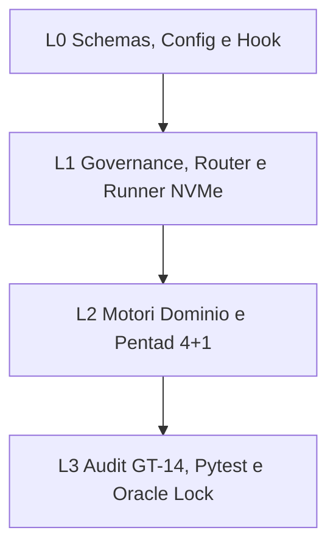

# Architettura Sistemica: DSM, DAG di Kahn, Heatmap e RTM (`v1.0.0-Generation`)

## 1. Matrice DSM Aciclica (`scc_cycle_count == 0`)

`NK Hub Generation` (`v1.0.0-Generation`, Milestone `NK-GEN-1.0.0`) mantiene il grafo Python privo di cicli Tarjan (`scc_cycle_count == 0`).
I moduli Python evitano duplicati di classe e delegano i contratti condivisi a `scripts/schemas/` e `scripts/_internal/nk_common/`.
Tutti i conteggi test e copertura live risiedono in [quality_baseline.json](../../nk_tracking/quality_baseline.json).

* **Layer `L0` foglia (`scripts/schemas/`):** `dual_ledgers.py`, `nk_catalog_contracts.py` e `nk_ipc_contracts.py` non importano motori `L1..L3`.
* **Zero duplicati:** `SBFLEngine`, `SBFLLocation`, `HealingSnapshotManager`, `KarpathySlicer` e `DSPyTelemetryHook` hanno un solo SSOT.
* **Split `_internal/`:** tutti i sottomoduli restano entro `500` LOC sotto le facciate CLI compatibili.

## 2. DAG Topologico di Kahn a `4` Layer

| Layer | Moduli Principali | Vincolo Aciclico |
| :--- | :--- | :--- |
| `L0` | `scripts/schemas/`, `configs/saturation_thresholds.json`, hook `python -S -B -u` | Zero import ascendenti |
| `L1` | `_internal/nk_common/`, `vibe_sprint_router.py`, `nk_session_bootstrap.py`, `win32_2pc_engine.py` | Dipende solo da `L0` |
| `L2` | `DOM-02..DOM-05`, `Pentad Sovrana 4+1`, `11` skill JIT, `6` sub-agenti foglia | Dipende da `L0..L1` |
| `L3` | `platform_runner.py --pytest-isolated`, `rsi_convergence_engine.py`, `oracle_lock.json` | Verifica finale senza cicli |

## 3. Heatmap Architetturale `NK Hub Generation`

| ID | Area | Architettura `1.0.0-Generation` | Beneficio Chiave |
| :--- | :--- | :--- | :--- |
| `HM-01` | Plugin `nk-gate` | Unico `hooks.json` con `python -S -B -u` e `6/6` mirror | Zero duplicati |
| `HM-02` | Manifest JSON | Facciata `<= 800` tok e `7` shard `DOM-00..06.json` | Caricamento `O(1)` |
| `HM-03` | `nk_genome/` | `00_GENOME_INDEX.md <= 950` tok e `Pentad Sovrana 4+1 <= 1.100` tok | Taglio contesto |
| `HM-04` | Catalogo e Dashboard | `11` skill JIT, `6` sub-agenti foglia e `10` nodi `[0]..[9]` | Routing mirato |
| `HM-05` | Onboarding `16` Shortcut | `8` shortcut legacy + `8` shortcut `Generation` in `nk_common.constants` | Boot singolo CLI |
| `HM-06` | Sonde `GT-14` | `--emit-gt14-bundle --with-dast` in `%TEMP%/nk_diagnostics` | Audit unificato |
| `HM-07` | Soglie `ACS` | Profilo `generation` (alias `carbon`): `160k/185k/205k` tok, `120/150/180` step, `1200` tier1 | Piu margine |
| `HM-08` | Runner Pytest NVMe | `isolated_test_runner.py`, `--pytest-isolated`, `WIN32_DETACHED_FLAGS`, `PIDFileLock` | Zero crash `0xC000013A` |

## 4. Matrice RTM `GT-14`

| ID | Attore | Dominio | Permessi | Ruolo |
| :--- | :--- | :--- | :--- | :--- |
| `R-01` | Orchestrator-Direct | DOM-01 | Lettura e CLI | Instrada DAG e `2PC` |
| `R-02` | NK-Arch-Specifier | DOM-02 | RO no-MCP | Valida contratti e DAG |
| `R-03` | NK-Specifier-Agent | DOM-02 | Staging no-MCP | Spec UI e `nk_genome/` |
| `R-04` | NK-Builder-Agent | DOM-03 | Staging no-MCP | Implementa codice e test |
| `R-05` | NK-RSI-Auditor | DOM-04 | RO no-MCP | Verifica `6` Gate e RSI |
| `R-06` | NK-Security-DAST-Auditor | DOM-04 | RO no-MCP | Esegue SAST, DAST e SBFL |
| `R-07` | NK-Scribe-Agent | DOM-05 | Staging no-MCP | Memoria `3-Tier` e SSOT |
| `R-08` | Built-In browser research image | Trasversale | Sandbox nativa | Delegati solo da `DOM-01` |

Puntatori: [00_GENOME_INDEX.md](../00_GENOME_INDEX.md) e [repo_map.md](../repo_map.md).
