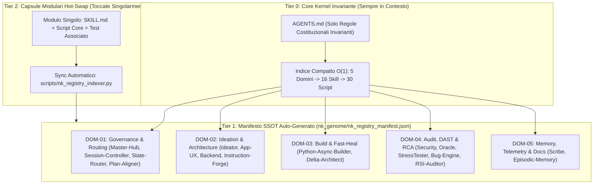

# 🏛️ Brief di Operatività: Strategia Multilivello di Indicizzazione e Modularizzazione (`v3.5.0`)

> **Badge di Certificazione:** 🛡️ `[NK-BRIEF-STATUS: AUDITED_AND_OPTIMIZED 🟢]` | `[RSI-CONVERGENCE: CONVERGED_OPTIMAL (Δk=0, Q=100.0) 🟢]`  
> **Milestone Anchor ID:** `NK-MS-20261017-MODULAR-INDEX-v3.5.0`  
> **Modalità di Ricerca Attiva:** `Mode D (Analytical Discovery)` verso `Mode A (Sovereign CRV 4.0)`  
> **Standard Linguistico:** ASD-STE100 Italiano Tecnico (`[RULE-STE100]`, frasi `<= 20` parole)

---

## 1. Diagnosi Preliminare: Perché Oggi il Modello Spreca Risorse

L'indagine preliminare sull'ecosistema `NK-Hub` e sul runtime Antigravity ha isolato quattro colli di bottiglia strutturali.

| ID | Problema Rilevato | Impatto su Velocità, Token e Manutenibilità | Evidenza Empirica nel Workspace |
| :--- | :--- | :--- | :--- |
| **`P-01`** | **Inquinamento del Contesto Globale (`63` Skill Piatte)** | Il modello riceve `63` skill alfabetiche ad ogni turno (`16` `NK-*` più `47` globali/plugin). Questo consuma `~3.500` token fissi e rallenta la selezione del nodo. | `~/.gemini/config/plugins/science` e `~/.gemini/config/skills/gcp-*` attivi insieme a `.agents/skills/`. |
| **`P-02`** | **Assenza di Indice Tassonomico `O(1)` Machine-Readable** | Le `16` skill e i `30` script risiedono in cartelle piatte prive di un registro di lookup rapido. Il modello deve leggere più file per scoprire flag CLI, contratti e dipendenze. | Assenza di un manifesto `nk_registry_manifest.json` interrogabile in `O(1)`. |
| **`P-03`** | **Accoppiamento Rigido ("Shotgun Surgery" su `12+` File)** | Aggiungere o modificare un singolo modulo costringe a riscrivere manualmente fino a `12` file diversi. | Numeri e liste cablati in `AGENTS.md`, Tetralogia `4/4`, `preflight_health_check.py` e test. |
| **`P-04`** | **Deriva Schema in `.agents/hooks.json`** | Il file `.agents/hooks.json` usa chiavi non allineate allo schema nativo Antigravity 2.0 (`blocking`, `timeout_ms`). | Confronto diretto con `agy-customizations/docs/hooks.md`. |

---

## 2. Architettura Target: Tassonomia a 5 Domini, Indice `O(1)` e Moduli Hot-Swap

La strategia SOTA 2025/2026 trasforma `NK-Hub` da contenitore piatto a sistema modulare indicizzato a **3 Livelli di Disclosure**.

### I 3 Pilastri del Nuovo Standard `NK-Hub`
1. **Standard di Indicizzazione `O(1)` (`nk_genome/nk_registry_manifest.json`):**
   * Un singolo manifesto JSON/Markdown mappa ogni intento utente al dominio, alla skill, allo script Python e ai flag CLI.
   * Il modello risolve il routing in `1` sola lettura deterministica senza esplorare l'intero repository.
2. **Struttura Modulare "Zero-Rewrite" (Fine della Shotgun Surgery):**
   * Ogni skill e script dichiara i propri metadati localmente nel proprio frontmatter YAML o docstring strutturata.
   * Quando modifichi o aggiungi un modulo, tocchi **solo il file del modulo stesso**.
   * Un sincronizzatore deterministico aggiorna automaticamente l'indice centrale e le tabelle della Tetralogia.
3. **Settorializzazione a 5 Domini e Igiene del Contesto (`Progressive Disclosure`):**
   * I percorsi fisici `.agents/skills/NK-*` restano invariati per preservare il `100%` dei `68` Golden Tests (`GT-08`).
   * L'indice logico organizza le `16` skill e i `30` script in `5` Domini Funzionali (`DOM-01..DOM-05`).
   * Un profilo di igiene globale consente di disattivare le `47` skill esterne (`science`, `gcp`) quando non richieste.

---

## 3. Piano di Azione Multilivello per l'Analisi e l'Esecuzione (`Fase 1 -> Fase 4`)

L'attività procederà in **4 Fasi Stratificate** per massimizzare la velocità e azzerare il consumo superfluo di token.

| Fase | Livello Strategico | Attività Operativa e Strumenti | Output Verificabile |
| :---: | :--- | :--- | :--- |
| **Fase 1** | **Audit Automatico AST e Accoppiamenti (`Mode D` Read-Only)** | Esecuzione di uno scanner diagnostico veloce in `scratch/` su `.agents/`, `scripts/`, `nk_genome/` e `tests/`. Nessuna lettura manuale dispersiva dei `30` script. | Report `Matrice_Accoppiamento_e_Disordine_NK.md` con tutti i punti hardcoded da disaccoppiare. |
| **Fase 2** | **Progettazione dello Standard e Manifesto SSOT (`Turno 1-4 FSM`)** | Definizione dello schema `nk_genome/nk_registry_manifest.json` e della Tassonomia a `5` Domini. Allineamento della Tetralogia Sovrana `4/4`. | Specifica tecnica approvata e certificata da `NK-Plan-Aligner` (`Δk = 0`). |
| **Fase 3** | **Implementazione Modulare in `.staging/` (`Mode A` CRV 4.0)** | Creazione dell'indicizzatore automatico e rimozione dei valori hardcoded negli script di controllo. Allineamento di `.agents/hooks.json` allo schema nativo. | Moduli isolati in `.staging/` validati con `python scripts/ast_guard_validator.py --stage-dir .staging`. |
| **Fase 4** | **Audit TAS v4.0, Convergenza RSI e Commit 2PC** | Esecuzione dei `68` Golden Tests più i nuovi test dell'indice. Verifica finale con `python scripts/rsi_convergence_engine.py --verify` e promozione `win32_2pc_engine.py`. | `100.0%` Pass Rate Ratchet, `CONVERGED_OPTIMAL` (`Q = 100.0`) e ambiente indicizzato. |

---

## 4. Guardie di Sicurezza e Invarianti Protetti (`GT-01..GT-14`)

1. **Zero Modifiche Non Autorizzate (`[RULE-00]`):** Nessun file di produzione subisce modifiche senza la tua approvazione.
2. **Retrocompatibilità Totale (`[RULE-01.10]`):** I `68` Golden Tests e le guardie `GT-01..GT-14` restano intatti.
3. **Efficienza di Ricerca (`[RULE-01]`):** La Fase 1 usa uno scanner AST automatico in `scratch/`.
