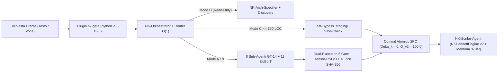

# Brief Release GitHub: `NK Hub Generation` (`v3.0.2-Generation`)

> **Brief ID:** `IB-20261125-78E243`  
> **Versione Pubblica Target:** `v3.0.2-Generation`  
> **Milestone Anchor ID:** `NK-GEN-3.0.2-FORENSIC-HARDENING-CLEAN`  
> **Core ABI Protetto:** `1.0.0-Generation` (invariante SSOT verificato da `ssot_governance.py`)  
> **Repository Target:** `https://github.com/erbaldo86/NK-Hub.git`  
> **Autore Specifica:** `NK-Specifier-Agent` (`DOM-02`, Playbook `NK-System-Architect`)

---

## 1. Obiettivo e Requisiti Tracciabili (`R1..R6`)

Questo brief definisce la specifica per allineare vetrina GitHub, manuali utente, CI e pacchetto ZIP alla release pubblica `v3.0.2-Generation`. Il Core ABI resta ancorato a `1.0.0-Generation` per preservare la parità costituzionale.

| ID | Requisito | Obiettivo Operativo | Criterio di Verifica |
| :--- | :--- | :--- | :--- |
| **`R1`** | **Analisi Stile Attuale** | Analizzare `.github/README.md` (`v1.0.0-Generation`, `451` righe IT+EN) preservando tono, struttura a 6 sezioni, tabelle e Mermaid. | Nessuna perdita di chiarezza Vibe Coding o rigore Senior Architect. |
| **`R2`** | **Restyling Coerente IT+EN** | Aggiornare titoli, badge, metriche live e riferimenti tecnici da `v1.0.0-Generation` a `v3.0.2-Generation` mantenendo `Core ABI 1.0.0-Generation`. | Parità speculare tra sezione Italiana e sezione Inglese. |
| **`R3`** | **Upgrade Qualitativo & Patch Notes** | Aggiungere la tabella comparativa `v1.0.0-Generation` vs `v3.0.2-Generation` e la sintesi delle milestone `NK-GEN-1.0.0` -> `NK-GEN-3.0.2`. | Tutti i numeri derivano solo da `PATCH_NOTES.md` e `quality_baseline.json`. |
| **`R4`** | **Allineamento Manuali, CI e ZIP** | Sincronizzare `.github/workflows/ci.yml`, `nk_docs_and_setup/*`, `nk_genome/PATCH_NOTES.md` (`prepend-only`) e `NK_Hub_OneClick_Package.zip`. | Coerenza totale di link, badge versione, soglie CI e archivio ZIP. |
| **`R5`** | **Esecuzione Multi-Agente `2-Tier`** | Eseguire la pipeline in `.staging/` tramite `DOM-01` -> `DOM-02` -> `DOM-03` -> `DOM-05` -> `DOM-04` -> commit atomico `Win32 2PC`. | Nessuna modifica diretta fuori `.staging/` prima del gate $\Delta_k = 0$. |
| **`R6`** | **Pubblicazione GitHub Pulita** | Certificare `4` lock `SHA-256`, `HEALTHY_GREEN`, `pytest` isolato su NVMe, audit anti-PII, commit, tag `v3.0.2-Generation` e push. | Zero PII o path locali nel diff e nel pacchetto ZIP pubblicato. |

---

## 2. Analisi Stile e Architettura del Nuovo `.github/README.md` (`R1`, `R2`)

### 2.1 Diagnosi Stilistica dell'Esistente
Il documento attuale `.github/README.md` (`451` righe) adotta una struttura bilingue simmetrica efficace:
1. **Doppio Target:** guida l'utente Vibe Coding in `90` secondi e certifica garanzie deterministiche per il Senior Architect.
2. **Impatto Visivo:** usa link ancora IT/EN, box download 1-Click per `NK_Hub_OneClick_Package.zip`, tabelle comparative dirette e diagramma `Mermaid` `flowchart LR`.
3. **Criticità da Risolvere:** espone ancora etichette `v1.0.0-Generation` (`NK-GEN-1.0.0`) nella vetrina, nella CI e nei manuali. La sezione `6. Patch Notes` dichiara ancora assenza di storico precedente, ignorando le `13` milestone consolidate in `nk_genome/PATCH_NOTES.md` fino a `NK-GEN-3.0.2-FORENSIC-HARDENING-CLEAN`.

### 2.2 Struttura Sezioni IT e EN del Nuovo `.github/README.md`
La versione `v3.0.2-Generation` mantiene esattamente la spina dorsale in `6` sezioni speculari (Italiano righe superiori, English Version righe inferiori):

| Sezione | Struttura IT (`NK Hub Generation v3.0.2-Generation`) | Mirror EN (`English Version : v3.0.2-Generation`) | Elementi Visivi Chiave |
| :--- | :--- | :--- | :--- |
| **Header & Box ZIP** | Titolo `v3.0.2-Generation`, sottotitolo, barra link IT/EN/Manuali, box download ZIP (`NK-GEN-3.0.2-FORENSIC-HARDENING-CLEAN`, `Core ABI 1.0.0-Generation`). | English header, language anchors, manual links, 1-Click ZIP download box (`v3.0.2-Generation`, `Core ABI 1.0.0-Generation`). | Callout `>` + badge Milestone e Core ABI. |
| **1. Presentazione `90s`** | Perché nasce, `3` problemi risolti, esempio dialogo `30s` con Gate L0, tabella benefici immediati con `4` lock `SHA-256` e blocco RO `NK Proget/Online/`. | `90-Second Quick Look`, `30-Second Live Example`, immediate benefits table with `4` `SHA-256` locks and read-only `NK Proget/Online/`. | Box citazione `30s` + tabella `6` righe. |
| **2. Evoluzione & Upgrade** | Salto architetturale vs modello legacy + **Nuova Tabella Qualitativa `v1.0.0-Generation` vs `v3.0.2-Generation`** (`PATCH_NOTES.md` + `quality_baseline.json`). | Evolutionary Leap vs legacy model + **New Qualitative Upgrade Table `v1.0.0-Generation` vs `v3.0.2-Generation`**. | `2` tabelle comparative + `3` punti chiave. |
| **3. Installazione `3` Passi** | Estrazione ZIP, `install.ps1` / `install.sh` (supporto `7` profili: `generation`, `carbon`, `neon`, `pro`, `flash`, `argon`, `standard`), `Antigravity.code-workspace` e `16` trigger. | 3-Step Setup (`install.ps1` / `install.sh`, `7` model profiles, `Antigravity.code-workspace`, `16` startup triggers). | Blocchi codice `powershell` e `bash`. |
| **4. Modi, Pilastri & `Mode A`** | `4.A` Vibe Coding; `4.B` Senior Architect (inclusi `NKHandoffEngine v2` e `Tensor-RSI v3`); `4.C` `6` Pilastri & SLA (`384/384`, `20.0s`, `91.25%`/`83.43%`/`88.98%`); `4.D` Pipeline `Mode A`. | `4.A` Vibe Coders; `4.B` Senior Architects; `4.C` `6` Engineering Pillars & Measured SLAs; `4.D` Real End-to-End `Mode A` Pipeline. | `2` tabelle + formule $\Delta_k(p)$ + elenco `5` fasi FSM. |
| **5. Riferimento Tecnico** | `Mermaid flowchart LR` aggiornato (`nk-gate`, `O(1)` Router, `6` Sub-Agenti `GT-14`, `Tensor-RSI v3`, `4` Lock `SHA-256`, `Win32 2PC`, `NKHandoffEngine v2`), tabelle `5.1`..`5.4` (`34` moduli su `5` domini). | Updated `Mermaid flowchart LR`, tables `5.1`..`5.4` (`4` modes, `6` sub-agents, `10` nodes / `11` skills, `34` `scripts/` modules across `5` domains + CI pyramid). | `1` diagramma `Mermaid` + `3` tabelle + elenco domini. |
| **6. Patch Notes `v1.0.0 -> v3.0.2`** | Sintesi cronologica delle milestone chiave da `NK-GEN-1.0.0` (`2026-11-17`) a `NK-GEN-3.0.2-FORENSIC-HARDENING-CLEAN` (`2026-11-24`) con link a `nk_genome/PATCH_NOTES.md`. | Chronological summary from `NK-GEN-1.0.0` (`2026-11-17`) to `NK-GEN-3.0.2-FORENSIC-HARDENING-CLEAN` (`2026-11-24`) linking `nk_genome/PATCH_NOTES.md`. | Elenco milestone tracciabile + footer SSOT. |

### 2.3 Diagramma `Mermaid` Target per Sezione `5`

---

## 3. Tabella Comparativa Qualitativa `v1.0.0-Generation` vs `v3.0.2-Generation` (`R3`)

Tutti i valori seguenti derivano esclusivamente dai registri ufficiali `nk_genome/PATCH_NOTES.md`, `nk_tracking/quality_baseline.json` e `nk_genome/nk_registry_manifest.json`.

| Dimensione Misurata / Architetturale | `v1.0.0-Generation` (`NK-GEN-1.0.0`, `2026-11-17`) | `v3.0.2-Generation` (`NK-GEN-3.0.2`, `2026-11-24`) | Fonte Verificata (`SSOT`) |
| :--- | :--- | :--- | :--- |
| **Core ABI & Topologia `2-Tier`** | `1.0.0-Generation` (`6` Sub-Agenti `GT-14`, `11` Skill JIT, `10` nodi, `16` trigger, `5` domini) | `1.0.0-Generation` invariata (`6` Sub-Agenti `GT-14`, `11` Skill JIT, `10` nodi, `16` trigger, `5` domini) | `nk_registry_manifest.json`, `PATCH_NOTES.md` |
| **Suite Permanente Zero-Mock (`tests/`)** | Baseline inaugurale azzerata (`NK-GEN-1.0.1`: `523/523` `PASS`; `NK-GEN-2.0.0-W1`: `522/522` `PASS`; poi potatura piramide `W2`: `274/274`) | **`384/384` `PASS`** (`unit_tests_pass_pct: 100.0%`, `failed_tests: 0`, `tests_skipped: 0`; `385/385` in run sharding NVMe `6` worker) | `quality_baseline.json`, `PATCH_NOTES.md` |
| **Durata Suite Pytest (`pytest_duration_s`)** | `70.43s` in `NK-GEN-2.0.0-W1` (`131.38s` live pre-audit in `NK-GEN-1.3.0`) | **`20.0s`** (`<= 28.0s` ceiling T1+T2; profilo `-m fast <= 8.0s` con `PYTEST_DISABLE_PLUGIN_AUTOLOAD=1`) | `quality_baseline.json`, `PATCH_NOTES.md` |
| **Copertura Statement (`scripts/`)** | `89.29%` in `NK-GEN-2.0.0-W1` (`88.81%` in `NK-GEN-1.3.0`) | **`91.25%`** (soglia minima ratchet `>= 90.5%`) | `quality_baseline.json`, `PATCH_NOTES.md` |
| **Copertura True Branch (`scripts/`)** | `80.09%` in `NK-GEN-2.0.0-W1` (`79.32%` in `NK-GEN-1.3.0`) | **`83.43%`** (soglia minima ratchet e CI `>= 82.0%`) | `quality_baseline.json`, `PATCH_NOTES.md` |
| **Copertura Combinata (`scripts/`)** | `86.56%` in `NK-GEN-2.0.0-W1` (`86.01%` in `NK-GEN-1.3.0`) | **`88.98%`** (soglia minima ratchet e CI `>= 88.0%`) | `quality_baseline.json`, `PATCH_NOTES.md` |
| **Violazioni SAST Critiche** | `0` (`PASS`) | **`0`** (`PASS`, guardie `D01..D04` attive) | `quality_baseline.json` |
| **Sigilli Anti-Manomissione `SHA-256`** | `1` sigillo iniziale (`oracle_lock.json`) | **`4` sigilli `SHA-256`** (`oracle_lock.json`, `oracle_lock_holdout.json`, `governance_lock.json`, `tensor_rsi_lock.json`) | `PATCH_NOTES.md` |
| **Moduli `scripts/` Indicizzati** | `39` script pre-debloat (`33` in `NK-GEN-1.3.0`, tutti `<= 400` LOC) | **`34` moduli** nel registro (`29` script CLI incl. `tensor_rsi.py` + `5` schemi `schemas/`, `7` shard `DOM-00..06`) | `nk_registry_manifest.json`, `PATCH_NOTES.md` |
| **Control Plane `Tensor-RSI` & `2PC`** | `Win32 2PC` base | **`Tensor-RSI v3`** (`trsi1` HMAC, `ParetoGate`, `CladeBandit K=4`, `Jeffreys LCB90`, clamp `NaN/Inf`) + **`nonce_store.py`** anti-replay + gate `ACTIVE.json` | `PATCH_NOTES.md` |
| **Handoff & Epistemic Firewall** | Anchor di sessione base | **`NKHandoffEngine v2`** (`35` chiavi whitelist, Epistemic Firewall `AP-12..16`, precedenza `2PC_ATOMIC_PROMOTION` post-compattazione) | `PATCH_NOTES.md` |
| **Isolamento `NK Proget/` & App** | Isolamento app in `NK_External_Projects/` | **`NK Proget/Online/`** bloccato `RO` (`CRIT-01`); **`NK Proget/Locale/`** con `.staging/` e **`526/526`** test applicativi `PASS` su `4/4` repo | `PATCH_NOTES.md` (`NK-GEN-3.0.1`) |

### Sintesi Upgrade Qualitativo `v1.0.0-Generation` -> `v3.0.2-Generation`
* **`v1.1.0 / v1.1.1` (`HANDOFF-V2`):** introduce `NKHandoffEngine v2`, whitelist `35` chiavi ed Epistemic Firewall pure-stdlib.
* **`v1.2.0 / v1.3.0 / v1.3.1` (`BUILDER-RSI` & `HARDENING`):** riduce i moduli top-level (`39 -> 33`), abbatte la latenza live (`131.38s -> 57.46s`), attiva DAST fail-closed e holdout `NVMe`.
* **`v2.0.0-W0..W3` & `v2.1.0-W6`:** introduce la piramide test (`fast <= 8.0s`, `T1+T2 <= 28.0s`), lo schema `quality_baseline.json` `v2` (`12` ratchet key), `3` lock `SHA-256` e `21/21` moduli mutation audit (`97.22%`).
* **`v3.0.0` (`TENSOR-CORE`):** attiva `Tensor-RSI v3`, ticket `trsi1` HMAC, `nonce_store.py` persistente, `4°` sigillo `tensor_rsi_lock.json` e pavimento branch `82.0%`.
* **`v3.0.1` (`PROGET-MIGRATION`):** impone sola lettura su `NK Proget/Online/`, abilita `.staging/` in `NK Proget/Locale/` e certifica `526/526` test sui `4` progetti applicativi.
* **`v3.0.2` (`FORENSIC-HARDENING-CLEAN`):** applica clamp `NaN/Inf`, `Jeffreys LCB90`, `PYTEST_DISABLE_PLUGIN_AUTOLOAD=1`, potatura di `18` file orfani e correzione precedenza milestone post-compattazione (`384/384` `PASS` in `20.0s`).

---

## 4. Mappa Esatta dei File in `.staging/` e Vincoli ABI (`R4`, `R5`)

Tutte le modifiche devono essere eseguite esclusivamente dentro `NK_Hub/.staging/` e promosse via `win32_2pc_engine.py --promote-staging`.

### 4.1 File Target da Aggiornare in `NK_Hub/.staging/`

| # | Percorso Staging (`NK_Hub/.staging/...`) | Azione Richiesta | Dettaglio Aggiornamento |
| :---: | :--- | :--- | :--- |
| `1` | `.staging/.github/README.md` | **Riscrittura coerente IT+EN** | Aggiornamento integrale a `v3.0.2-Generation` (`NK-GEN-3.0.2-FORENSIC-HARDENING-CLEAN`, `Core ABI 1.0.0-Generation`), tabella qualitativa `v1.0.0 -> v3.0.2`, metriche live `384/384` / `20.0s` e storico milestone. |
| `2` | `.staging/.github/workflows/ci.yml` | **Aggiornamento header** | Aggiornare `name:` da `(v1.0.0-Generation)` a `(v3.0.2-Generation)`. Mantenere intatti i `4` check `oracle-lock`, soglie `<= 8.0s`, `<= 28.0s`, `>= 88.0%` e `>= 82.0%`. |
| `3` | `.staging/nk_docs_and_setup/README.md` | **Allineamento EN** | Aggiornare badge, link ZIP e titolo a `v3.0.2-Generation` (`Milestone NK-GEN-3.0.2-FORENSIC-HARDENING-CLEAN`, `Core ABI 1.0.0-Generation`) con sintesi upgrade e SLA `quality_baseline.json`. |
| `4` | `.staging/nk_docs_and_setup/README.it.md` | **Allineamento IT** | Aggiornare badge, link ZIP e titolo a `v3.0.2-Generation` (`Milestone NK-GEN-3.0.2-FORENSIC-HARDENING-CLEAN`, `Core ABI 1.0.0-Generation`) in specchio con `README.md`. |
| `5` | `.staging/nk_docs_and_setup/GUIDA_INSTALLAZIONE.md` | **Allineamento Guida ZIP** | Aggiornare intestazione pacchetto a `v3.0.2-Generation` (`NK-GEN-3.0.2-FORENSIC-HARDENING-CLEAN`, `Core ABI 1.0.0-Generation`) e verificare i comandi dei `4` sigilli e `--pytest-isolated`. |
| `6` | `.staging/nk_docs_and_setup/00_MAPPA_LIBRERIA_NK.md` | **Allineamento Mappa** | Aggiornare titolo e stato motore a `v3.0.2-Generation` (`Core ABI 1.0.0-Generation`), confermando `NK Proget/Locale/` e `NK Proget/Online/` RO. |
| `7` | `.staging/nk_genome/PATCH_NOTES.md` | **`PREPEND-ONLY` sotto header SSOT** | Aggiungere in testa dopo riga `13` (`---`) una sola voce per il rilascio pubblico GitHub `v3.0.2-Generation` (sync docs, CI e ZIP), lasciando intatte le voci storiche e il frontmatter YAML. |
| `8` | `.staging/nk_docs_and_setup/NK_Hub_OneClick_Package.zip` | **Rebuild pacchetto ZIP** | Rigenerare lo ZIP dopo il merge/validazione dei manuali e prima o subito dopo la promozione `2PC`, escludendo file temporanei, cache, `.staging/` di lavoro e PII. |

*(Nota operativa: `nk_docs_and_setup/install.ps1` e `install.sh` riportano nel banner `v1.0.0-Generation`; lasciarli invariati evita modifiche non richieste a script installer, oppure aggiornare il solo banner testuale in una patch dedicata fuori `governance_lock.json` solo se approvato da `DOM-01`.)*

### 4.2 Vincolo Categorico ABI `"1.0.0-Generation"` (`ssot_governance.py`)
Il modulo `scripts/_internal/preflight_health_check/ssot_governance.py` impone la parità esatta rispetto a `VERSION = "1.0.0-Generation"` (`scripts/preflight_health_check.py`). **È VIETATO modificare la stringa `"1.0.0-Generation"` nei file ABI seguenti:**
1. `.agents/AGENTS.md` (deve contenere `1.0.0-Generation`).
2. `.agents/skills/*/SKILL.md` (tutti gli `11` playbook devono conservare `version: "1.0.0-Generation"`).
3. `.agents/agents/*/agent.md` (tutti i `6` sub-agenti nativi devono conservare `version: "1.0.0-Generation"`).
4. `nk_tracking/quality_baseline.json` (deve conservare `"_version": "1.0.0-Generation"`).
5. `nk_genome/nk_registry_manifest.json` (deve conservare `"version": "1.0.0-Generation"`).
6. `nk_docs_and_setup/root_bridge_AGENTS.md` e `../.agents/AGENTS.md` (devono preservare `1.0.0-Generation`, `11 skill`, `6 sub-agenti` e `10 nodi`).
7. Frontmatter YAML di `nk_genome/PATCH_NOTES.md` (`version: "1.0.0-Generation"`, `milestone_anchor_id: "NK-GEN-1.0.0"`).

---

## 5. Flusso Esecutivo Multi-Agente `2-Tier` (`R5`)

1. **`DOM-02` (`NK-Specifier-Agent`):** emette il presente Brief `IB-20261125-78E243` (completato).
2. **`DOM-03` (`NK-Builder-Agent`) & `DOM-05` (`NK-Scribe-Agent`):**
   * `NK-Builder-Agent` scrive i file `1..6` in `.staging/`.
   * `NK-Scribe-Agent` esegue l'aggiornamento `prepend-only` di `.staging/nk_genome/PATCH_NOTES.md` in ASD-STE100.
3. **`DOM-04` (`NK-RSI-Auditor` & `NK-Security-DAST-Auditor`, sola lettura):** verificano assenza di alterazioni ABI `1.0.0-Generation`, zero PII, link relativi validi e coerenza numerica con `quality_baseline.json`.
4. **`DOM-01` (`NK-Orchestrator`):** esegue le sonde CLI di verifica, promuove con `win32_2pc_engine.py --promote-staging`, rigenera `NK_Hub_OneClick_Package.zip`, esegue commit, tag `v3.0.2-Generation` e push su `https://github.com/erbaldo86/NK-Hub.git`.

---

## 6. Criteri di Accettazione e Gate di Pubblicazione (`R6`)

Il rilascio `v3.0.2-Generation` è pronto per `commit`, `tag` e `push` solo quando tutte le condizioni seguenti risultano verificate con `exit_code: 0`:

1. **Verifica `4` Lock `SHA-256` (`oracle-lock verify`):**
   * `nk_tracking/oracle_lock.json` (`tests/`) -> `VERIFIED`.
   * `nk_tracking/oracle_lock_holdout.json` (`nk_tracking/oracle_holdout`) -> `VERIFIED`.
   * `nk_tracking/governance_lock.json` (`scripts`) -> `VERIFIED`.
   * `nk_tracking/tensor_rsi_lock.json` (`nk_genome/configs/tensor_rsi`) -> `VERIFIED`.
2. **Preflight & Integrità SSOT:**
   * `python -B -u scripts/preflight_health_check.py --check-only` -> stato `HEALTHY_GREEN` (`ssot_governance.py` `passed: true` con `Core ABI 1.0.0-Generation` intatto).
   * `python -B -u scripts/nk_registry_indexer.py --verify` -> `VALID`.
   * `python -B -u scripts/ast_guard_validator.py --target all` -> `0` violazioni critiche SAST.
3. **Suite Pytest Isolata su NVMe (`[RULE-WIN32-ISOLATED-PYTEST]`):**
   * `python -B -u scripts/platform_runner.py --pytest-isolated --overlay-staging` -> `100.0% PASS` (`384/384`, `0` failed, `0` skipped).
   * Budget temporali e coperture confermati: `tier 1 -m fast <= 8.0s`, `tier 1+2 <= 28.0s`, `combined >= 88.0%`, `true_branch >= 82.0%`.
   * Convergenza RSI (`rsi_convergence_engine.py --verify --strict-verify`) -> $\Delta_k = 0, Q_{v2}(S_k) = 100.0$.
4. **Pacchetto ZIP & Audit Anti-PII:**
   * `nk_docs_and_setup/NK_Hub_OneClick_Package.zip` aggiornato con tutti i documenti `v3.0.2-Generation`, privo di `.staging/`, `__pycache__`, cache o file temporanei.
   * Scansione `git diff` e contenuto ZIP con `0` occorrenze di username locali, path locali di unità disco, token, segreti o credenziali.
5. **Pubblicazione Git Pulita (`https://github.com/erbaldo86/NK-Hub.git`):**
   * Working tree pulito post-commit su `main`.
   * Tag Git annotato `v3.0.2-Generation` puntato al commit di release.
   * `git push origin main` e `git push origin v3.0.2-Generation` completati senza errori.
