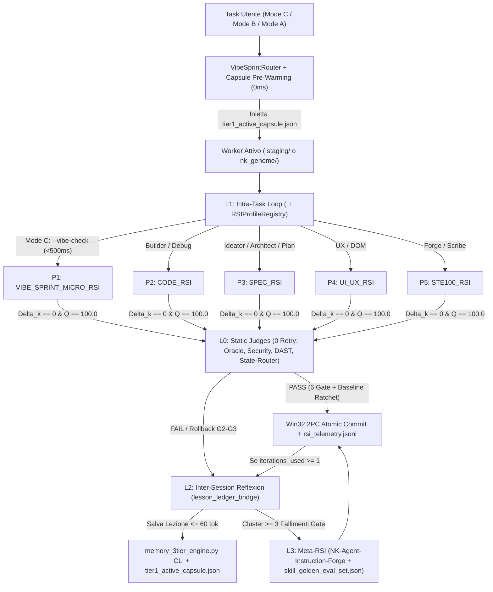

# Super-Brief Unificato: Nexus Keystone `v3.1.0-Tensor-RSI` (Vibe Coding & Post-Refactoring Remediation)

> **Stato Certificazione:** 🛡️ `[NK-SUPER-BRIEF: AUDITED_AND_CONVERGED 🟢]` | `[RSI-STATUS: CONVERGED_OPTIMAL (Δ=0, Q=100.0) 🟢]`  
> **Milestone Anchor ID:** `NK-MS-20261015-TENSOR-RSI-v3.1.0`  
> **Fonti Integrate:** [Opus (`030a38dc`)](conversation://030a38dc-8ae5-474c-9407-1725a66f83a3) + [Argon (`c9fe96c8`)](conversation://c9fe96c8-2b58-4422-98c2-18630ae56962) + Innovazioni Revisore Esterno (`EXT-01..EXT-07`)  
> **Standard Linguistico:** Italiano Tecnico ASD-STE100 (`[RULE-STE100]`, frasi `<= 20` parole, zero trattini d'inciso)  
> **Modalità Esecutiva:** Protocollo CRV 4.0 in `.staging/` con promozione atomica Win32 2PC (`[RULE-00]`, `[RULE-01.1]`)

---

## 1. Obiettivo Architetturale del Super-Brief `v3.1.0-Tensor-RSI`

Questo Super-Brief unifica i rilievi post-refactoring di `Opus` (`110` finding) e `Argon` (`18` finding) con `7` innovazioni inedite (`EXT-01..EXT-07`).
Il piano risolve tutti i bug residui della versione `v3.0.0-STE100-Unified` senza rompere alcuno dei `100` Golden Tests (`GT-01..GT-14`).
Il piano introduce l'architettura **Tensor-RSI 2D** che unisce i `4` livelli verticali (`L0..L3`) con i `5` profili di dominio (`RSIProfileRegistry`).

---

## 2. Architettura Unificata "Tensor-RSI 2D" per il Vibe Coding (`[RULE-RSI.1]`)

Il motore [rsi_convergence_engine.py](file:///g:/Il%20mio%20Drive/Antigravity/scripts/rsi_convergence_engine.py) combina due dimensioni ortogonali: la profondità temporale (`L0..L3`) e la specializzazione di dominio (`P1..P5`).

### 2.1 Dimensione Verticale: I 4 Livelli Operativi RSI (Origine: `Opus` + `Nostra`)
1. **Livello `L0` (Static Gate & Defect Producer, `0` iterazioni):**
   * I nodi di audit e verifica topologica non iterano mai per alterare il proprio verdetto.
   * Emettono in sola lettura un file JSON conforme a `RSIDefectVector` dentro `%TEMP%\nk_diagnostics\`.
2. **Livello `L1` (Intra-Task Fast-Healing Micro-Loop):**
   * Ogni skill attiva esegue il blocco `<rsi_micro_loop>` sul proprio output prima di cedere il turno.
   * Il loop usa [auto_heal_pipeline.py](file:///g:/Il%20mio%20Drive/Antigravity/scripts/auto_heal_pipeline.py) collegato direttamente a `RSIConvergenceEngine.run_convergence_loop()`.
3. **Livello `L2` (Inter-Session Reflexion & Capsule Pre-Warming):**
   * Quando `iterations_used >= 1` o avviene un rollback `G2/G3`, il sistema distilla una lezione atomica (`<= 60` token).
   * [memory_3tier_engine.py](file:///g:/Il%20mio%20Drive/Antigravity/scripts/memory_3tier_engine.py) persiste la lezione su disco in `nk_tracking/memory_3tier/tier1_active_capsule.json`.
   * [vibe_sprint_router.py](file:///g:/Il%20mio%20Drive/Antigravity/scripts/vibe_sprint_router.py) pre-inietta le lezioni del profilo attivo nel prompt Template 8A in `< 2 ms` (`EXT-06`).
4. **Livello `L3` (Meta-RSI Skill Evolution Loop):**
   * Quando una skill accumula `>= 3` fallimenti sullo stesso Gate in `rsi_telemetry.jsonl`, si attiva [NK-Agent-Instruction-Forge](file:///g:/Il%20mio%20Drive/Antigravity/.agents/skills/NK-Agent-Instruction-Forge/SKILL.md).
   * La skill muta il `SKILL.md` difettoso in `.staging/` e lo valida contro `tests/evals/skill_golden_eval_set.json` prima del 2PC.

### 2.2 Dimensione Orizzontale: I 5 Profili `RSIProfileRegistry` (Origine: `Argon` + `Nostra`)

Per non penalizzare le skill prive di test pytest (dove `effective_totals()` bloccherebbe il 60% di $Q(S_k)$), `RSIProfileRegistry` definisce `5` profili:

| ID Profilo | Nome Profilo | Pesi $(\text{SAST}, T_{\text{fail}}, C, H, M, L, G)$ | Formula Fitness $Q(S_k) \in [0, 100]$ | Latenza Target | Skill Associate |
| :---: | :--- | :---: | :--- | :---: | :--- |
| **`P1`** | `VIBE_SPRINT_MICRO_RSI` | `(15, 10, 10, 5, 1, 0, 1)` | $60 \frac{T_{\text{pass}}^{\text{blast}}}{T_{\text{tot}}^{\text{blast}}} + \frac{40}{1 + \Delta_k / 25}$ | `< 500 ms` (`--vibe-check`) | Tutte le skill in `Mode C` (`<= 150` LOC) |
| **`P2`** | `CODE_RSI` *(Default)* | `(15, 10, 10, 5, 2, 1, 1)` | $60 \frac{T_{\text{pass}}}{T_{\text{tot}}} + \frac{40}{1 + \Delta_k / 25}$ | `< 4 s` (mirato) / `30 s` (full) | `[4] Async-Builder`, `[5] Delta-Architect`, `[9] Bug-Diagnostic` |
| **`P3`** | `SPEC_RSI` | `(0, 0, 15, 8, 4, 1, 5)` | $\frac{100.0}{1.0 + (\Delta_k / 15.0)}$ | `< 40 ms` (in-memory) | `[0] Ideator`, `[2] Backend-Architect`, `[10] Plan-Aligner`, `[13] Memory` |
| **`P4`** | `UI_UX_RSI` | `(10, 5, 12, 6, 3, 1, 2)` | $50 \cdot \text{DOM}_{\text{pass}} + \frac{50.0}{1.0 + (\Delta_k / 20.0)}$ | `< 60 ms` (`oracle_l3`) | `[1] App-UX-Architect` |
| **`P5`** | `STE100_RSI` | `(0, 0, 10, 5, 2, 1, 10)` | $\frac{100.0}{1.0 + (\Delta_k / 10.0)}$ | `< 30 ms` (AST + Regex) | `[3] Instruction-Forge`, `[12] Scribe` |

### 2.3 Matrice Operativa Unificata delle 16 Skill (`Tensor-RSI 2D`)

| Nodo | Skill | Livello RSI | Profilo RSI | Valutatore Deterministico $E(S_k)$ e Azione di Raffinamento $R(S_k)$ | Cap Retry (`C / B / A`) |
| :---: | :--- | :---: | :---: | :--- | :---: |
| **`[0]`** | [NK-Ideator](file:///g:/Il%20mio%20Drive/Antigravity/.agents/skills/NK-Ideator/SKILL.md) | `L1` | `SPEC_RSI` | Verifica i `7` assi SCAMPER, le `3` prospettive STORM, zero placeholder e `<= 20` parole in `nk_genome/idea_canvas.md`. | `1 / 1 / 2` |
| **`[1]`** | [NK-App-UX-Architect](file:///g:/Il%20mio%20Drive/Antigravity/.agents/skills/NK-App-UX-Architect/SKILL.md) | `L1 + L2` | `UI_UX_RSI` | Verifica multipli di `8px` (`val % 8 == 0`), contrasto HSL WCAG AAA e struttura DOM tramite `oracle_evaluator_l3.py`. | `1 / 2 / 2` |
| **`[2]`** | [NK-Backend-Architect](file:///g:/Il%20mio%20Drive/Antigravity/.agents/skills/NK-Backend-Architect/SKILL.md) | `L1 + L2` | `SPEC_RSI` | Valida contratti Pydantic v2 (`strict=True, extra="forbid"`, zero `Any`) in `nk_genome/` e aciclicità DAG di Kahn ($C_k = 0$). | `1 / 2 / 3` |
| **`[3]`** | [NK-Agent-Instruction-Forge](file:///g:/Il%20mio%20Drive/Antigravity/.agents/skills/NK-Agent-Instruction-Forge/SKILL.md) | `L1 + L3` | `STE100_RSI` | Valida `max_sentence_words=20`, zero trattini, CoVe CLI sull'AST di `scripts/*.py` (`EXT-07`) e `skill_golden_eval_set.json`. | `2 / 2 / 3` |
| **`[4]`** | [NK-Python-Async-Builder](file:///g:/Il%20mio%20Drive/Antigravity/.agents/skills/NK-Python-Async-Builder/SKILL.md) | `L1 + L2` | `CODE_RSI` | Esegue `AutoHealPipeline` + `RSIConvergenceEngine` in `.staging/` (AST + SAST + SBFL + Pytest nel raggio di Kahn). | `2 / 3 / 4` |
| **`[5]`** | [NK-Delta-Architect](file:///g:/Il%20mio%20Drive/Antigravity/.agents/skills/NK-Delta-Architect/SKILL.md) | `L1 + L2` | `CODE_RSI` | Confronta l'AST in `.staging/` con la produzione preservando il `100%` delle firme fuori da `allowed_mutations`. | `2 / 3 / 4` |
| **`[6]`** | [NK-Security-Auditor](file:///g:/Il%20mio%20Drive/Antigravity/.agents/skills/NK-Security-Auditor/SKILL.md) | `L0 + L2` | `Producer` | Opera in sola lettura (`[RULE-00.1]`), applica `1` pass CoVe interno ed esporta `sast_defect_vector.json` in `%TEMP%\nk_diagnostics\`. | `0 / 0 / 0` |
| **`[7]`** | [NK-Oracle-Evaluator](file:///g:/Il%20mio%20Drive/Antigravity/.agents/skills/NK-Oracle-Evaluator/SKILL.md) | `L0` | `Producer` | Giudice immutabile dei `6` Gate di Cold Review; esporta il vettore `RSIDefectVector` serializzato senza mai auto-riparare. | `0 / 0 / 0` |
| **`[8]`** | [NK-Dynamic-Sandbox-StressTester](file:///g:/Il%20mio%20Drive/Antigravity/.agents/skills/NK-Dynamic-Sandbox-StressTester/SKILL.md) | `L0` | `Producer` | Zero retry per non mascherare race condition; mappa crash, timeout e `WinError 32` su $T_{\text{fail},k}$ e $C_k$. | `0 / 0 / 0` |
| **`[9]`** | [NK-Bug-Diagnostic-Engine](file:///g:/Il%20mio%20Drive/Antigravity/.agents/skills/NK-Bug-Diagnostic-Engine/SKILL.md) | `L1 + L2` | `CODE_RSI` | Calibra i pesi AST Def-Use (`cc_gamma`) e `tri_pass_voting_filter` fino a isolare il bug con $\text{Ochiai} \ge 0.80$ in `<= 80` token. | `1 / 2 / 3` |
| **`[10]`** | [NK-Plan-Aligner](file:///g:/Il%20mio%20Drive/Antigravity/.agents/skills/NK-Plan-Aligner/SKILL.md) | `L0 / L1` | `SPEC_RSI` | Verifica in sola lettura l'allineamento 1:1 tra `concept_map`, `structural_tree`, `implementation_plan` e freschezza `repo_map` ($G_k = 0$). | `0 / 1 / 2` |
| **`[11]`** | [NK-State-Router](file:///g:/Il%20mio%20Drive/Antigravity/.agents/skills/NK-State-Router/SKILL.md) | `L0` | `Producer` | Calcola in sola lettura il `blast_radius` sul DAG di Kahn e segnala gli hash SHA-256 fuori sincrono per `--vibe-check`. | `0 / 0 / 0` |
| **`[12]`** | [NK-Scribe](file:///g:/Il%20mio%20Drive/Antigravity/.agents/skills/NK-Scribe/SKILL.md) | `L1` | `STE100_RSI` | Azzera $G_k$ verificando parità SHA-256 di `PATCH_NOTES.md`, `repo_map.md` a `4000` token, baseline `100%` e `<= 20` parole. | `1 / 1 / 2` |
| **`[13]`** | [NK-Episodic-Memory-Engine](file:///g:/Il%20mio%20Drive/Antigravity/.agents/skills/NK-Episodic-Memory-Engine/SKILL.md) | `L1 + L2` | `SPEC_RSI` | Espande la query RRF se la copertura è `< 50%` e sincronizza `tier1_active_capsule.json` entro il budget `350 / 1200` token. | `1 / 2 / 2` |
| **`[14]`** | [NK-Session-Controller](file:///g:/Il%20mio%20Drive/Antigravity/.agents/skills/NK-Session-Controller/SKILL.md) | `L2 + L3` | `Orchestrator` | Governa il loop `L1` (`--vibe-check` in Mode C, Swarm in Mode B/A), i `6` Gate di Cold Review e l'attivazione `L3`. | `2 / 3 / 4` |
| **`Hub`** | [NK-Master-Hub](file:///g:/Il%20mio%20Drive/Antigravity/.agents/skills/NK-Master-Hub/SKILL.md) | `L2` | `Gatekeeper` | Verifica `quality_baseline.json` e l'integrità SHA-256 di `rsi_telemetry.jsonl` (`CONVERGED_OPTIMAL`) prima del commit Win32 2PC. | `1` (Gate 2PC) |

---

## 3. Le 14 Guardie di Compatibilità coi 100 Golden Tests (`GT-01..GT-14`)

Oltre alle guardie `GT-01..GT-10` già attive in `v3.0.0`, ogni modifica deve rispettare le **4 nuove guardie `GT-11..GT-14`**:
1. **`GT-11` ([test_rsi_convergence_engine.py](file:///g:/Il%20mio%20Drive/Antigravity/tests/test_rsi_convergence_engine.py#L141-L176)):** Mantieni `profile="code_rsi"` in `compute_delta()` e `strict_monotonic: bool = False` in `check_hard_gate_regression()`. Preserva inoltre la stringa `verdict="HALTED_CYCLE_DETECTED"`.
2. **`GT-12` ([test_rsi_convergence_engine.py](file:///g:/Il%20mio%20Drive/Antigravity/tests/test_rsi_convergence_engine.py#L220)):** Imposta `max_sentence_words: int = 20` in `verify_ste100_compliance()`. Aggiungi simultaneamente lo skip del frontmatter YAML (`---`) e correggi le `20` frasi in `.agents/`.
3. **`GT-13` ([test_quality_baseline_manager.py](file:///g:/Il%20mio%20Drive/Antigravity/tests/test_quality_baseline_manager.py#L84)):** Supporta in `quality_baseline_manager.py` sia i sottocomandi `check`/`update` sia i flag `--file`, `--update` e `--check-only` del test.
4. **`GT-14` (`[RULE-00.1]`):** Non assegnare mai `write_to_file` sulla produzione né `enable_write_tools: true` agli Auditor (`[6]..[11], NK-RSI-Auditor`).

---

## 4. Piano Esecutivo Atomico in 4 Work Package (`WP1..WP4`)

### 4.1 WP1: Bonifica dei 14 Script Core e Motore Tensor-RSI (`scripts/`)
1. **[ast_guard_validator.py](file:///g:/Il%20mio%20Drive/Antigravity/scripts/ast_guard_validator.py):** Aggiungi `--stage-dir` come alias di `--target` in `argparse` (`C-01`). Rileva nell'AST `eval()`, `exec()`, `pickle.loads()`, `yaml.load()` e `MagicMock` (`C-07`).
2. **[quality_baseline_manager.py](file:///g:/Il%20mio%20Drive/Antigravity/scripts/quality_baseline_manager.py):** Aggiungi `sast_critical_violations` e `rsi_residual_delta` a `LOWER_IS_BETTER_KEYS` (`EXT-01`). Sostituisci `sys.argv` con `argparse` per `check`, `update`, `--file` e `--check-only` (`C-02`, `GT-13`).
3. **[memory_3tier_engine.py](file:///g:/Il%20mio%20Drive/Antigravity/scripts/memory_3tier_engine.py):** Importa `win32_atomic_replace` da `win32_2pc_engine.py` (`P2.12`) e aggiungi la CLI `__main__` (`--recall`, `--append`, `--tier1-sync`). Persisti inoltre `tier1_active_capsule.json` (`C-04`) con RRF adattivo.
4. **[rsi_convergence_engine.py](file:///g:/Il%20mio%20Drive/Antigravity/scripts/rsi_convergence_engine.py):**
   * Imposta `max_sentence_words: int = 20` con skip del blocco frontmatter YAML `---` (`G-01`, `EXT-04`, `GT-12`).
   * Implementa `RSIProfileRegistry` (`P1..P5`) e il flag `--vibe-check <target>` (`< 500 ms`, `EXT-05`). Aggiungi il CoVe CLI AST Gate in `verify_ecosystem()` (`EXT-07`).
   * Aggiungi il parametro opzionale `strict_monotonic: bool = False` in `check_hard_gate_regression()` e rimuovi le righe duplicate `721-723` (`GT-11`).
5. **[auto_heal_pipeline.py](file:///g:/Il%20mio%20Drive/Antigravity/scripts/auto_heal_pipeline.py):** Collega `run_pipeline()` a `RSIConvergenceEngine.run_convergence_loop()` (`RSI-02`). Popola tutti i campi di `RSIDefectVector` ed elimina lo snapshot ridondante finale.
6. **[safe_cleanup_dev_servers.py](file:///g:/Il%20mio%20Drive/Antigravity/scripts/safe_cleanup_dev_servers.py) e [async_heartbeat_signaler.py](file:///g:/Il%20mio%20Drive/Antigravity/scripts/async_heartbeat_signaler.py):** Imposta `_workspace_root` come default in `run_cleanup()` (`D-02`). Aggiungi `argparse` (`--task-id`, `--interval`, `--max-beats`) a `async_heartbeat_signaler.py` (`D-06`).
7. **[nk_session_bootstrap.py](file:///g:/Il%20mio%20Drive/Antigravity/scripts/nk_session_bootstrap.py) e [nk_active_runtime_sentinel.py](file:///g:/Il%20mio%20Drive/Antigravity/scripts/nk_active_runtime_sentinel.py):** Salva `mtime`/`size` di `transcript.jsonl` e `active_profile` nella cache (`D-05`). Filtra i sub-agenti e leggi `NK_MODEL_PROFILE` nel Sentinel (`EXT-02`).
8. **[nk_compliance_checker.py](file:///g:/Il%20mio%20Drive/Antigravity/scripts/nk_compliance_checker.py) e [nk_auto_inning.py](file:///g:/Il%20mio%20Drive/Antigravity/scripts/nk_auto_inning.py):** Esenta le sessioni `write_calls == 0` dalla penalità AST (`P1.6`). Leggi `rsi_convergence_score` da `rsi_telemetry.jsonl` (`GT-10`) e imposta fail-closed (`compliance_score = 0`) in `nk_auto_inning.py` (`D-04`).
9. **Altri 6 Script Core:** Aggiungi il Capsule Pre-Warming e `--prompt` in [vibe_sprint_router.py](file:///g:/Il%20mio%20Drive/Antigravity/scripts/vibe_sprint_router.py) (`EXT-06`) e il pre-check baseline in [win32_2pc_engine.py](file:///g:/Il%20mio%20Drive/Antigravity/scripts/win32_2pc_engine.py) (`G-02`). Aggiungi `--force-refresh` in [deterministic_api_cache.py](file:///g:/Il%20mio%20Drive/Antigravity/scripts/deterministic_api_cache.py) e `cwd=str(_workspace_root)` in [nk_session_handoff.py](file:///g:/Il%20mio%20Drive/Antigravity/scripts/nk_session_handoff.py) (`EXT-03`). Rimuovi infine i modelli duplicati in [nk_ipc_contracts.py](file:///g:/Il%20mio%20Drive/Antigravity/scripts/schemas/nk_ipc_contracts.py) (`P2.11`).

### 4.2 WP2: Allineamento delle 16 Skill, Regolamento e L3 Meta-RSI (`.agents/`)
1. **Regolamento [.agents/AGENTS.md](file:///g:/Il%20mio%20Drive/Antigravity/.agents/AGENTS.md) e [.agents/hooks.json](file:///g:/Il%20mio%20Drive/Antigravity/.agents/hooks.json):** Aggiungi la sotto-regola `[RULE-RSI.1]` sul Tensore RSI 2D e sincronizza le soglie in `saturation_thresholds.yaml`.
2. **Permessi Tool e Invarianti nelle 16 Skill (`GT-14`):**
   * Rimuovi `invoke_subagent` e aggiungi `write_to_file` (confinato a `nk_genome/`) in `NK-Ideator`, `NK-App-UX-Architect` e `NK-Backend-Architect` (`H-06`, `H-07`).
   * Aggiungi `run_command` e `send_message` in `NK-Agent-Instruction-Forge/SKILL.md` (`F-REG-05`).
   * Mantieni gli Auditor 100% Read-Only (`GT-14`), delegando il salvataggio dei report in `%TEMP%\nk_diagnostics\` agli script CLI.
3. **Correzioni Funzionali nelle Skill e nei Template:**
   * In `NK-Episodic-Memory-Engine/SKILL.md` e `NK-Bug-Diagnostic-Engine/SKILL.md`, allinea i 4 domini a `01_Bug_Diagnostics`, `02_Development_Patterns`, `03_Ideation_and_Decisions`, `04_Governance_and_Rules` (`C-03`).
   * In `NK-Session-Controller/SKILL.md`, rinomina il Turno 5 in `Final Handoff` e sposta la pulizia di `.staging/` alla Macro-Fase 4 (`H-01`). Uniforma inoltre i `6 Gate` (`G-05`) e `Mode C` a `2` iterazioni.
   * In `NK-Plan-Aligner/SKILL.md`, verifica `Milestone Anchor ID` sui primi 3 file della Tetralogia e controlla l'hash su `repo_map.md` (`H-04`).
   * In `NK-State-Router/SKILL.md`, aggiorna il path della cache a `%TEMP%\nk_diagnostics\repo_map_cache.json` (`C-05`).
   * In `NK-App-UX-Architect/SKILL.md`, sostituisci Google Stitch con il flusso `image-generator` e `generative_ui` (`P1.9`).
   * In `prompt_templates.md`, documenta tutti i flag CLI obbligatori (`H-03`).
   * Inserisci la sezione `<rsi_micro_loop>` nelle 16 skill e crea `tests/evals/skill_golden_eval_set.json` per il livello `L3`.
4. **Conformità `[RULE-STE100]` (`20` Parole):** Riscrivi le `20` frasi lunghe e rimuovi il trattino in `NK-Master-Hub/SKILL.md:161` (`EXT-04`).

### 4.3 WP3: Riallineamento Tetralogia Sovrana 4/4, `nk_tracking/` e CI/CD
1. **Tetralogia `nk_genome/`:**
   * Crea il template canonico `nk_genome/idea_canvas.md` e rimuovi il relitto legacy [brief_controller_of_controller.md](file:///g:/Il%20mio%20Drive/Antigravity/nk_genome/brief_controller_of_controller.md) (`P1.10`).
   * Riscrivi le `18` frasi lunghe in [concept_map.md](file:///g:/Il%20mio%20Drive/Antigravity/nk_genome/concept_map.md) e [implementation_plan.md](file:///g:/Il%20mio%20Drive/Antigravity/nk_genome/implementation_plan.md). Aggiorna i path in [structural_tree.md](file:///g:/Il%20mio%20Drive/Antigravity/nk_genome/structural_tree.md) e rigenera [repo_map.md](file:///g:/Il%20mio%20Drive/Antigravity/nk_genome/repo_map.md) a `4.000` token.
2. **Bonifica `nk_tracking/`:** Ripara le righe `23-25` di [session_anchor.jsonl](file:///g:/Il%20mio%20Drive/Antigravity/nk_tracking/anchor/session_anchor.jsonl). Allinea `stress_test_concurrency_pass` in [quality_baseline.json](file:///g:/Il%20mio%20Drive/Antigravity/nk_tracking/quality_baseline.json) e rimuovi i file `.bak_*` (`P2.14`).
3. **Allineamento CI/CD e Docs:** Aggiorna [ci.yml](file:///g:/Il%20mio%20Drive/Antigravity/.github/workflows/ci.yml) (`100+ Golden Tests`, `--check-only`, `--verify`, `quality_baseline_manager.py check`). Correggi le ancore in [README.md](file:///g:/Il%20mio%20Drive/Antigravity/README.md), [README.it.md](file:///g:/Il%20mio%20Drive/Antigravity/README.it.md) e `100` in [PATCH_NOTES.md](file:///g:/Il%20mio%20Drive/Antigravity/PATCH_NOTES.md#L21).

### 4.4 WP4: Espansione e Certificazione della Golden Test Suite (`100 -> 108 Golden Tests`)
1. Correggi il test CLI in [test_quality_baseline_manager.py](file:///g:/Il%20mio%20Drive/Antigravity/tests/test_quality_baseline_manager.py#L84) e il path esterno hardcoded in [test_ast_repo_mapper.py](file:///g:/Il%20mio%20Drive/Antigravity/tests/test_ast_repo_mapper.py#L224) (`D-01`, `D-03`).
2. Aggiungi `8` nuovi test reali Zero-Mock per coprire:
   * `async_heartbeat_signaler.py` CLI (`1` test);
   * `RSIProfileRegistry` (`P1..P5`), `--vibe-check` e CoVe CLI AST Gate in `test_rsi_convergence_engine.py` (`4` test);
   * `LOWER_IS_BETTER_KEYS` su `sast_critical_violations` e `rsi_residual_delta` (`1` test);
   * `tier1_active_capsule.json` CLI e Capsule Pre-Warming (`2` test).
3. Verifica `108/108 PASS` (`100.0%`) e lancia `python scripts/rsi_convergence_engine.py --verify` ($\Delta_k = 0$, $Q(S_k) = 100.0$). Promuovi infine via `win32_2pc_engine.py`.
