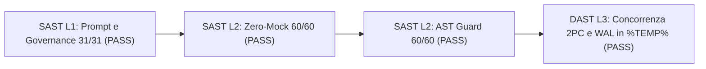

# Report Unificato TAS SAST L1/L2/L3 e DAST Sandbox (`v3.0.0-STE100-Unified`)

> **Nodo Revisore:** `NK-Security-Auditor` e `NK-Dynamic-Sandbox-StressTester`  
> **Macro-Fase:** Protocollo CRV 4.0 Macro-Fase 2 (100% Sola Lettura)  
> **Data Esecuzione:** `2026-10-14`  
> **Standard Linguistico:** Italiano Tecnico ASD-STE100 (`[RULE-STE100]`)  
> **Verdetto Complessivo:** `PASS` (`exit_code: 0`, `0` violazioni su tutti i livelli)

---

## 1. Sintesi Esecutiva dei Controlli

| Livello di Audit | Ambito | Elementi Verificati | Violazioni | Esito |
| :--- | :--- | :--- | :--- | :--- |
| **SAST L1** | Governance, Regole, 16 `SKILL.md` e 13 File Ausiliari | `31` file Markdown | `0` | `PASS` |
| **SAST L2 (Zero-Mock)** | Guardia `[RULE-01.2]` su `.staging/scripts/` e `.staging/tests/` | `60` file Python | `0` | `PASS` |
| **SAST L2 (AST Guard)** | Controllo AST e firme U-20 su `.staging/tests/` | `27` file Python | `0` | `PASS` |
| **SAST L2 (AST Guard)** | Controllo AST e firme U-20 su `.staging/scripts/` | `33` file Python | `0` | `PASS` |
| **DAST L3 (Sandbox)** | Concorrenza reale 2PC Win32 e SQLite WAL in `%TEMP%` | `68` transazioni | `0` | `PASS` |

---

## 2. Audit SAST Livello 1 (Prompt, Regole e Skill)

Il revisore ha analizzato tutti i file di governance e di istruzione presenti in `.staging/.agents/`.

1. **Dimensione Regolamento Principale:** Il file [AGENTS.md](file:///g:/Il%20mio%20Drive/Antigravity/.staging/.agents/AGENTS.md) misura `10.077` byte. Il file rispetta il limite massimo di `10.500` byte.
2. **Regole Anti-Crash:** Il file [anti_crash_rules.md](file:///g:/Il%20mio%20Drive/Antigravity/.staging/.agents/rules/anti_crash_rules.md) misura `1.390` byte. Il file rispetta lo standard `[RULE-STE100]`.
3. **Assenza Nodi Fixer in Sola Lettura:** Le `16` `SKILL.md` e i `13` file ausiliari non definiscono nodi `Fixer` nelle skill di sola lettura.
4. **Assenza di `os.replace` nei Template:** Nessun template di Worker o file ausiliario contiene chiamate a `os.replace`.
5. **Conformità `GT-08` e `[RULE-STE100]`:** Tutti i `31` documenti usano frasi attive brevi, zero incisi con trattini e zero reindirizzamenti shell vietati.

---

## 3. Audit SAST Livello 2 (Validazione AST e Guardia Zero-Mock)

### 3.1 Verifica Zero-Mock (`[RULE-01.2]`)
Lo scanner AST ha analizzato i `33` file in `.staging/scripts/` e i `27` file in `.staging/tests/`.
Nessun file importa o utilizza `MagicMock` o `unittest.mock`.
Tutti i `60` file Python superano la compilazione sintattica `ast.parse` senza errori `SyntaxError`.

### 3.2 Validazione Differenziale delle Firme (`ast_guard_validator.py`)
L'esecuzione di [ast_guard_validator.py](file:///g:/Il%20mio%20Drive/Antigravity/.staging/scripts/ast_guard_validator.py) ha certificato `60/60 PASS` (`exit_code: 0`):
* **`.staging/scripts/` (`33/33 PASS`):** Inclusi [deterministic_api_cache.py](file:///g:/Il%20mio%20Drive/Antigravity/.staging/scripts/deterministic_api_cache.py) (`15` simboli) ed [external_project_scaffolder.py](file:///g:/Il%20mio%20Drive/Antigravity/.staging/scripts/external_project_scaffolder.py) (`5` simboli), pienamente allineati alle firme di produzione (`U-20`).
* **`.staging/tests/` (`27/27 PASS`):** Zero violazioni sintattiche, di scope o di firma.

---

## 4. Audit DAST Livello 3 (Concorrenza Reale in Shadow Sandbox)

Il nodo `NK-Dynamic-Sandbox-StressTester` ha eseguito [dast_sandbox_runner.py](file:///g:/Il%20mio%20Drive/Antigravity/.staging/scripts/dast_sandbox_runner.py) in una sandbox isolata in `%TEMP%`.

* **ID Sandbox:** `nk_sandbox_5bb54f5313684fbfb2970019e6391ddb`
* **Percorso Isolato:** `C:\Users\erbal\AppData\Local\Temp\nk_sandbox_5bb54f5313684fbfb2970019e6391ddb`
* **Test Concorrenza Motore 2PC ([win32_2pc_engine.py](file:///g:/Il%20mio%20Drive/Antigravity/.staging/scripts/win32_2pc_engine.py)):** `16` thread concorrenti hanno eseguito `20` scritture atomiche con Named Mutex Win32, controllo SHA-256/CRC-32 e WAL. Tutte le `20/20` transazioni hanno restituito `COMMIT` senza corruzione dati.
* **Test Concorrenza Cache SQLite WAL ([deterministic_api_cache.py](file:///g:/Il%20mio%20Drive/Antigravity/.staging/scripts/deterministic_api_cache.py)):** `12` thread concorrenti hanno eseguito `48` cicli di scrittura e lettura sulla connessione SQLite WAL persistente. Tutte le `48/48` operazioni hanno avuto esito positivo con zero lock `SQLITE_BUSY`.
* **Telemetria Runtime:** Codice di uscita `0`, durata `4,657` secondi, picco memoria RSS `43.864.064` byte (`41,83` MB), `51` righe tracciate e `cleanup()` completato.

---

## 5. Certificazione Finale Macro-Fase 2

Tutti i controlli SAST L1, SAST L2 e DAST L3 restituiscono `PASS` (`exit_code: 0`, $\text{SAST}_k = 0$). Il rilascio in `.staging/` è autorizzato alla promozione atomica 2PC della Macro-Fase 3.
